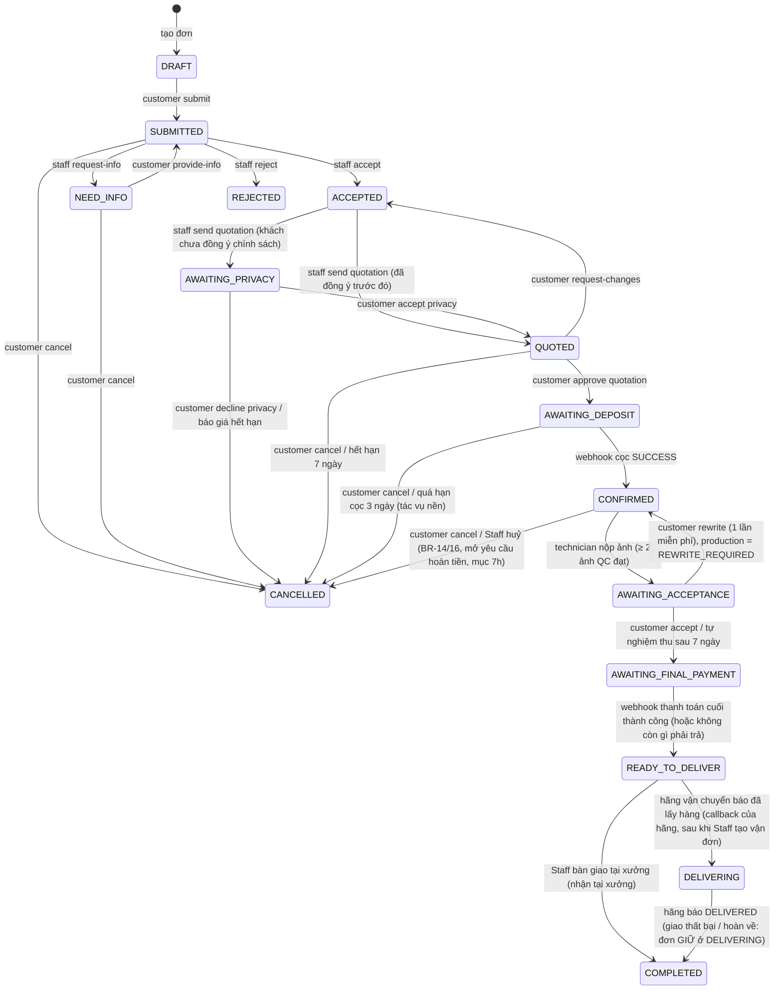

# AI-VHRS – Hướng dẫn kết nối API cho Frontend

> Dành cho: đội FE (web + Flutter) cần biết **gọi API nào, theo thứ tự nào, nhận gì về** để nối giao diện.
> Cập nhật lần cuối: **2026-10-22, tới Phase 4f** (thanh toán VNPay/MoMo/payOS, chọn dịch vụ vận chuyển, vận đơn, chat; xem `../PROJECT_STATUS.md` để biết dự án đang tới đâu).
> Nguồn sự thật tuyệt đối là Swagger (`/docs`): file này giải thích **luồng** và **quy ước**, Swagger cho **schema chi tiết**.

## 0. DANH SÁCH VIỆC FE CẦN LÀM (BE đã xong, FE chưa làm; cập nhật 2026-10-22)

Mỗi dòng trỏ tới mục có chi tiết. Đánh dấu khi xong.

**Thanh toán (mục 5.3b, 5.3c, 7d)**
- [ ] **Thêm `vercel.json`** với rewrite SPA `{"rewrites":[{"source":"/(.*)","destination":"/index.html"}]}`: thiếu thì `/payment/result` và mọi đường dẫn sâu bị 404 trên Vercel.
- [ ] **Trang `/payment/result`** (cổng đưa khách về đây kèm `?order_id=<id>`): poll `GET /orders/{id}` tới ~60 giây, gọi `POST /payments/{id}/refresh` một lần nếu còn `PENDING` (bỏ qua lỗi 502 của VNPay), rồi đưa khách về đơn. Không tin tham số của cổng.
- [ ] **`pages/order/Deposit.tsx`:** thêm lựa chọn **PAYOS** (đọc `GET /payments/gateways`, chỉ hiện cổng `enabled`); khi `PaymentOut.pay_url` có giá trị thì `window.location.assign(pay_url)` và không chạy luồng mock; nhãn "MOCK" chỉ hiện khi `mode === "MOCK"`; thêm `pay_url`, `pay_url_expires_at`, `qr_code`, `bank`, `needs_refund` vào kiểu `Payment` trong `services/orders.ts`.
- [ ] **payOS:** hiện hạn của mã (`pay_url_expires_at`) và cho tạo mã mới khi hết hạn; thông báo "đã chuyển sai số tiền" khi `needs_refund`. Khi test, trang `pay.payos.vn/web/<id>` từng không mở được trên trình duyệt của chủ dự án (nghi sao chép sai đường dẫn): hãy thử luồng redirect thật và báo lại BE nếu vẫn lỗi. Tuỳ chọn: tự vẽ QR từ `qr_code`.
- [ ] **Xác minh số điện thoại + quên mật khẩu bằng SMS (2026-11-11, Phase 5e, mục 3.2):** ở hồ sơ, khi `phone_verified=false` hiện nút "Xác minh" (`POST /me/phone/otp` → ô nhập 6 số → `POST /me/phone/verify`), đếm ngược `resend_after` cho nút "Gửi lại"; màn đăng nhập thêm "Quên mật khẩu bằng số điện thoại" (`/auth/phone-reset/request` → `/auth/password-reset/confirm {phone, code, new_password}`; không còn `/auth/phone-reset/verify` và token, 2026-11-26). SMS mặc định MOCK; đã có adapter eSMS (`mode` = `ESMS_SANDBOX` / `ESMS` / `SPEEDSMS` khi server bật).
- [ ] **Chat tức thời + PDF báo cáo (2026-11-10, Phase 5d, mục 5.4, 7j, 7m):** màn chat mở bằng `latest=true`, cuộn lên tải `before_id`; nghe `event: message` trên stream thông báo để nối tin mới (bỏ poll tin nhắn); màn báo cáo Manager thêm nút "Xuất PDF" (`format=pdf`).
- [ ] **Đánh giá + showcase (2026-11-07, mục 7n, 7o):** khách: nút "Đánh giá" ở đơn `COMPLETED` (sao, nhận xét, tối đa 5 ảnh, sửa trong 30 ngày); trang chủ: khối "Sản phẩm mẫu" (`GET /catalog/showcase`) và "Khách nói gì" (`GET /catalog/reviews`, điểm trung bình + số lượt theo sao); web xưởng: màn quản lý showcase (Staff, Manager), màn đánh giá có nút ẩn / hiện lại (Manager).
- [ ] **Thông báo (2026-11-04, mục 7j):** chuông + badge (`GET /me/notifications/unread-count`), danh sách có "xem thêm" (`before_id`), đánh dấu đã đọc / đọc hết, mở `GET /me/notifications/stream` bằng fetch-stream (có header Bearer) để cập nhật tức thời và tải lại màn đơn đang xem; áp dụng cho cả web khách, web xưởng và DesktopApp kỹ thuật viên.
- [ ] **Màn thanh toán cuối** (`POST /orders/{id}/payments/final`, mục 7d).

**Giao hàng (mục 7d, 7e)**
- [ ] Thanh công cụ soạn chữ cho đơn viết theo mẫu: cỡ chữ, nghiêng, gạch chân, gạch ngang, giãn dòng + xem trước (`GET /catalog/text-styles`, `POST /catalog/templates/{id}/preview`, mục 5.1b). Không có chữ đậm.
- [ ] Form địa chỉ **tỉnh/thành → phường/xã** (hai cấp, `GET /locations/...`, mục 7d-2; bỏ ô quận/huyện) cho hồ sơ và đơn hàng.
- [ ] Màn **chọn hãng + dịch vụ vận chuyển** (`POST /orders/{id}/delivery-quote`, rồi `PUT /orders/{id}/delivery` với `carrier`, `service_code`), xử lý `FEE_CHANGED`. Chỉ còn hãng GHN.
- [ ] Màn **xem vận đơn** của khách (`GET /orders/{id}/shipment`) và màn Staff tạo vận đơn / nhãn PDF (`/workshop/orders/{id}/shipment`).

**Chat (mục 5.4)**
- [ ] **Gửi thẻ đơn qua API** (`POST /orders/{id}/messages {kind:"ORDER_CARD"}`) thay cho state tạm trong `store/chatDock.ts`; hiển thị tin `ORDER_CARD` (từ `order_card`) cho **cả khách và Staff/Manager**.
- [ ] `services/chat.ts` dùng **`GET /me/conversations`** (khách) và **`GET /workshop/conversations`** (Staff/Manager) thay cho gọi `/messages` từng đơn; badge nút chat dùng **`GET /me/conversations/unread-count`** (hoặc `/workshop/...`).
- [ ] **Bỏ việc khoá ô nhập khi đơn `COMPLETED`** (BE vẫn cho nhắn; chỉ `REJECTED`/`CANCELLED` là đã đóng).
- [ ] **Staff: ngừng ẩn các đơn chưa ai nhận** trong danh sách chat (BE trả cả đơn mình phụ trách lẫn đơn `SUBMITTED` chưa ai nhận). Khi khách nhắn đơn chưa ai nhận, FE khách có thể hiện "Đơn chưa có nhân viên nhận, xưởng sẽ trả lời sớm" (Manager trả lời được, Staff chưa nhắn được).

**Robot, hiệu chuẩn, mẫu chữ mới (mục 7b, 7.1; chi tiết `docs/ROBOT_INTEGRATION.md`)**
- [ ] **Màn hiệu chuẩn của Technical Staff** gửi thêm khối `frame_transform = {schema:"vhrs-motion/1", motion:{…}, workspace:{…}}` (các trường ở mục 7b); hiển thị `UNCONFIGURED` khi thiếu số đo.
- [ ] Sau `POST .../simulation`, **đọc kết quả của server** (`passed` có thể bị server đổi thành `false`) và hiện danh sách lỗi `SERVER …`; `GET /technician/jobs/{id}` có `can_start`.
- [ ] **App Technical Staff điều khiển robot qua BE** (mục 7g, KHÔNG gọi máy trạm trực tiếp): gửi lệnh bằng `POST /technician/robot-commands`, hỏi kết quả bằng `GET /technician/robot-commands/{id}`; luôn hiện nhãn chế độ MOCK / SIM / REAL và trạng thái kết nối agent (`GET /technician/robots/{id}/live` → `agent_online`).
- [ ] **Danh sách mẫu chữ:** có thêm 4 mẫu `kind = "TYPOGRAPHY"` (Playpen Sans, Pangolin, Patrick Hand, Mali Light, `font_uri` dạng `outline:fonts/...`); `GET /catalog/templates/{id}/preview?text=` trả PNG (không còn giới hạn 80 ký tự từ 2026-11-27; lần đầu mỗi font có thể chậm ~1 giây). **2026-11-27: thêm 7 mẫu** Itim, Merienda, Great Vibes, Dancing Script, Ms Madi, Pacifico, Allura. Hiển thị cảnh báo "thứ tự nét do hệ thống dựng lại" nếu cần.

**Cuộc chat với trợ lý AI và chính sách dữ liệu chat (mục 7s.1, 7s.2; 2026-11-24, migration 0031)**
- [ ] **Ô đồng ý chính sách chat AI:** hiện khi `policy_accepted = false` (từ `GET /studio/assistant/status` hoặc `GET /orders/{id}/assistant/messages`), kèm link mở toàn văn `GET /privacy-policy/ai-chat`; đồng ý một lần cho tài khoản, bị hỏi lại khi chính sách đổi phiên bản.
- [ ] **Nút "Cuộc chat mới"** trong chatbox (gửi tin đầu với `new_session: true`, các tin sau gửi `session_id`), danh sách cuộc chat của đơn, đổi tên, xoá (chỉ khi đơn còn nháp).
- [ ] **Thanh bên kiểu ChatGPT:** `GET /me/assistant/sessions` (mọi cuộc chat của khách, có phân trang), bấm vào thì mở đơn và cuộc chat đó.
- [ ] **Tài khoản > Quyền riêng tư:** xem trạng thái đồng ý và nút rút lại đồng ý (`DELETE /me/assistant/consent`).

**Ảnh thật của giấy, bút, mực (mục 5.1, 7.1b; 2026-11-24, migration 0030)**
- [ ] **Màn chọn vật tư của khách:** giấy, bút, mực trong `/catalog/*` có thêm `image_url`. Có ảnh thì hiện ảnh (``, URL công khai, không cần token); `null` thì giữ cách vẽ hiện tại (vạch theo `stroke_width_mm`, chấm màu theo `hex_code`). Không dùng ảnh lấy ở nguồn khác.
- [ ] **Màn vật tư của Manager:** nút tải / thay / gỡ ảnh cho từng loại giấy, bút, màu mực (`PUT` / `DELETE /manager/papers|pens|inks/{id}/image`, thân request là chính file ảnh).
- [ ] **Danh sách mẫu chữ:** `preview_url` giờ luôn là địa chỉ ảnh mở được; dùng làm ảnh đại diện của mẫu chữ.

**Bản sao số 3D của robot (mục 7g)**
- [ ] **Xem 3D = nhúng trang do BE phục vụ** (cách chắc chắn nhất, không cần viết three.js): gọi `POST /technician/robots/{id}/view-ticket` → mở `<BE>` + `viewer_path` trong WebView (mobile) hoặc `<iframe>` (web). Trang chỉ-đọc, tự cập nhật 4 lần/giây, tự hiện cảnh báo đỏ "NHẤN NÚT E-STOP". Vé sống 60 phút: hết hạn thì xin vé mới và nạp lại. Chi tiết và phương án tự vẽ ở mục 7g.3. Nút Tạm dừng/Tiếp tục/DỪNG của FE nằm **ngoài** khung 3D và gọi `POST /technician/robot-commands`.
- [ ] **Ảnh phác thảo cho khách** (mục 5.2, 6): `GET /orders/{id}/quotation` → `sketch.image_urls[]` (JPG) là ảnh khách xem để quyết định đặt cọc; Staff dùng `image_urls[]` + `trajectory_url` (file chạy của robot) ở `GET /workshop/orders/{id}/sketches/{v}`.
- [ ] **Đánh giá chất lượng bản viết** (mục 7c.2): sau khi tải ảnh QC, nút "Đánh giá" gọi `POST /technician/jobs/{id}/photos/{photo_id}/evaluate`; hiện `verdict`, số đo mm và `overlay_url`; luôn kèm dòng `advisory` (chỉ tham khảo).

**Vận hành robot: cảnh báo, tình trạng, tuân thủ quy trình (mục 7f)**
- [ ] **Màn Technical Staff:** poll `GET /technician/robot-status` (2 giây) hiển thị `headline_vi`, `level` 1–4, `open_alerts[]` (`title_vi` + `action_vi`), nút "Đã thấy" (`POST /technician/alerts/{id}/ack`) và "Đóng" (`.../resolve`, mức 4 bị chặn). **Mức 4 = banner đỏ nhấp nháy + còi + chữ "BẤM NÚT E-STOP NGAY"**; không bao giờ ẩn banner đỏ khi chưa có Manager đóng.
- [ ] **Màn Manager:** `GET /manager/robot-status`, `GET /manager/robots/{id}/health`, `GET /manager/alerts`, `GET /manager/jobs/{id}/compliance` (từng bước đạt/không + ngoại lệ), `GET /manager/runs`, `GET/PATCH /manager/alert-catalog`.
- [ ] Cảnh báo mức 4 cũng được **gửi email** (BE làm); FE không cần gửi.

**Đã có từ 2026-11-04:** trung tâm thông báo in-app + email và đẩy tức thời qua SSE (mục 7j), huỷ sau cọc và hoàn tiền (mục 7h), ETA (mục 7i).

## 1. Kết nối nhanh

| Mục | Giá trị |
|---|---|
| Base URL | `<host>/api/v1` (local: `http://localhost:8000/api/v1`) |
| Swagger UI | `<host>/docs` (bấm **Authorize**, nhập email vào `username`) |
| Health check | `GET /api/v1/health` |
| Content-Type | `application/json` (trừ upload file: PUT thẳng lên link ký sẵn) |
| Xác thực | Header `Authorization: Bearer <access_token>` |
| Thời gian | ISO-8601 có múi giờ (UTC hoặc `+07:00`). FE tự hiển thị giờ VN |
| Tiền | VND, số nguyên. **Decimal trả về dạng chuỗi** (`"399600"`, `"50.00"`): dùng `Number()`/`BigInt`, đừng cộng chuỗi |
| Enum | Chuỗi IN HOA, ví dụ `AWAITING_DEPOSIT` |

Chạy local: `cd BE && source .venv/bin/activate && python -m uvicorn app.main:app --reload --port 8000`.
Tài khoản demo (mật khẩu chung do nhóm giữ): `customer@example.com`, `staff@netviet.vn`, `manager@netviet.vn`, `tech@netviet.vn`, `admin@netviet.vn`.

### Quy ước chung

**Lỗi luôn cùng một dạng** (hiển thị `message` cho người dùng, xử lý logic theo `code`):
```json
{"error": {"code": "INVALID_DEPOSIT", "message": "Tiền cọc phải từ 50% đến 100% ...", "details": {"min_deposit_pct": "50.00"}}}
```
Lỗi nhập liệu (422 `VALIDATION_ERROR`) có `details = [{"field": "quantity", "message": "..."}]`: gắn lỗi vào đúng ô nhập.

**Phân trang**: `?page=1&page_size=20` → `{items, total, page, page_size}`.

**Mã HTTP**: `401` chưa đăng nhập/hết phiên · `403` sai vai trò · `404` không tồn tại **hoặc không phải của bạn** (cố ý, để không lộ dữ liệu người khác) · `409` sai trạng thái/xung đột · `422` dữ liệu sai · `429` gọi quá nhanh (đọc header `Retry-After`) · `503` dịch vụ phụ chưa cấu hình.

**Phân biệt 403 và 404**: gọi sai vai trò → 403. Gọi đúng vai trò nhưng đơn của người khác → 404.

## 2. Vai trò và phạm vi

| Vai trò | Làm được gì | Không làm được |
|---|---|---|
| `CUSTOMER` | Tạo/sửa/gửi/huỷ đơn của mình, duyệt báo giá, đặt cọc, chat, **xem ảnh sản phẩm, nghiệm thu hoặc yêu cầu viết lại** | Xem đơn người khác, bất kỳ API `/workshop`, `/manager` |
| `STAFF` | Hàng đợi, nhận/tiếp nhận/từ chối đơn, phác thảo AI, lập & gửi báo giá, chat với khách | Đơn của Staff khác, `/manager/*`, đổi bảng giá, tự duyệt giá vượt ngưỡng |
| `MANAGER` | **Xem** mọi đơn đã gửi, xem phác thảo/báo giá/chat; **phân công Staff**, **duyệt/từ chối giá vượt ngưỡng**, vật tư/tồn kho/mẫu chữ/duyệt bộ nét/robot, **bảng giá + ngưỡng %**, lập lịch sản xuất | **Không** tiếp nhận/từ chối đơn, tạo phác thảo, lập/chỉnh/gửi báo giá (tách nhiệm vụ: người duyệt không tự làm). **Được** nhắn tin với khách để xử lý khiếu nại |
| `TECHNICAL_STAFF` | Chỉ **job được giao cho mình**: xem job, tải gói job + hash, chuẩn bị, hiệu chuẩn, ghi kết quả mô phỏng, bắt đầu/kết thúc viết, báo sự kiện an toàn, báo sự cố, **tải ảnh sản phẩm + QC rồi nộp ảnh** (`/technician/*`) | Job của người khác (trả `404`), đơn/khách/giá, `/manager/*`. **Không** điều khiển robot |
| `ADMIN` | Tài khoản, vai trò, nhật ký hệ thống (`/admin/*`) | **Không** xem/sửa đơn, giá, sản xuất (BR-02) |

Bản nháp (`DRAFT`) chỉ chủ đơn thấy; xưởng không thấy cho tới khi khách bấm gửi.

### Bảng quyền theo nhóm endpoint (BE kiểm tra từng request)

| Nhóm | Customer | Staff | Manager | Technical | Admin |
|---|:-:|:-:|:-:|:-:|:-:|
| Công khai: `/health`, `/catalog/papers|pens|templates`, `/privacy-policy`, `/verify/{code}` (U8), đăng ký/đăng nhập/làm mới/quên mật khẩu | ✔ | ✔ | ✔ | ✔ | ✔ |
| Mọi vai trò đã đăng nhập: `/me*`, `/auth/logout` | ✔ | ✔ | ✔ | ✔ | ✔ |
| `/orders/*` (đơn của mình), `/pricing/estimate`, `/catalog/my-styles`, thanh toán cọc, `/payments/{id}/mock-checkout` | ✔ | ✘ | ✘ | ✘ | ✘ |
| `/studio/*` (bản nháp studio của mình + trợ lý AI, U5) | ✔ | ✘ | ✘ | ✘ | ✘ |
| Chat `/orders/{id}/messages` (đọc, gửi, ảnh, đánh dấu đã đọc) | ✔ | ✔ | ✔ (xử lý khiếu nại) | ✘ | ✘ |
| `/workshop/*` **đọc** (GET: hàng đợi, chi tiết, phác thảo, báo giá, PDF, payments, jobs, **product-photos**, thẻ chứng nhận U8, bản nháp studio của đơn U5) | ✘ | ✔ | ✔ | ✘ | ✘ |
| `/workshop/*` **ghi** (claim, accept, reject, request-info, phác thảo, báo giá, điều chỉnh, gửi, huỷ báo giá) | ✘ | ✔ | ✘ | ✘ | ✘ |
| `/manager/*` (phân công, duyệt giá, vật tư, mẫu chữ, robot, bảng giá, lịch sản xuất, **sự cố, nhật ký job**) | ✘ | ✘ | ✔ | ✘ | ✘ |
| `/technician/*` (job của tôi, gói job, hiệu chuẩn, mô phỏng, viết, sự kiện, sự cố, ảnh sản phẩm + QC) | ✘ | ✘ | ✘ | ✔ (chỉ job được giao) | ✘ |
| `/admin/*` (tài khoản, nhật ký, tham số hệ thống, tích hợp, dashboard hệ thống, tác vụ nền) | ✘ | ✘ | ✘ | ✘ | ✔ |
| `POST /webhooks/payments/{gateway}` | không dùng token: xác thực bằng chữ ký HMAC | | | | |

**Cách hoạt động:** đăng nhập → nhận `access_token` (JWT) → gắn `Authorization: Bearer <token>` vào MỌI request. BE giải token, **đọc lại tài khoản và phiên từ DB mỗi lần** (khoá tài khoản, đăng xuất, đổi vai trò có hiệu lực ngay) và lấy **vai trò từ DB, không từ nội dung token**. Thiếu/sai/hết hạn token → `401`; đúng token nhưng sai vai trò → `403 FORBIDDEN`. Bảng trên được test tự động cho **từng route** (`tests/test_permission_matrix.py`); thêm endpoint mà quên khai báo quyền sẽ làm test đỏ.

## 3. Xác thực

```
POST /auth/register     {email, password(≥8, đủ mạnh), full_name, phone?}  → AccountOut
POST /auth/login        {email, password}  → {access_token, refresh_token, token_type, account{id,role,...}, reminders[]}
POST /auth/google       {id_token}         → cùng dạng như /auth/login (chỉ khách hàng, xem 3.1)
POST /auth/refresh      {refresh_token}    → cặp token mới
POST /auth/logout       (Bearer)           → thu hồi phiên hiện tại
GET  /me                → AccountOut        PATCH /me {full_name?, phone?, addresses?}
POST /me/change-password, POST /auth/password-reset/request|confirm
POST /me/phone/otp, POST /me/phone/verify, POST /auth/phone-reset/request|verify   (OTP SMS, mục 3.2)
```
- **Quên mật khẩu qua email (2026-11-26, chỉ bằng mã OTP):** `POST /auth/password-reset/request {email}` → mail chứa **mã 6 số** (hết hạn 15 phút, dùng một lần, sai 5 lần thì mã bị huỷ; gửi lại cách nhau tối thiểu 60 giây, tối đa 5 mã / 24 giờ) và một link ngắn `<web>/reset-password` (**không có token**, chỉ mở trang). Trang `/reset-password`: ô email (điền sẵn nếu khách vừa nhập ở bước trước), ô mã 6 số, mật khẩu mới → `POST /auth/password-reset/confirm {email, code, new_password}` → `204`, mọi thiết bị bị đăng xuất. Lỗi: `400 OTP_INVALID` (`details.attempts_left`), `OTP_EXPIRED`, `OTP_TOO_MANY_ATTEMPTS`; `422` mật khẩu yếu (mã chưa bị dùng). **Bỏ** cách đọc `?token=` từ URL; `confirm` không còn trường `token` (luồng SMS cũng dùng mã, mục 3.2). `<web>` là `PUBLIC_WEB_URL` của BE (bỏ trống: gốc của `PAYMENT_RETURN_URL`).
### 3.1 Đăng nhập bằng Google (khách hàng)
1. FE dùng **Google Identity Services** (web) hoặc Google Sign-In SDK (Flutter) với **Web Client ID** của dự án, nhận `credential` (= Google **ID token**).
2. `POST /auth/google {"id_token": "<credential>"}` → trả `{access_token, refresh_token, account}` y như đăng nhập thường; từ đó dùng Bearer như mọi API.
3. Lần đầu: BE tự tạo tài khoản `CUSTOMER` theo email Google (họ tên lấy từ Google). Đã có tài khoản cùng email: đăng nhập vào tài khoản đó (khớp theo email, không phân biệt hoa/thường). Khách có thể đặt mật khẩu sau bằng "Quên mật khẩu".
4. Lỗi: `401 GOOGLE_TOKEN_INVALID` (token sai/hết hạn/không phải của app này), `401 GOOGLE_EMAIL_NOT_VERIFIED`, `403 GOOGLE_NOT_ALLOWED` (email thuộc Staff/Manager/Admin/Technical: dùng email + mật khẩu), `403 ACCOUNT_DISABLED`, `503 GOOGLE_NOT_CONFIGURED` (BE chưa có env `GOOGLE_CLIENT`), `503 GOOGLE_UNAVAILABLE`.
5. FE **không** gửi email/họ tên tự khai: chỉ gửi `id_token`; BE xác minh với Google.

### 3.2 Xác minh số điện thoại và quên mật khẩu bằng SMS (Phase 5e, FR-53, UC-54)

**Nhà cung cấp SMS: eSMS.vn** (thêm 2026-11-16). Trường `mode` trong `OtpSentOut` cho biết chế độ: `"MOCK"` (mặc định, không gửi tin; mã chỉ nằm trong bộ nhớ server cho test, **không hiện ra cho FE**), `"ESMS_SANDBOX"` (gọi eSMS ở chế độ thử, eSMS không giao tin), `"ESMS"` (gửi SMS thật), `"SPEEDSMS"` (gửi SMS thật qua SpeedSMS.vn, thêm 2026-11-17, không có chế độ thử), `"SPEEDSMS_2FA"` (gửi SMS thật qua ứng dụng 2FA của SpeedSMS, tên người gửi "Verify", thêm 2026-11-26). Luồng và API không đổi. Lỗi mới có thể gặp ở `POST /me/phone/otp` khi gửi SMS thất bại: `503 SMS_NOT_CONFIGURED` (server chưa cấu hình hoặc tài khoản eSMS có vấn đề), `502 SMS_UNAVAILABLE` (không kết nối được eSMS), `502 SMS_REJECTED` (eSMS từ chối). FE hiện thông báo "thử lại sau"; mã lỗi không tính vào giới hạn 60 giây / 5 mã mỗi ngày. `POST /auth/phone-reset/request` vẫn luôn trả 202.

**Xác minh số trong hồ sơ** (đã đăng nhập; mọi vai trò):
1. Hồ sơ có `phone` và `phone_verified=false` → nút "Xác minh". `POST /me/phone/otp` (không body) → `202 {phone_masked, expires_in: 300, resend_after: 60, mode}`.
2. Ô nhập 6 chữ số → `POST /me/phone/verify {code}` → `AccountOut` với `phone_verified=true` (số được lưu dạng `0xxxxxxxxx` dù khách nhập `+84...`).
3. Đổi số bằng `PATCH /me` thì `phone_verified` về `false`, phải xác minh lại.

**Nhắc thêm / xác minh số (2026-11-26):** kết quả `POST /auth/login` và `/auth/google` có `reminders` (mảng, thường rỗng; `/auth/refresh` luôn rỗng):
- `"ADD_PHONE"`: tài khoản chưa có số điện thoại. Chỉ **một lần** cho mỗi tài khoản (lần đăng nhập đầu tiên không có số). FE mở hộp nhắc "Thêm số điện thoại" (ô số → `PATCH /me {phone}` → luồng xác minh ở trên; có nút "Để sau").
- `"VERIFY_PHONE"`: có số nhưng chưa xác minh. Tối đa 7 ngày một lần và không gửi thêm khi tin nhắc cũ chưa đọc. FE mở hộp nhắc "Xác minh số" (→ `POST /me/phone/otp`).
- Mỗi nhắc nhở cũng là một **thông báo trong chuông** (`type: "SYSTEM"`, `order_id: null`, `msg_code`: `PHONE_ADD` / `PHONE_VER`, không gửi email); bấm vào thì mở Tài khoản > Hồ sơ. Đổi số bằng `PATCH /me` cũng tạo ngay thông báo `PHONE_VER` (trừ khi tin cũ chưa đọc). Số trong nội dung đã che (`090****123`).

**Quên mật khẩu bằng số điện thoại** (chưa đăng nhập; chỉ dùng được với số **đã xác minh**):
1. `POST /auth/phone-reset/request {phone}` → **luôn `202`** (kể cả số không tồn tại, chưa xác minh, đang phải chờ, hết lượt), nên FE luôn chuyển sang ô nhập mã với câu "Nếu số đã được xác minh, mã đã được gửi".
2. Một màn: ô mã 6 số + mật khẩu mới + nhập lại → `POST /auth/password-reset/confirm {phone, code, new_password}` (cùng endpoint và cùng cách của luồng email, chỉ thay `email` bằng `phone`; **không còn `/auth/phone-reset/verify` và `reset_token`**, 2026-11-26) → `204`; mọi thiết bị bị đăng xuất, email báo "mật khẩu đã được đổi" được gửi tới email của tài khoản. Sau đó về màn đăng nhập. Gửi cả `email` lẫn `phone`, hoặc không gửi cái nào: `422`. Mã sai: `400 OTP_INVALID` (`details.attempts_left`), `OTP_EXPIRED`, `OTP_TOO_MANY_ATTEMPTS`; mật khẩu yếu: `422`, mã chưa bị dùng.

**Xác minh số bằng Firebase (2026-11-27, cách đang dùng để gửi SMS thật; Google gửi tin):** FE cài `firebase`, khởi tạo bằng `firebaseConfig` của project (biến `VITE_FIREBASE_*`), đặt `auth.languageCode = 'vi'`. Hai màn dùng cùng một đoạn:
```ts
import { getAuth, RecaptchaVerifier, signInWithPhoneNumber, signOut } from 'firebase/auth'
const auth = getAuth(app); auth.languageCode = 'vi'
const verifier = new RecaptchaVerifier(auth, 'id-cua-nut-gui-ma', { size: 'invisible' })
const confirmation = await signInWithPhoneNumber(auth, '+84' + phone.slice(1), verifier)   // Google gửi SMS
const { user } = await confirmation.confirm(code)                                          // mã khách nhập
const idToken = await user.getIdToken()
await signOut(auth)                                                                         // chỉ cần bằng chứng, không giữ phiên Firebase
```
- **Hồ sơ (đã đăng nhập):** số gửi cho Firebase phải là số trong hồ sơ → `POST /me/phone/verify-firebase {id_token}` → `AccountOut` với `phone_verified=true`. Lỗi: `400 PHONE_MISMATCH` (số vừa xác minh khác số hồ sơ), `409 PHONE_ALREADY_VERIFIED` / `PHONE_TAKEN`, `422 PHONE_MISSING`.
- **Quên mật khẩu bằng số (chưa đăng nhập):** khách nhập số → luồng Firebase → màn mật khẩu mới → `POST /auth/password-reset/confirm {firebase_id_token, new_password}` (không kèm `code` / `phone`) → `204`. Lỗi: `400 PHONE_NOT_VERIFIED` (số này chưa xác minh cho tài khoản nào: bảo khách dùng email), `422` mật khẩu yếu (token chưa bị dùng, gửi lại được).
- Lỗi chung: `401 FIREBASE_TOKEN_INVALID` (token sai, hoặc đã dùng để đặt lại mật khẩu), `401 FIREBASE_TOKEN_EXPIRED` (đăng nhập Firebase cũ hơn 10 phút: nhận mã mới), `503 FIREBASE_NOT_CONFIGURED` / `FIREBASE_UNAVAILABLE`. Lỗi của chính Firebase (`auth/invalid-phone-number`, `auth/too-many-requests`, `auth/invalid-verification-code`, `auth/code-expired`...) FE tự dịch.
- Khi phát triển: `localhost` không dùng được cho phone auth của Firebase; dùng "Phone numbers for testing" trong Firebase console (số giả + mã cố định, không tốn tin) hoặc thử trên tên miền thật. Các API `POST /me/phone/otp`, `/me/phone/verify`, `/auth/phone-reset/request` (mã do BE gửi) vẫn còn cho chế độ MOCK và các nhà cung cấp SMS khác.

**Quy tắc mã:** 6 chữ số, hiệu lực **5 phút**; sai **5 lần** thì mã bị huỷ; xin mã mới thì mã cũ hết hiệu lực; phải chờ **60 giây** giữa hai lần gửi và tối đa **5 mã mỗi số trong 24 giờ** (tính chung cả hai luồng).

| Lỗi | Khi nào | UI |
|---|---|---|
| `400 OTP_INVALID` | Sai mã (`details.attempts_left`), hoặc không có mã nào đang mở | "Mã không đúng, còn n lần thử" |
| `400 OTP_EXPIRED` | Quá 5 phút | Nút "Gửi lại mã" |
| `400 OTP_TOO_MANY_ATTEMPTS` | Sai lần thứ 5 | Bắt buộc gửi lại mã |
| `409 PHONE_ALREADY_VERIFIED` / `409 PHONE_TAKEN` | Số đã xác minh / số đã được xác minh cho tài khoản khác | Báo lỗi, gợi ý dùng số khác |
| `422 PHONE_MISSING` | Hồ sơ chưa có số | Đưa về form sửa hồ sơ |
| `429 OTP_RESEND_TOO_SOON` (`details.retry_after`) / `429 OTP_DAILY_LIMIT` | Gửi lại quá sớm / quá 5 mã trong 24 giờ | Đếm ngược / "thử lại sau" |

- Access token sống **30 phút**, refresh token **7 ngày**. Lưu refresh token an toàn (Flutter: secure storage; web: ưu tiên bộ nhớ/`httpOnly` nếu có BFF).
- Khi nhận `401` với `code` = `TOKEN_EXPIRED` hoặc `NOT_AUTHENTICATED` → gọi `/auth/refresh` **một lần**, thử lại request; refresh cũng lỗi → về màn đăng nhập.
- Sai mật khẩu 5 lần → `423 ACCOUNT_TEMP_LOCKED` (khoá tạm 15 phút).
- Vai trò lấy từ `account.role` sau login: dùng để chọn menu, **nhưng quyền thật luôn do BE kiểm tra**.

## 4. Vòng đời đơn hàng (state machine)

`order_status` (trạng thái nghiệp vụ) và `production_status` (trạng thái sản xuất) là **hai trường riêng** trong mọi object đơn.



`production_status`: `NOT_STARTED → PENDING_SCHEDULE (sau khi cọc xong) → SCHEDULED (Manager xếp lịch) → PREPARING → WRITING ⇄ PAUSED → WRITTEN → PHOTO_UPLOADED → FINISHED`; nhánh lỗi `FAILED`, `REWRITE_REQUIRED` quay lại `PENDING_SCHEDULE`. Hai bước đầu do Phase 3 làm; từ `PREPARING` trở đi là Phase 4.

### Bảng "trạng thái → màn hình khách thấy → nút được phép"

| `order_status` | Khách thấy | Hành động gọi |
|---|---|---|
| `DRAFT` | Đơn đang soạn | sửa vật tư, nhập nội dung, `submit`, xoá nháp |
| `SUBMITTED` | Chờ xưởng tiếp nhận | `cancel`, chat |
| `NEED_INFO` | Xưởng cần bổ sung (`info_request_note`) | sửa đơn, `provide-info`, `cancel` |
| `REJECTED` | Bị từ chối (`reject_reason`, `reject_note`) | chỉ xem |
| `ACCEPTED` | Xưởng đang làm phác thảo/báo giá | chat |
| `AWAITING_PRIVACY` | **Phải** đọc & đồng ý chính sách riêng tư mới xem được báo giá | `GET /privacy-policy`, `POST /orders/{id}/privacy` |
| `QUOTED` | Xem phác thảo + báo giá (hiệu lực `valid_until`) | `approve`, `request-changes`, `cancel` |
| `AWAITING_DEPOSIT` | Chờ cọc (`deposit_amount`). Quá **3 ngày** sau khi duyệt báo giá mà chưa cọc thì BE tự huỷ (`cancel_reason` "Quá hạn đặt cọc…", thông báo in-app), trừ khi khách vừa mở giao dịch cọc trong 60 phút qua | `payments/deposit`, mock-checkout, `cancel` |
| `CONFIRMED` | Đã cọc, xưởng sắp xếp sản xuất (`production_status` cho biết bước; `REWRITE_REQUIRED` = đang viết lại) | chat; `GET cancel-preview` rồi `cancel` nếu `allowed` (mục 7h) |
| `AWAITING_ACCEPTANCE` | Sản phẩm đã viết xong, có ảnh thật để nghiệm thu (`awaiting_acceptance_at`) | `GET /orders/{id}/product-photos`, `accept`, `rewrite` (xem mục 7c). **Không huỷ được ở bước này** |
| `AWAITING_FINAL_PAYMENT` | Đã nghiệm thu (`accepted_product_at`); chờ thanh toán phần còn lại | `GET delivery-quote`, `PUT delivery`, `POST payments/final`, mock-checkout (mục 7d) |
| `READY_TO_DELIVER` | Đã thanh toán đủ; chờ nhận tại xưởng (`pickup_slot_*`) hoặc chờ hãng vận chuyển lấy hàng (`shipping_carrier`, `shipping_service_code`, `shipping_eta`) | chỉ xem. Nhận tại xưởng: Staff bàn giao → `COMPLETED`. Giao hàng: Staff tạo vận đơn, khách theo dõi bằng `GET /orders/{id}/shipment` (mục 7e) |
| `DELIVERING` | Hãng đã nhận hàng, đang giao; hiện mã vận đơn và `tracking_url` | `GET /orders/{id}/shipment`; giao thất bại thì đơn vẫn ở đây và Staff tạo vận đơn mới |
| `COMPLETED` | Đã nhận hàng (`completed_at`) | `POST /orders/{id}/receipt` (ghi `received_confirmed_at`), đánh giá (Phase 5) |
| `CANCELLED` | Đã huỷ (`cancel_reason`) | chỉ xem |

> **Thông báo đẩy:** mở `GET /me/notifications/stream` (mục 7j); khi có sự kiện `notification` của đơn đang xem thì tải lại `GET /orders/{id}`. Không mở được stream thì poll như cũ (15–30 giây).

## 5. Luồng Customer (từ ý tưởng tới đã cọc)

### 5.1 Chuẩn bị đơn
1. **Danh mục** (không cần đăng nhập): `GET /catalog/papers`, `GET /catalog/pens?paper_id=` (chỉ bút tương thích với giấy), `GET /catalog/pens/{id}/inks`, `GET /catalog/templates`, `GET /catalog/templates/{id}/preview?text=...` (ảnh PNG xem thử). Bộ nét đã lưu: `GET /catalog/my-styles`.
   **Ảnh thật của vật tư (migration 0030, 2026-11-24):** mỗi giấy, bút, mực trong các câu trả lời trên (kể cả `suggest-materials`) có **`image_url`**: ảnh do xưởng tự chụp / quét, lưu trong kho của hệ thống, định dạng WebP, cạnh dài tối đa 800 px, **URL công khai** (đặt thẳng vào ``, không cần Bearer). `null` = xưởng chưa tải ảnh: FE giữ cách vẽ hiện tại, **không lấy ảnh ở nguồn ngoài**. URL đổi mỗi khi xưởng thay ảnh, nên không cần tự chống cache. Mẫu chữ: **`preview_url`** luôn là địa chỉ ảnh mở được (ảnh đã lưu ở kho công khai, hoặc `/api/v1/catalog/templates/{id}/preview` do BE vẽ; địa chỉ này là tương đối khi BE chưa đặt `PUBLIC_BASE_URL`, FE nối với gốc API như các lời gọi khác).
2. **Giá ước tính**: `POST /pricing/estimate {order_type, quantity, paper_type_id?, pen_type_id?, ink_color_id?, text? | order_id?}` → `{chars_min, chars_max, price_min, price_max, min_deposit_pct, basis, note}`. Hiển thị **khoảng giá**; không bao giờ bắt khách tự nhập số ký tự (hệ thống tự đếm).
3. **Tạo đơn**: `POST /orders {order_type, quantity}` → đơn `DRAFT`. Loại đơn đang mở cho khách do hệ thống cấu hình: hiện **chỉ `OT1_COPY_RESTORE` và `OT3_TEMPLATE`** (OT-2 bị khoá, lỗi `409 ORDER_TYPE_SUSPENDED`).
4. **Chọn vật tư theo thứ tự giấy → bút → mực.** Sau khi khách chọn giấy, gọi **`GET /catalog/suggest-materials?paper_type_id=`** (công khai) → `{paper, pens:[{id,name,category,surcharge,..., inks:[{id,name,hex_code,unit_price}]}]}`: chỉ gồm các bút **tương thích** với giấy đó, mỗi bút kèm màu mực còn bán; hiển thị để khách chọn (không cần gọi thêm `/catalog/pens` và `/pens/{id}/inks`). Khách không thể chọn bút/mực không phù hợp (BE từ chối `422 PEN_INCOMPATIBLE`), nên không cần cảnh báo chất lượng.
   **"Để xưởng chọn"** (`workshop_suggest_materials:true`): khách **giữ nguyên** những gì đã chọn (có thể chỉ chọn giấy, hoặc giấy + bút) và để trống phần còn lại; Staff chỉ điền phần thiếu (bút, mực… vẫn theo luật tương thích) và đề xuất 1–3 phương án, khách chọn một khi duyệt báo giá. Chọn đủ cả ba thì không còn gì để xưởng đề xuất.
   `PATCH /orders/{id} {paper_type_id, pen_type_id, ink_color_id | workshop_suggest_materials:true, quantity, customer_note, restoration_mode?}`; `restoration_mode` (U4, chỉ đơn OT-1, khác loại → `422 RESTORATION_MODE_OT1_ONLY`): `"FAITHFUL"` (mặc định khi bỏ trống: chỉ viết đúng những gì có trong ảnh, chỗ mờ được đánh dấu, không tự viết thêm) hoặc `"ASSISTED"` (cho phép xưởng viết bù phần mất, phần đó luôn gắn nhãn "suy đoán"); FE nên hỏi khách ở bước tải ảnh gốc; `physical_watermark` (U8, true/false): robot viết thêm một dòng nhỏ ở lề tờ giấy "Tái tạo bằng AI-VHRS - Mã XXXX-XXXX" và xưởng in kèm thẻ chứng nhận có QR; **tuỳ chọn với OT-3** (khách chọn, mặc định tắt), **luôn bật với OT-1** (gửi `false` cho đơn OT-1 → `422 WATERMARK_MANDATORY_OT1`); `OrderOut` có `physical_watermark` (lựa chọn của khách) và `watermark_required` (quy tắc thực tế, luôn `true` với OT-1); bút/mực sai tương thích → `422 PEN_INCOMPATIBLE / INK_REQUIRES_PEN`. Mọi thay đổi khi còn nháp được **tự lưu** (có `last_saved_at`); danh sách nháp: `GET /orders?status=DRAFT`.
5. **Nội dung theo loại đơn**:

| Loại đơn | Gọi |
|---|---|
| `OT3_TEMPLATE` (viết theo mẫu) | `PUT /orders/{id}/inputs/text {text_content, template_id, font_size_mm? (4–100 mm), alignment?, layout?}` (`layout` = cỡ chữ/kiểu chữ theo đoạn, mục 5.1b, và lề / căn dọc trên trang, mục 5.1c; **mặc định khối chữ nằm giữa tờ giấy**); vẽ tay: `PUT /orders/{id}/inputs/canvas {canvas_data:{strokes:[{points:[{x,y,p}]}]}}` (x,y theo **mm**) |
| `OT1_COPY_RESTORE` (sao chép) | **Upload ảnh 3 bước** (bên dưới) |
| `OT2_LEARNED_STYLE` (nét chữ đã học, **đang tắt**, mục 7y) | `PUT /orders/{id}/inputs/text {text_content, handwriting_style_id, font_size_mm?, alignment?, layout?}` (bộ nét `APPROVED` của chính khách, không thì `422 INVALID_STYLE`); hoặc tải ảnh mẫu chữ `kind=HANDWRITING_SAMPLE` (Staff vẽ tay). Gửi đơn cần `confirm_right_to_use: true` |

**5.1b Cỡ chữ và kiểu chữ theo đoạn (đơn viết theo mẫu, FR-08).** Ngoài `font_size_mm` chung, khách có thể đổi **cỡ chữ**, **nghiêng**, **gạch chân** (đơn/đôi), **gạch ngang** cho từng đoạn và chỉnh **giãn dòng**. **Không có chữ đậm.** Kiểu chữ **không đổi giá** (báo giá vẫn theo số ký tự × độ phức tạp, và độ phức tạp được tính như khi chưa có kiểu chữ).
- `GET /catalog/text-styles` (không cần đăng nhập) → giới hạn để dựng thanh công cụ: `min_font_size_mm: 4`, `max_font_size_mm: 100`, `default_font_size_mm: 8`, `line_spacing {min 0.8, max 2.5, default 1}`, `styles`, `underline: ["single","double"]`, `max_spans: 200`.
- `layout` gửi kèm `PUT /orders/{id}/inputs/text`:
```json
{"version": 1, "line_spacing": 1.2,
 "spans": [{"start": 0, "end": 12, "size_mm": 14, "italic": true, "underline": "single"},
           {"start": 20, "end": 27, "strike": true}]}
```
  `start`/`end` là vị trí ký tự **theo code point** trong nội dung **đã chuẩn hoá NFC**, khoảng `[start, end)` (khác chỉ số UTF-16 của JavaScript: dùng `Array.from(text.normalize('NFC'))` để đếm). Đoạn không nêu thuộc tính nào thì giữ cỡ chung và chữ thường; các đoạn không được chồng nhau, tối đa 200. Cỡ chữ của đoạn: 4–100 mm. **PUT thay thế toàn bộ**: không gửi `layout` nghĩa là xoá định dạng; sửa nội dung phải gửi lại `layout` cho khớp vị trí. Sai → `422 INVALID_LAYOUT` (`details` nói đoạn nào). Cỡ chữ chung dưới 4 mm → `422 VALIDATION_ERROR`.
- Xem trước: `POST /catalog/templates/{id}/preview {text (≤2000), font_size_mm?, alignment?, layout?, paper_size? (A4 | A5 | A6, mặc định A5)}` → ảnh PNG **trang đầu** trên đúng khổ giấy, không cần đăng nhập, 60 lần/phút/IP. `GET .../preview?text=` (≤200 ký tự) cũ vẫn dùng được (không có kiểu chữ / vị trí); thêm `fit=text` → ảnh **chỉ có nét chữ, cắt sát chữ** (dùng cho thẻ mẫu chữ), trả kèm `Cache-Control: public, max-age=3600`. **Từ 2026-11-27:** không còn giới hạn 80 ký tự cho mẫu `TYPOGRAPHY` (đo: 1.000 ký tự vẽ ~15 ms; chỉ lần đầu tải font ~1 s); **mọi ảnh xem thử cho khách đều vẽ từ chính các nét robot sẽ viết và không có chấm xanh đầu nét** (chấm xanh chỉ còn ở ảnh kỹ thuật của phác thảo cho xưởng). **Quy tắc hiển thị (chủ dự án, 2026-11-27): FE không tự vẽ chữ bằng web font**: trình duyệt vẽ nét đậm / thanh đậm mà robot không viết; mọi hình chữ phải là ảnh BE vẽ (ảnh xem thử, ảnh mẫu `preview_url`, ảnh phác thảo của đơn). `preview_url` của mẫu outline giờ là ảnh mẫu cắt sát chữ, không chấm xanh.
- `InputOut.layout` trả đúng dạng đã lưu (đoạn theo thứ tự, bỏ giá trị mặc định); từ 2026-11-07 luôn có `vertical_align` (mục 5.1c), nên nội dung lưu mới không còn `layout: null`. Lúc Staff sinh phác thảo, nghiêng/gạch chân/cỡ chữ được vẽ thành nét thật (gạch chân là một nét thẳng dưới mỗi dòng của đoạn); layout hỏng → `422 INVALID_LAYOUT`.
- Cỡ tối thiểu 4 mm là giả định tạm (chưa thử với bút thật); độ nghiêng cố định khoảng 12°.

**5.1c Vị trí chữ trên trang: lề 4 phía và căn giữa tờ giấy (đơn viết theo mẫu, 2026-11-07).** **Mặc định khối chữ nằm giữa tờ giấy**: căn ngang `CENTER` và căn dọc `MIDDLE`, lề 15 mm mỗi phía. Khách có thể đổi lề trên / dưới / trái / phải và kiểu căn nếu muốn. Vị trí **không đổi giá** (nét chữ không đổi, chỉ dời chỗ).
- Hai khoá thêm vào `layout` (dùng chung với 5.1b):
```json
{"version": 1,
 "margins_mm": {"top": 40, "bottom": 20, "left": 25, "right": 25},
 "vertical_align": "MIDDLE",
 "spans": []}
```
  - `margins_mm`: mỗi phía **5–80 mm**, phía nào không gửi lấy **15**. Lề tính từ mép giấy; chữ chỉ nằm trong vùng giữa các lề.
  - `vertical_align`: `TOP` (chữ bắt đầu từ lề trên) | `MIDDLE` (khối chữ nằm giữa lề trên và lề dưới) | `BOTTOM` (dòng cuối chạm lề dưới). Không gửi = `MIDDLE`.
  - `alignment` (trường riêng, không nằm trong `layout`): `LEFT | CENTER | RIGHT | JUSTIFY` trong vùng giữa lề trái và lề phải. Không gửi = `CENTER`.
  - Muốn khối chữ nằm đúng giữa tờ: để mặc định (hoặc lề bằng nhau + `CENTER` + `MIDDLE`). Muốn nhích lên/xuống: tăng lề dưới/trên.
- Nội dung nhiều trang: căn dọc áp dụng cho **từng trang**; trang đầy chữ gần như không dời, trang cuối ít chữ nằm giữa (hoặc trên/dưới) theo lựa chọn.
- Hình vẽ tay (canvas) **giữ đúng vị trí đã vẽ**, không dời theo chữ.
- `GET /catalog/text-styles` trả thêm: `default_alignment: "CENTER"`, `vertical_alignments: ["TOP","MIDDLE","BOTTOM"]`, `default_vertical_align: "MIDDLE"`, `margins_mm {min: 5, max: 80, default: 15, sides, min_writing_area_mm: 30}`.
- Xem trước `POST /catalog/templates/{id}/preview` nhận cùng `alignment` / `layout` (mặc định cũng là giữa tờ) và vẽ thêm **khung lề mờ** để khách thấy vùng viết (khung chỉ có trong ảnh, robot không viết).
- Lỗi: giá trị lề/căn sai → `422 INVALID_LAYOUT`. Lề hợp lệ từng phía nhưng vùng viết còn dưới **30 mm** một chiều trên khổ giấy của đơn → `422 MARGINS_TOO_LARGE` (`details {paper_size, area_mm:[rộng, cao]}`). Khổ giấy chỉ biết chắc khi sinh phác thảo / xem trước (A5), nên khi PUT nội dung chỉ kiểm tra từng phía; FE nên tự chặn trước bằng khổ giấy khách đã chọn (A6 105×148, A5 148×210, A4 210×297 mm).
- Phác thảo ghi vị trí đã dùng vào `trajectory.engine`: `alignment`, `vertical_align`, `margins_mm`.
- Nội dung lưu **trước 2026-11-07** (không có `vertical_align`) vẫn vẽ như cũ: từ lề trên, lề 15 mm, căn ngang như đã lưu. Lần PUT kế tiếp sẽ dùng mặc định mới.
- Giới hạn lề 5–80 mm và vùng viết tối thiểu 30 mm là **giả định**, chưa thử robot viết sát mép 5 mm trên giấy thật.

**Upload ảnh/PDF – 3 bước** (jpg/png/pdf, ≤ 20 MB, ≤ 10 tệp):
```
1) POST /orders/{id}/inputs/upload-url {kind:"ORIGINAL_IMAGE", mime_type:"image/jpeg", size_bytes}
      → {input_id, upload_url, method:"PUT", expires_in}
2) PUT <upload_url>   body = file thô, header Content-Type = mime_type      (gọi thẳng Supabase Storage, KHÔNG qua BE, KHÔNG kèm Bearer)
3) POST /orders/{id}/inputs/{input_id}/confirm → InputOut {quality_result, is_quality_warning, ...}
```
Sau `confirm`, BE kiểm tra chất lượng + ước lượng số ký tự; nếu `is_quality_warning` hãy gợi ý chụp lại nhưng vẫn cho đi tiếp. Xoay/cắt: `PATCH .../inputs/{input_id} {rotation_deg, crop_box}`. **Hướng dẫn chụp bản gốc OT-1** (chủ dự án chốt 2026-11-24: giới hạn của bộ phục dựng được xử lý ở bước chụp, không ở thuật toán): trước khi chụp / tải ảnh (đơn và studio), FE hiện nhắc ngắn: "Chụp nơi đủ sáng, không để bóng tay / bóng điện thoại đè lên trang; đặt trang phẳng; chụp thẳng từ trên xuống, thấy đủ trang", và sau khi tải lên cho khách cắt sát vùng chữ (`crop_box`). Lý do: trên vở ô ly / giấy kẻ, vạch lưới trong vùng bóng và nét bút chì có độ đậm như nhau nên không tách được; vạch lưới, lề vở, mép trang, gáy, logo in trên vở nằm trong vùng bóng hoặc ngoài vùng chữ sẽ bị vẽ thành nét (Staff xoá bằng bước "Xoá nét thừa", mục 7t). Mở lại nháp cần ảnh: `GET .../inputs/{input_id}/file` (link hết hạn sau 10 phút, đừng cache lâu).

6. **Gửi đơn**: `POST /orders/{id}/submit {terms_accepted:true}` → `SUBMITTED`. Thiếu nội dung/vật tư → `422 ORDER_INCOMPLETE` (kèm `details` cho biết thiếu gì).

### 5.2 Nhận phác thảo & báo giá
- `NEED_INFO` → khách sửa rồi `POST /orders/{id}/provide-info {terms_accepted:true}`.
- Khi xưởng gửi báo giá, đơn sang `AWAITING_PRIVACY` (hoặc `QUOTED` nếu khách đã đồng ý bản chính sách hiện hành):
  1. `GET /privacy-policy` (public) → `{version, title, body}`; hiển thị toàn văn.
  2. `POST /orders/{id}/privacy {accept:true}` → `QUOTED`. `{accept:false}` → đơn **bị huỷ**; hãy hỏi xác nhận trước khi gọi.
  3. Trước bước này `GET /orders/{id}/quotation` trả `403 PRIVACY_REQUIRED`.
- `GET /orders/{id}/quotation` → `{status, line_items[], options[], final_total, min_deposit_pct, eta, valid_until, pdf_url, sketch{image_urls[], preview_urls[], estimated_writing_sec, ...}}`. **`sketch.image_urls[]` là ảnh JPG phác thảo (mực, độ dày nét và loại giấy đúng như đơn) để khách xem rồi quyết định đặt cọc**, mỗi trang một ảnh, đặt trong thẻ báo giá / `ORDER_CARD`; `preview_urls` giữ để tương thích (bằng `image_urls` khi có). Ảnh là hình dung **kế hoạch** nét viết, không phải ảnh chụp kết quả. `pdf_url` và các link ảnh là **link hết hạn sau 10 phút**: lấy lại khi cần.
  - **Nâng cấp U2 (2026-11-12):** ảnh phác thảo (`image_urls`, `preview_urls`) đã có **dấu nhận diện AI-VHRS** in sẵn (dải chữ ở mép dưới kèm mã đơn + chữ chìm chéo mờ); FE không cần tự vẽ thêm và không được che / cắt dải dưới. Thêm `sketch.id` (gửi lại khi duyệt), `ai_notice` (câu "Phác thảo là bản tái tạo nét chữ bằng AI-VHRS, không phải văn bản gốc."; hiện ngay dưới ảnh), và `revision` (`null` ở báo giá đầu; báo giá lập lại sau khi khách yêu cầu sửa thì có `{reason, previous_version, previous_total}`: hiện "Lý do thay đổi so với báo giá v{previous_version} (tổng trước {previous_total} đ): {reason}"). PDF báo giá cũng in lý do này và câu AI.
  - **U6 (mọi đơn):** `sketch.preview_tier` = `VISUAL` | `CALIBRATED` | `PRODUCTION_READY` và `sketch.preview_note` (câu tiếng Việt). **FE phải hiện nhãn này cạnh ảnh phác thảo**: `VISUAL` = ảnh minh hoạ, nét theo độ rộng danh định của bút; `CALIBRATED` = nét vẽ theo số đo thật của đúng giấy + bút + mực này; `PRODUCTION_READY` = hồ sơ vật tư đã được xác nhận và gói sản xuất đã khoá đúng phác thảo này (chỉ có sau khi cọc). Hồ sơ bị đo lại sau khi vẽ ảnh → ảnh về `VISUAL`.
  - **U8 (đơn có dòng xác thực):** `sketch.watermark_text` = dòng robot sẽ viết ở lề (đã có sẵn trong ảnh phác thảo khách xem, ở lề dưới, hoặc lề trên nếu nội dung chạm lề dưới); `null` = không có. FE nên ghi chú cạnh ảnh: "Dòng nhỏ ở lề là mã xác thực, robot viết cùng sản phẩm".
  - **So sánh phiên bản (U2, 2026-11-16):** `GET /orders/{id}/quotation/compare?against_version=` → so phác thảo của báo giá hiện tại với phác thảo của báo giá **đã gửi khách trước đó** (mặc định bản liền trước; `against_version` chỉ nhận các số trong `versions_available`). Bản nháp Staff chưa từng gửi khách không so được (`404 SKETCH_NOT_FOUND`); báo giá đầu tiên → `404 NO_PREVIOUS_VERSION` (FE ẩn nút "So sánh"). Kết quả `SketchCompareOut = {from_version, to_version, from_sketch_id, to_sketch_id, identical, metrics:{pages, estimated_writing_sec, total_stroke_mm, pen_lift_count: {from, to, delta}}, pages:[{page_no, in_from, in_to, kept, removed, added, changed, image_url}], regions:[{page_no, region_no, change: ADDED|REMOVED|LABEL_CHANGED|EDITED, from_label, to_label, text, note}], legend, quote:{from_quotation_version, to_quotation_version, from_total, to_total, revision_reason}, versions_available}`. `image_url` (link 10 phút, chỉ có ở trang đổi) là JPEG chồng hai bản: **xám = giữ nguyên, đỏ = bỏ, xanh dương = thêm**, có dấu AI. Một nét chỉ dịch đi chút ít cũng tính là bỏ + thêm (robot sẽ đi đường mới).
  - **U4 (đơn OT-1):** `sketch` có thêm `restoration_mode` (`FAITHFUL` / `ASSISTED`), `region_counts` và `regions[]` = các vùng **không** phải nét gốc: `{page_no, region_no, bbox_mm:[x0,y0,x1,y1], label: "RESTORED"|"INFERRED", confidence, text}`. FE vẽ khung lên ảnh phác thảo (màu riêng cho "phục dựng từ chỗ mờ" và "xưởng viết bù"), kèm chú thích, để khách biết chính xác phần nào không phải nét gốc trước khi duyệt.
  - Báo giá **1 phương án**: `options` có 1 phần tử. Khách chọn "để xưởng gợi ý" có thể có **2–3 phương án vật tư**: bắt khách chọn 1.
  - `valid_until` quá hạn: lần gọi kế tiếp thấy `status:"EXPIRED"` và đơn `CANCELLED` (đếm ngược 7 ngày trong UI).
- Không đồng ý: `POST /orders/{id}/quotation/request-changes {note}` → đơn về `ACCEPTED`, xưởng lập lại; hoặc `POST /orders/{id}/cancel {reason}`.

### 5.3 Duyệt báo giá và đặt cọc
```
POST /orders/{id}/quotation/approve {option?: 1..3, deposit_pct?: số, sketch_id?: số}      → OrderOut (order_status = AWAITING_DEPOSIT)
      - deposit_pct: từ min_deposit_pct (trong quotation) tới 100; bỏ trống = mức tối thiểu
      - đơn nhiều phương án bắt buộc có `option`
      - sketch_id (U2, nên gửi): `sketch.id` của màn hình khách đang xem; phác thảo đã đổi → 409 SKETCH_VERSION_STALE
        (`details.sketch_id` là bản mới): tải lại báo giá, cho khách xem lại ảnh rồi mới duyệt
      - khi duyệt, máy chủ lưu bản ghi bất biến: phiên bản + hash phác thảo, các ảnh khách thấy, phương án, tổng, IP
      - OrderOut mới có total_amount, deposit_pct, deposit_amount
POST /orders/{id}/payments/deposit {gateway:"VNPAY"|"MOMO"}                → PaymentOut {id, amount, status:"PENDING", mode:"MOCK", checkout_path, gateway_txn_id}
POST /payments/{payment_id}/mock-checkout {result:"SUCCESS"|"FAILED"}      → {result, status, order_status}
GET  /orders/{id}/payments                                                 → lịch sử giao dịch
```
- **Hai chế độ (xem mục 5.3b):** mặc định thanh toán là **MOCK**; khi máy chủ bật cổng thật thì `mode` là `SANDBOX` (môi trường thử của VNPay/MoMo) hoặc `LIVE` (tiền thật) và giao dịch trả `pay_url`. Phần dưới mô tả MOCK.
- **Thanh toán MOCK** (`mode:"MOCK"`): không có tiền thật. FE nên hiện nhãn "Thanh toán mô phỏng" khi `mode == "MOCK"` và nút "Thanh toán thành công / thất bại" gọi `mock-checkout`.
- Cổng thật sau này sẽ trả URL chuyển hướng; `checkout_path` là chỗ FE đọc để mở trang thanh toán. Kết quả luôn tới BE qua **webhook** (FE không báo kết quả thanh toán cho BE); sau khi thanh toán xong, FE chỉ cần poll `GET /orders/{id}` tới khi `order_status = CONFIRMED`.
- Thất bại (`status:"FAILED"`): đơn vẫn `AWAITING_DEPOSIT`, gọi lại `payments/deposit` để thử lần mới. Gọi lại cùng cổng khi còn giao dịch `PENDING` sẽ **dùng lại** giao dịch đó.
- Cọc xong: `order_status = CONFIRMED`, `production_status = PENDING_SCHEDULE`. Từ đây khách **không tự huỷ online được** (`409 ORDER_CANCEL_UNSUPPORTED`: chính sách hoàn tiền ở Phase 4): hiển thị "Liên hệ xưởng".

### 5.3b Thanh toán thật qua VNPay / MoMo (Phase 4c-2a)

`PAYMENT_MODE` của máy chủ quyết định: `mock` (mặc định), `sandbox` (cổng thử, tiền thử), `live` (tiền thật). FE đọc cổng nào dùng được và chế độ hiện tại:

```
GET  /payments/gateways                          → [{gateway: "VNPAY"|"MOMO", mode: "MOCK"|"SANDBOX"|"LIVE", enabled: bool}]   (khách; chỉ hiện cổng enabled)
POST /orders/{id}/payments/deposit {gateway}     → PaymentOut        (cọc)
POST /orders/{id}/payments/final   {gateway, expected_total?}        (thanh toán cuối, mục 7d)
POST /payments/{id}/refresh                      → {result, status, order_status}   hỏi cổng khi IPN trễ/mất
```
- **MOCK**: `PaymentOut.checkout_path` có giá trị, nút "thanh toán thử" gọi `mock-checkout` (như trên). `pay_url` là `null`.
- **SANDBOX / LIVE**: `PaymentOut.pay_url` là địa chỉ trang thanh toán của cổng, `pay_url_expires_at` là hạn (mặc định 15 phút); `checkout_path` là `null`. **FE chuyển trình duyệt của khách tới `pay_url`** (`window.location = pay_url`). `mock-checkout` bị từ chối (`409 NOT_A_MOCK_PAYMENT`).
- Sau khi trả tiền, cổng đưa khách về **trang kết quả của web app** (`PAYMENT_RETURN_URL`, hiện là `https://ai-vhrs.vercel.app/payment/result`; BE gắn thêm `?order_id=`) kèm tham số của cổng. **Đừng tin các tham số đó**: trang kết quả chỉ để hiển thị. Kết quả thật tới BE qua IPN của cổng. Trang kết quả nên: gọi `GET /orders/{id}` mỗi 2–3 giây tới khi `order_status` đổi (`CONFIRMED` sau cọc; `READY_TO_DELIVER` sau thanh toán cuối) tối đa ~30 giây; nếu giao dịch vẫn `PENDING`, gọi **`POST /payments/{id}/refresh`** một lần (BE hỏi thẳng cổng). `result`: `PROCESSED` (vừa cập nhật), `ALREADY_PROCESSED`, `IGNORED` + `status:"PENDING"` (cổng chưa có kết quả cuối).
- **Việc FE phải làm để thanh toán thật chạy (chưa làm, ghi cho team FE):**
  1. **Trang kết quả `/payment/result`** (hiện FE chưa có; chỉ có `/orders/:id/review` và `/orders/:id/deposit`). BE tự gắn `?order_id=<id đơn>` vào địa chỉ này, cổng thêm tham số của họ (VNPay `vnp_*`, MoMo `orderId`, `resultCode`...). Trang đọc `order_id` rồi làm theo đoạn trên (poll `GET /orders/{id}`, tối đa ~30 giây; còn `PENDING` thì `POST /payments/{id}/refresh` một lần với `id` lấy từ `GET /orders/{id}/payments`); xong thì chuyển khách về `/orders/{id}/review` (hoặc trang đơn). Không dùng tham số của cổng để quyết định đã trả tiền.
  2. **`Deposit.tsx`**: hiện chỉ chạy luồng mock (`startDeposit` rồi `mock-checkout`). Khi `PaymentOut.pay_url` khác `null` thì `window.location.assign(pay_url)` và không gọi `mock-checkout`; thêm `pay_url`, `pay_url_expires_at` vào kiểu `Payment` trong `services/orders.ts`; nhãn "MOCK" chỉ hiện khi `mode === "MOCK"`.
  3. **Rewrite cho SPA trên Vercel** (hiện chưa có `vercel.json`): `{"rewrites":[{"source":"/(.*)","destination":"/index.html"}]}`. Thiếu thì cổng đưa khách về `/payment/result` sẽ bị 404.
  4. Màn **thanh toán cuối**, **chọn hãng + dịch vụ vận chuyển** (`POST /orders/{id}/delivery-quote`) và **xem vận đơn** (mục 7d, 7e) cũng chưa có trên FE.
- **`refresh` với VNPay hiện có thể trả `502 GATEWAY_UNAVAILABLE`** (máy chủ BE chưa gọi được API truy vấn của VNPay từ nước ngoài; đã thấy ở sandbox). Đó không phải lỗi thanh toán: kết quả thật vẫn tới BE qua IPN. FE chỉ cần **bỏ qua lỗi này và tiếp tục poll `GET /orders/{id}`** (tới ~60 giây), đừng báo thanh toán thất bại.
- Giao dịch `FAILED` (khách huỷ/hết hạn trên cổng): đơn vẫn chờ, gọi lại endpoint thanh toán để tạo giao dịch mới. Gọi lại khi liên kết cũ còn hạn sẽ **dùng lại** giao dịch đó; hết hạn hoặc đổi cổng thì giao dịch cũ bị huỷ và tạo cái mới.
- `needs_refund: true` trên một giao dịch nghĩa là tiền đã về một giao dịch đã bị huỷ (khách trả muộn sau khi đổi ý): BE giữ bản ghi để hoàn tiền (Phase 4d); hãy hiện "Liên hệ xưởng".
- Lỗi riêng: `503 GATEWAY_NOT_CONFIGURED` (cổng chưa cấu hình trên máy chủ), `502 GATEWAY_UNAVAILABLE` / `502 GATEWAY_REJECTED` (cổng lỗi hoặc từ chối tạo giao dịch; không tạo giao dịch nào), `403 MOCK_WEBHOOK_DISABLED` (webhook mô phỏng bị tắt khi dùng cổng thật), `409 NOT_A_REAL_PAYMENT` (refresh giao dịch mô phỏng).
- FE **không** gọi các IPN: `GET /webhooks/payments/vnpay/ipn` và `POST /webhooks/payments/momo/ipn` là của cổng (xem mục 9).

### 5.3c Chuyển khoản VietQR qua payOS (Phase 4c-2d) — cổng thứ ba, `gateway = "PAYOS"`

Khách quét mã VietQR bằng app ngân hàng; tiền về **thẳng tài khoản ngân hàng của chủ xưởng**; payOS báo cho BE bằng webhook. **Không có môi trường test: mọi giao dịch PAYOS là chuyển khoản thật** (`mode = "LIVE"`), và cổng này bật ngay khi máy chủ có đủ khoá, bất kể `PAYMENT_MODE` (chế độ đó chỉ áp dụng cho VNPay/MoMo).

```
GET  /payments/gateways                       → thêm {"gateway":"PAYOS","mode":"LIVE","enabled":true|false}
POST /orders/{id}/payments/deposit   {"gateway":"PAYOS"}        → PaymentOut (cọc)
POST /orders/{id}/payments/final     {"gateway":"PAYOS", ...}   → thanh toán cuối (FINAL + SHIPPING trong MỘT mã QR, mục 7d)
GET  /orders/{id}/payments                    → trạng thái hiện tại (poll)
```

`PaymentOut` của PAYOS (khi còn `PENDING`) có thêm:
- `pay_url`: trang thanh toán của payOS (có QR và thông tin chuyển khoản). **Cách đơn giản nhất (đã chọn): `window.location.assign(pay_url)`.** payOS đưa khách về `PAYMENT_RETURN_URL?order_id=<id>` khi xong (thêm tham số `cancelled=1` nếu khách bấm huỷ trên trang payOS).
- `qr_code`: chuỗi VietQR (EMV), để FE **tự vẽ mã QR** sau này nếu muốn (thư viện QR bất kỳ, nội dung chính là chuỗi này). Số tiền và nội dung chuyển khoản đã nằm trong mã.
- `bank`: `{bin, account_number, account_name, amount, content}`: hiển thị cạnh mã QR để khách đối chiếu hoặc chuyển tay. **`amount` là số tiền phải chuyển (với thanh toán cuối là tổng FINAL + SHIPPING), `content` là nội dung chuyển khoản: phải đúng cả hai.**
- `pay_url_expires_at`: hạn của mã (mặc định 15 phút); hết hạn thì gọi lại endpoint để tạo mã mới.

Luồng giống mục 5.3b: sau khi khách chuyển khoản, **FE poll `GET /orders/{id}`** mỗi 2–3 giây (tới ~60 giây; ngân hàng có thể trễ vài chục giây) tới khi `order_status` đổi (`CONFIRMED` sau cọc, `READY_TO_DELIVER` sau thanh toán cuối). Kết quả thật chỉ tới BE qua webhook của payOS; trang kết quả chỉ để hiển thị. Gọi lại `POST /orders/{id}/payments/deposit` khi mã cũ còn hạn sẽ trả lại **đúng mã đó**; đổi cổng hoặc mã hết hạn thì mã cũ bị đóng (cả bên payOS).

Các tình huống cần UI xử lý:
- **Khách chuyển sai số tiền hoặc sửa nội dung:** tuỳ app ngân hàng có cho sửa hay không (BE không kiểm soát được). Chuyển **sai nội dung**: payOS không ghép được vào đơn, đơn không đổi, khách phải liên hệ xưởng hoặc tạo mã mới. Chuyển **sai số tiền** (thiếu hoặc thừa): đơn **không** được xác nhận, giao dịch giữ `PENDING` và có `needs_refund: true` (hiện "Liên hệ xưởng để được hoàn/bù tiền"); khách vẫn có thể chuyển đúng số tiền qua cùng mã trước khi hết hạn.
- **Hoàn tiền không tự động** (payOS không có API hoàn tiền cho chuyển khoản): Staff chuyển khoản ngược rồi xử lý theo quy trình hoàn tiền (Phase 4d).
- **Mã hết hạn / khách huỷ:** payOS chỉ báo webhook khi **đã nhận tiền**, nên `FAILED` không tự tới; FE hiện "Mã đã hết hạn" theo `pay_url_expires_at` rồi cho tạo mã mới. `POST /payments/{id}/refresh` hỏi thẳng payOS (trạng thái `EXPIRED`/`CANCELLED` → giao dịch `FAILED`; `PAID` → xác nhận), dùng khi nghi webhook trễ.
- Lỗi riêng: `503 GATEWAY_NOT_CONFIGURED` (máy chủ chưa có khoá payOS, `enabled:false` trong `/payments/gateways`: ẩn lựa chọn này), `502 GATEWAY_UNAVAILABLE` / `502 GATEWAY_REJECTED` (payOS lỗi hoặc từ chối tạo mã; không tạo giao dịch).
- FE **không** gọi webhook `POST /webhooks/payments/payos` (của payOS, mục 9).

### 5.4 Chat trong đơn
```
GET  /orders/{id}/messages?latest=true&page_size=50   → 50 tin MỚI NHẤT (xếp cũ → mới) + next_before_id   ← màn chat dùng cái này
GET  /orders/{id}/messages?before_id=<next_before_id>&page_size=50 → các tin cũ hơn (khi cuộn lên); next_before_id null = hết
GET  /orders/{id}/messages?page=&page_size=     → phân trang cũ → mới như trước (giữ để không vỡ FE cũ)
     mọi dạng trả → {items[{id,mine,kind,order_card,body,attachments[{url,mime}],read_at,created_at}], total, page, page_size, unread, next_before_id}
POST /orders/{id}/messages {body?, attachments?:[{path}]}        → 201 MessageOut (tin chữ / ảnh)
POST /orders/{id}/messages {kind:"ORDER_CARD"}                   → 201 thẻ mới | 200 thẻ cũ (chỉ khách; xem dưới)
POST /orders/{id}/messages/read                  (đánh dấu đã đọc tin của bên kia)
POST /orders/{id}/messages/upload-url {mime_type:"image/jpeg"|"image/png", size_bytes ≤ 5MB} → {path, upload_url, method, expires_in}
```
Gửi ảnh: xin `upload-url` → `PUT` file → `POST messages` với `attachments:[{path}]`. Chat chỉ dùng được sau khi đơn đã gửi (`409 ORDER_NOT_SUBMITTED` nếu chưa) và còn mở (`409 ORDER_CLOSED` khi đơn bị **từ chối hoặc huỷ**); Staff phải nhận đơn trước khi nhắn (`409 ORDER_NOT_CLAIMED`). Tối đa 2000 ký tự và 5 ảnh mỗi tin.

**Đơn `COMPLETED` vẫn nhắn được** (BE giữ nguyên: chỉ `REJECTED` và `CANCELLED` là đã đóng) để khách còn khiếu nại sau khi nhận hàng. **FE không được khoá ô nhập khi đơn `COMPLETED`**; chỉ khoá khi `order_status` là `REJECTED`/`CANCELLED` (hoặc khi gọi gửi bị `409 ORDER_CLOSED`).

**Thẻ đơn hàng (`kind = "ORDER_CARD"`)** — thay cho state tạm ở `store/chatDock.ts`:
- Chỉ **khách** gửi được và luôn là thẻ của **chính đơn này** (`403 CARD_CUSTOMER_ONLY` nếu Staff/Manager gửi; `422 INVALID_CARD` nếu kèm `body` hoặc `attachments`). Không cần `body`.
- **Chống spam:** nếu đơn đã có thẻ trong **10 phút** gần nhất, BE trả lại **thẻ cũ** với HTTP **200** (không tạo tin mới, không báo lại cho xưởng); gửi mới thì **201**. FE cứ gọi, đừng cần tự chống trùng. Bấm đúp chỉ ra một thẻ.
- Mỗi tin trong danh sách có `kind` (`"TEXT"` hoặc `"ORDER_CARD"`). Với thẻ: `body = null`, `attachments = []`, và `order_card = {code, order_type, order_status, quantity, total_amount}` đọc từ **trạng thái hiện tại của đơn** (không phải bản sao lúc gửi), nên thẻ luôn khớp với đơn; `total_amount` là `null` tới khi báo giá được duyệt. **Cả hai phía thấy thẻ** (Staff/Manager đọc cùng `GET /orders/{id}/messages`).
- Với tin `TEXT`, `order_card` là `null`.

**Danh sách cuộc chat (một truy vấn, thay cho việc gọi `/messages` từng đơn):**
```
GET /me/conversations?page=&page_size=                   (khách)           → {items[], total, page, page_size}
GET /workshop/conversations?page=&page_size=             (Staff, Manager)  → như trên
GET /me/conversations/unread-count                       (khách)           → {unread: n}
GET /workshop/conversations/unread-count                 (Staff, Manager)  → {unread: n}
```
- Mỗi dòng: `{order_id, code, order_type, order_status, customer_name, last_message:{body, kind, has_attachment, created_at, mine}, unread}`. Chỉ có **đơn đã có ít nhất một tin nhắn**, sắp theo tin mới nhất trước; `page_size` mặc định 20, tối đa 100. `customer_name` chỉ có ở phía xưởng (`null` với khách). `last_message.body` là `null` khi tin cuối là thẻ hoặc chỉ có ảnh (dùng `kind` / `has_attachment` để hiện "[Thẻ đơn hàng]" / "[Hình ảnh]").
- Phạm vi: khách thấy đơn của mình (đã gửi); **Staff thấy đơn mình phụ trách và các đơn chưa ai nhận (`SUBMITTED`)**; Manager thấy mọi đơn đã gửi. Vì vậy **FE Staff không nên ẩn các đơn chưa ai nhận** nữa.
- `unread-count` chỉ là một con số (một truy vấn đếm, có chỉ mục): gọi thoải mái cho badge nút chat (15–60 giây/lần). `unread` đếm tin của **bên kia** chưa `read_at`; `POST /orders/{id}/messages/read` đánh dấu đã đọc. Lưu ý: `read_at` gắn vào tin nhắn, không theo từng người đọc, nên khi Staff và Manager cùng xem một đơn thì một người đọc là cả hai thấy đã đọc.

**Khách nhắn khi đơn chưa có Staff nhận:** tin vẫn được lưu; BE báo cho **mọi Manager đang hoạt động** (thông báo in-app `MESSAGE_UNCLAIMED`, mục 7j). Staff đọc được nhưng **chưa nhắn được** cho tới khi nhận đơn (`409 ORDER_NOT_CLAIMED`); Manager trả lời được. FE khách có thể hiện dòng "Đơn chưa có nhân viên nhận, xưởng sẽ trả lời sớm".

**Tin nhắn mới đến tức thời (Phase 5d):** cùng stream `GET /me/notifications/stream` (mục 7j) có thêm `event: message`, `data: {order_id, order_code, message: MessageOut}` (`message.mine` luôn `false`; đúng dạng một phần tử của `GET /orders/{id}/messages`). Nếu đang mở đơn `order_id` thì **nối thẳng `message` vào cuối khung chat** (bỏ qua nếu đã có `id` đó) rồi gọi `POST .../read` nếu khung chat đang hiện; nếu không thì tăng badge của cuộc chat. Ai nhận: khách, Staff phụ trách, các Manager đã nhắn trong đơn, và mọi Manager khi đơn chưa có Staff nhận; **không gửi cho người gửi** (người gửi đã có tin trong response của `POST`) và không gửi cho Staff đang xem đơn trong pool. Gửi **sau khi** tin đã lưu; thẻ đơn bị trả lại (HTTP 200) không đẩy lại. Thông báo in-app `NEW_MESSAGE` vẫn có như trước (không chồng). Mất kết nối thì sự kiện không phát lại: khi nối lại, tải lại `latest=true`.

## 6. Luồng Staff (`/workshop/*`; Manager chỉ đọc ở nhóm này)

Staff thấy **đơn được giao cho mình + "pool" đơn `SUBMITTED` chưa ai nhận** (chỉ đọc cho tới khi nhận). Manager **chỉ đọc** mọi đơn (trừ nháp); mọi thao tác ghi trong `/workshop/*` là của Staff. Đơn mới trong pool: Staff tự `claim`, hoặc Manager `PUT /manager/orders/{id}/assignment` giao cho một Staff.

```
GET  /workshop/orders?status=&order_type=&unassigned=&q=&eta_before=&page=   hàng đợi
GET  /workshop/orders/{id}                      chi tiết: inputs (ảnh có link 10 phút), cảnh báo chất lượng
POST /workshop/orders/{id}/claim                Staff tự nhận (nguyên tử: 1 người thắng, người kia 404/409)
POST /workshop/orders/{id}/accept | reject {reason: TOO_OLD|DAMAGED|MISSING_CONTENT|PROHIBITED_CONTENT|OTHER, note?} | request-info {note}
        (chỉ STAFF; Manager gọi các lệnh ghi này nhận 403)
PUT  /manager/orders/{id}/assignment {staff_id}      Manager phân công / đổi Staff
```
**Phác thảo (AI thật)** – chỉ khi đơn `ACCEPTED`:
```
POST /workshop/orders/{id}/sketches/generate {paper_size?, approach_note?, seed?}   (seed mặc định: theo nội dung, 2026-11-17)   OT-1: phục dựng nét từ ảnh; OT-3: sinh nét từ font một nét
POST /workshop/orders/{id}/sketches {trajectory, approach_note?, suggested_complexity?}   tải quỹ đạo vẽ tay (OT-2 / chỉnh sửa)
GET  /workshop/orders/{id}/sketches[/{version}]   danh sách / chi tiết (quỹ đạo + preview_urls từng trang)
PATCH .../sketches/{version} {approach_note, suggested_complexity}      POST .../sketches/{version}/finalize   (chốt đúng 1 bản)
GET  .../sketches/compare?from_version=&to_version=                   U2: so sánh hai phiên bản bất kỳ (SketchCompareOut, không có `quote`)
GET  .../sketches/{version}/regions                                    U4: các vùng phục dựng (OT-1)
POST .../sketches/{version}/regions/{region_id}/edit {action, note, strokes?, label?, text?, font?}   U4: sửa đúng 1 vùng → phiên bản mới (201 SketchOut)
```
**Thứ tự nét (U7):** phác thảo sinh tự động (OT-1, OT-3) được sắp lại thứ tự **giữa các từ** để robot nhấc bút đi ít hơn; nét trong một từ (kể cả dấu thanh) giữ nguyên thứ tự và chiều, chỉ nét tự do (hình vẽ của khách, gạch chân / gạch ngang) có thể bị đảo chiều. Hệ quả FE thấy được: chấm xanh đầu nét trên ảnh xem trước có thể không theo thứ tự đọc; `trajectory.engine.path_order` = `{method, travel_mm_before, travel_mm_after, clusters, reversed_strokes}`; `SketchOut.estimated_writing_sec` đã tính theo thứ tự mới. Quỹ đạo Staff tải lên / sửa vùng (U4) **không** bị sắp lại. Với OT-1, `stroke_start` / `stroke_end` của vùng là vị trí sau khi sắp; `region_no` vẫn theo thứ tự đọc.

**Dòng xác thực (U8, migration 0020):** với đơn OT-1 và đơn OT-3 khách bật `physical_watermark`, **mỗi lần lưu phiên bản phác thảo** (sinh tự động, tải tay, sửa vùng) BE tự thêm vào cuối mỗi trang các nét `kind: "watermark"`: dòng "Tái tạo bằng AI-VHRS - Mã XXXX-XXXX" (font Hershey một nét, chữ hoa cao 2,2 mm, căn giữa, cách mép giấy 5 mm, ở lề dưới; nội dung chạm lề dưới thì lên lề trên; cả hai lề đều có nội dung → `409 WATERMARK_NO_SPACE`, Staff tăng lề / đổi khổ giấy). Nét watermark Staff tải lên bị bỏ và vẽ lại, nên không xoá hay làm giả được. Mã (`XXXX-XXXX`, 31 ký tự không nhầm lẫn, không có 0/O/1/I/L) cấp một lần cho mỗi đơn, mọi bản in của đơn dùng chung. `SketchOut.watermark` = `{method, code, text, pages:[{page_no, placement: "BOTTOM"|"TOP", cap_mm, strokes}]}` hoặc `null`. Thẻ chứng nhận: `GET /workshop/orders/{id}/certificate` → PDF khổ A6 (Staff và Manager), có câu khẳng định "bản tái tạo, không phải bản gốc", mã, QR tới trang xác thực; chỉ in được sau khi đơn đã khoá gói sản xuất (`409 CERTIFICATE_NOT_READY`), đơn đã huỷ → `409 CERTIFICATE_REVOKED`. Trang xác thực công khai: mục 7p.

**Cấp ảnh xem trước (U6):** mọi `SketchOut` có `render_profile_id` (hồ sơ vật tư đã dùng để vẽ ảnh, `null` = độ rộng danh định) và `preview_tier` (`VISUAL` / `CALIBRATED` / `PRODUCTION_READY`, xem mục 5).

**Vùng phục dựng (U4, chỉ OT-1):** khi sinh phác thảo từ ảnh, mỗi **từ** là một vùng: `{id, page_no, region_no, x0, y0, x1, y1 (mm, gốc góc trên trái trang), stroke_start, stroke_end (dải nét của trang đó trong file quỹ đạo), label, confidence, metrics{fit, fit_rel, contrast}, text, source AUTO|STAFF, note, edited_by}`. Nhãn: `ORIGINAL` (nét rõ trong ảnh), `RESTORED` (mực mờ / nét khớp kém, hoặc Staff vẽ lại theo ảnh; cần Staff xem lại), `INFERRED` (không có trong ảnh, Staff viết bù). `confidence` = min(độ khớp nét với mực so với trung vị của trang `fit_rel`, độ đậm mực so với cả trang `contrast`), 0..1, ngưỡng 0,6 đã đo trên 50 ảnh thật (U3): ảnh sạch 0,1% vùng bị gắn RESTORED, mực mờ giả lập 96,9% được gắn; chưa đo trên ảnh hư hại thật; không phải điểm nhận dạng chữ. Mực mất hẳn (rách, tẩy trắng) thì không có nét nên **không có vùng**: Staff phải tự xem ảnh gốc. `SketchOut.region_counts` = `{"ORIGINAL": n, "RESTORED": n, "INFERRED": n}` (`{}` với OT-3 / quỹ đạo tải tay); `SketchDetailOut.regions[]`; `warnings` có `UNCERTAIN_REGIONS` khi có vùng RESTORED. **U5:** đơn tạo từ studio mà khách đã bỏ / viết chữ vào vùng thì lần sinh phác thảo OT-1 tự áp đúng các chỉnh sửa đó (vùng viết chữ có `source: "CUSTOMER"`, nhãn INFERRED), `warnings` có `CUSTOMER_REGION_EDITS_APPLIED`; chỉnh sửa không còn khớp (ảnh đã bị xoay / cắt sau đó) bị bỏ qua và báo `CUSTOMER_REGION_EDITS_SKIPPED`; chi tiết ở `trajectory.engine.customer_region_edits = {draft_id, revision_id, applied, skipped}`. Từ 2026-11-12 không còn cảnh báo `SIMILARITY_BELOW_80` (tạm tắt: cách đo `similarity` có trần khoảng 62–69 trên ảnh thật, xem `docs/benchmarks/`); `similarity_score` vẫn trả về để tham khảo. FE editor: vẽ khung vùng lên ảnh (quy đổi `x_px = x_mm / chiều rộng giấy mm × chiều rộng ảnh`), tô màu theo nhãn, cho chọn một vùng rồi:
- `{"action":"REPLACE_STROKES","strokes":[[[x,y],...],...],"label":"RESTORED"|"INFERRED","note":"..."}` vẽ lại nét (mm, cùng trang);
- `{"action":"TEXT","text":"...","font?":"cursive","note":"..."}` viết chữ vào khung vùng (luôn `INFERRED`);
- `{"action":"REMOVE","note":"..."}` xoá vùng (vết bẩn...).
`note` bắt buộc (lý do sửa). Kết quả là **phiên bản mới**, mọi nét của vùng khác giữ nguyên từng byte, số vùng giữ nguyên; phải chốt lại phiên bản mới. Lỗi: `409 SKETCH_VERSION_CONFLICT` (chỉ sửa được phiên bản mới nhất, `details.latest_version`), `409 INFERRED_NOT_ALLOWED` (đơn FAITHFUL: không được viết bù; cũng chặn khi **chốt** phiên bản có vùng INFERRED, `details.regions`), `404 REGION_NOT_FOUND`, `422 INVALID_REGION_STROKES / INVALID_REGION_TEXT / NO_CONTENT`.
`SketchOut` có `image_urls[]` (**JPG cho khách**, mỗi trang một ảnh), `preview_urls[]` (PNG kỹ thuật có chấm xanh đầu nét, chỉ để Staff xem), **`trajectory_url`** (link ký 10 phút tới file quỹ đạo JSON mà robot chạy; Staff xem/tải cùng ảnh) và `similarity_score` (độ giống bản gốc, OT-1), `suggested_complexity`, `estimated_writing_sec`, `warnings[]`. Lỗi AI thường gặp: `NO_STROKES_FOUND`, `IMAGE_TOO_NOISY`, `UNSUPPORTED_CHARS` (kèm danh sách ký tự), `TEXT_TOO_LONG`, `AI_TYPE_UNSUPPORTED` (OT-2 không có AI).

**OT-1 phục dựng v2 (R4, 2026-11-22, `docs/OT1_RECOVERY_V2_PLAN.md`):** **từ 2026-11-22 mặc định là v2** (chủ dự án chọn; Admin đặt `ot1_recovery_engine = "v1"` để quay về bộ cũ), phác thảo OT-1 sinh bằng bộ v2: tìm tờ giấy trong ảnh và nắn thẳng, bỏ dòng kẻ in sẵn, nếp gấp, bóng mép giấy. API và kiểu dữ liệu **không đổi**; khác ở: `trajectory.engine.name = "ot1-recovery-v2"`, `version = "2"`, `similarity_method = "ink-f1-v2"` (v1: `"ink-iou-v1"`); `similarity_score` là F1 có dung sai giữa nét vẽ lại và **mực đã làm sạch** (thường 96–99, **không** cho biết nhiễu đã được bỏ hết hay chưa; đừng hiện như "độ chính xác"); `trajectory.engine.pages[i]` có thêm `paper` (`null` hoặc `{method: quad|box, pieces, share}`), `placement` (`sheet` | `fit`) và `noise_removed = {counts: {RULING, FOLD, EDGE, BLOB, COLOUR}, pieces: [{reason, bbox_mm: [x0,y0,x1,y1], px}]}` (tối đa 100 mảnh lớn nhất, toạ độ mm cùng hệ với nét; từ 2026-11-22 thêm lý do `BLOB` = mảng tối dày như lỗ bấm giấy, `COLOUR` = mực in khác màu bút như logo, vạch lề; `EDGE` chỉ có khi tìm được tờ giấy; FE nên hiện được lý do lạ). FE editor của Staff có thể vẽ các khung này (màu nhạt, theo `reason`) để Staff thấy chỗ đã bỏ và vẽ lại nếu lỡ bỏ nhầm chữ (ví dụ gạch chân viết bằng bút bị coi là dòng kẻ). `engine.regions.method = "word-local-ink-f1-v2"`; `metrics.fit` của vùng đo cùng cách. **Độ khó gợi ý (`suggested_complexity`) với v2 không dựa vào độ giống** (chủ dự án chọn 2026-11-22), chỉ dựa vào số lần nhấc bút / ký tự và loại bút; `trajectory.engine.complexity_basis = "pen-lifts-and-pen-type"`. Khi có khoá này, FE của Staff hiện ghi chú cạnh độ khó gợi ý: "Gợi ý chưa xét độ hư hại của ảnh; hãy tự đánh giá trang này". **Cảnh báo riêng của v2 trong `warnings[]`** (chỉ là cảnh báo, phác thảo vẫn sinh): `LOW_RESOLUTION` (nét bút trong ảnh mảnh dưới 2,5 px: ảnh nhỏ / chụp xa, nét có thể đứt); `PAPER_EDGE_UNSURE` (từ 2026-11-24: mép tờ giấy tìm được cắt ngang từ 8 mẩu chữ trở lên, có thể một phần tờ giấy (vùng bóng tối, hình in trên trang) đã bị coi là nền và chữ ở đó **không được vẽ**). Gặp `PAPER_EDGE_UNSURE`, FE nên nhắc khách / Staff cắt ảnh sát tờ giấy (`crop_box`) rồi sinh lại, và đối chiếu phác thảo với ảnh gốc.

**Báo giá** (cần phác thảo đã chốt – BR-22):
```
POST /workshop/orders/{id}/quotations {complexity?, char_count?, options?:[{paper_type_id,pen_type_id,ink_color_id}] (≤3), eta?, revision_reason?}
      (U2: khi khách đã yêu cầu sửa báo giá trước, `revision_reason` là bắt buộc: lý do giá đổi hoặc giữ nguyên, ≤1000 ký tự;
       thiếu → 422 REVISION_REASON_REQUIRED, `details` = {previous_version, customer_note} để hiện lại yêu cầu của khách.
       Không giới hạn số vòng sửa. QuotationOut có thêm `revision_reason`)
PUT  /workshop/quotations/{qid}/adjustment {adjusted_total, reason}     Staff điều chỉnh trong ngưỡng; vượt ngưỡng → chờ Manager
DELETE /workshop/quotations/{qid}/adjustment
POST /workshop/quotations/{qid}/send   (tạo PDF, hiệu lực 7 ngày)      POST .../cancel      GET .../pdf
GET  /manager/quotations/pending-approval      POST /manager/quotations/{qid}/approve-adjustment | reject-adjustment {reason}
```
- **PDF báo giá (2026-11-24)** dùng cùng bố cục với PDF báo cáo Manager (logo, dải thông tin, ô KPI tổng / cọc tối thiểu, bảng từng phương án có dòng tổng, mục Lưu ý, khung báo giá lại, "Trang x/y"). API, tên file và cách tải không đổi; FE không cần sửa.
- **Ngưỡng điều chỉnh** (mặc định ±15%) và tỷ lệ cọc tối thiểu do Manager cấu hình ở bảng giá (xem 7.2). Ngưỡng so **giá Staff nhập** với **giá hệ thống tính** của chính báo giá đó (không so với giá ước tính lúc khách đặt đơn). Giá không chỉnh thì gửi thẳng, không cần duyệt. Manager **không** tự chỉnh giá: giá vượt ngưỡng do Staff đặt, Manager duyệt/từ chối. `adjustment_status`: `NONE | WITHIN_THRESHOLD | PENDING_MANAGER | APPROVED | REJECTED`. Khi `PENDING_MANAGER` không gửi được (`409 APPROVAL_PENDING`).
- **Vật tư khi khách chọn "để xưởng chọn"**: `GET /workshop/orders/{id}/material-suggestions?paper_type_id=&pen_type_id=&size=A4|A5|A6&surface=&limit=200&offset=0` → `{fixed (phần khách đã chọn), combos[{paper,pen,ink ids + tên, paper_size, paper_surface}], total, offset, limit}` (2026-11-26: danh mục đã quá 60 tổ hợp nên có lọc theo giấy / bút / khổ / mặt giấy và phân trang; `total` là số tổ hợp khớp bộ lọc, `limit` tối đa 500) liệt kê các tổ hợp còn đề xuất được. Tạo báo giá `options:[{paper_type_id?,pen_type_id?,ink_color_id?}]` chỉ cần ghi **phần còn thiếu**; đổi thứ khách đã chọn → `422 MATERIAL_LOCKED_BY_CUSTOMER` (`details.field`), thiếu/không tương thích → `422 INVALID_MATERIALS`.
- Giá nhập tay là **tổng đơn**, bội số 100 đồng; báo giá nhiều phương án **không** điều chỉnh được (`422`).
- Lý do điều chỉnh của Staff **không** hiện cho khách.
- Đọc thêm tiền/lịch của một đơn: `GET /workshop/orders/{id}/payments`, `GET /workshop/orders/{id}/jobs` (chỉ đọc).
- Chat dùng chung endpoint với khách (`/orders/{id}/messages`); Manager cũng nhắn được cho khách để xử lý khiếu nại.

## 7. Luồng Manager (`/manager/*`)

### 7.U6 Thông số vật tư mở rộng và hồ sơ hiệu chuẩn (U6, migration 0019)
```
GET  /manager/material-specs/fields                     {sources:[SUPPLIER,MEASURED,ASSUMED], fields:{paper:[..], pen:[..], ink:[..]}}
PUT  /manager/papers/{id}/specs  {specs}                 thay TOÀN BỘ specs của giấy  → PaperOut (có `specs`)
PUT  /manager/pens/{id}/specs    {specs}                 → PenOut
PUT  /manager/inks/{id}/specs    {specs}                 → InkOut
GET  /manager/material-profiles?paper_id=&pen_id=&ink_id=
POST /manager/material-profiles  {paper_type_id, pen_type_id, ink_color_id, robot_id?, line_width_mm?, darkness?, bleed_mm?, v_max_mm_s?, method?, evidence_uri?, note?}   201
PATCH /manager/material-profiles/{id}  {line_width_mm?, darkness?, bleed_mm?, v_max_mm_s?, method?, evidence_uri?, note?}
POST /manager/material-profiles/{id}/verify  {note?}     MEASURED → VERIFIED
```
- `specs` = `{khoá: {value, source, note?}}`, BE trả thêm `unit`. **`source` bắt buộc**: `SUPPLIER` (thông số nhà cung cấp), `MEASURED` (xưởng tự đo), `ASSUMED` (giả định). FE dựng form từ `/material-specs/fields` (`kind`: `num` có `rule:[min,max]`, `enum` có danh sách, `bool`, `hex`, `text` có độ dài tối đa); mỗi trường có ô chọn nguồn. Sai khoá / giá trị / thiếu nguồn → `422 INVALID_SPECS`, `details.key` = trường lỗi. `PUT` thay cả object: gửi lại các trường cũ nếu muốn giữ.
- **Hồ sơ hiệu chuẩn** = số đo thật của một tổ hợp giấy + bút + mực trên tờ thử: `line_width_mm` (độ rộng nét), `darkness` 0..1, `bleed_mm` (lem), `v_max_mm_s` (tốc độ khuyên dùng). Trạng thái: `UNCALIBRATED` (chưa có số đo) → `MEASURED` (có `line_width_mm`) → `VERIFIED` (người khác hoặc cùng người xác nhận; audit ghi rõ). Sửa **bất kỳ số đo nào** = lần đo mới: về `MEASURED`, mất xác nhận; sửa `method` / `evidence_uri` / `note` thì giữ nguyên. Mực phải thuộc bút (`422 INK_NOT_FOR_PEN`), giấy–bút phải tương thích (`422 PEN_INCOMPATIBLE`), mỗi tổ hợp một hồ sơ (`409 PROFILE_EXISTS`; `robot_id` bỏ trống = mọi robot). FE nên hiện bảng tổ hợp với nhãn trạng thái và nút "Xác nhận".
- Từ khi tổ hợp có hồ sơ `MEASURED`/`VERIFIED`, **ảnh phác thảo mới** của đơn dùng tổ hợp đó được vẽ bằng độ rộng nét đo được (thay vì độ rộng danh định của bút); ảnh cũ giữ nguyên. Gói sản xuất ký (U1) ghi thêm `materials.profile` (số đo dạng chuỗi, `null` nếu chưa hiệu chuẩn).

## 7f. Vận hành robot: lần chạy, cảnh báo, tình trạng (migration 0008)

Robot Agent (máy trạm) gọi các route `/technician/*` bằng token của Technical Staff. Agent chỉ **gọi tên** cảnh báo; **mức, câu chữ và việc cần làm do bảng `alert_catalog` quyết định** (agent không thể báo thấp hơn thực tế).
Bốn mức: 1 xanh · 2 vàng (chú ý) · 3 cam (**robot đã tự dừng an toàn**: kiểm tra rồi tiếp tục/bỏ qua nét dở) · 4 đỏ (**bấm nút E-Stop vật lý ngay**, `estop_advised = true`, gửi email cho Technical Staff của job và mọi Manager đang hoạt động).

| Việc | Endpoint |
|---|---|
| Mở lần chạy | `POST /technician/jobs/{id}/runs {run_id, mode: MOCK\|SIM\|REAL, dry_run, authorized, plan_digest?, total_strokes, agent_version?, robot_info?, refused_reason?}` → 201. Chạy thử cần job `PREPARING`; chạy viết cần `WRITING`/`PAUSED`; **REAL cần `authorized:true`** (người vận hành đã xác nhận; BE ghi `authorized_by/at`; DB có CHECK). Một robot chỉ có **một** lần chạy đang mở (`409 ROBOT_BUSY`). `refused_reason` = lần chạy bị từ chối ở bước kiểm tra, lưu đã đóng với kết quả `REFUSED` |
| Đóng lần chạy | `PATCH /technician/runs/{run_id} {result: DONE\|STOPPED\|FAULT\|UNKNOWN\|DRY_RUN_DONE\|REFUSED, completed_strokes, total_strokes?, summary?}`; gọi lại cùng kết quả là idempotent, kết quả khác → `409 RUN_ALREADY_CLOSED` |
| Báo cảnh báo | `POST /technician/alerts {robot_id, code, job_id?, run_id?, details?}` (mã trong danh mục, sai mã → `422 UNKNOWN_ALERT`). Cảnh báo cùng (robot, mã, job) đang mở chỉ tăng `occurrences` |
| Xem cảnh báo | `GET /technician/alerts?open=true&min_level=&robot_id=&job_id=` (robot tôi phụ trách); Manager: `GET /manager/alerts` |
| Đã thấy / đóng | `POST /technician/alerts/{id}/ack`, `POST /technician/alerts/{id}/resolve {note}` (mức 1–3). **Mức 4 chỉ Manager đóng được** (`403 RED_ALERT_NEEDS_MANAGER`): `POST /manager/alerts/{id}/resolve {note}`. **2026-11-26:** cùng mã xảy ra lại khi cảnh báo còn mở thì BE gộp vào cảnh báo cũ (`occurrences` +1, `last_raised_at` mới) và **giữ** `acknowledged_at` cũ; app coi `last_raised_at > acknowledged_at` là "chưa trả lời lần này" (DesktopApp hiện lại màn E-Stop). Gọi `ack` lần nữa lúc đó thì BE ghi `acknowledged_at` mới; không có lần lặp mới thì `ack` không đổi gì. |
| Heartbeat | `PUT /technician/robots/{id}/heartbeat {mode, controller_version?, firmware_version?, sdk_version?, agent_version?}` mỗi 1–5 giây; quá `offline_after_seconds` (15) coi là mất kết nối. Khi robot đang có lần chạy mở mà agent im lặng, BE tự báo `AGENT_OFFLINE` + `RUN_OUTCOME_UNKNOWN` (kiểm tra "lười" khi có người gọi các route status/alerts) |
| Tình trạng bằng lời thường | `GET /technician/robot-status` · `GET /manager/robot-status` → `[{robot_id, robot_code, state: OFFLINE\|IDLE\|PREPARING\|WRITING\|PAUSED_SAFE\|DANGER, headline_vi, level, mode, connection_state, last_seen_at, controller_version, sdk_version, agent_version, job_id, job_status, open_run, open_alerts[], calibration_age_minutes}]` |
| Sức khoẻ robot (Manager) | `GET /manager/robots/{id}/health?days=30` → số lần chạy theo kết quả/chế độ, giờ chạy, số lần dừng an toàn, cảnh báo theo mức, `in_band_pct_avg`, sự cố mở, cảnh báo đỏ chưa đóng |
| Lần chạy (Manager) | `GET /manager/runs?robot_id=&job_id=` |
| Có đúng quy trình không | `GET /manager/jobs/{id}/compliance` → `steps[{key, label_vi, status: PASS\|FAIL\|PENDING\|NOT_APPLICABLE, at, detail}]`, `exceptions[]`, `followed_process`. Các bước: gói khớp hash, hiệu chuẩn, máy chủ tự kiểm lại, mô phỏng, chạy thử pen-up, người vận hành xác nhận, viết xong, **có lần chạy robot thật hoàn tất** (job ghi nhận viết xong mà chỉ có MOCK/SIM bị đánh FAIL), ảnh QC |
| Danh mục cảnh báo | `GET /manager/alert-catalog`; `PATCH /manager/alert-catalog/{code} {title_vi?, action_vi?, notify_roles?, send_email?, threshold?, is_active?}` (mức không đổi được; cảnh báo đỏ không tắt được, không tắt email, không bỏ Technical Staff khỏi người nhận: `422 RED_ALERT_PROTECTED`). Cảnh báo đã phát giữ nguyên câu chữ lúc phát |

Mã cảnh báo: mức 4 `STOP_NOT_EFFECTIVE`, `LINK_LOST_MOVING`, `TRACKING_ERROR`, `CONTROLLER_SAFETY_FAULT`, `OVER_FORCE_STILL`; mức 3 `OVER_FORCE`, `SENSOR_LOST`, `STROKE_LOST`, `RUN_OUTCOME_UNKNOWN`, `STROKE_INTERRUPTED`; mức 2 `PREFLIGHT_REFUSED`, `CALIBRATION_OLD`, `FORCE_NEAR_LIMIT`, `DROPPED_FRAMES`, `AGENT_OFFLINE`; mức 1 `PAPER_CHANGE`.
Lỗi riêng: `404 ROBOT_NOT_FOUND`, `404 RUN_NOT_FOUND`, `404 ALERT_NOT_FOUND`, `409 RUN_EXISTS`, `409 ROBOT_BUSY`, `409 RUN_ALREADY_CLOSED`, `422 AUTHORIZATION_REQUIRED`, `422 UNKNOWN_ALERT`, `422 RESULT_INVALID`, `403 RED_ALERT_NEEDS_MANAGER`.
Phần mềm không bấm được E-Stop: câu chữ mức 4 luôn nói rõ điều đó. Email cần cấu hình SMTP (`SMTP_HOST`, ...); chưa cấu hình thì chỉ ghi log.

## 7g. Điều khiển robot qua BE (kiến trúc A, migration 0010, 0011)

**Mọi thứ liên quan robot là API của BE đã deploy.** Máy trạm chạy Robot Agent **gọi RA** BE (không mở cổng vào xưởng); app Technical Staff chỉ nói chuyện với BE. Lệnh là bản ghi bền trong DB, agent kéo về khoảng 1 lần/giây (4 lần/giây khi đang chạy). Không lệnh nào được gửi lại sau khi hết hạn.

```
App kỹ thuật viên ──POST robot-commands──▶ BE (Render) ◀──POST /agent/sync (agent gọi ra)── Máy trạm ── FR3 + gripper
        ▲  GET live / view-ticket (3D)  ◀── khung hình sống: khớp, bút, lực, cảnh báo ──────────┘
```

### 7g.1 Lệnh (Technical Staff; Manager chỉ PAUSE/RESUME/STOP)
`POST /technician/robot-commands {kind, job_id?, robot_id?, params, idempotency_key?}` → 201 `CommandOut {id, kind, status, result, error_code, expires_at, ...}`. Theo dõi `GET /technician/robot-commands/{id}` mỗi 0,5–1 giây tới khi `status` là `DONE` hoặc `FAILED`. Trạng thái: `PENDING` (chưa được agent lấy) → `DELIVERED` (agent đã nhận, đang làm) → `DONE` / `FAILED`; `PENDING` quá hạn (20 giây cho PAUSE/RESUME/STOP, 60 giây cho lệnh khác) → `EXPIRED` (**không chạy trễ**). `GET /technician/jobs/{id}/robot-commands` liệt kê lịch sử.

| `kind` | `params` | Điều kiện job | `result` khi `DONE` |
|---|---|---|---|
| `LOAD` | (không) | job đang hoạt động | tóm tắt job, `validation`, `plan_digest`, **`authorization_token`** (mã người vận hành xác nhận khi chạy THẬT), `scene` (cho 3D) |
| `PREFLIGHT` | `mode` | đang hoạt động | `{ok, moves, plan_digest}` hoặc `{ok:false, code, message}`; robot không di chuyển |
| `DRY_RUN` | `mode`, `speed?` | job `PREPARING` | `{started:true}`; chạy thử pen-up (bút không chạm giấy); xem kết quả qua `live` |
| `RUN` | `mode`, `authorization?`, `resume_from?`, `confirm_unknown?`, `speed?` | job `WRITING`/`PAUSED` (**bấm `POST /technician/jobs/{id}/start` trước**) | `{started:true}`; theo dõi bằng `live` |
| `PAUSE` / `RESUME` / `STOP` | (không) | có lần chạy | `{ok}`; `STOP` chỉ dừng phần mềm, **không thay nút E-Stop** |
| `PAPER_CHANGED` | (không) | đang đợi thay giấy | `{ok}` |
| `ALIGN_START` | `mode`, `authorization` (REAL) | job đang hoạt động | đưa đầu bút (người vận hành đã đặt gần điểm bắt đầu bằng tay) tới **điểm bắt đầu cố định của job** (trên tờ giấy, cách góc trái-trên 20 mm, ở độ cao nhấc bút + 2 mm) với **đúng góc viết**; một lệnh MoveL chậm, từ chối khi xa hơn 150 mm hoặc lệch góc quá 15°, hoặc đầu bút thấp hơn độ cao nhấc bút. `{moved, distance_mm, angle_deg, target_mm}`. Dùng khi `RUN` báo `START_ORIENTATION_MISMATCH`. Chạy REAL cần `real-enable` + mã `AUTHORIZE-…` như `DRY_RUN`; `STOP`/`PAUSE` dừng nó tại chỗ |
| `IDENTIFY` | `mode` | (không cần job; gửi `robot_id`) | nối **chỉ-đọc** lấy mẫu/phiên bản/tư thế robot rồi ngắt; không enable, không chuyển động |

`mode` là `MOCK` / `SIM` / `REAL`. `FAILED` kèm `error_code` của agent: `REAL_NOT_ENABLED_ON_SITE`, `MODE_DISABLED`, `AGENT_BUSY`, `JOB_NOT_LOADED`, `VALIDATION_FAILED`, `DRY_RUN_REQUIRED`, `PARTIAL_JOB_EXISTS`, `NO_RUN_ACTIVE`, ... (hiện `error_message` cho người dùng).
Lỗi tạo lệnh: `409 ROBOT_IN_USE` (robot đang do kỹ thuật viên khác điều khiển; **2026-11-26: không áp cho `STOP` và `PAUSE`**: kỹ thuật viên đang giữ job hoạt động trên robot luôn dừng được, kể cả khi app của người khác đang giữ robot; `RESUME` và mọi lệnh khởi động vẫn bị chặn), `409 AGENT_OFFLINE` (máy trạm chưa kết nối: **không** xếp hàng; hiện "robot không liên lạc được, nếu nguy hiểm hãy nhấn E-Stop vật lý"), `409 JOB_STATE_CONFLICT` (sai trạng thái job), `409 JOB_NOT_ACTIVE`, `409 IDEMPOTENCY_KEY_REUSED`, `422 MODE_REQUIRED`, `422 AUTHORIZATION_REQUIRED` (RUN chạy REAL cần `authorization: "AUTHORIZE-<job>-<mã>"` lấy từ kết quả `LOAD`), `422 JOB_REQUIRED`, `404` khi không có job trên robot đó (BR-19), `403` khi Manager gửi lệnh khác PAUSE/RESUME/STOP.
Gửi `idempotency_key` (UUID mới cho mỗi lần bấm) để bấm đúp / mạng chập chờn không tạo hai lệnh.
**Chạy robot THẬT** vẫn cần ba điều độc lập mà lệnh từ xa không thay được: (1) `real` nằm trong `modes` của agent ở máy trạm; (2) **bật REAL cho đúng job tại máy trạm**: nút "Bật REAL" trên màn desktop (`POST /api/jobs/{id}/real-enable` của agent, không cần gõ YES: chủ dự án chọn c1 2026-11-26; agent kiểm tra kết nối robot thật trước, chỉ đọc, robot không phản hồi thì `502 ROBOT_UNREACHABLE`, robot trả lời nhưng cấu hình chưa khớp (sai ô tool, WObj, mẫu robot...) thì `409 ROBOT_CONFIG_MISMATCH` với `details.reason`; cả hai đều không bật. `IDENTIFY` qua BE trả cùng hai mã này trong `error_code`) hoặc `cli real-enable --job N --minutes M`; file hết hạn, đúng job đó; **không lệnh BE nào bật được** (`REAL_ENABLE` không phải kind hợp lệ), agent báo trạng thái trong `live.status.real_enabled` và `RobotStatusOut.real_enabled`; (3) mã `AUTHORIZE-…` gắn kế hoạch + đã chạy thử pen-up. Quy trình đầy đủ: `docs/ROBOT_REAL_TEST_RUNBOOK.md`.

**Trình tự một job (app kỹ thuật viên):** `package` → `prepare` → `calibration` → `simulation` → `LOAD` → `PREFLIGHT` → `DRY_RUN` → (người vận hành xác nhận tại máy trạm khi chạy THẬT) → `POST /jobs/{id}/start` → `RUN` → theo dõi `live` → tới khi `status.busy=false` → `POST /jobs/{id}/finish` → ảnh QC.

### 7g.2 Trạng thái sống
`GET /technician/robots/{robot_id}/live?after=<last_seq>` (Manager: `/manager/robots/{id}/live`) → `{agent_online, age_s, mode, status{busy, current, last, state, level, ...}, last_seq, frames[]}`. Gọi **4–5 lần/giây** khi đang xem; truyền `after = last_seq` lần trước để chỉ nhận khung mới. Mỗi khung: `state, mode, tcp (mm), joints_deg (độ, j1..j6), move_kind, stroke, total_strokes, progress_pct, force_n, touching, level, alerts[], message`. `agent_online=false` (im lặng > 15 giây) → banner "mất kết nối máy trạm". `GET /technician/robots/{id}/scene` → tờ giấy, khung toạ độ, nét của job đã `LOAD`. Cảnh báo đỏ/cam/vàng vẫn lấy từ `robot-status` và `alerts` (mục 7f) và có thêm mã **`BACKEND_LINK_LOST` (mức 3, cam)**.

**Mất liên lạc agent ↔ BE khi đang viết (đã chốt):** sau ~6 giây không gọi được BE, agent viết nốt nét đang viết, nhấc bút, **tạm dừng** và hiện cảnh báo cam tại máy trạm; khi nối lại, nó báo `BACKEND_LINK_LOST` lên BE và **không tự tiếp tục**: kỹ thuật viên gửi `RESUME` hoặc `STOP`. Agent không thể dừng robot nó không liên lạc được: **nút E-Stop vật lý là an toàn thật**.

### 7g.3 Xem 3D (cách chọn và vì sao)
**Chọn: nhúng trang 3D do BE phục vụ** (FE không viết three.js). Lý do: một nguồn code duy nhất cho cả mobile (WebView) và web (iframe), mô hình robot và logic đặt tờ giấy/khớp đã được kiểm tra, cập nhật không cần phát hành lại app.
1. `POST /technician/robots/{robot_id}/view-ticket` (Manager: `/manager/robots/{id}/view-ticket`) → `{ticket, expires_in:3600, viewer_path, live_path, scene_path}`.
2. Mở `<BE_URL>` + `viewer_path` (ví dụ `https://<be>/viewer/robot.html?ticket=...`) trong WebView/iframe. Chiều cao tối thiểu 300 px; chạm-kéo để xoay, véo để thu phóng.
3. Hết vé (401 `INVALID_VIEW_TICKET`): xin vé mới và nạp lại. **Vé chỉ đọc**: không gửi được lệnh. Điều khiển luôn qua `robot-commands` bằng token của người dùng.
4. Web FE: thêm origin của FE vào `CORS_ORIGINS` của BE (BE dùng danh sách này cho `frame-ancestors`); nếu không iframe bị chặn.
Phương án tự vẽ (không khuyến nghị): three.js r160 + `urdf-loader` 0.12.1; URDF `GET /api/v1/robot-model/fairino3_v6.urdf` (công khai, cache 1 ngày), mesh `GET /api/v1/robot-model/meshes/fairino3_v6/{name}.STL`, `loader.packages = {fairino_description: "<BE>/api/v1/robot-model"}`; dữ liệu từ `viewer/{ticket}/live` và `viewer/{ticket}/scene` (không cần token); `joints_deg` theo độ, tên khớp `j1`..`j6`; hệ trục Z hướng lên, đơn vị mét (tcp/scene theo mm). Ghi chú trung thực: đây là **dữ liệu thật từ agent hiển thị lại**, không phải camera và không mô phỏng vật lý; mô hình giả định gốc URDF trùng gốc controller (chưa kiểm chứng trên robot thật).

### 7g.4 Khoá agent: đăng nhập là có (app desktop) và khoá của Manager (migration 0010, 0012)
**Đường chính (app desktop của technical staff): khoá theo phiên đăng nhập, không ai phải cấp tay.**
1. App đăng nhập bằng tài khoản technical staff (`/auth/login`), chọn robot mình đang giữ job (`GET /technician/robot-status` → `robot_id`).
2. `POST /technician/robots/{robot_id}/agent-session {instance_id}` → `201 {key, key_prefix, expires_at, renew_after_s}`. `instance_id` là UUID (hoặc chuỗi 8–64 ký tự `A-Za-z0-9_.-`) **sinh một lần mỗi lần mở app** và giữ nguyên cho mọi lần gia hạn. Chỉ technical staff **đang giữ job đang hoạt động trên robot đó** mới lấy được (không có thì `404`); Manager `403`.
3. App đưa `key` cho agent chạy trong app (chỉ trong bộ nhớ, **không ghi ra file**). Khoá sống ~4 giờ (`expires_at`).
4. **Gia hạn êm:** sau `renew_after_s` (~3 giờ) gọi lại đúng endpoint với **cùng `instance_id`**; khoá mới cấp ngay, khoá cũ còn dùng được thêm ~2 phút rồi hết hạn. Không có khoảng trống nên không sinh "mất liên lạc". Nếu gia hạn lỗi, giữ khoá cũ và thử lại sau 30 giây.
5. Đóng app: `DELETE /technician/robots/{robot_id}/agent-session?instance_id=...` → `204` (`409 RUN_OPEN` nếu robot còn lần chạy chưa kết thúc: dừng trước). App sập thì khoá tự hết hạn.

**Mỗi robot chỉ có một app điều khiển, không ai bị đẩy ra giữa chừng:** lấy khoá lần đầu (instance mới) bị `409 ROBOT_IN_USE` khi robot đang có agent online (kể cả cùng một người mở cửa sổ/máy thứ hai, hoặc agent dùng khoá của Manager), đang có lần chạy mở, hoặc có khoá vừa cấp chưa kịp kết nối (60 giây). Hiện lời báo "Robot đang do người khác điều khiển" và đừng thử lại liên tục. Khoá của app đã bỏ đi (offline, quá 60 giây, không có lần chạy mở) bị thay thế bởi lần đăng nhập mới. Khi một agent theo phiên đang online, kỹ thuật viên khác gửi lệnh nhận `409 ROBOT_IN_USE`, trừ `STOP` / `PAUSE` (từ 2026-11-26 luôn được nhận) (Manager vẫn PAUSE/RESUME/STOP).
Khoá phiên chỉ mở `/agent/*` và `/technician/*` **với tư cách đúng tài khoản đó** (cần còn job hoạt động trên robot); không tạo được lệnh, không xin được khoá khác.

**Đường phụ (máy trạm cố định, không cần ai đăng nhập): khoá của Manager.** `POST /manager/robots/{id}/agent-key` → `{key}` **chỉ hiện một lần** (BE chỉ lưu SHA-256); cấp lại thu hồi khoá Manager cũ (không đụng khoá phiên). `GET /manager/robots/{id}/agent` cho biết đã có khoá Manager chưa, agent `online`, `session_keys[]` đang hiệu lực và `controlled_by_account_id`. `DELETE /manager/robots/{id}/agent-key` thu hồi **mọi** khoá của robot (cắt ngay). Đặt khoá vào biến môi trường `VHRS_AGENT_KEY`, không commit.

### 7g.5 Agent API trong LAN (tuỳ chọn, để gỡ lỗi)
Agent vẫn có thể phục vụ trang điều khiển riêng trong LAN (`cli serve`, `lan_server:true`; đăng nhập bằng tài khoản hệ thống; `GET /api/agent`, `POST /api/login`, `/api/jobs/{id}/load|preflight|dry-run|run`, `/api/pause|resume|stop`, `WS /ws`...). Đây là đường phụ cho kỹ thuật viên đứng tại máy trạm; **FE không dựa vào nó**.

### 7.1 Vật tư, mẫu chữ, robot
| Việc | Endpoint |
|---|---|
| Giấy | `GET/POST /manager/papers`, `PATCH /manager/papers/{id}`, `POST /manager/papers/{id}/stock {mode:"ADD"\|"SET", quantity, reason}` |
| Bút (hồ sơ lực) | `GET/POST /manager/pens`, `PATCH .../{id}`, `POST .../{id}/stock` |
| Mực | `GET /manager/inks?pen_id=`, `POST /manager/pens/{id}/inks`, `PATCH /manager/inks/{id}`, `POST .../stock` |
| Tương thích giấy–bút | `GET /manager/compatibility`, `PUT /manager/compatibility/{paper_id}/{pen_id} {is_compatible, note?}` (thiếu dòng = **không** tương thích) |
| Mẫu chữ | `GET/POST /manager/templates`, `PATCH .../{id}` (bật/tắt qua `is_active`). `font_uri` dạng `hershey:<tên>` (font một nét) hoặc `outline:fonts/<tên>/<file>.ttf` (font có sẵn trong Storage, thêm bằng `scripts/add_outline_font.py`, không qua API) |
| Bộ nét chờ duyệt | `GET /manager/styles?status=`, `POST .../{id}/approve`, `POST .../{id}/reject {reason}` |
| Robot | `GET/POST /manager/robots`, `PATCH .../{id}`; đặt `MAINTENANCE`/`BROKEN` trả `affected_job_ids` (job cần xếp lại). Không đặt tay `BUSY` |

Không có xoá cứng: dùng `is_active:false` (khách không còn thấy nhưng đơn cũ vẫn tham chiếu được). Mọi thay đổi tồn kho cần `reason` và được ghi nhật ký.

### 7.1b Ảnh thật của giấy, bút, mực (migration 0030, 2026-11-24)
Xưởng tải ảnh của chính mình cho từng loại giấy, bút, màu mực; khách thấy ảnh đó ở màn chọn vật tư (`image_url` trong `/catalog/*`, mục 5.1).
```
PUT    /manager/papers/{id}/image     thân request = file ảnh   → PaperOut (có image_url)
DELETE /manager/papers/{id}/image                               → PaperOut (image_url: null)
PUT    /manager/pens/{id}/image       → PenOut      DELETE /manager/pens/{id}/image → PenOut
PUT    /manager/inks/{id}/image       → InkOut      DELETE /manager/inks/{id}/image → InkOut
```
- **Thân request là chính file ảnh**, không phải `multipart/form-data` và không phải JSON:
  ```ts
  await fetch(`${API}/manager/papers/${id}/image`, {
    method: 'PUT',
    headers: { Authorization: `Bearer ${token}`, 'Content-Type': file.type },   // image/jpeg | image/png | image/webp
    body: file,                                                                  // File lấy từ <input type="file">
  })
  ```
- Nhận **JPEG, PNG, WebP, tối đa 5 MB**. BE đọc loại ảnh từ nội dung file (không tin `Content-Type`), xoay ảnh JPEG theo chiều chụp, thu về cạnh dài tối đa **800 px**, lưu **WebP**, **bỏ EXIF** (vị trí GPS, máy chụp). Ảnh PNG / WebP nền trong suốt giữ được nền trong suốt. Ảnh nhỏ hơn 800 px không bị phóng to.
- `GET /manager/papers|pens|inks` cũng trả `image_url`. Tải ảnh mới thì ảnh cũ bị thay và **`image_url` đổi** (đường dẫn chứa mã băm nội dung); tải lại đúng ảnh cũ thì URL giữ nguyên.
- `DELETE` gỡ ảnh: `image_url` thành `null`, file bị xoá khỏi kho (trình duyệt / CDN có thể còn giữ bản cũ tối đa 1 ngày). Gọi lại không lỗi.
- Lỗi: `422 FILE_TOO_LARGE` (quá 5 MB), `422 UNSUPPORTED_FILE` (không phải jpg / png / webp), `422 INVALID_IMAGE` (file hỏng hoặc rỗng), `422 IMAGE_TOO_MANY_PIXELS` (trên 40 triệu điểm ảnh: thu nhỏ rồi tải lại), `422 IMAGE_TOO_SMALL` (cạnh dưới 32 px), `404 NOT_FOUND`, `503 STORAGE_NOT_CONFIGURED | STORAGE_UNAVAILABLE | MEDIA_BUCKET_NOT_PUBLIC` (kho ảnh chưa cấu hình / lỗi: báo quản trị).
- Mỗi lần tải / gỡ được ghi nhật ký (`CATALOG_IMAGE_SET`, `CATALOG_IMAGE_REMOVE`).
- **Nên chụp gì** (gợi ý, chi tiết ở `docs/MATERIALS_RESEARCH_2026-11-24.md` mục 7): giấy = một góc tờ giấy thật; bút = nét bút do robot viết trên giấy trắng; mực = ô màu / dòng chữ do robot viết bằng đúng mực đó. Nạp nhiều ảnh một lần: `scripts/upload_catalog_images.py --dir <thư mục>` (tên file = mã vật tư; chạy không có `--apply` để xem trước).
- Mẫu chữ: `GET /manager/templates` có thêm `preview_url` (cùng địa chỉ khách thấy). Ảnh mẫu của font TTF do `scripts/add_outline_font.py` tạo; chưa có API tải ảnh mẫu chữ.

### 7.2 Bảng giá có phiên bản (FR-30)
```
GET  /manager/pricing-config                  phiên bản đang áp dụng
GET  /manager/pricing-config/versions         mọi phiên bản (mới nhất trước)
POST /manager/pricing-config {…chỉ các trường muốn đổi…, note?}   → tạo phiên bản N+1 và áp dụng ngay
```
Trường: `u_ot1/2/3` (đ/ký tự), `w_min`, `s_ot1/2/3` (phí setup), `k_simple/medium/complex`, `discount_tiers[{min_qty,pct}]`, `p_min_pct` (cọc tối thiểu %), `adjust_threshold_pct` (ngưỡng điều chỉnh giá %), `canvas_mm_per_char`. Tiền là bội số 100. Báo giá đã lập **giữ nguyên** giá cũ; chỉ báo giá mới theo phiên bản mới. Lỗi `422 INVALID_PRICING` có `details[{field,message}]`; `422 NO_CHANGES` nếu không đổi gì.

### 7.3 Lập lịch sản xuất (đơn đã cọc)
```
GET  /manager/schedule/queue                       đơn PENDING_SCHEDULE / FAILED / REWRITE_REQUIRED (+ duration_min ước tính)
GET  /manager/schedule/config                      {working_hours{days,start,end,utc_offset_min}, eta_buffer_days, lead_min, slot_step_min}
GET  /manager/orders/{id}/schedule-suggestion      ≤5 gợi ý, MỖI KỸ THUẬT VIÊN MỘT gợi ý {technician, robot của người đó, slot_start, slot_end, finish_by, eta_risk} + stock_warnings
POST /manager/orders/{id}/schedule {technician_id, slot_start, robot_id?, note?}   → JobOut (201)   (0032: robot_id tuỳ chọn)
     (U1: khoá + ký gói sản xuất của đơn; 503 PRODUCTION_SIGNING_NOT_CONFIGURED khi máy chủ chưa có khoá ký,
      409 APPROVAL_REQUIRED / DEPOSIT_REQUIRED khi báo giá đã duyệt hoặc cọc không khớp phiên bản phác thảo chốt)
POST /manager/jobs/{id}/reschedule {robot_id?, technician_id?, slot_start?, reason}   (chỉ khi job còn SCHEDULED)
POST /manager/jobs/{id}/unschedule {reason}
GET  /manager/jobs?status=&robot_id=&technician_id=&from=&to=      (cũng dùng làm lịch/calendar)       GET /manager/jobs/{id}
GET  /manager/technicians                          kỹ thuật viên + số job đang giữ + robots[{id, code, status}] được giao
PUT    /manager/robots/{robot_id}/technician {technician_id}   giao cố định robot cho một kỹ thuật viên (giao lại = chuyển người)
DELETE /manager/robots/{robot_id}/technician                   thu hồi robot
```
**Giao robot cố định (migration 0032, chủ dự án quyết định 2026-11-26, thay UC-41 cũ):** mỗi robot thuộc **tối đa một** kỹ thuật viên;
một kỹ thuật viên giữ được nhiều robot. Manager **xếp lịch cho kỹ thuật viên**; `robot_id` tuỳ chọn (nếu gửi thì phải là robot của
chính người đó); không gửi thì job có `robot_id = null` và **kỹ thuật viên tự chọn** một robot của mình trước khi Chuẩn bị (mục 7b.0).
- BE chỉ nhận lịch khi kỹ thuật viên có ít nhất một robot `AVAILABLE`, hợp loại bút của đơn, rảnh trong khung giờ.
- `GET /manager/robots` có thêm `technician_id`, `technician_name` (null = chưa giao ai). Gợi ý lịch chỉ dùng robot đã giao.
- Đổi người nhận lịch (`reschedule` với `technician_id` khác): robot cũ không thuộc người mới thì job mới có `robot_id = null`.
- Lỗi mới: `422 TECHNICIAN_HAS_NO_ROBOT` (`details.assigned_robots`), `422 ROBOT_NOT_ASSIGNED` (robot của người khác),
  `409 SLOT_CONFLICT` với `details.resource = "robot"` cũng có nghĩa "không robot nào của người này rảnh",
  `409 ROBOT_HAS_ACTIVE_JOBS` (`details.job_ids`) khi giao lại / thu hồi robot mà người đang giữ còn job SCHEDULED/PREPARING/WRITING/PAUSED trên nó.
- `JobOut.robot_id` có thể `null`, khi đó `robot_code = ""`: hiện "Kỹ thuật viên chưa chọn robot".
- Thời lượng job = thời gian viết × số lượng + 15' chuẩn bị + 5' chụp ảnh. Giờ làm việc mặc định T2–T7, 08:00–17:00 (UTC+7); job dài tự nối sang ngày làm việc kế.
- `slot_start` **bắt buộc có múi giờ** (ví dụ `2026-10-20T09:00:00+07:00`) và nằm trong giờ làm việc.
- Lỗi cần xử lý trên UI: `409 SLOT_CONFLICT` (`details.resource` = `robot`|`technician`), `409 ROBOT_UNAVAILABLE`, `422 ROBOT_NOT_SUITABLE` (robot không hỗ trợ loại bút), `422 OUTSIDE_WORKING_HOURS`, `422 SLOT_IN_PAST`, `409 JOB_ALREADY_STARTED`.
- Vẽ lịch và xem trước giờ kết thúc theo `schedule/config`, không ghi cứng giờ làm. `eta` chỉ có ngày: `eta_risk` đúng khi ngày job xong (giờ xưởng) + `eta_buffer_days` sau `eta`, nên job nên xong trước hết ngày `eta - eta_buffer_days`.
- Đây chỉ là **lịch**; không điều khiển robot.
- Xem diễn biến sau khi xếp lịch (Phase 4a, chỉ đọc): `GET /manager/jobs/{id}/events` (nhật ký: tải gói, hiệu chuẩn, mô phỏng, tiến độ, dừng khẩn cấp, sự cố), `GET /manager/incidents?resolved=&robot_id=` và `POST /manager/incidents/{id}/resolve {note}`. `JobOut` có thêm `progress_pct`, `downloaded_at`, `started_at`, `finished_at`, `simulation_passed`. Đơn có sự cố quay lại `schedule/queue` với `production_status=FAILED`; đổi trạng thái robot về `AVAILABLE` (API robot) rồi xếp lại như bình thường.

## 7b. Luồng Technical Staff (`/technician/*`) – Phase 4a

### 7b.0 Robot của tôi và chọn robot cho job (migration 0032, 2026-11-26)
> **2026-11-26: bỏ giao diện kỹ thuật viên trên web.** Kỹ thuật viên chỉ làm việc trên **màn desktop của Robot Agent ở máy trạm**; màn này gọi các API `/technician/*` dưới đây qua proxy của agent (`/api/technician/...`). Việc cần làm: `docs/FE_TECH_WORKSPACE_HANDOFF.md`.

```
GET /technician/robots                  {total, online, active, robots: RobotStatusOut[]}  chỉ robot Manager giao cho tôi
PUT /technician/jobs/{id}/robot {robot_id}   chọn / đổi robot cho job còn SCHEDULED → JobOut
```
- `online` = số robot có Robot Agent gửi heartbeat trong 15 giây gần nhất; `active` = số robot đang làm việc (có lần chạy đang mở hoặc job WRITING/PAUSED).
- Mỗi robot (`RobotStatusOut`) có thêm: `robot_status` (AVAILABLE/BUSY/MAINTENANCE/BROKEN), `station`, `is_simulated`, `supported_pen_categories`,
  `technician_id`, `active`, `enabled_modes` (chế độ agent cho phép, `[]` khi offline), `agent_busy`, `real_enabled` (`{job_id, expires_at, enabled_by, waive_dry_run}` khi máy trạm đang bật REAL, ngược lại `null`); cùng các trường cũ
  (`connection_state` ONLINE/OFFLINE/UNKNOWN, `state`, `headline_vi`, `level`, `job_id`, `job_status`, `open_alerts`, ...).
- Chọn robot: chỉ robot của tôi (khác → `404 ROBOT_NOT_FOUND`), robot `AVAILABLE`/`BUSY` (khác → `409 ROBOT_UNAVAILABLE`), hợp bút
  (`422 ROBOT_NOT_SUITABLE`), rảnh trong khung giờ của job (`409 SLOT_CONFLICT`), job còn `SCHEDULED` (`409 JOB_STATE_CONFLICT`).
  Gửi lại đúng robot đang chọn: không đổi gì.
- Chưa chọn robot thì `prepare` và lệnh robot trả `409 ROBOT_NOT_SELECTED`.
- Robot được giao cho tôi thì tôi xem / điều khiển được (`live`, `scene`, lệnh, khoá phiên agent, cảnh báo) ngay cả khi chưa có job trên nó.

Chỉ vai trò `TECHNICAL_STAFF`, chỉ job được giao cho chính mình (job khác → `404 JOB_NOT_FOUND`). **Hiện BE chưa kết nối robot** (sẽ làm khi chủ dự án yêu cầu); BE chỉ ghi nhận và canh trạng thái. Kết quả mô phỏng, tiến độ, lực, dừng khẩn cấp do client báo lên các endpoint dưới đây (web app, máy trạm hoặc nhập tay). Khi nối robot thật, hợp đồng các endpoint này giữ nguyên. Mỗi bước đổi trạng thái job đồng thời đổi `production_status` của đơn (BR-17).

```
SCHEDULED ──prepare──▶ PREPARING ──start──▶ WRITING ◀──RESUME──┐
                          │                    │ │ └─PAUSE/ESTOP/OVER_FORCE/STROKE_LOST/SENSOR_LOST─▶ PAUSED
                          │                    │ └──finish──▶ WRITTEN   (trừ tồn kho)
        PREPARING/WRITING/PAUSED ──báo sự cố──▶ FAILED ──▶ đơn về hàng đợi xếp lại của Manager
```
| Việc | Endpoint |
|---|---|
| Job được giao | `GET /technician/jobs?status=&from=&to=&page=` · `GET /technician/jobs/{id}` (chi tiết + hiệu chuẩn hiện hành + sự cố + `can_start`) |
| Tải gói job (UC-32) | `GET /technician/jobs/{id}/package` → `trajectory_url` (liên kết có chữ ký, hết hạn sau `trajectory_url_expires_in` giây), `package_hash` (SHA-256), `pages`, `paper`, `pen` (hồ sơ lực BR-20: `f_min_n/f_target_n/f_max_n/f_hard_n`, `v_max_mm_s`), `ink_*`, `preview_url`. **Máy trạm phải tính SHA-256 của file tải về và so với `package_hash` trước khi chạy** (khác → MSG14 "Gói job không khớp phác thảo đã duyệt"). Từ nâng cấp U1 (2026-11-12) có thêm `snapshot` (gói sản xuất đã khoá và ký Ed25519: `payload` là văn bản JSON đã ký, `payload_sha256`, `signature`, `key_id`, `signature_algorithm: "Ed25519"`; `null` = job cũ trước U1) và `material_drift` (danh sách chữ: thông số vật tư trong danh mục đã bị sửa sau khi khoá; job vẫn dùng giá trị đã khoá, nên `pen` trả về là giá trị đã khoá). FE/app chỉ hiển thị `material_drift` như cảnh báo; việc kiểm chữ ký do Robot Agent làm. Từ U8 gói mới có `payload.schema = "vhrs-production/2"` và khối `payload.watermark` (`{required, method, code, text, pages[]}` hoặc `null`); gói `vhrs-production/1` cấp trước U8 vẫn chạy được |
| Chuẩn bị | `POST /technician/jobs/{id}/prepare` (cần đã tải gói; robot phải `AVAILABLE`/`BUSY`) |
| Hiệu chuẩn (FR-44) | `POST /technician/jobs/{id}/calibration {checklist{frame_mounted,paper_clamped,pen_installed,force_zeroed: true}, force_zero_offset, probe_points[{x,y,z}…≥3, P0 P1 P2 không thẳng hàng], frame_transform?, height_map?, force_curve?}` → 201. Bản mới thay bản cũ và **xoá kết quả mô phỏng** (phải mô phỏng lại). Cũng được phép khi job đang **PAUSED** (đổi gripper/giấy sau khi dừng): lúc đó cờ mô phỏng được giữ (ràng buộc DB) nhưng báo cáo đánh dấu `stale_after_recalibration`, phải gọi `simulation` lại; ở PAUSED mô phỏng không đạt trả `409 SIMULATION_NOT_PASSED`. **Tới khi có mô phỏng đạt mới**, mọi đường cho bút viết tiếp trả `409 SIMULATION_STALE`: sự kiện `RESUME`, lệnh robot `RUN`/`RESUME`, mở lần chạy viết (`POST /technician/jobs/{id}/runs` với `dry_run=false`); chạy thử (`DRY_RUN`) vẫn được. WRITING vẫn bị chặn |
| Kết quả mô phỏng (FR-45) | `POST /technician/jobs/{id}/simulation {passed, errors[], report?}`; cần đã hiệu chuẩn; `passed:true` mà còn `errors` → 422 |
| Bắt đầu viết (UC-35) | `POST /technician/jobs/{id}/start` – cần: đã tải gói, hiệu chuẩn hiện hành, mô phỏng **đạt**, hash khớp |
| Sự kiện từ máy trạm (UC-36) | `POST /technician/jobs/{id}/events {event_type, stroke_index?, progress_pct?, force_summary?, payload?}` với `PROGRESS` (cần `progress_pct`, không bao giờ giảm), `PAUSE`, `RESUME`, `ESTOP`/`OVER_FORCE`/`STROKE_LOST`/`SENSOR_LOST` (tự chuyển `PAUSED`), `FORCE_SUMMARY {f_mean,f_max,rms_err_pct,in_band_pct,samples}`. Các loại do BE tự ghi (`DOWNLOADED`, `CALIBRATED`, `SIMULATED`, `START`, `WRITTEN`, `INCIDENT`, `HASH_MISMATCH`) → `422 EVENT_NOT_ALLOWED`. `GET .../events` xem nhật ký |
| Viết xong (UC-39) | `POST /technician/jobs/{id}/finish` → `WRITTEN`; trừ tồn kho (giấy = số lượng × số trang, bút 1, mực 1); tồn không đủ thì về 0 và ghi `shortfall` trong sự kiện `WRITTEN`, **không chặn** |
| Báo sự cố (UC-37) | `POST /technician/jobs/{id}/incidents {type: ROBOT\|MATERIAL\|FORCE_MODULE\|OTHER, description, robot_status_after?: MAINTENANCE\|BROKEN}` → 201; job → `FAILED`, đơn → `FAILED` (về hàng đợi Manager). Chỉ khi job đã `PREPARING`/`WRITING`/`PAUSED` |

Lỗi riêng: `404 JOB_NOT_FOUND`, `409 JOB_STATE_CONFLICT` (sai bước; `details.allowed`), `409 JOB_NOT_ACTIVE` (job đã xong/hỏng/huỷ), `409 ORDER_NOT_ACTIVE` (đơn không còn `CONFIRMED`, ví dụ bị huỷ), `409 JOB_NOT_DOWNLOADED`, `409 CALIBRATION_REQUIRED`, `409 SIMULATION_REQUIRED`/`SIMULATION_FAILED`, `409 JOB_HASH_MISMATCH` (MSG14), `409 PRODUCTION_PACKAGE_INVALID` (U1: gói không qua kiểm tra chữ ký, khi tải gói hoặc khi bấm bắt đầu viết; `details.reason` là `SIGNATURE_INVALID` / `SIGNING_KEY_UNKNOWN` / `SNAPSHOT_REVOKED` / `SNAPSHOT_WRONG_JOB` / `TRAJECTORY_MISMATCH` / `SNAPSHOT_HASH_MISMATCH` / `SNAPSHOT_MISSING`, và từ U8 `WATERMARK_REQUIRED` (gói của đơn OT-1 không có dòng xác thực) / `WATERMARK_MISMATCH` (nét dòng xác thực trong file không đúng mã / vị trí đã ký); hệ thống đã tự ghi sự cố, báo Quản lý, không có nút bỏ qua), `409 FILE_MISSING`, `409 ROBOT_UNAVAILABLE`, `422 CHECKLIST_INCOMPLETE`, `422 INVALID_PROBE_POINTS`, `422 SIMULATION_INCONSISTENT`, `422 INVALID_FORCE_SUMMARY`, `422 PROGRESS_REQUIRED`, `422 EVENT_NOT_ALLOWED`, `503 STORAGE_NOT_CONFIGURED`.
Ảnh sản phẩm + QC (UC-38) ở mục 7c; sự cố chưa có ảnh đính kèm.

**Kiểm chứng phía server (thêm 2026-10-23, không đổi route).** Nếu `frame_transform` của hiệu chuẩn có `schema:"vhrs-motion/1"`, `POST .../simulation` tự dựng lại kế hoạch từ phác thảo đã duyệt và kiểm tra;
lời khai `passed:true` bị đổi thành `false` khi server tìm thấy lỗi (lỗi vào `simulation_report.errors` với tiền tố `SERVER`; `simulation_report.server_validation` có `checks`, `errors`, `stats`).
Khối gồm: `motion {a_lat_mm_s2, a_tan_mm_s2, travel_speed_mm_s, approach_speed_mm_s, pen_up_clearance_mm, spring_k_n_per_mm, max_spring_travel_mm, j_max_mm_s3?}` (mọi số **do nhóm đo**, thiếu → `UNCONFIGURED`; `j_max_mm_s3` (U7) là **tuỳ chọn**: bỏ trống = không giới hạn jerk, quỹ đạo và mã `AUTHORIZE` giữ nguyên như trước; có giá trị thì tốc độ viết được hạ để |jerk| ≤ giá trị đó, nét viết chậm hơn; `f_target_n`, `v_max_mm_s` luôn lấy từ hồ sơ bút trong DB)
và `workspace {box_min_mm[x,y,z], box_max_mm[x,y,z], max_reach_mm?, edge_margin_mm?}` (hộp bắt buộc). Với `MOTION_VALIDATION_REQUIRED=true` (trạm có robot thật) hiệu chuẩn thiếu khối này → mô phỏng không đạt (`MOTION_BLOCK_MISSING`).
Kiểm tra IK / giới hạn khớp **không** làm ở server (`checks.joint_reachability_ik = NOT_CHECKED`): do Robot Agent hỏi controller trước khi chạy.
Robot Agent gửi thêm vào sự kiện đầu của lần chạy `PROGRESS.payload.agent_run {run_id, mode, robot{model, controller_version, sdk_version, ip}, digest, total_strokes, estimated_seconds}`; dừng bằng phần mềm ghi `payload.source = "agent_software_stop"`.

## 7c. Ảnh sản phẩm, QC và nghiệm thu – Phase 4b

Sau khi `finish` (job `WRITTEN`), kỹ thuật viên chụp ảnh sản phẩm thật, đánh dấu QC rồi nộp; khách xem ảnh và nghiệm thu hoặc yêu cầu viết lại.

```
job WRITTEN ──nộp ≥2 ảnh QC đạt──▶ job PHOTO_UPLOADED + đơn AWAITING_ACCEPTANCE ──accept / quá 7 ngày──▶ job DONE, production FINISHED, đơn AWAITING_FINAL_PAYMENT
     │                                               └──rewrite (khách, 1 lần miễn phí)──▶ job REWRITE_REQUIRED, đơn CONFIRMED + production REWRITE_REQUIRED ─▶ Manager xếp lại (`POST /manager/orders/{id}/schedule`) ─▶ job mới `is_rewrite`
     └──qc-fail (kỹ thuật viên)──▶ job REWRITE_REQUIRED (đơn vẫn CONFIRMED; KHÔNG tính lượt viết lại miễn phí của khách)
```

**Kỹ thuật viên** (`/technician/jobs/{id}/…`, chỉ khi job `WRITTEN`):

| Việc | Endpoint |
|---|---|
| Xin liên kết tải ảnh | `POST …/photos/upload-url {mime_type: image/jpeg\|image/png, size_bytes}` → 201 `{photo_key, upload_url, method: "PUT", expires_in}`. Client `PUT` file thẳng vào `upload_url` |
| Đăng ký ảnh đã tải | `POST …/photos {photo_key, kind: OVERALL\|CLOSE_UP\|OTHER, qc_result?: PASS\|FAIL, qc_note?}` → 201 `{id, kind, qc_result, qc_note, url, url_expires_in}`. BE đọc lại file, kiểm tra loại thật (jpg/png), ≤ `max_upload_mb`, cạnh dài ≥ **1280 px**; sai thì xoá file và trả lỗi, không để lại bản ghi. Gọi lại cùng `photo_key` an toàn |
| Đánh dấu QC | `PATCH …/photos/{photo_id} {qc_result, qc_note}` (**FAIL bắt buộc có ghi chú**) |
| Xoá ảnh | `DELETE …/photos/{photo_id}` → 204 (xoá mềm; ảnh đã xoá không tính vào BR-21 và không đăng ký lại được) |
| Danh sách ảnh | `GET …/photos` (kèm liên kết xem có chữ ký) |
| Nộp ảnh | `POST …/photos/submit` – cần ≥ 2 ảnh, **có cả OVERALL và CLOSE_UP**, mọi ảnh còn lại QC = PASS (BR-21). Thành công: job `PHOTO_UPLOADED`, đơn `AWAITING_ACCEPTANCE`, khách được báo (MSG12) |
| Sản phẩm không đạt | `POST …/qc-fail {note}` → job `REWRITE_REQUIRED`, đơn vào hàng đợi xếp lịch của Manager |

Tối đa 10 ảnh/job. Lỗi: `409 PHOTO_REQUIREMENTS_NOT_MET` (`details`: `photos`, `missing_kinds`, `failed`, `unchecked`), `409 UPLOAD_NOT_FOUND`, `409 PHOTO_REMOVED`, `409 JOB_STATE_CONFLICT` (job không ở `WRITTEN`), `409 ORDER_NOT_ACTIVE`, `422 INVALID_PHOTO`, `422 PHOTO_TOO_SMALL`, `422 FILE_TOO_LARGE`, `422 TOO_MANY_PHOTOS`, `422 QC_NOTE_REQUIRED`, `422 INVALID_PHOTO_KEY`.

**Khách hàng** (chỉ đơn của mình):

| Việc | Endpoint |
|---|---|
| Xem ảnh thật | `GET /orders/{id}/product-photos` → `{order_status, photos[{id, kind, url, url_expires_in}] (chỉ ảnh QC đạt của lần viết gần nhất), sketch_preview_url (đối chiếu phác thảo), acceptance_due_at, can_accept, can_request_rewrite, free_rewrite_used}`. Dùng từ `AWAITING_ACCEPTANCE`; trước đó `409 PHOTOS_NOT_AVAILABLE` |
| Nghiệm thu | `POST /orders/{id}/accept` → đơn `AWAITING_FINAL_PAYMENT` (`production_status = FINISHED`, `accepted_product_at`) |
| Viết lại | `POST /orders/{id}/rewrite {reason_code: WORKSHOP_ERROR\|DIFFERS_FROM_SKETCH, note (≥5 ký tự)}` → đơn `CONFIRMED`, `production_status = REWRITE_REQUIRED`, `free_rewrite_used = true`. **Chỉ 1 lần miễn phí**; lần 2 trả `409 REWRITE_LIMIT_REACHED` ("liên hệ xưởng"). UI nên ẩn nút khi `can_request_rewrite = false` |

**Tự nghiệm thu:** nếu khách không trả lời trong `auto_accept_days` (mặc định 7 ngày) kể từ `awaiting_acceptance_at` thì đơn được nghiệm thu tự động (hiển thị hạn ở `acceptance_due_at`). BE kiểm tra khi khách đọc hoặc thao tác trên đơn (`GET /orders/{id}/product-photos`, `accept`, `rewrite`); thao tác muộn trả `409 ACCEPTANCE_CLOSED` và đơn đã được nghiệm thu. Chưa có tiến trình chạy nền chủ động và chưa có nhắc nghiệm thu sau 3 ngày (Phase 5 / 4e).
`OrderOut` có thêm `awaiting_acceptance_at`, `accepted_product_at`, `free_rewrite_used`.

**Xưởng:** `GET /workshop/orders/{id}/product-photos` (Staff của đơn, Manager) – mọi ảnh còn hiện của mọi job kèm QC (`job_status`, `qc_result`, `qc_note`). Ảnh chồng với phác thảo (`overlay_url`) **chưa được BE tạo**: client tự chồng `sketch_preview_url` lên ảnh.

### 7c.2 Đánh giá chất lượng bản viết (Service G, migration 0011)
`POST /technician/jobs/{id}/photos/{photo_id}/evaluate {page?}` → 201 `{id, verdict: PASS|NEEDS_REVIEW|FAIL, metrics{coverage_pct, extra_ink_pct, chamfer_mm, hd95_mm, hausdorff_mm, alignment{dx_mm,dy_mm,rot_deg}, thresholds{..., source}}, overlay_url, advisory}`. BE tìm tờ giấy trong ảnh, nắn phẳng, tìm nét mực (mọi màu mực), căn chỉnh nhỏ rồi đo so với phác thảo đã duyệt (mm). `overlay_url`: xanh dương = nét đo được, xanh lá = nét có đủ, đỏ = nét kế hoạch bị thiếu. `GET /technician/jobs/{id}/quality` và `GET /manager/jobs/{id}/quality` liệt kê các lần đánh giá.
- **Ảnh không đo được thì báo chứ không đoán:** `422 PAPER_NOT_FOUND` (không thấy đủ tờ giấy: chụp thấy 4 góc, nền tương phản, đủ sáng), `422 NO_INK`, `422 NO_MATCH` (sai tờ/sai đơn), `422 PHOTO_UNREADABLE`, `422 PAGE_OUT_OF_RANGE`.
- **Chỉ tham khảo:** số mm giả định tờ giấy phẳng và **chưa hiệu chuẩn bằng thước**; ngưỡng đạt/không đạt là mặc định chưa kiểm chứng (`thresholds.source = DEFAULT_UNCALIBRATED`). Kết luận QC vẫn là của kỹ thuật viên (`qc_result` của ảnh không bị đổi). FE hiện dòng `advisory` cạnh kết quả.

## 7d. Thanh toán cuối và nhận hàng – Phase 4c-1

Sau khi nghiệm thu, đơn ở `AWAITING_FINAL_PAYMENT`. Khách **chọn cách nhận**, rồi **thanh toán một lần** `(G − D) + phí ship` (G = tổng, D = tiền cọc). Cổng thanh toán theo `PAYMENT_MODE` (mục 5.3b). Khách **chọn hãng và dịch vụ vận chuyển** như trên các sàn thương mại điện tử (Phase 4c-2b); sau khi thanh toán xong, Staff tạo vận đơn và hãng đưa đơn tới `DELIVERING` rồi `COMPLETED` (mục 7e). Nhận tại xưởng vẫn chạy như trước.

```
AWAITING_FINAL_PAYMENT ──chọn cách nhận──▶ ──POST payments/final──▶ (webhook SUCCESS) ──▶ READY_TO_DELIVER ──Staff bàn giao (mã đơn + SĐT)──▶ COMPLETED
                                                  └─ cọc 100% + nhận tại xưởng: không có gì phải trả → READY_TO_DELIVER ngay (payment_required = false)
```

| Việc | Endpoint |
|---|---|
| Xem phí và dịch vụ cho một **địa chỉ chưa lưu** (FR-21) | `POST /orders/{id}/delivery-quote {address: {...}}` → `services[]` mỗi mục `{carrier: "GHN", service_code, service_name, fee, total_due (= G−D + phí), eta, is_fallback_fee, mode}`. Không đổi dữ liệu. **Dùng ngay khi khách nhập xong địa chỉ** để hiện danh sách cho khách chọn |
| Xem phí của đơn | `GET /orders/{id}/delivery-quote` → như trên cho địa chỉ **đã lưu** (chưa lưu: chỉ phí dự phòng) + `{paper_size, package_type, balance, is_fallback_fee, options: {DELIVERY, PICKUP}, chosen, chosen_service}`. Gói: A6/A5 → `FLAT_BOX_A5`, A4 → `FLAT_BOX_A4`. GHN thật (`SANDBOX`/`LIVE`) trả **một** dịch vụ cho gói nhẹ (`service_code: "2"`, "Giao hàng nhẹ"), phí + ngày giao dự kiến lấy từ GHN; `MOCK` trả hai dịch vụ `STANDARD`/`EXPRESS` để demo. Khi API GHN đang tắt/lỗi chỉ có **một** dịch vụ `STANDARD` tính theo bảng phí dự phòng (`is_fallback_fee: true`, `mode: "FALLBACK"`, `eta: null`). Địa chỉ GHN không nhận → `422 INVALID_ADDRESS` (khách sửa địa chỉ), không rơi về phí dự phòng |
| Chọn giao hàng + dịch vụ | `PUT /orders/{id}/delivery {method: "DELIVERY", address: {receiver, phone, street, province_code, ward_code, label?}, carrier: "GHN", service_code}` → `OrderOut` có `shipping_carrier`, `shipping_service_code`, `shipping_eta`. `carrier` và `service_code` **đi cùng nhau** và phải là một trong các dịch vụ vừa báo (`422 SERVICE_NOT_AVAILABLE` nếu không); **bỏ trống cả hai** = BE chọn dịch vụ rẻ nhất. **Địa chỉ theo mô hình hai cấp (tỉnh/thành → phường/xã, không còn quận/huyện)**: `province_code` và `ward_code` lấy từ `GET /locations/...` (mục 7d-2); BE kiểm tra ward thuộc đúng tỉnh và **tự điền** `province_name`, `ward_name` theo danh mục (tên FE gửi lên bị bỏ qua). `district_code`/`district_name` cũ vẫn được nhận nhưng **bị bỏ qua và không lưu**. Hãng duy nhất là **GHN** (GHTK đã gỡ: gửi `carrier: "GHTK"` → `422 VALIDATION_ERROR`) |
| Chọn nhận tại xưởng (FR-23) | `PUT /orders/{id}/delivery {method: "PICKUP", pickup_slot_start, pickup_slot_end (có múi giờ, trong giờ làm việc của xưởng, dài 15–240 phút, trong 30 ngày tới), contact_phone, receiver?}`. SĐT này dùng để đối chiếu khi bàn giao |
| Thanh toán cuối (FR-18) | `POST /orders/{id}/payments/final {gateway: VNPAY\|MOMO, expected_total?}` → 201 `{payment_required, total_due, order_status, payments[]}`. Giao hàng: 2 dòng `FINAL` (G−D) + `SHIPPING` (phí ship); nhận tại xưởng: chỉ `FINAL`. Cọc 100% thì không có dòng `FINAL`. **Hai dòng thuộc một giao dịch cổng**: mock-checkout bằng id của một trong hai dòng đều thanh toán cả hai |
| Mock thanh toán | `POST /payments/{payment_id}/mock-checkout {result: SUCCESS\|FAILED}` (như đặt cọc) → đơn `READY_TO_DELIVER` |
| Bàn giao tại xưởng | **Staff** `POST /workshop/orders/{id}/pickup/confirm {phone}` → đơn `COMPLETED` (`completed_at`). Chỉ Staff của đơn; sai số điện thoại → `422 PICKUP_PHONE_MISMATCH` |
| Xác nhận đã nhận (UC-20) | `POST /orders/{id}/receipt` → chỉ ghi `received_confirmed_at` (cho `DELIVERING` hoặc `COMPLETED`), gọi lại → `409 RECEIPT_ALREADY_CONFIRMED` |

- **`expected_total`** (nên gửi): số tiền khách đã thấy (`total_due` của dịch vụ đã chọn). Phí hãng thay đổi từ lúc đó thì trả `409 FEE_CHANGED` (`details.expected_total`, `details.current_total`) và **không** mở giao dịch nào: hiện số mới cho khách xác nhận lại. Dịch vụ đã chọn không còn khả dụng → `409 SERVICE_NOT_AVAILABLE` (cho khách chọn lại).
- Đổi cách nhận sau khi đã bắt đầu thanh toán: các giao dịch cuối đang chờ bị **huỷ** (webhook muộn của chúng được bỏ qua, `IGNORED`); gọi lại `payments/final` để tạo giao dịch mới theo số tiền mới. Sau khi đã thanh toán thì không đổi được (`409 FINAL_ALREADY_PAID`).
- `GET /orders/{id}/payments` liệt kê cả `FINAL` và `SHIPPING`. `OrderOut` có thêm `delivery_method`, `delivery_address` (nhận tại xưởng: chỉ `{receiver, phone}`), `pickup_slot_start/end`, `received_confirmed_at`, `completed_at`.
- Lỗi riêng: `409 FINAL_PAYMENT_NOT_EXPECTED`, `409 FINAL_ALREADY_PAID`, `409 DELIVERY_NOT_CHOSEN`, `409 DELIVERY_NOT_READY` (đơn chưa có loại giấy), `409 ORDER_NOT_DELIVERED`, `409 RECEIPT_ALREADY_CONFIRMED`, `409 PICKUP_NOT_EXPECTED`, `422 INVALID_ADDRESS` (thiếu trường: `details.missing`; mã tỉnh/phường không có trong danh mục hoặc phường không thuộc tỉnh; hoặc GHN không nhận địa chỉ/số điện thoại), `422 INVALID_SLOT`, `422 SLOT_IN_PAST`, `422 SLOT_TOO_FAR`, `422 OUTSIDE_WORKING_HOURS`, `422 INVALID_CONTACT`, `422 PICKUP_PHONE_MISMATCH`, `503 SHIPPING_FEE_UNAVAILABLE` (chưa cấu hình phí cho loại gói), `409 FEE_CHANGED`, `409`/`422 SERVICE_NOT_AVAILABLE`, `503 LOCATIONS_UNAVAILABLE` (chưa tải được danh mục địa chỉ từ GHN và chưa có bản lưu).

### 7d-2. Danh mục địa chỉ (tỉnh/thành, phường/xã) – dùng cho form địa chỉ

Từ 01/07/2025 Việt Nam chỉ còn **hai cấp** (tỉnh/thành → phường/xã). BE lấy danh mục từ **GHN** (cùng nguồn đã tính phí và tạo vận đơn, nên mã không bao giờ lệch) và giữ cache 24 giờ; **FE không giữ token GHN và không gọi GHN**. Cần đăng nhập (mọi vai trò). Giới hạn 120 lần/phút/IP; trình duyệt được giữ kết quả 1 giờ (`Cache-Control: private, max-age=3600`).

| Việc | Endpoint |
|---|---|
| Danh sách tỉnh/thành (khoảng 34) | `GET /locations/provinces` → `[{code, name}]`, sắp theo tên |
| Phường/xã của một tỉnh | `GET /locations/provinces/{province_code}/wards` → `[{code, name}]` (tỉnh lớn nhất ~170 phường). Tỉnh lạ → `404 PROVINCE_NOT_FOUND` |

- Form địa chỉ: chọn tỉnh → tải phường/xã của tỉnh đó → ô đường/số nhà (`street`). Gửi `province_code` + `ward_code` (chuỗi) cùng `receiver`, `phone`, `street` khi `PUT /orders/{id}/delivery`, `POST .../delivery-quote` và `PATCH /me` (địa chỉ hồ sơ).
- `PATCH /me` kiểm tra địa chỉ như khi đặt hàng: mã sai → `422 INVALID_ADDRESS`; địa chỉ đã lưu **bằng mã cũ (có quận/huyện) không còn dùng được**, khách cần chọn lại.
- `503 LOCATIONS_UNAVAILABLE`: GHN không trả lời và BE chưa có bản lưu (hiếm). Cho khách thử lại.
- `MOCK` (mặc định): chỉ có 4 tỉnh (Hà Nội, Hồ Chí Minh, Đà Nẵng, Cà Mau) với vài phường mỗi tỉnh, mã thật của GHN staging. Khi máy chủ bật GHN (`CARRIER_MODE=sandbox|live`) danh sách đầy đủ.

## 7e. Vận đơn và giao hàng – Phase 4c-2c

Khách đã chọn hãng + dịch vụ và đã thanh toán đủ (`READY_TO_DELIVER`). **Staff tạo vận đơn đúng hãng + dịch vụ khách đã chọn**; hãng báo hành trình qua callback; đơn đi theo:

```
READY_TO_DELIVER ──Staff tạo vận đơn (CREATED)──▶ hãng lấy hàng (PICKED_UP/DELIVERING) ──▶ đơn DELIVERING ──hãng báo DELIVERED──▶ đơn COMPLETED
                                                       └─ FAILED / RETURNED: vận đơn đổi trạng thái, ĐƠN GIỮ DELIVERING; Staff tạo lại vận đơn mới
```
| Ai | Việc | Endpoint |
|---|---|---|
| Khách | Theo dõi vận đơn (FR-22), mới nhất trước | `GET /orders/{id}/shipment` → `[{id, carrier, service_code, waybill_code, status, fee (khách đã trả), eta, picked_up_at, delivered_at, mode, tracking_url}]`. `tracking_url` là trang tra cứu của GHN (`null` với vận đơn mô phỏng). Chưa có vận đơn → `[]` |
| Staff | Xem vận đơn + link nhãn (MOCK: PDF lưu sẵn, hết hạn sau 10 phút; GHN thật: **trang in A5 của GHN**, link mới mỗi lần xem, chỉ có khi vận đơn còn sống) | `GET /workshop/orders/{id}/shipment` (Staff, Manager đọc) → thêm `package_type, weight_g, is_fallback_fee, carrier_status_raw, to_address, label_link, created_by` |
| Staff | Tạo vận đơn (UC-29) | `POST /workshop/orders/{id}/shipment {note?}` → 201. Đơn phải `READY_TO_DELIVER` (hoặc `DELIVERING` khi vận đơn trước đã `FAILED`/`RETURNED`/`CANCELLED`), hình thức giao hàng, đã có dịch vụ khách chọn, chưa có vận đơn đang sống |
| Staff | Huỷ vận đơn hãng chưa lấy hàng | `POST /workshop/shipments/{id}/cancel {reason}` (chỉ `CREATED`) → `CANCELLED`; sau đó tạo lại. GHN từ chối huỷ (hãng đã lấy hàng) → `409 CARRIER_CANCEL_REFUSED`, vận đơn **giữ nguyên** `CREATED` |
| Staff | **Demo** hãng báo trạng thái (chỉ vận đơn MOCK) | `POST /workshop/shipments/{id}/mock-event {status: PICKED_UP\|DELIVERING\|DELIVERED\|FAILED\|RETURNED, reason?}` → phát lại đúng callback có chữ ký |
| Hãng | Callback (FE không gọi) | `POST /webhooks/shipments/GHN` (mục 9) |

- Vận đơn: `CREATED → PICKED_UP → DELIVERING → DELIVERED`; `FAILED` (có thể giao lại), `RETURNED`, `CANCELLED`. Callback **trùng hoặc cũ hơn** trạng thái hiện tại bị bỏ qua (`ALREADY_PROCESSED`). Chỉ vận đơn **mới nhất** của đơn điều khiển trạng thái đơn.
- **Giao thất bại / hoàn về: đơn vẫn `DELIVERING`.** UI Staff nên hiện "Giao thất bại" và nút "Tạo vận đơn mới" (hoặc liên hệ khách chuyển sang nhận tại xưởng).
- Sau `COMPLETED` khách bấm "Đã nhận hàng" (`POST /orders/{id}/receipt`, chỉ ghi `received_confirmed_at`).
- Lỗi riêng: `409 SHIPMENT_NOT_EXPECTED`, `409 SHIPPING_SERVICE_NOT_CHOSEN`, `409 SHIPMENT_ALREADY_EXISTS` (`details.shipment_id`), `409 SHIPMENT_NOT_CANCELLABLE`, `409 CARRIER_CANCEL_REFUSED`, `409 NOT_A_MOCK_SHIPMENT`, `404 SHIPMENT_NOT_FOUND`, `502 CARRIER_REJECTED` / `502 CARRIER_UNAVAILABLE` (hãng từ chối/lỗi: chưa tạo vận đơn), `503 CARRIER_NOT_CONFIGURED`.
- Hãng mặc định là **MOCK** (`mode:"MOCK"`, mã vận đơn dạng `MOCK-GHN-...`, nhãn PDF có chữ MÔ PHỎNG). Khi máy chủ bật hãng thật, `mode` là `SANDBOX`/`LIVE` và hợp đồng API giữ nguyên.

## 7h. Huỷ đơn sau cọc và hoàn tiền – Phase 4d-1 (FR-19, FR-20, UC-21, UC-28; BR-14, BR-16)

**Luật** (BE tính, FE chỉ hiển thị): đơn `CONFIRMED`

| Lúc huỷ (`production_status`) | Được huỷ? | Hoàn | `rule` |
|---|---|---|---|
| `PENDING_SCHEDULE` (chưa xếp lịch) | có | 100% tiền cọc | `BR14_BEFORE_SCHEDULE` |
| `SCHEDULED`, `PREPARING` (đã xếp lịch, chưa viết) | có | cọc − phí setup `S_type` của báo giá đã duyệt (không âm) | `BR14_AFTER_SCHEDULE` |
| `WRITING` | **không** (robot đang chạy) | – | lỗi `JOB_RUNNING` |
| đã bắt đầu viết (`PAUSED`, `WRITTEN`, `PHOTO_UPLOADED`, `REWRITE_REQUIRED`, `FAILED`, hoặc đơn viết lại đã từng viết) | chỉ khi ETA dời lũy kế **> `threshold_days`** (mặc định 7) | 100% số đã trả | `BR16_ETA_POSTPONED`; nếu chưa đủ: `CANCEL_AFTER_WRITING_STARTED` |
| Xưởng (Staff) huỷ vì không làm được | như trên về thời điểm | 100% số đã trả | `WORKSHOP_CANCEL` |

Từ `AWAITING_ACCEPTANCE` trở đi không huỷ được. Đơn chưa cọc vẫn huỷ như cũ (`rule = NO_PAYMENT`).

**Khách**

1. `GET /orders/{id}/cancel-preview` → `{allowed, rule, error_code, message, paid, refund_amount, deduction, setup_fee, eta_postponed_days, threshold_days, account_required}`. Hiện số tiền hoàn và khoản bị giữ **trước** khi cho bấm huỷ; `allowed=false` thì ẩn nút và hiện `message`.
2. `POST /orders/{id}/cancel {reason, refund_account?}`. `account_required = true` (cọc qua payOS) thì **bắt buộc** `refund_account = {bank_name, account_number (6–20 chữ số), account_name}`, thiếu → `422 REFUND_ACCOUNT_REQUIRED`. Thành công: đơn `CANCELLED`, `production_status = NOT_STARTED`, job của đơn bị huỷ, và (nếu `refund_amount > 0`) có một dòng `type = "REFUND"`, `status = "PENDING"` trong `GET /orders/{id}/payments`.
3. Dòng REFUND có thêm `refund = {kind: "CANCELLATION"|"ORPHAN", refund_of_id, reason, rule, deduction, account (số tài khoản che còn 4 số cuối), reference, confirmed_at}`. `PENDING` = xưởng chưa chuyển; `SUCCESS` = đã chuyển (`reference` là mã giao dịch ngân hàng).
4. Chưa nhập tài khoản / muốn đổi: `PUT /orders/{id}/refunds/{refund_id}/account {bank_name, account_number, account_name}` (chỉ khi `PENDING`, sau đó `409 REFUND_NOT_PENDING`).

**Staff / Manager** (Manager chỉ đọc)

| Việc | Endpoint |
|---|---|
| Xem trước khi xưởng huỷ | `GET /workshop/orders/{id}/cancel-preview` (luôn `WORKSHOP_CANCEL` khi được phép) |
| Xưởng huỷ đơn đã cọc | `POST /workshop/orders/{id}/cancel {reason}` (Staff được giao đơn) → `OrderOut` |
| Danh sách cần hoàn tiền | `GET /workshop/refunds?status=PENDING\|SUCCESS` → `{refunds: [...], orphans: [...]}`. Staff: đơn của mình; Manager: tất cả. `refunds[].refund.account` hiện **đầy đủ** số tài khoản để chuyển |
| Tiền về muộn / sai số tiền (`orphans`, cờ `needs_refund`) | `POST /workshop/payments/{payment_id}/refund {reason, amount?, refund_account?}` → `201`; `amount` mặc định = `received_amount`, không được lớn hơn. Mỗi khoản chỉ một yêu cầu (`409 REFUND_EXISTS`) |
| Đã chuyển tiền | `POST /workshop/refunds/{id}/confirm {reference, note?, refund_account?}` → `SUCCESS`, ghi người xác nhận. Lần hai → `409 REFUND_NOT_PENDING` |

Hoàn tiền **chưa** gọi API của cổng (payOS không có API hoàn tiền; VNPay cần whitelist IP; MoMo chưa thử): Staff chuyển khoản tay (hoặc hoàn trong trang quản trị của cổng) rồi bấm xác nhận. Thông báo in-app (mục 7j): khách nhận `ORDER_CANCELLED`, `REFUND_REQUESTED`, `REFUND_SENT`; Staff nhận "Cần hoàn tiền"; kỹ thuật viên nhận "Huỷ việc".

## 7i. Ngày giao dự kiến (ETA) và dời ETA – Phase 4d-2 (FR-26, UC-30; BR-15, BR-16, MSG11)

**Cách BE tính (BR-15):** ETA = ngày cọc + chờ robot (khung trống sớm nhất của robot phù hợp) + `eta_buffer_days` (ảnh, QC, nghiệm thu; mặc định 2) + số ngày giao (`eta_delivery_days`, mặc định 3, cho tới khi khách chọn dịch vụ vận chuyển; sau đó dùng ngày giao dự kiến của dịch vụ đó). Hai tham số nằm trong `GET /manager/schedule/config`.

| Lúc | ETA |
|---|---|
| Staff lập báo giá, để trống `eta` | BE tự điền ETA ước tính vào báo giá (khách thấy ở báo giá) |
| Trước khi cọc | `order.eta = null`; ETA hiện cho khách lấy từ báo giá |
| Cọc thành công | ETA đầu tiên của đơn = muộn hơn giữa ETA báo giá và ETA tính lại từ ngày cọc. **Không** tính là dời |
| Manager xếp lịch / xếp lại (sự cố, viết lại, đổi lịch) | Nếu dự kiến giao muộn hơn ETA: tự dời, lý do `Lịch sản xuất: …`, `Sự cố, xếp lại lịch: …`, `Viết lại: …`, `Đổi lịch sản xuất: …`. Xếp sớm hơn thì ETA giữ nguyên |
| Khách chọn dịch vụ vận chuyển | Nếu hãng giao muộn hơn ETA: tự dời, lý do `Hãng GHN (…) dự kiến giao …` |
| Staff đổi tay | Sớm hơn hoặc muộn hơn, bắt buộc lý do |

Mọi lần **dời muộn hơn** được ghi lịch sử và cộng vào `postponed_days`; dời sớm hơn không trừ. `postponed_days > threshold_days` (mặc định 7) thì khách được huỷ và hoàn 100% (BR-16, mục 7h).

| Ai | Endpoint |
|---|---|
| Khách | `GET /orders/{id}/eta` → `{order_id, eta, postponed_days, threshold_days, can_cancel_full_refund, history: [{old_eta, new_eta, reason, changed_at}]}` |
| Staff / Manager (chỉ đọc) | `GET /workshop/orders/{id}/eta` → như trên + `history[].actor_id` (null = hệ thống) + `suggested_eta` (ETA ước tính nếu xác nhận lúc này, để điền sẵn ô ETA khi lập báo giá) |
| Staff được giao đơn | `POST /workshop/orders/{id}/eta {eta, reason}` → `EtaOut`. Chỉ khi đơn đã cọc và chưa giao xong (`409 ETA_NOT_EDITABLE`); `422 ETA_IN_PAST`, `ETA_TOO_FAR` (quá 1 năm), `ETA_UNCHANGED` |

Dời ETA gửi MSG11 (in-app + email, `type` `ETA_POSTPONED`); Staff kéo ETA sớm hơn chỉ gửi in-app (mục 7j).

## 7j. Thông báo in-app, email và đẩy tức thời – Phase 4e (FR-27, FR-57; MSG07/08/10/11/12/15)

Mọi vai trò đã đăng nhập (kể cả Staff, Technical Staff, Manager) có danh sách thông báo riêng, dưới `/me/notifications`:

| Việc | API |
|---|---|
| Danh sách (mới nhất trước) | `GET /me/notifications?unread_only=false&limit=20&before_id=` → `{items: NotificationOut[], unread_count, next_before_id}`. Trang sau: gửi `before_id = next_before_id`; `null` là hết |
| Badge | `GET /me/notifications/unread-count` → `{unread_count}` |
| Đọc một | `POST /me/notifications/{id}/read` → `NotificationOut` (gọi lại vẫn 200; của người khác: `404 NOTIFICATION_NOT_FOUND`) |
| Đọc hết | `POST /me/notifications/read-all` → `{updated}` |
| Nhận tức thời | `GET /me/notifications/stream` (Server-Sent Events, xem dưới) |

`NotificationOut`: `id, order_id, type, msg_code, title, body, is_read, read_at, created_at`. `title`/`body` là **tiếng Việt do BE soạn** (theo SRS mục 5.3) và giữ nguyên câu chữ lúc gửi; FE hiện thẳng, mở đơn theo `order_id` khi bấm. `type` (để chọn icon): `ORDER_REJECTED`, `QUOTATION_AVAILABLE`, `QUOTATION_EXPIRED`, `ETA_POSTPONED`, `PRODUCT_COMPLETED`, `DELIVERING`, `PAYMENT`, `ORDER_STATUS_CHANGED`, `PRODUCTION_STATUS_CHANGED`, `NEW_MESSAGE`, `SYSTEM`. `msg_code` chỉ có với các thông báo SRS đánh số (`MSG07`, `MSG08`, `MSG10`, `MSG11`, `MSG12`, `MSG15`): đúng các thông báo này **cũng được gửi email** tới email của tài khoản; còn lại chỉ in-app.

**Stream (SSE):** gửi `Authorization: Bearer <access token>` như mọi API (BE **không** nhận token trên URL), nên trên web dùng thư viện fetch-stream (ví dụ `@microsoft/fetch-event-source`), không dùng `EventSource` thuần. Luồng sự kiện:
- `event: ready`, `data: {"unread_count": n}` ngay khi mở;
- `event: notification`, `id: <id>`, `data: <NotificationOut>` mỗi khi có thông báo mới (gửi **sau khi** giao dịch của sự kiện đã lưu);
- `event: message`, `data: {order_id, order_code, message: MessageOut}` khi có tin chat mới của một đơn mình tham gia (Phase 5d, mục 5.4), không có `id:`; FE nhận sự kiện theo tên, sự kiện lạ thì bỏ qua;
- dòng `: ping` mỗi 20 giây giữ kết nối;
- BE tự đóng sau 30 phút; client nối lại (gợi ý chờ 5 giây, `retry: 5000`). Token hết hạn: refresh rồi nối lại; `401` khi mở là token sai.

Stream chỉ là "có cái mới": nguồn đúng vẫn là `GET /me/notifications`. Khi nối lại, tải lại danh sách và badge (sự kiện trong lúc mất kết nối không được phát lại).

## 7k. Tác vụ nền – Phase 5a (BE tự chạy, FE chỉ hiển thị kết quả)

BE tự chạy mỗi 10 phút (khi bật `BACKGROUND_JOBS_ENABLED` trên server). FE không cần poll để kích hoạt, chỉ cần tải lại dữ liệu khi nhận thông báo (mục 7j):

| Việc | Kết quả FE thấy |
|---|---|
| Báo giá `SENT` quá hạn (BR-08) | đơn `CANCELLED`, thông báo MSG08 (trước đây chỉ xảy ra khi có người mở đơn) |
| Chưa cọc 3 ngày sau khi duyệt báo giá | đơn `CANCELLED`, giao dịch cọc đang chờ `CANCELLED`, thông báo "Đơn … đã huỷ do quá hạn cọc" |
| Chờ nghiệm thu 3 ngày | một thông báo nhắc, kèm giờ sẽ tự nghiệm thu |
| Chờ nghiệm thu 7 ngày | tự nghiệm thu, đơn `AWAITING_FINAL_PAYMENT` |
| Email thông báo gửi lỗi | gửi lại trong 24 giờ |
| Ảnh khách tải lên của đơn đã xong / đã huỷ quá 90 ngày (BR-23) | file bị xoá, `order_inputs` không còn hiện; bộ nét khách đồng ý lưu thì giữ. **Đang tắt** (chỉ đếm) cho tới khi chủ dự án bật `photo_purge_enabled` |

Admin: `POST /admin/jobs/run {confirm: true, only?: ["quotation_expiry"|"deposit_deadline"|"acceptance"|"email_retry"|"photo_purge"]}` chạy ngay một lượt → `{ran, reason?, results: {việc: {...số liệu} | {error}}, started_at, seconds}` (`ran: false` khi một lượt khác đang chạy); `GET /admin/jobs/last` → kết quả lượt gần nhất (hoặc `null`).

## 7l. Admin: tham số, tích hợp, dashboard hệ thống – Phase 5b (UC-49, UC-50, UC-52)

| Việc | API |
|---|---|
| Tham số sửa được | `GET /admin/settings` → `[{key, label, value, is_default, updated_by, updated_at}]` (`is_default`: chưa có dòng trong DB, đang dùng mặc định của code) |
| Sửa một tham số | `PUT /admin/settings/{key} {value, reason?}` → dòng đó. Sai kiểu / ngoài khoảng: `422 INVALID_SETTING` (`message` nói rõ); khoá khác: `404 SETTING_NOT_EDITABLE`. Ghi AuditLog `SETTING_UPDATE` |
| Tích hợp | `GET /admin/integrations` → `[{name, kind, mode, configured, toggleable, enabled}]` cho `VNPAY`, `MOMO`, `PAYOS`, `GHN`, `SMTP`, `STORAGE`, `SMS` (Phase 5e, `mode`: `MOCK` / `ESMS_SANDBOX` / `ESMS` / `SPEEDSMS`), `GOOGLE_LOGIN`. **Không** có khoá/mật khẩu nào trong kết quả |
| Bật/tắt tích hợp | `PUT /admin/integrations/{name} {enabled, reason?}`: hiện chỉ `GHN`; còn lại `422 INTEGRATION_NOT_TOGGLEABLE` (khoá và chế độ đặt trên server) |
| Dashboard hệ thống | `GET /admin/dashboard` → `{database_ms, accounts{by_role{ROLE{STATUS: n}}, new_last_7_days, active_sessions}, robots{total, online, by_status}, integrations[], background_jobs{enabled, interval_seconds, last_run}, notifications{emails_failed_last_24h}}` |

Khoá sửa được và khoảng hợp lệ: `quotation_valid_days` 1–60, `deposit_deadline_days` 1–30, `accept_reminder_days` 1–30 (nhỏ hơn `auto_accept_days`), `auto_accept_days` 2–60, `eta_cancel_threshold_days` 1–60, `max_upload_mb` 1–20, `max_pages_per_order` 1–50, `order_types_enabled` (chỉ `OT1_COPY_RESTORE`, `OT3_TEMPLATE`; OT-2 vẫn khoá), `fallback_shipping_fees` (đủ 3 khoá `FLAT_BOX_A5`, `FLAT_BOX_A4`, `TUBE`, 0–1.000.000đ), `image_retention_days` 30–3650, `photo_purge_enabled` (true = **xoá thật** ảnh khách quá hạn; UI nên hỏi xác nhận).

**OT-1 v2 (R4, 2026-11-22):** khoá `ot1_recovery_engine` = `"v2"` (mặc định từ 2026-11-22) | `"v1"` (bộ cũ, để quay lui), giá trị khác → `422 INVALID_SETTING`. Chọn bộ phục dựng ảnh cho phác thảo OT-1 (Staff sinh phác thảo, phác thảo làm việc của khách, xem trước trong studio). Đổi tham số này **không** vẽ lại phác thảo đã có; chỉ các lần sinh sau mới dùng bộ mới. FE Admin hiện như một lựa chọn 2 giá trị.

## 7m. Manager: dashboard sản xuất và báo cáo – Phase 5b (UC-45, UC-46, FR-50)

- `GET /manager/dashboard` → `{date, orders_by_status{STATUS: n}, jobs_today[{job_id, order_id, order_code, robot_id, robot_code, technician_id, status, slot_start, slot_end, is_rewrite}], jobs_next_7_days, late_orders[{order_id, code, status, eta, days_late, assigned_staff_id}], due_in_2_days[...], low_stock[{kind: PAPER|PEN|INK, id, name, stock_qty}], pending{unclaimed_orders, price_adjustments, orders_to_schedule, open_incidents, refunds_to_confirm}}`. Giấy "sắp hết" khi < 10 tờ, bút/mực khi hết hẳn.
- `GET /manager/reports?from=YYYY-MM-DD&to=YYYY-MM-DD&group=day|week|month` (mặc định 30 ngày gần nhất, theo ngày; tối đa 366 ngày: `422 PERIOD_TOO_LONG`; `from` sau `to`: `422 INVALID_PERIOD`) → `{from, to, group, revenue{series[{bucket, received, refunded, net, payments}], received, refunded, net}, output_by_type[{order_type, orders, quantity, total_amount}], rates{submitted, rejected, reject_rate, jobs_written, rewrites, rewrite_rate}, robots[{robot_id, robot_code, jobs_written, writing_minutes, incidents}], late_completed{count, of_completed, late_rate, orders[...]}}`.
  - **Doanh thu = tiền thực nhận**: các khoản cọc, thanh toán cuối, phí ship `SUCCESS` theo ngày trả, trừ tiền hoàn `SUCCESS` theo ngày hoàn. Ngày/tuần/tháng theo giờ Việt Nam; `bucket` là ngày đầu kỳ. Tỷ lệ là số thập phân 0–1 (`null` khi chia cho 0).
- `GET /manager/reports/export?...` (cùng tham số) → file Excel `bao-cao_<from>_<to>.xlsx`, 5 sheet giữ nguyên tên: **Tổng quan** (dải thông tin kỳ báo cáo, gom theo, thời điểm xuất, người xuất, nguồn dữ liệu; rồi 3 nhóm chỉ số Tài chính / Đơn hàng và chất lượng / Tiến độ và thiết bị, mỗi dòng có cột "Cách tính"), **Doanh thu**, **Sản lượng** (thêm nhãn tiếng Việt của loại đơn và cột tỷ trọng giá trị), **Robot**, **Trễ ETA**. Số là số, ngày là ngày Excel (`dd/mm/yyyy`, tháng `mm/yyyy`), tiền `#,##0` (số âm màu đỏ), tỷ lệ `0.0%`; tỷ lệ không có mẫu số ghi `–`. Sheet chi tiết: tiêu đề cố định, AutoFilter, dòng **Tổng cộng** là công thức `SUM` (Excel tự tính khi mở), khổ A4, lặp dòng tiêu đề cột khi in. Sheet Doanh thu có biểu đồ cột (từ 2 kỳ trở lên; trên 62 kỳ thì biểu đồ cộng dồn theo tháng từ một bảng phụ ghi rõ). FE tải bằng `fetch` có header Bearer rồi lưu `blob` (không mở link trần).
- `GET /manager/reports/export?...&format=pdf` (Phase 5d, thiết kế lại 2026-11-15) → `application/pdf`, `bao-cao_<from>_<to>.pdf`: cùng số liệu, A4 dọc. Trang 1: logo AI-VHRS, tiêu đề, dải thông tin (kỳ, gom theo, thời điểm xuất, người xuất), 7 ô KPI; rồi biểu đồ doanh thu (từ 2 kỳ; trên 62 kỳ thì cộng dồn theo tháng, bảng vẫn chi tiết), các bảng Doanh thu, Sản lượng, Robot, Đơn hoàn tất trễ ETA có dòng tổng. Bảng dài sang trang thì lặp tiêu đề cột, chữ dài xuống dòng trong ô (không cắt). Trang 2 trở đi có header ngắn; mọi trang có chân trang: AI-VHRS, giờ xuất, nguồn dữ liệu, "Trang x/y". Font DejaVu Sans nhúng sẵn. `format` mặc định `xlsx`; giá trị khác `xlsx`/`pdf` → `422 VALIDATION_ERROR`. Tải như file Excel. Không đổi tham số, quyền (chỉ Manager) hay số liệu; file mẫu ở `BE/docs/report_samples/`.

## 7n. Đánh giá đơn hàng – Phase 5c (FR-58, UC-20, UC-59)

**Khách** (chỉ đơn của mình, đơn phải `COMPLETED`; mỗi đơn **1** đánh giá):
1. Ảnh (tuỳ chọn, tối đa 5, jpg/png ≤ 5 MB): `POST /orders/{id}/review/photos/upload-url {mime_type, size_bytes}` → `{path, upload_url, method:"PUT", expires_in}`; PUT file vào `upload_url`; giữ `path`.
2. `POST /orders/{id}/review {rating: 1–5, comment?: ≤ 2000 ký tự, photos?: [path...]}` → `201 ReviewOut`.
3. Xem lại: `GET /orders/{id}/review` (`404 REVIEW_NOT_FOUND` khi chưa đánh giá: hiện nút "Đánh giá").
4. Sửa **trong 30 ngày** sau khi đăng: `PUT /orders/{id}/review` cùng dạng, **thay toàn bộ** (gửi lại cả danh sách `photos` muốn giữ; ảnh bị bỏ ra sẽ bị xoá khỏi kho). Quá hạn: `409 REVIEW_EDIT_CLOSED`.

`ReviewOut = {id, order_id, rating, comment, photos:[{id, path, url}], hidden, created_at, updated_at, editable_until}` (`url` có hạn 10 phút). `hidden: true` = Manager đã ẩn khỏi trang công khai: hiện nhãn "Đã ẩn", không cho sửa (`409 REVIEW_HIDDEN`).
Staff phụ trách đơn nhận thông báo in-app "Khách đánh giá đơn …: n/5 sao".

Lỗi: `409 ORDER_NOT_COMPLETED`, `409 REVIEW_EXISTS` (đã có: dùng PUT), `422 INVALID_PHOTO` (đường dẫn không phải của đơn/khách này, hoặc file không phải jpg/png ≤ 5 MB, file sai bị xoá), `422 PHOTO_NOT_UPLOADED` (chưa PUT file), `422 TOO_MANY_PHOTOS`, `422 UNSUPPORTED_FILE`, `422 FILE_TOO_LARGE`, `422 VALIDATION_ERROR` (sao ngoài 1–5, nhận xét quá dài), `503 STORAGE_NOT_CONFIGURED`.

**Công khai** (không cần đăng nhập, cho trang chủ): `GET /catalog/reviews?limit=10&before_id=&order_type=` → `{average (2 số lẻ, null khi chưa có), count, by_star{"1".."5"}, items:[{id, rating, comment, customer_name, order_type, photos:[url], created_at}], next_before_id}`. Mới nhất trước; "xem thêm" bằng `before_id = next_before_id`. `customer_name` là tên rút gọn ("Nguyễn V. A."), **không có email/SĐT**; đánh giá bị ẩn không có ở đây. Link ảnh có hạn 1 giờ.

**Manager:** `GET /manager/reviews?hidden=true|false&rating=1..5&page=&page_size=` → `{items:[ReviewOut + order_code, order_type, customer_name (tên đầy đủ), hidden_at], total, page, page_size}`; `POST /manager/reviews/{id}/hide {reason (5–300 ký tự)}` và `POST /manager/reviews/{id}/unhide {reason}` → `ReviewOut`. Không xoá đánh giá; ai ẩn và lý do nằm trong nhật ký (`REVIEW_HIDE` / `REVIEW_UNHIDE`).

## 7o. Showcase sản phẩm mẫu – Phase 5c (FR-54, UC-55)

**Staff, Manager** (web xưởng):
1. `POST /workshop/showcase/upload-url {mime_type, size_bytes}` (jpg/png ≤ 10 MB) → `{path, upload_url, ...}`; PUT file vào `upload_url`.
2. `POST /workshop/showcase {image_path, title (≤ 200), description? (≤ 2000), order_type?, is_visible? (mặc định true), sort_order? (0–100000, nhỏ hiện trước)}` → `201`.
3. `GET /workshop/showcase` → mọi bài kể cả đang ẩn: `[{id, image_url, image_path, title, description, order_type, is_visible, sort_order, posted_by, created_at, updated_at}]`.
4. `PATCH /workshop/showcase/{id}` chỉ các trường gửi lên (ẩn/hiện, thứ tự, tiêu đề, ảnh mới: ảnh cũ bị xoá khỏi kho); `DELETE /workshop/showcase/{id}` → `204` (xoá luôn ảnh).

Ảnh phải do **chính người đăng** tải lên (`image_path` nằm trong thư mục của họ); BE không cho lấy ảnh sản phẩm của đơn khách vì chưa có sự đồng ý của khách. Mọi thao tác ghi nhật ký `SHOWCASE_CREATE/UPDATE/DELETE`. Lỗi: `404 SHOWCASE_NOT_FOUND`, `422 INVALID_PHOTO`, `422 PHOTO_NOT_UPLOADED`, `422 UNSUPPORTED_FILE`, `422 FILE_TOO_LARGE`.

**Công khai:** `GET /catalog/showcase?order_type=&limit=20` → `[{id, image_url (hạn 1 giờ), title, description, order_type, sort_order, created_at}]`, chỉ bài đang hiện, theo `sort_order` rồi mới nhất; không lộ người đăng.

## 7p. Xác thực sản phẩm bằng mã / QR (U8, không cần đăng nhập)

`GET /verify/{code}` (giới hạn 30 lần / phút / IP) nhận mã có hoặc không có gạch nối, chữ hoa hay thường (người dùng gõ lại từ tờ giấy). Trả `{code, status, status_text, statement, watermark_text, order_type, order_type_label, paper_size, pages, quantity, issued_at, production_locked_at, written_at}`; `status` = `VALID` (đã viết xong), `NOT_PRODUCED` (mã đã cấp, chưa viết xong), `REVOKED` (đơn đã huỷ). **Không** có tên khách, số điện thoại, mã đơn hay nội dung đã viết (thư có thể là riêng tư). Mã sai → `404 CERTIFICATE_NOT_FOUND`. QR trên thẻ trỏ tới `{PUBLIC_VERIFY_URL}/{code}` (mặc định `http://localhost:5173/verify`, đặt biến môi trường trên Render), nên **FE cần trang `/verify/:code`** gọi API này, hiện rõ câu `statement` (bản tái tạo bằng AI, không phải bản gốc), trạng thái và `watermark_text` để người cầm tờ giấy đối chiếu.

## 7q. Studio và trợ lý AI (U5, migration 0021; Q1 nhiều nhà cung cấp, Q2 = A studio trước đơn)

**2026-11-17:** bản xem trước OT-3 của studio và phác thảo Staff sinh sau khi khách gửi giờ là **cùng một nét** (cùng seed theo nội dung, cùng bố cục: bản nháp chưa chọn bố cục được vẽ giữa trang như đơn). Bản xem trước của bản nháp cũ chưa có bố cục vì vậy dịch xuống giữa trang. Kế hoạch gộp studio vào màn tạo đơn: `docs/UNIFIED_SKETCH_V2_PLAN.md` (chưa làm, FE chưa cần đổi).

Studio là **lớp bản nháp đứng trước đơn hàng**: khách soạn, chọn vật tư, xem trước, nhờ trợ lý AI sửa, rồi bấm "Gửi xưởng" mới thành đơn `SUBMITTED`. Từ đó trở đi đơn chạy đúng luồng cũ (mục 4, 5). Luồng tạo đơn trực tiếp `/orders` **vẫn giữ nguyên**: FE có thể dùng studio làm màn tạo đơn mới, hoặc để cả hai.

**Bản nháp** (CUSTOMER, chỉ thấy bản của mình; bản của người khác → `404 DRAFT_NOT_FOUND`):
- `POST /studio {mode: "TEXT"|"RESTORE", title?}` → `201 DraftOut`. TEXT = soạn chữ theo mẫu (thành đơn OT-3); RESTORE = phục dựng ảnh (OT-1, dòng xác thực U8 luôn bật). Loại đơn đang tắt → `409 ORDER_TYPE_SUSPENDED`; quá 20 bản nháp mở → `409 TOO_MANY_DRAFTS`.
- `GET /studio?status=OPEN|SUBMITTED|ABANDONED` (danh sách), `GET /studio/{id}` → `DraftOut = {id, mode, status, title, order_id, revision_id, revision_seq, content, can_undo, can_redo, ready, problems:[{field, code, message}], estimate:{chars_min, chars_max, price_min, price_max, basis, materials_priced}|null, warnings, created_at, updated_at, submitted_at}`.
- `content` = `{order_type, quantity, text, template_id, font_size_mm, alignment, layout, canvas, paper_type_id, pen_type_id, ink_color_id, workshop_suggest_materials, physical_watermark, restoration_mode, customer_note, images:[{id, path, mime_type, size_bytes, rotation_deg, crop_box, quality_result, is_quality_warning}], region_edits:[{page, region, action, text?, font?, note}]}` (`region_edits` chỉ ở bản RESTORE).
- `PATCH /studio/{id}` chỉ gửi trường cần đổi (`null` để xoá giá trị). **Mỗi lần đổi là một revision**; đổi mà không khác gì thì không tạo revision. Quy tắc giống đơn: vật tư (BR-05, `PEN_INCOMPATIBLE`, `INVALID_INK`, `INK_REQUIRES_PEN`, đổi giấy làm bút không hợp → `warnings: ["PEN_RESET"]`), mẫu chữ (`INVALID_TEMPLATE`), cỡ chữ 4–100 mm, `layout` như `PUT /orders/{id}/inputs/text` (sửa chữ làm offset của đoạn có kiểu chữ sai → bỏ kiểu chữ, `warnings: ["LAYOUT_RESET"]`). Bản RESTORE không có trường chữ (`422 FIELD_NOT_FOR_MODE`) và không tắt được dòng xác thực (`422 WATERMARK_MANDATORY_OT1`). Bản đã gửi / đã bỏ → `409 DRAFT_CLOSED`.
- `POST /studio/{id}/undo`, `/redo` → `DraftOut` (`409 NOTHING_TO_UNDO` / `NOTHING_TO_REDO`). Sửa sau khi hoàn tác tạo nhánh mới (không còn "làm lại"). `GET /studio/{id}/revisions` → `[{id, seq, parent_id, author: "CUSTOMER"|"AI", tool_name, note, is_current, created_at}]`: FE hiện được "Trợ lý đã đổi vật tư" kèm nút hoàn tác.
- `POST /studio/{id}/check` (30 lần/phút) → `{ready, problems, estimate, pages}`: chạy **đúng bộ sinh nét của xưởng** nên báo được nội dung có vừa khổ giấy không, ký tự không viết được (`UNSUPPORTED_CHARS`), chữ quá to (`FONT_TOO_LARGE`), hết chỗ cho dòng xác thực (`WATERMARK_NO_SPACE`), số trang. `GET /studio/{id}` chỉ kiểm tra nhanh (không sinh nét).
- `GET /studio/{id}/preview?page=1` (30 lần/phút) → JPEG một trang, đúng màu mực / độ rộng nét / mặt giấy, có dấu AI (U2) và, nếu bật, dòng xác thực với mã giả `XXXX-XXXX` (mã thật cấp khi Staff lưu phác thảo). **Là ước tính**: Staff vẫn làm phác thảo chính thức để báo giá. Bản RESTORE chạy phục dựng thật trên ảnh nên chậm hơn (vài giây/ảnh); PDF chưa xem trước được (`PDF_NOT_SUPPORTED_AI`).
- Ảnh bản gốc (RESTORE): `POST /studio/{id}/images/upload-url {mime_type, size_bytes}` → `{image_id, upload_url, method, expires_in}`; PUT file lên `upload_url`; `POST /studio/{id}/images/confirm {image_id}` (BE kiểm tra loại file thật + phân tích chất lượng FR-33). `PATCH /studio/{id}/images/{image_id} {rotation_deg, crop_box}`, `DELETE /studio/{id}/images/{image_id}` (hoàn tác được, ảnh chỉ xoá thật khi bỏ bản nháp).
- **Vùng (RESTORE, 2026-11-16):** `GET /studio/{id}/regions` (30 lần/phút, chạy phục dựng thật) → `{restoration_mode, edits, regions:[{page_no, region_no, bbox_mm:[x0,y0,x1,y1], label, confidence, source, text, note}]}` đã áp chỉnh sửa của khách (vùng bị bỏ không còn trong danh sách). FE vẽ khung lên ảnh xem trước như editor Staff (mục 6) và cho chọn vùng: `PUT /studio/{id}/regions/{page}/{region} {action: "REMOVE"|"TEXT", text?, font?, note?}` → `DraftOut` (một revision, hoàn tác được). REMOVE = bỏ vùng (vết bẩn, chữ không muốn giữ); TEXT = viết chữ vào ô, **chỉ khi `restoration_mode = ASSISTED`** (nhãn INFERRED; FAITHFUL → `409 INFERRED_NOT_ALLOWED`; đang có vùng TEXT mà đổi về FAITHFUL cũng bị chặn, `details.regions`). `DELETE /studio/{id}/regions/{page}/{region}` → bỏ chỉnh sửa (`404 REGION_EDIT_NOT_FOUND`). Số vùng lấy từ ảnh: **thêm / xoay / cắt / bỏ ảnh thì mọi chỉnh sửa vùng bị xoá** (hoàn tác lấy lại được); vùng không còn → `409 REGION_MISMATCH`; chữ quá dài → `422 INVALID_REGION_TEXT`; tối đa 100 vùng (`422 TOO_MANY_REGION_EDITS`). Khi gửi xưởng, Staff nhận đúng các chỉnh sửa này trên phác thảo chính thức (mục 6).
- `POST /studio/{id}/submit {terms_accepted, confirm_right_to_use}` → `{draft_id, order_id}`. Thiếu gì → `422 ORDER_INCOMPLETE` với `details` là danh sách `problems`. BE tạo đơn qua đúng service đơn hàng (ảnh được chép sang thư mục của đơn), rồi gửi đơn; sau đó dùng các API `/orders/{order_id}` như cũ.
- `DELETE /studio/{id}` → `204`, bản nháp `ABANDONED`, ảnh đã tải của nó bị xoá.

**Trợ lý AI** (`POST /studio/{id}/messages {text, ai_consent}`, 10 lần/phút):
- Tin nhắn đầu tiên của mỗi bản nháp phải có `ai_consent: true` (FE hiện câu: "Tin nhắn và nội dung bản nháp sẽ được gửi tới nhà cung cấp AI bên ngoài để trả lời; ảnh của bạn không bị gửi"), không có → `422 AI_CONSENT_REQUIRED`.
- Trả `{user, reply, draft}`; `reply = {id, role, content, status: "OK"|"FAILED", provider, model, tool_calls:[{name, ok, revision_id}], created_at}`, `draft` là `DraftOut` mới (FE cập nhật form + ảnh xem trước ngay). `content` có thể có markdown đơn giản (chữ đậm, danh sách): FE render markdown hoặc bỏ ký hiệu.
- Trợ lý **chỉ sửa bản nháp bằng công cụ của hệ thống** (đọc bản nháp, đọc vật tư / mẫu chữ thật, sửa chữ / mẫu / cỡ / căn lề, chọn vật tư, đổi số bản / dòng xác thực / chế độ phục dựng / ghi chú, kiểm tra như khi gửi, hoàn tác, gắn cờ cho Staff); mọi tham số được kiểm tra như form, nên không bịa được vật tư hay chọn bút không hợp. Mỗi thay đổi là một revision `author: "AI"` → khách hoàn tác được. Tối đa 6 thao tác mỗi lượt. Trợ lý **không** xem ảnh (chỉ có số đo chất lượng), **không** đọc chữ trong ảnh, **không** gửi xưởng thay khách.
- Yêu cầu làm giả chữ ký / giấy tờ: trợ lý từ chối và gắn cờ `FORGERY_RISK`; Staff thấy cờ khi nhận đơn.
- Mọi nhà cung cấp đều lỗi → vẫn `200`, `reply.status = "FAILED"` và câu báo cho khách; studio vẫn dùng form bình thường.
- Lỗi: `503 AI_UNAVAILABLE` (chưa cấu hình nhà cung cấp), `503 AI_DISABLED` (Admin tắt), `503 AI_BUDGET_EXHAUSTED` (hết lượt gọi / ngân sách ngày của hệ thống), `429 AI_DAILY_LIMIT` (khách hết lượt nhắn hôm nay, mặc định 30). Với các lỗi này FE ẩn / khoá ô chat, giữ nguyên studio.
- **Tiến trình tức thời (2026-11-16):** `POST /studio/{id}/messages/stream {text, ai_consent}` (cùng trần 10 lần/phút) trả `text/event-stream` thay vì chờ cả lượt. Sự kiện theo thứ tự: `user_saved {id}`, `provider {provider, model}` (đang hỏi bên nào), `tool {name, ok, revision_id, error}` (mỗi thao tác trợ lý vừa làm: FE cập nhật ngay, ví dụ "Đã đổi bút"), `failover {provider, reason}` (bên đó lỗi, chuyển bên khác), rồi **`reply`** (đúng nội dung `{user, reply, draft}` của route thường) hoặc `error {code, message}`, cuối cùng `done`. Lỗi trước khi gọi mô hình (`AI_CONSENT_REQUIRED`, `AI_UNAVAILABLE`, `AI_DISABLED`, `AI_DAILY_LIMIT`, `AI_BUDGET_EXHAUSTED`, `DRAFT_CLOSED`) vẫn là HTTP lỗi thường. Câu trả lời đến **một lần** ở `reply` (chưa đẩy từng chữ). `EventSource` không gửi được POST: dùng `fetch` rồi đọc `response.body` (ReadableStream), tách theo dòng trống. Có dòng `: ping` mỗi 10 giây khi chờ.
- `GET /studio/{id}/messages` → lịch sử hội thoại; `GET /studio/assistant/status` → `{enabled, available, providers, messages_left_today, daily_message_limit, sends_photos: false}` (không trả khoá hay chi phí).

**Staff / Manager:** `GET /workshop/orders/{order_id}/studio` → `{draft_id, mode, flags:[{kind, note, by, at}], submitted_at, submitted_revision_id, revisions:[{seq, author, tool_name, note, created_at}], ai_consented_at, messages:[{role, content, status, provider, tools, created_at}]}`; đơn không tạo từ studio → `404 STUDIO_DRAFT_NOT_FOUND`. Nên hiện cờ `FORGERY_RISK` nổi bật ở màn tiếp nhận đơn.

**Admin** (`PUT /admin/settings/{key}`, mục 7l): `ai_assistant_enabled` (bật/tắt), `ai_daily_messages_per_customer` (100), `ai_daily_model_calls` (2000, toàn hệ thống), `ai_max_tool_calls` (12, khoảng 1–20), `ai_daily_cost_cap_cents` (0 = không đặt; chỉ áp dụng khi đã cấu hình giá `LLM_PRICES`). Khoá API của nhà cung cấp chỉ nằm trong biến môi trường (`DEPLOY.md`).

## 7r. Phác thảo làm việc của đơn + sửa nét (V2 Phase B, migration 0023, 2026-11-17)

Kế hoạch V2 (`docs/UNIFIED_SKETCH_V2_PLAN.md`, chủ dự án đã chốt D1–D6): **đơn DRAFT là nơi khách soạn, xem và sửa phác thảo**; studio (mục 7q) sẽ thành lớp tương thích rồi bỏ dần. Phase B mới có phần hình học + API dưới đây; **trợ lý AI chưa gắn vào đơn** (Phase C: vẫn ở studio), nên lúc này FE gọi các lệnh sửa trực tiếp (nút / kéo thả). FE có thể bắt đầu làm màn "Tạo đơn = editor phác thảo" với các API này.

Luồng (CUSTOMER, chủ đơn, đơn `DRAFT` hoặc `NEED_INFO`):
1. Nhập nội dung / ảnh / vật tư như cũ (mục 5) → `POST /orders/{id}/sketch/generate` → `201 WorkingSketchOut` (engine giống hệt của xưởng; OT-2 có bộ nét đã duyệt → viết bằng bộ nét, mục 7y; OT-2 chỉ có ảnh mẫu chữ → `422 AI_TYPE_UNSUPPORTED`).
2. Hiển thị `document` (vector, vẽ lên canvas để chọn) và/hoặc ảnh `GET /orders/{id}/sketch/preview?page=1` (JPEG đúng màu mực, mặt giấy, có dấu AI).
3. Khách chọn nét (click) hoặc cả từ (khung `words[].bbox`), chọn lệnh → `POST /orders/{id}/sketch/edit`.
4. `POST /orders/{id}/sketch/undo`, `/redo`; `GET /orders/{id}/sketch/revisions` (lịch sử: `author`, `operation`, `note`); `GET /orders/{id}/sketch?revision_id=` xem một bản cũ (Before / After: tải hai bản rồi so trên FE).
5. Gửi đơn như cũ (`POST /orders/{id}/submit`). Khi Staff tiếp nhận, **phiên bản chính thức v1 chính là hình học này** (không sinh lại; `trajectory.engine.name = "customer-working-sketch"`, `source_revision_id`). Đơn không tạo phác thảo làm việc thì luồng xưởng như cũ.

`WorkingSketchOut = {revision:{id, seq, parent_id, author: ENGINE|CUSTOMER|AI|STAFF, tool_name, provider, model, note, operation, geometry_hash, metrics:{total_stroke_mm, pen_lift_count, travel_mm, estimated_writing_sec, suggested_complexity}, validation, created_at}, is_current, can_undo, can_redo, inputs_changed, limits, document, warnings, report}`.

`document` (`vhrs-sketch/2`, toạ độ mm, gốc góc trên trái, y hướng xuống): `{format, engine, next_id, pages:[{no, paper_size, width_mm, height_mm, strokes:[{id: "s12", kind: base|mark|canvas, points:[[x,y],...], word: "w3"|null, provenance: ENGINE|RECOVERED|INFERRED|RESTORED|CANVAS|EDITED, edits?}], words:[{id, stroke_ids, bbox:[x0,y0,x1,y1], label?, confidence?, text?, region_no?}]}]}`. **Id ổn định**: sửa giữ id; tách nét cho id mới; sinh lại (đổi nội dung) cho bộ id mới. OT-1: mỗi từ là một vùng U4 (`label` ORIGINAL / RESTORED / INFERRED).

`POST /orders/{id}/sketch/edit {base_revision_id, op, stroke_ids?, word_ids?, params?, note?}` (120 lần/phút). `base_revision_id` = bản khách đang nhìn; bản hiện tại đã khác (tab khác, sau này là trợ lý) → `409 STALE_REVISION` (`details.current_revision_id`), tải lại rồi sửa. Các nét chọn phải cùng một trang. Nét ngoài vùng chọn **không bao giờ đổi** (BE tự kiểm, `report.untouched_verified`). `report = {op, params, page, changed, added, removed, max_point_shift_mm, limits}`.

| `op` | `params` | Ghi chú |
|---|---|---|
| `translate` | `dx_mm`, `dy_mm` | dời |
| `rotate` | `degrees` | quanh tâm vùng chọn |
| `scale` | `factor` | quanh tâm vùng chọn |
| `slant` | `degrees` | dương = nghiêng phải |
| `curvature` | `factor` | 1 = giữ nguyên; < 1 thẳng bớt; > 1 cong thêm; hai đầu nét giữ nguyên |
| `smooth` | `passes` 1–5 | làm mượt, hai đầu giữ nguyên |
| `extend` / `trim` | `mm`, `end`: `start`\|`end` | kéo dài theo hướng đầu nét / cắt ngắn |
| `join` | — | đúng 2 nét theo thứ tự (cuối nét 1 nối đầu nét 2) |
| `split` | `at` 0,05–0,95 | 1 nét thành 2 |
| `delete` | — | xoá nét |
| `erase` | `paths: [{points: [[x,y],...], radius_mm}]`, `page` | **cục tẩy** (2026-11-24): bỏ đúng phần nét nằm dưới các vệt tô, phần còn lại giữ nguyên toạ độ; xem dưới bảng |

**Cục tẩy (`erase`, chủ dự án yêu cầu 2026-11-24; khách và Staff, mọi loại đơn):** người dùng tô lên chỗ cần xoá như cục tẩy; FE vẽ các vệt (mờ, đè lên phác thảo) và chỉ gửi khi bấm **Lưu**: tất cả vệt trong **một** lệnh → một revision (khách) / một phiên bản (Staff).
- `params.paths[]`: mỗi vệt = dãy điểm `[x, y]` (mm, cùng hệ toạ độ với `document`, đổi từ pixel màn hình: `x_mm = x_px / scale`) + `radius_mm` (bán kính đầu tẩy 0,2–15 mm; FE cho chọn cỡ, gợi ý 1–3 mm). Một điểm = chấm tròn. Tối đa 200 vệt, 20.000 điểm mỗi lần lưu (nhiều hơn → `422 EDIT_OUT_OF_RANGE`, FE lưu thành nhiều lần). `params.page` (mặc định 1) = trang đang tẩy.
- Không cần chọn nét: vệt tô là vùng chọn (mọi nét của trang mà vệt đi qua). Gửi kèm `stroke_ids` thì chỉ tẩy trên các nét đó (ví dụ "chỉ tẩy nét đang chọn").
- Kết quả trong `report`: `changed` (nét bị tẩy một phần, giữ id, giữ phần đầu tiên còn lại), `added` (các phần còn lại khác của nét bị cắt đôi, id mới, cùng từ, đứng ngay sau nét gốc), `removed` (nét bị tẩy hết). Nét không bị vệt chạm giữ nguyên từng byte (`untouched_verified`). Phần còn lại ngắn hơn 0,2 mm bị bỏ. Điểm cắt nằm ở mép vệt, sai số ≤ 0,05 mm.
- Vệt không chạm nét nào → `422 NO_CHANGE` (không tạo revision).
- Hoàn tác: khách dùng `undo` như mọi lệnh; Staff chốt lại phiên bản trước (lệnh sửa chỉ chạy trên phiên bản mới nhất).
- Trợ lý AI **không** dùng lệnh này (cần toạ độ do người tô; `edit_strokes` của trợ lý không có `erase`). Khi sinh lại phác thảo (đổi nội dung), lệnh tẩy không được áp lại (`redraw.dropped`, lý do `OP_NOT_REAPPLIED`).

`limits` (thanh trượt trên FE): OT-3 (`TEXT`) chặt vì nét là của mẫu chữ: dời ≤ 3 mm, xoay ≤ 15°, co giãn 0,8–1,25, nghiêng ≤ 15°, độ cong 0,5–1,5, kéo dài ≤ 3 mm, nối khi hai đầu cách ≤ 2 mm. OT-1 / OT-2 (`FREE`): 10 mm, 45°, 0,5–2, 30°, 0–2, 10 mm, 5 mm. Vượt → `422 EDIT_OUT_OF_RANGE` (`details.min/max`).

**Nội dung đổi sau khi đã vẽ** (chữ, mẫu, cỡ, bố cục, ảnh, khổ giấy): `inputs_changed: true` → FE nhắc "Tạo lại phác thảo"; gửi đơn khi chưa tạo lại → `409 SKETCH_OUTDATED`. Đổi bút / mực / số bản không cần vẽ lại.

## 7s. Trợ lý AI trên đơn: chatbox đề xuất, khách áp dụng (V2 Phase C 0024; đề xuất 0029, 2026-11-22)

Trợ lý AI làm việc **trên chính đơn DRAFT / NEED_INFO** (D1) và đi cùng khách **suốt luồng Create Order**: soạn nội dung, chọn mẫu chữ, giấy / bút / mực, số bản, xem giá ước tính, tạo và chỉnh phác thảo. Trần lượt, đồng ý gửi dữ liệu và nhà cung cấp dùng chung với studio (`GET /studio/assistant/status`).

**Từ migration 0029 trợ lý KHÔNG tự đổi đơn.** Mỗi lượt có thay đổi trả về một **đề xuất** (`proposal`): phần thay đổi, giá ước tính mới, phác thảo mới (nếu có). Đơn chỉ đổi khi khách bấm **"Áp dụng vào đơn"**. Đề xuất lưu ở BE (không lưu `localStorage`), mở lại trang / đổi máy vẫn còn.

### Cách FE nên dựng (yêu cầu của chủ dự án 2026-11-22)
1. **Chatbox cố định ở mọi bước của Create Order** (Nội dung, Vật tư, Phác thảo, Xem lại), không chỉ ở bước phác thảo, không phải một nút "Tạo phác thảo". Trợ lý cần đơn đã có id: khi khách gửi tin nhắn đầu mà đơn chưa có, FE tạo đơn nháp trước (như lúc khách gõ chữ: `POST /orders`, rồi `PUT /orders/{id}/inputs/text` nếu đã có chữ).
2. **Mỗi tin trả lời có `proposal` → một thẻ đề xuất** trong chat: **ảnh phác thảo bắt buộc hiện khi `preview` khác null** (`GET preview.preview_url?page=N`, N = 1..`preview.pages`; tải bằng `fetch` kèm Bearer rồi `URL.createObjectURL`, không đặt thẳng vào `` vì cần token), danh sách `changes` (vd "Nội dung: … → …", "Số bản: 1 → 3", "Giấy: A → B"), giá ước tính mới, hai nút **Áp dụng vào đơn** / **Bỏ qua**. Canvas và form **không đổi** cho tới khi khách bấm Áp dụng.
3. Bấm Áp dụng → `POST .../proposals/{pid}/apply` → tải lại form (`GET /orders/{id}`) và phác thảo (`GET /orders/{id}/sketch`). Bỏ qua → `POST .../reject`.
4. Thẻ có `applicable: false` → khoá nút Áp dụng, hiện lý do theo `blocked_reason` (`ORDER_CHANGED`: "Đơn đã đổi sau đề xuất này, hãy nhắn trợ lý đề xuất lại"; `APPLIED`; `REJECTED`; `ORDER_NOT_EDITABLE`).
5. Không dùng trang `/studio` (bản nháp studio cũ) cho luồng này; không dùng `localStorage` để nhớ bản đã áp dụng; không cần tự undo / redo để "kéo" BE về bản đã chọn trước khi gửi đơn.

```
GET  /orders/{id}/assistant/messages                   → {consented_at, flags, messages: OrderMessageOut[], proposals: ProposalOut[]}
POST /orders/{id}/assistant/messages                   {text, ai_consent, base_revision_id?, selection?, client_ref?,
                                                        base_proposal_id?, from_order?} → OrderTurnOut
POST /orders/{id}/assistant/messages/stream            (cùng body) → text/event-stream
GET  /orders/{id}/assistant/proposals                  → ProposalOut[] (cũ trước)
POST /orders/{id}/assistant/proposals/{pid}/apply      → {proposal, current_sketch_revision_id, estimate}
POST /orders/{id}/assistant/proposals/{pid}/reject     → ProposalOut
GET  /orders/{id}/assistant/proposals/{pid}/preview?page=1  → image/jpeg (ảnh đơn SAU khi áp dụng, vật tư của đề xuất)
GET  /workshop/orders/{id}/assistant                   (Staff / Manager) cờ cảnh báo + hội thoại của đơn
```

**ProposalOut**
```
{ id, message_id, parent_proposal_id, status: PENDING | APPLIED | REJECTED,
  applicable: bool, blocked_reason: null | APPLIED | REJECTED | ORDER_NOT_EDITABLE | ORDER_CHANGED,
  changes: [{field, before, after}],          // theo thứ tự các bước tạo đơn
  estimate: {price_min, price_max, currency: "VND", is_estimate: true} | null,   // giá ước tính SAU khi áp dụng
  sketch_revision_id: int | null,             // phác thảo MỚI của đề xuất (null = giữ phác thảo hiện tại)
  preview: { revision_id, pages, preview_url, sketch_changed: bool, sketch_outdated: bool } | null,
                                              // ảnh để khách xem; null = đơn chưa có phác thảo nào (vd chưa có nội dung / mẫu chữ)
  created_at, decided_at }
```
- `field`: `text`, `template_id`, `handwriting_style_id`, `font_size_mm`, `alignment`, `layout` (before / after là object bố cục), `paper_type_id`, `pen_type_id`, `ink_color_id`, `workshop_suggest_materials`, `quantity`, `physical_watermark`, `restoration_mode`, `customer_note`, `sketch` (id revision trước / sau). Vật tư và mẫu chữ có dạng `{id, name}`.
- **Ảnh phác thảo của đề xuất** (trước khi áp dụng): `GET {preview.preview_url}?page=N` (JPEG, Bearer, có dấu AI). Ảnh là đơn **sau khi áp dụng**: phác thảo mới nếu có, nếu không thì phác thảo hiện tại, vẽ bằng **giấy / bút / mực của đề xuất** (đề xuất chỉ đổi giấy vẫn có ảnh mới). Trang ngoài phạm vi → `404 PAGE_NOT_FOUND`; đề xuất không có phác thảo → `404 PROPOSAL_HAS_NO_SKETCH`. Dữ liệu nét: `GET /orders/{id}/sketch?revision_id={preview.revision_id}`.
- **Trợ lý luôn vẽ phác thảo khi cần** (2026-11-22): đơn mẫu chữ (OT3) có nội dung + mẫu chữ mà **chưa có phác thảo**, hoặc **nội dung đổi sau khi đã có phác thảo**, thì trong cùng lượt trợ lý gọi `generate_sketch`; nếu mô hình quên, BE tự vẽ ở cuối lượt (`reply.tool_calls` có thêm `generate_sketch`, câu trả lời có thêm dòng "Mình đã tạo phác thảo theo nội dung hiện tại…"). Vì vậy một câu hỏi như "đơn ổn chưa?" trên đơn chưa có phác thảo cũng trả về đề xuất có ảnh. Ngoại lệ: phác thảo có nét khách đã sửa (`SKETCH_HAS_EDITS`) thì không tự vẽ đè; đề xuất giữ phác thảo cũ với `preview.sketch_outdated = true` → FE ghi "Phác thảo chưa khớp nội dung mới" và trợ lý hỏi khách có vẽ lại không.

**Tin nhắn**
- Đồng ý (từ 0031, mục 7s.1): khách đồng ý **chính sách dữ liệu chat AI** một lần cho tài khoản; khi chưa đồng ý phiên bản đang áp dụng thì tin nhắn phải kèm `ai_consent: true` (thiếu → `422 AI_CONSENT_REQUIRED`). Trước 0031 là "tin nhắn đầu tiên của mỗi đơn".
- Giới hạn (nâng 2026-11-22 để khách không bị chặn giữa chừng): tin nhắn tối đa **8000 ký tự** (dán cả bức thư được; `422 MESSAGE_TOO_LONG`), **30 tin / phút / IP** (`429 RATE_LIMITED` kèm `retry_after_seconds`; studio cũ vẫn 10), mặc định **100 tin / khách / ngày** (`429 AI_DAILY_LIMIT`; số còn lại ở `GET /studio/assistant/status`), tối đa **12 thao tác / lượt** (đủ cho chọn vật tư + sửa chữ + bố cục + vẽ + kiểm tra trong một đề xuất). Admin vẫn hạ được các trần ngày / lượt.
- `base_revision_id` = revision phác thảo khách đang nhìn (từ `GET /orders/{id}/sketch`). Đã đổi (tab khác) → `409 STALE_REVISION` **trước khi gọi AI**; tải lại rồi gửi lại. Không có phác thảo thì bỏ trống.
- `selection = {stroke_ids, word_ids, line_ids, paragraph_ids}`: vùng khách đang chọn trên canvas. Có selection thì trợ lý **chỉ được sửa trong vùng đó** (ngoài vùng → công cụ bị từ chối `OUTSIDE_SELECTION`). Không chọn gì thì trợ lý tìm từ theo chữ (OT-3 mỗi từ có `text`).
- **Nhắn tiếp trên đề xuất chưa áp dụng:** mặc định lượt mới **làm tiếp đề xuất PENDING mới nhất còn áp dụng được** (khách nói "và đổi mực xanh" thì đề xuất mới gồm cả phần cũ, `parent_proposal_id` = đề xuất cũ). Muốn làm tiếp một đề xuất cụ thể: `base_proposal_id`. Muốn bắt đầu lại từ đơn hiện tại: `from_order: true`. `base_proposal_id` đã áp dụng / bỏ qua → `409 PROPOSAL_NOT_PENDING`; đơn đã đổi → `409 PROPOSAL_STALE` (đều trước khi gọi AI).
- `client_ref`: id FE tự sinh cho mỗi tin nhắn (UUID). Gửi lại cùng id → `200` với `replayed: true`, câu trả lời và đề xuất đã lưu, **không** gọi AI lần hai.
- Một lượt mỗi đơn: tin nhắn thứ hai khi lượt trước chưa xong → `409 AI_TURN_IN_PROGRESS` (khoá ô nhập khi đang chờ). Áp dụng đề xuất trong lúc trợ lý đang trả lời cũng bị `409 AI_TURN_IN_PROGRESS`.
- `OrderTurnOut = {user, reply, replayed, sketch_revision_id, proposal}`. `proposal` null = trợ lý chỉ trả lời / đọc đơn. `reply.proposal` giống `proposal` (để vẽ thẻ ngay trong tin). `sketch_revision_id` là revision **hiện tại của đơn** (không đổi sau lượt chat). `reply.tool_calls[] = {name, ok, revision_id}` chỉ để hiện tiến trình.
- Mọi nhà cung cấp lỗi / quá thời gian → `200` với `reply.status = FAILED`, `proposal = null`, đơn không đổi (kể cả khi trợ lý đã chạy vài công cụ trước khi lỗi).
- Stream: `user_saved`, `provider`, `tool {name, ok, revision_id, error, auto?}` (`auto: true` = BE tự vẽ phác thảo cuối lượt), `failover`, **`proposal {id, sketch_revision_id, fields}`**, rồi `reply` (= `OrderTurnOut`) hoặc `error`; cuối cùng `done`. Revision trong sự kiện `tool` là bản nháp của đề xuất, **không** tải nó lên canvas.

### 7s.1 Chính sách dữ liệu chat AI và đồng ý (migration 0031, 2026-11-24)
Khách phải đồng ý **chính sách dữ liệu khi chat với trợ lý AI** trước khi dùng trợ lý: **một lần cho tài khoản** (mọi đơn, mọi cuộc chat), **hỏi lại khi chính sách đổi phiên bản**, rút lại được bất cứ lúc nào.
```
GET    /privacy-policy/ai-chat        (không cần đăng nhập) → {title, version, body, sections[{title, body}], providers[], retention_days, retention_enforced, is_draft}
GET    /me/assistant/consent          (khách) → {policy_version, accepted, accepted_at}
POST   /me/assistant/consent          {policy_version} → như trên   (409 POLICY_VERSION_CHANGED: chính sách vừa đổi, tải lại cho khách đọc)
DELETE /me/assistant/consent          rút lại đồng ý → accepted: false (gọi lại không lỗi)
```
- Văn bản **"QUYỀN RIÊNG TƯ KHI SỬ DỤNG TRỢ LÝ AI"**, phiên bản `AI-1.0`, **chủ dự án đã duyệt 2026-11-24** (`is_draft: false`), 7 mục: phạm vi hỗ trợ; dữ liệu gửi cho nhà cung cấp AI (tin nhắn, nội dung và lựa chọn của đơn, thông số kích thước phác thảo; **không gửi ảnh**); quyền truy cập (đơn nháp: chỉ khách; sau khi gửi đơn: nhân viên tiếp nhận / xử lý đơn và quản lý xưởng, chỉ xem); lưu trữ và xoá (`retention_days` ngày sau khi đơn hoàn tất / huỷ; xoá đơn nháp là xoá chat; cảnh báo an toàn vẫn lưu); quyền của khách; lưu ý không gửi thông tin nhạy cảm; nhà cung cấp AI đang dùng (BE tự điền).
- Hiển thị: `body` là toàn văn, xuống dòng thật, đoạn cách nhau bằng dòng trống, gạch đầu dòng `- ` (dùng `white-space: pre-line`); hoặc dùng `sections[]` để in đậm đề mục (`title`) và hiện `body` của từng mục. Không có ký hiệu markdown.
- **Hiện ô đồng ý khi `policy_accepted = false`.** Trạng thái có sẵn ở `GET /studio/assistant/status` (`policy_version`, `policy_accepted`, `policy_accepted_at`) và `GET /orders/{id}/assistant/messages` (`policy_version`, `policy_accepted`, `consented_at`). Câu ngắn gợi ý cạnh ô: "Tôi đồng ý với chính sách dữ liệu khi chat với trợ lý AI: tin nhắn và nội dung đơn được gửi tới nhà cung cấp AI, xưởng có thể đọc đoạn chat khi tôi gửi đơn" + link "Xem chính sách".
- Khách tick: gọi `POST /me/assistant/consent {policy_version}`, **hoặc** gửi tin nhắn kèm `ai_consent: true` (BE ghi nhận đồng ý phiên bản đang áp dụng). Đã đồng ý thì không cần gửi `ai_consent` nữa.
- `422 AI_CONSENT_REQUIRED` (có `details.policy_version`) khi khách chưa đồng ý, đã rút lại, hoặc chính sách vừa đổi phiên bản: hiện lại ô đồng ý.
- `consented_at` trong `GET .../assistant/messages` giờ là **lúc tài khoản đồng ý phiên bản đang áp dụng** (trước 0031 là lúc bắt đầu cuộc chat của đơn).
- Màn **Tài khoản > Quyền riêng tư** nên có trạng thái đồng ý (`GET /me/assistant/consent`) và nút "Rút lại đồng ý" (`DELETE`). Rút lại không xoá các đoạn chat cũ; khách vẫn tự tạo và gửi đơn bằng các ô nhập.

### 7s.2 Nhiều cuộc chat trên một đơn và thanh bên kiểu ChatGPT (migration 0031, 2026-11-24)
Mỗi đơn có thể có **nhiều cuộc chat** (tối đa 20). Ở **cuộc chat mới**, trợ lý **không nhớ** các cuộc chat khác nhưng **vẫn thấy đơn như hiện tại** (nội dung, vật tư, phác thảo). Nhắn tiếp một cuộc chat cũ thì trợ lý nhớ lại cuộc chat đó.
```
POST   /orders/{id}/assistant/messages       {..., new_session: true}  → bắt đầu cuộc chat mới; OrderTurnOut có session_id
POST   /orders/{id}/assistant/messages       {..., session_id}         → nhắn tiếp cuộc chat đó
GET    /orders/{id}/assistant/messages?session_id=                      → một cuộc chat (bỏ trống: cuộc chat dùng gần nhất); có `session`
GET    /orders/{id}/assistant/sessions                                  → SessionItem[] của đơn, dùng gần nhất trước
PATCH  /orders/{id}/assistant/sessions/{sid}  {title}                   → SessionItem (1 đến 120 ký tự)
DELETE /orders/{id}/assistant/sessions/{sid}                            → 204 (chỉ khi đơn còn nháp)
GET    /me/assistant/sessions?limit=20&cursor=                          → {items: SessionItem[], next_cursor} mọi đơn của khách
```
`SessionItem = {id, order_id, order_code, order_type, order_status, title, title_is_custom, preview, message_count, created_at, last_message_at, can_chat, can_delete}`. `title`: tên khách đặt hoặc câu đầu tiên của cuộc chat (`title_is_custom: false`). `preview`: tin cuối (tối đa 140 ký tự). `can_chat: false`: đơn đã gửi, chỉ xem. `can_delete`: hiện nút xoá (chỉ đơn `DRAFT`). Khách xoá cả đơn nháp thì các cuộc chat của đơn mất theo; cảnh báo an toàn của chúng được giữ trong nhật ký.
- **Nút "Cuộc chat mới":** xoá khung chat trên màn hình, chưa gọi BE; tin đầu tiên gửi `new_session: true`, lấy `session_id` trong kết quả rồi các tin sau gửi `session_id`. Không gửi `new_session` cùng `session_id` (`422 INVALID_SESSION_CHOICE`). Đủ 20 cuộc chat → `409 TOO_MANY_SESSIONS`.
- **Không gửi `session_id`** thì tin nhắn vào cuộc chat dùng gần nhất của đơn (FE cũ vẫn chạy như trước).
- **Thanh bên:** `GET /me/assistant/sessions`, cuộn xuống thì gọi lại với `cursor = next_cursor` (null: hết; cursor sai → `422 INVALID_CURSOR`). Bấm một mục → mở đơn `order_id` (trang tạo đơn với bản nháp) và tải `GET /orders/{order_id}/assistant/messages?session_id={id}`. Mục có `can_chat: false` mở ở chế độ chỉ xem.
- **Xoá cuộc chat** (chỉ khi đơn còn là **bản nháp `DRAFT`**, theo chính sách: `SessionItem.can_delete`; đơn đã gửi, kể cả `NEED_INFO` (vẫn nhắn được), → `409 ORDER_NOT_EDITABLE`; trợ lý đang trả lời → `409 AI_TURN_IN_PROGRESS`): nội dung bị xoá vĩnh viễn, cuộc chat biến mất khỏi mọi danh sách, đề xuất đang chờ của nó thành `REJECTED`. Hộp xác nhận nên ghi: "Xoá nội dung cuộc chat này? Không khôi phục được. Lượt nhắn đã dùng hôm nay không được trả lại." Cảnh báo an toàn của cuộc chat (vd yêu cầu làm giả chữ ký) vẫn lưu cho xưởng.
- `404 SESSION_NOT_FOUND`: cuộc chat không thuộc đơn này, của khách khác, hoặc đã xoá.
- Staff / Manager (`GET /workshop/orders/{id}/assistant`, sau khi khách gửi đơn): thêm `sessions[] {id, title, created_at, last_message_at, message_count, flags, deleted, deleted_reason}` và `messages[].session_id`; cuộc chat đã xoá chỉ còn cờ cảnh báo, không còn tin nhắn. `flags` gom cờ của mọi cuộc chat.

**Áp dụng / bỏ qua**
- Áp dụng ghi nội dung / vật tư / tuỳ chọn / phác thảo của đề xuất vào đơn và tính lại giá theo bảng giá hiện hành (`estimate` trong kết quả). Bấm lại đề xuất đã áp dụng → `200` như lần trước.
- Chỉ áp dụng được khi đơn **còn đúng trạng thái lúc trợ lý đề xuất** (form, vật tư, số bản, ghi chú, phác thảo hiện tại). Khách sửa form / sửa nét / áp dụng đề xuất khác sau đó → `409 PROPOSAL_STALE {reason: ORDER_CHANGED}`, không đổi gì; FE mời khách nhắn lại. Vật tư / mẫu chữ trong đề xuất vừa ngừng bán → `409 PROPOSAL_STALE {reason: MATERIAL_UNAVAILABLE | TEMPLATE_UNAVAILABLE}`.
- Áp dụng xong, các đề xuất PENDING khác thành `applicable: false` (`ORDER_CHANGED`).
- Bỏ qua: `status = REJECTED` (bấm lại vẫn `200`); bỏ qua đề xuất đã áp dụng → `409 PROPOSAL_NOT_PENDING`. Đơn đã gửi → áp dụng `409 ORDER_NOT_EDITABLE`.
- Phác thảo áp dụng là một revision bình thường: **Hoàn tác** (`POST /orders/{id}/sketch/undo`) đưa phác thảo và nội dung đã vẽ cùng nó về như trước (mục 7r, `inputs_restored`).
- Lịch sử phác thảo (`GET /orders/{id}/sketch/revisions`, `revision` của `GET /orders/{id}/sketch`) có thêm `proposal_id`, `proposal_status`. Revision có `proposal_status` khác `APPLIED` là bản nháp của đề xuất chưa áp dụng: **không** hiện trong dòng lịch sử / undo của canvas (redo của BE cũng bỏ qua chúng).

**Giới hạn**
- Trợ lý **không** áp dụng đề xuất, gửi đơn, thanh toán, huỷ đơn, không đọc ảnh (chỉ số đo chất lượng), không đổi loại đơn và không sửa ảnh / canvas vẽ tay. Yêu cầu làm giả chữ ký / giấy tờ → trợ lý gắn cờ `FORGERY_RISK` (gắn ngay, không cần áp dụng), Staff thấy trong `GET /workshop/orders/{id}/assistant`.
- Sửa nội dung chữ / mẫu / bố cục chỉ có ở đơn OT-3 (với OT-1 / OT-2 các công cụ đó bị ẩn).
- Nội dung trợ lý ghi vào đơn là **chữ thuần với xuống dòng thật** (sửa 2026-11-24, báo lỗi của FE ở đơn 12514): BE đổi chuỗi gạch chéo + n mà mô hình gửi thành xuống dòng và bỏ định dạng chat (`**`, `#`, `>`, dấu `); gạch đầu dòng `-` / `+`, số thứ tự vẫn giữ. FE không cần làm sạch gì thêm. Đơn đã lưu chuỗi sai trước bản sửa không tự sửa: khách sửa ở ô nội dung hoặc nhờ trợ lý viết lại.

## 7t. Staff sửa nét bằng Geometry Engine (V2 Phase H, migration 0025, 2026-11-19)

Editor phác thảo của Staff dùng **cùng lệnh và cùng giới hạn** với editor của khách (mục 7r): `translate`, `rotate`, `scale`, `slant`, `curvature`, `smooth`, `extend`, `trim`, `join`, `split`, `delete`, `erase` (cục tẩy, từ 2026-11-24); OT-3 giới hạn chặt (dời ≤ 3 mm mỗi lệnh...), OT-1 / OT-2 rộng hơn. Cần hơn thế thì vẫn sinh lại hoặc tải quỹ đạo tay như cũ.

```
GET  /workshop/orders/{id}/sketches/{version}        → SketchDetailOut + document + edit_summary
POST /workshop/orders/{id}/sketches/{version}/edit   {op, stroke_ids?, word_ids?, params, note} → 201 StaffStrokeEditOut
```

- `document` = tài liệu `vhrs-sketch/2` của phiên bản (như `GET /orders/{id}/sketch` của khách): `pages[].strokes[] = {id, kind, points, word, provenance, edited_by?}`, `pages[].words[] = {id, stroke_ids, bbox, label?, text?}`. FE chọn nét / từ theo `id`.
- `edited_by` của nét = ai đã sửa nét đó, theo thứ tự (`CUSTOMER`, `AI`, `STAFF`). v1 nhận từ khách (D2) giữ **đúng id và dấu** của bản khách gửi: FE tô màu khác cho nét khách / trợ lý đã sửa để Staff kiểm. `edit_summary = {strokes, edited, CUSTOMER, AI, STAFF}` (số nét).
- `document.derived: true`: phiên bản lưu trước migration 0025, tài liệu được dựng lại từ file quỹ đạo khi đọc (id theo thứ tự nét, không có dấu ai sửa). Sửa được như thường; phiên bản mới sinh ra có tài liệu riêng.
- `edit` chỉ trên **phiên bản mới nhất** (khác → `409 SKETCH_VERSION_CONFLICT` kèm `latest_version`), đơn phải `ACCEPTED`. Kết quả là **phiên bản mới** (chưa chốt), phiên bản cũ không đổi; nét ngoài vùng chọn được kiểm từng byte; id nét không sửa được giữ nguyên. `note` bắt buộc (ghi vào engine + audit `SKETCH_GEOMETRY_EDIT`). `report = {op, page, changed, added, removed, untouched_verified, max_point_shift_mm, limits}`.
- OT-1: vùng U4 đi theo (nhãn giữ nguyên; vùng có nét bị sửa thành `source = STAFF`).
- Lỗi: như mục 7r (`EDIT_OUT_OF_RANGE`, `EDIT_OUTSIDE_PAPER`, `STROKE_NOT_FOUND`, `WORD_NOT_FOUND`, `EMPTY_SELECTION`, `INVALID_EDIT`, `JOIN_TOO_FAR`, ...) + `GEOMETRY_TAMPERED` (file tài liệu / quỹ đạo trong kho không khớp mã băm).
- **Bước "Xoá nét thừa" cho phác thảo OT-1 (chủ dự án yêu cầu 2026-11-24; không cần API mới):** ảnh vở ô ly / giấy kẻ chụp có bóng, lề vở, mép trang, gáy, logo in trên vở có thể bị vẽ thành nét (giới hạn đã chấp nhận của bộ phục dựng v2). Trước khi chốt phác thảo (`finalize`), Staff đặt ảnh gốc cạnh phác thảo và xoá phần thừa:
  1. Công cụ **chọn vùng** (kéo khung chữ nhật hoặc vẽ lasso) trên `document`: FE lấy id các nét nằm trong vùng (khuyến nghị: nét có ≥ 90 % điểm trong vùng, để nét chữ chỉ chạm mép vùng không bị chọn), tô đậm để Staff xem lại, cho bỏ chọn / thêm từng nét bằng click.
  2. Bấm **Xoá** → `POST .../sketches/{version}/edit {op: "delete", stroke_ids: [...], note: "Xoá nét thừa: lưới / lề / mép trang"}` (tối đa 500 nét một lần, cùng một trang; nhiều hơn → `422 SELECTION_TOO_LARGE`, FE chia nhiều lần). Mỗi lần là một **phiên bản mới**, phiên bản cũ giữ nguyên. Lỡ xoá nhầm: nét đã xoá không lấy lại được trên bản mới nhất (lệnh sửa chỉ chạy trên bản mới nhất); Staff chốt (`finalize`) phiên bản trước đó, hoặc sinh lại phác thảo rồi xoá lại. Vì vậy nên xoá theo từng vùng nhỏ, xem kết quả rồi mới xoá tiếp.
  3. Có thể xoá cả một "từ" rác (vùng U4 chỉ chứa vạch lưới) bằng `word_ids`.
  3b. **Cục tẩy** (`op: "erase"`, mục 7r): tô lên phần thừa, nhất là vạch lưới chạy xuyên qua chữ (xoá cả nét thì mất luôn phần chữ dính vào); chỉ phần dưới vệt tô bị bỏ. Tô nhiều vệt rồi bấm Lưu một lần (một phiên bản).
  4. Gợi ý chỗ cần xem: khung `noise_removed.pieces` (chỗ đã tự bỏ) và cảnh báo `PAPER_EDGE_UNSURE`; vùng sát mép trang / lề vở và vạch dài thẳng đều là chỗ hay sót.
  Khách cũng làm được việc này trên phác thảo làm việc của đơn (mục 7r, cùng lệnh `delete` trên `POST /orders/{id}/sketch/edit`).
- Sau khi khách duyệt báo giá, đơn không còn `ACCEPTED` nên không sửa được nữa. Gói sản xuất (snapshot) chỉ khoá **đúng phiên bản và mã băm khách đã duyệt** (`409 SKETCH_NOT_APPROVED` nếu lệch, khi Manager xếp lịch).

## 7u. Chỉnh cả văn bản trên đơn: định dạng đoạn văn, giữ định dạng khi sửa chữ, vẽ lại, hoàn tác form (V2 Phase D, migration 0026, 2026-11-19)

Đơn OT-3 đã có từ trước: cỡ / nghiêng / gạch chân / gạch ngang theo đoạn chữ (`layout.spans`), giãn dòng, lề, căn dọc, căn ngang, màu mực (đổi mực không cần vẽ lại). Phase D thêm:

**Định dạng theo đoạn văn** (`layout.paragraphs`, trong `PUT /orders/{id}/inputs/text`):
```json
"layout": {"version": 1, "line_spacing": 1.2,
           "paragraphs": [{"index": 1, "line_spacing": 1.5, "alignment": "RIGHT", "space_before_mm": 6}]}
```
- Đoạn văn = phần chữ giữa hai dấu xuống dòng (`\n`), `index` đếm từ 0. Mỗi đoạn tối đa một mục; mục phải đổi ít nhất một thứ.
- `line_spacing` 0,8–2,5 (thay giãn dòng chung cho đoạn đó); `alignment` LEFT / CENTER / RIGHT / JUSTIFY (thay căn ngang của ô chữ); `space_before_mm` 0–50 (khoảng trống phía trên đoạn; ở đầu trang thì bỏ). Không có font riêng theo đoạn (một đơn một mẫu chữ). Không đổi giá. Giới hạn trong `GET /catalog/text-styles` → `paragraphs`.
- Sai → `422 INVALID_LAYOUT` (`details` chỉ mục lỗi).

**Sửa chữ mà giữ định dạng**: `PUT .../inputs/text` với `keep_layout: true` và **không gửi `layout`** → bố cục đang lưu đi theo chữ mới: phần chữ không đổi giữ cỡ / kiểu, đoạn văn giữ nguyên hoặc sửa tại chỗ giữ định dạng đoạn; phần chữ mới là chữ thường. Phản hồi có `layout_remap = {spans_kept, spans_dropped, paragraphs_kept, paragraphs_dropped}` để FE báo khách. Không gửi `keep_layout` → như cũ (PUT thay toàn bộ, không gửi `layout` = xoá định dạng). Trợ lý `update_text` luôn giữ định dạng như vậy.

**Vẽ lại khi đã sửa nét**: `POST /orders/{id}/sketch/generate` khi phác thảo hiện tại có nét khách / trợ lý đã chỉnh → `409 SKETCH_HAS_EDITS`, `details = {edited_strokes, by: {CUSTOMER, AI, STAFF}, current_revision_id}`. FE hỏi khách ("N nét đã chỉnh sẽ được thay bằng nét mới; vẫn hoàn tác được"), đồng ý thì gửi lại body `{"discard_edits": true}`. Phác thảo chưa sửa nét thì vẽ lại không cần cờ (body có thể bỏ trống như cũ).

**Hoàn tác / làm lại kéo theo form**: mỗi lần vẽ, BE lưu nội dung form đã dùng (chữ, mẫu, cỡ, căn, bố cục, canvas, giấy / bút / mực). `POST .../sketch/undo` hoặc `/redo` sang một revision của **lần vẽ khác** → form cũng trở về đúng lúc vẽ revision đó, phản hồi `inputs_restored: true` (FE tải lại `GET /orders/{id}`; giá ước tính đã tính lại). Hoàn tác giữa các lần sửa nét trong cùng một lần vẽ không đụng form.
- Form đã sửa sau lần vẽ gần nhất mà chưa vẽ lại → hoàn tác sẽ làm mất phần sửa đó: `409 UNDRAWN_INPUT_CHANGES`; khách đồng ý thì gửi body `{"discard_input_changes": true}`.
- Ảnh (OT-1) không được khôi phục theo. Revision tạo trước migration 0026 không có bản form: hoàn tác chỉ đổi phác thảo như trước (`inputs_restored: false`, có thể `inputs_changed: true`).

**Trợ lý** (mục 7s) có thêm công cụ `set_layout` (giãn dòng, lề, căn dọc, định dạng một đoạn văn, cỡ / kiểu một đoạn chữ tìm theo nội dung), cùng kiểm tra với form; `generate_sketch` và `undo_sketch` / `redo_sketch` nhận `SKETCH_HAS_EDITS` / `UNDRAWN_INPUT_CHANGES` như FE và phải hỏi khách trước khi gửi cờ bỏ.

## 7v. Gợi ý chữ cho từng vùng OT-1: AI đọc ảnh thư (V2 Phase E2b, migration 0027, 2026-11-19)

Chỉ đơn **OT-1** (chép / phục dựng từ ảnh), đơn đang nháp. Khách bấm "Đọc chữ trên ảnh"; ảnh được gửi cho AI đọc (Gemini, Gemini lỗi thì Claude nếu có khoá), rồi BE gắn chữ vào từng vùng chữ của phác thảo. **Gợi ý có thể sai**: không đổi nét, không đổi giá, không thành chữ của vùng (`text` vẫn null), không phải điều khách duyệt. Mặc định **tắt** (Admin `htr_enabled`).

- `GET /orders/{id}/sketch/read-text` → `{enabled, available, providers: ["gemini", "anthropic"], consent_text, daily_cap, used_today, pages: [{page_no, input_id, status: READ | FAILED | NOT_READ, provider, read_at}]}`. Ẩn nút khi `available = false`.
- **Xin đồng ý mỗi lần**: hiện nguyên văn `consent_text` (nêu tên bên nhận ảnh; với Gemini gói miễn phí có câu "Google có thể lưu và dùng ảnh này để cải thiện dịch vụ của họ"), có nút đồng ý và nút bỏ qua. Không có sẵn dấu tick.
- `POST /orders/{id}/sketch/read-text` `{"consent": true}` → như GET, thêm `read_now: [{input_id, status, provider}]`. **Chậm** (mỗi trang tới vài chục giây; hiện tiến trình). Ảnh đã đọc thì không gửi lại (`read_now` rỗng); trang `FAILED` được thử lại ở lần bấm sau. Giới hạn 10 lần / phút.
- Gợi ý đi kèm phác thảo: `GET /orders/{id}/sketch` (và mọi phản hồi phác thảo: generate, edit, undo, redo) có `text_hints = {state, pages: [{no, status, provider, check}], words: {word id: {text, status: READ | UNREAD}}}`. `check = "TOO_MANY_WORDS"` (V2 Phase I): bản đọc của trang có nhiều chữ hơn hẳn số vùng mực (có chữ không có trên giấy), nên cả trang **không có gợi ý nào**; FE nên báo "không đọc chắc được trang này". Bình thường `check = null`. `state`: `NOT_READ` (chưa đọc), `READY`, `PARTIAL` (có trang chưa đọc / lỗi), `FAILED`, `SKETCH_OUTDATED` (ảnh / nội dung đổi sau lần vẽ: vẽ lại rồi mới có gợi ý). Đơn OT-3: `text_hints = null`.
- Hiển thị: chữ gợi ý cạnh / trên khung vùng, khác kiểu với chữ thật (ví dụ chữ nghiêng, màu nhạt, nhãn "AI đọc, có thể sai"); vùng `UNREAD` để trống hoặc dấu "?". Gợi ý tính lại theo phác thảo đang xem nên dời / sửa / hoàn tác vẫn đúng vùng.
- **Trợ lý** (mục 7s): `get_sketch` có `text_hint` / `text_hint_unread` cho từng chữ và `text_hints.state`; trợ lý gọi tên chữ theo gợi ý và nói rõ là gợi ý, **không tự gửi ảnh** (chỉ khách bấm nút).
- **Staff** (mục 6): vùng của bản v1 nhận từ khách có `metrics.htr = {text, status}`; giữ qua các lần Staff sửa nét. `text` của vùng vẫn do Staff / khách nhập như trước.
- Lỗi: `HTR_DISABLED` (409), `HTR_UNAVAILABLE` (503, chưa có khoá), `HTR_CONSENT_REQUIRED` (400, `details.consent_text`), `HTR_DAILY_CAP` (429, `details = {daily_cap, used_today, pages_needed}`), `HTR_NOT_OT1` (422), `NO_ORIGINAL_IMAGE` (422), `ORDER_NOT_EDITABLE` (409).
- **Admin** (`PUT /admin/settings/{key}`, mục 7l): `htr_enabled` (mặc định `false`), `htr_daily_pages` (100 trang / ngày toàn hệ thống). Thứ tự bên đọc: biến môi trường `HTR_PROVIDER_ORDER` (mặc định `gemini,anthropic`), dùng lại `GEMINI_API_KEY` / `ANTHROPIC_API_KEY`.

## 7w. Dòng và đoạn trong phác thảo, giữ id và lệnh sửa khi vẽ lại (V2 Phase F, không migration, 2026-11-19)

Áp cho phác thảo làm việc của khách (mục 7r), trợ lý (7s) và Staff sửa nét (7t).

- **Tài liệu `vhrs-sketch/2`**: mỗi trang thêm
  - `lines: [{id: "l1", word_ids, bbox, paragraph: "p1"}]`, theo thứ tự đọc;
  - `paragraphs: [{id: "p1", line_ids, bbox, source}]`.
  - `source = "TEXT"`: đơn OT-3, mỗi lần xuống dòng trong nội dung là một đoạn.
  - `source = "LAYOUT"`: đơn OT-1, đoán theo khoảng cách dòng và thụt đầu dòng; có thể sai.
  - Không có id cho từng ký tự.
  - Phác thảo lưu trước Phase F được BE tự thêm dòng / đoạn khi đọc.
- **Chọn cả dòng / đoạn**: `POST /orders/{id}/sketch/edit` nhận thêm `line_ids` và `paragraph_ids`, dùng như `word_ids`. Có thể kết hợp với `stroke_ids` / `word_ids`.
  - Staff dùng cùng hai trường trên `POST /workshop/orders/{id}/sketches/{v}/edit`.
  - Trợ lý: tin nhắn gửi kèm `selection.line_ids` / `selection.paragraph_ids`.
  - Lỗi: `LINE_NOT_FOUND` / `PARAGRAPH_NOT_FOUND` (404).
- **Phạm vi lệnh sửa** (`report.affected = {strokes, words, lines}`): các nét, từ và dòng lệnh vừa chạm tới. FE dùng để tô sáng và để vẽ lại riêng phần đó.
- **Vẽ lại giữ id** (`POST /orders/{id}/sketch/generate`):
  - Từ được vẽ lại giữ id cũ, và id các nét của nó nếu số nét không đổi. Dòng và đoạn giữ id theo đa số từ.
  - OT-3 so theo chữ; OT-1 so theo vị trí khung.
  - Từ mới nhận id chưa từng dùng.
  - Phản hồi có `redraw`. Lần vẽ đầu tiên thì `redraw = null`. Các trường:
    - `ids = {matched_by: TEXT | POSITION, words_kept, words_new, words_gone, strokes_kept}`;
    - `reapplied: [{op, word_ids, line_ids, paragraph_ids, params, author}]`;
    - `dropped: [... + reason]`.
- **Lệnh sửa được áp lại sau khi vẽ lại**:
  - Chỉ áp lại dời / xoay / đổi cỡ / nghiêng (`translate`, `rotate`, `scale`, `slant`) trên **cả từ / dòng / đoạn**, và chỉ khi các từ đó còn (cùng id).
  - Các lệnh khác bị bỏ, kèm `reason`:
    - `OP_NOT_REAPPLIED`: độ cong, làm mượt, kéo dài, cắt, nối, tách, xoá;
    - `NOT_WHOLE_WORDS`: lệnh chọn từng nét;
    - `GONE`: từ không còn;
    - hoặc mã lỗi của lệnh, ví dụ `EDIT_OUTSIDE_PAPER`.
  - Báo cho khách "Đã giữ n chỉnh sửa, bỏ m".
  - Lỗi 409 `SKETCH_HAS_EDITS` có thêm `details.edits` và `details.reapplicable_edits` để hỏi khách trước.
  - Hoàn tác một lần sẽ về bản trước khi vẽ lại.
- **Trợ lý**:
  - `get_sketch` có `lines` / `paragraphs` theo trang.
  - `edit_strokes` nhận `line_ids` / `paragraph_ids`.
  - Sau `generate_sketch`, vùng chọn cũ của khách bị bỏ: FE nên xoá vùng chọn trên canvas sau khi vẽ lại.

## 7x. Nghiệm thu V2 (Phase I, không migration, 2026-11-20)

Không thêm API. Ba thay đổi hành vi FE nên biết:
- `text_hints.pages[].check` (mục 7v): `TOO_MANY_WORDS` thì trang đó không có gợi ý.
- Trợ lý: khi một lệnh sửa không lưu được do lỗi hệ thống, công cụ trả `SAVE_FAILED` cho trợ lý và lượt chat vẫn trả lời bình
  thường (trước đây cả lượt trả 500). Phác thảo giữ nguyên; FE không cần xử lý riêng.
- Gửi đơn hai lần (bấm đúp, hai tab): lần sau nhận `409 ORDER_NOT_EDITABLE` hoặc `409 ORDER_NOT_DRAFT`; coi như đơn đã gửi,
  tải lại đơn. Xếp lịch song song trùng technician / robot: bên thua luôn nhận `409 SLOT_CONFLICT` (trước đây hiếm khi 500).

Báo cáo nghiệm thu 10 test: `docs/benchmarks/V2_acceptance_2026-11-20.md`.

## 7y. OT-2 bộ nét từ phiếu mẫu (Phase O2, migration 0028, 2026-11-20)

Khách tạo **bộ nét** (nét chữ của chính mình) bằng một **phiếu mẫu in sẵn** 3 trang A4, mỗi chữ một ô. Server đọc ảnh phiếu
(không gửi ảnh cho AI bên ngoài). Đơn OT-2 vẫn bị chặn tới khi chủ dự án bật loại đơn này; API bộ nét mở sẵn để làm trước.
Bộ nét được Manager duyệt (FR-42). Viết nội dung bằng bộ nét: O3 (2026-11-21), cuối mục này.

Khách (`CUSTOMER`), tiền tố `/api/v1/styles`:

| Gọi | Ghi chú |
|---|---|
| `POST /styles` `{name, right_to_use_confirmed, keep_consent}` | `right_to_use_confirmed` phải `true` (BR-23), không thì `422 RIGHT_TO_USE_REQUIRED`. Trả bộ nét `DRAFT`. Tối đa 5 bộ đang `DRAFT` (`TOO_MANY_DRAFT_STYLES`) |
| `GET /styles/sheet.pdf` | PDF phiếu `SHEET_V1` để in |
| `POST /styles/{id}/pages/{page_no}/upload-url` `{mime_type: image/jpeg\|image/png, size_bytes}` | Trả `{upload_id, upload_url, method, expires_in}`; PUT ảnh lên `upload_url` |
| `POST /styles/{id}/pages/{page_no}/confirm` `{upload_id, mime_type}` | Server đọc trang (1–2 giây), trả `{page_no, cells: [{cell, char, status}]}`. Tải lại cùng trang thì thay trang cũ |
| `GET /styles`, `GET /styles/{id}` | `{id, name, status, coverage_pct, missing, issues, review_note, pages_total, pages: [{page_no, uploaded_at, cells: {OK, EMPTY, OVERFLOW, NOISY, MARKS_UNCLEAR}}], ...}` |
| `POST /styles/{id}/submit` | Cần đủ 3 trang (`422 SHEET_PAGES_MISSING`, `details.missing_pages`); → `PENDING_REVIEW` |
| `DELETE /styles/{id}` | Xoá bộ nét và ảnh phiếu (204) |

Trạng thái ô: `OK`; `EMPTY` (ô trống); `OVERFLOW` (nét chạm / tràn viền ô); `NOISY`; `MARKS_UNCLEAR` (ô chữ có dấu nhưng
không tách được dấu khỏi chữ, thường do dấu dính vào chữ). FE nên hiện danh sách `issues` và `missing` (ký tự chưa có mẫu dùng
được, kể cả tên dấu: `acute`, `grave`, `hook`, `tilde`, `dot_below`, `breve`, `circumflex`), gợi ý chụp / viết lại trang.

Lỗi khi đọc ảnh: `SHEET_CORNERS_NOT_FOUND` (không thấy 4 ô vuông đen ở góc: chụp lại thẳng, đủ góc),
`SHEET_PAGE_UNREADABLE`, `SHEET_PAGE_MISMATCH` (ảnh là trang khác), `SHEET_PAGE_INVALID`, `INVALID_FILE`,
`STYLE_NOT_DRAFT` (409, đã gửi duyệt). Ảnh bị từ chối không được giữ lại.

Manager, tiền tố `/api/v1/manager`:
- `GET /styles?status=PENDING_REVIEW` (đã có).
- `GET /styles/{id}`: như trên, kèm `cells` (mọi ô: `cell`, `char`, `status`, `strokes` theo đơn vị x-height,
  `pen_width_mm`, `marks`, `rejected`, `page_no`).
- `GET /styles/{id}/cells/{cell}.png`: ảnh chụp ô. Trả `410 PHOTO_PURGED` nếu ảnh đã bị xoá theo NFR-12.
- `PUT /styles/{id}/samples/{sample_id}` `{rejected}`: loại hoặc lấy lại một mẫu. `sample_id` là `p1c07`, hoặc
  `p3c32:acute` cho dấu.
- `POST /styles/{id}/approve`: ghi bộ glyph (`glyph_set_uri`, `coverage_pct`).
- `POST /styles/{id}/reject` `{reason}`: lý do hiện cho khách ở `review_note`.
Bộ nét đã duyệt hiện ở `GET /catalog/my-styles` (đã có).

Ảnh phiếu của bộ nét không chọn lưu (`keep_consent = false`) bị xoá sau `image_retention_days` (90) kể từ lần cập nhật cuối,
trừ khi đang chờ duyệt (job `photo_purge`); nét đã dò vẫn giữ.

**O3: đơn OT-2 viết bằng bộ nét (2026-11-21, không đổi DB).** Loại đơn OT-2 **vẫn tắt** (`order_types_enabled`) tới khi chủ
dự án bật; FE có thể làm trước theo đây.
- Khách chọn bộ nét `APPROVED` của mình (`GET /catalog/my-styles`) và gửi `handwriting_style_id` trong
  `PUT /orders/{id}/inputs/text` (cùng `text_content`, `font_size_mm`, `alignment`, `layout` như OT-3). Đổi bộ nét làm phác
  thảo làm việc cũ thành "cần vẽ lại" như mọi thay đổi đầu vào.
- `POST /orders/{id}/sketch/generate` vẽ bằng nét của khách: engine `learned-style-compose`, `engine.style_id`,
  `engine.glyph_set_sha256`, `engine.letters = "separate"` (chữ rời, chưa nối chữ). Mỗi lần một chữ lặp lại dùng một mẫu khác
  của người viết; cùng nội dung luôn ra cùng nét. Sửa nét D3, trợ lý, gửi xưởng, báo giá, duyệt, snapshot như OT-3.
- Chữ có dấu ghép từ chữ gốc và dấu của chính người viết. Ký tự bộ nét không có (kể cả ký tự ngoài phiếu như `@ # % /`) →
  `422 UNSUPPORTED_CHARS`, `details = [{index, char}]`: FE tô các ký tự đó, gợi ý sửa nội dung hoặc viết lại phiếu. **Không bao
  giờ thay bằng font khác.**
- Bộ nét đã xoá / không còn duyệt / mất file → `409 STYLE_UNAVAILABLE` (`details.style_id`): bảo khách chọn bộ nét khác.
  Phác thảo đã duyệt và đã khoá thì không bị ảnh hưởng.
- Đơn OT-2 chỉ có ảnh mẫu chữ tự do (không chọn bộ nét) → `422 AI_TYPE_UNSUPPORTED` như trước; Staff tải phác thảo thủ công
  hoặc từ chối.

## 7z. Thay đổi API sau đợt audit 2026-11-27 (migration 0033; chi tiết và lý do ở `docs/audit/09_APPROVAL_AND_IMPLEMENTATION_PLAN.md` mục 6)

Mọi thay đổi dưới đây đã có test trên Postgres cục bộ; **chưa chạy trên Supabase**. Mục nào ghi "FE đã làm" là đã sửa trong `FE/` cùng đợt; còn lại FE chưa có màn.

**Thanh toán**
- Biến môi trường mới `ALLOW_TEST_PAYMENTS` (mặc định `false`). Khi tắt, `GET /payments/gateways` trả `enabled: false` cho cổng `MOCK` / `SANDBOX`; `POST /orders/{id}/payments/deposit`, `.../payments/final`, `POST /payments/{id}/mock-checkout` và webhook mô phỏng trả `403 TEST_PAYMENTS_DISABLED`. FE không cần đổi (đã lọc theo `enabled`). **Môi trường demo phải bật cờ này.**
- `POST /orders/{id}/quotation/approve`: FE đã gửi `sketch_id` (lấy từ `sketch.id` của báo giá); `409 SKETCH_VERSION_STALE` thì tải lại trang. BE vẫn nhận request không có `sketch_id`.

**Huỷ đơn**
- `POST /orders/{id}/cancel` (khách): nhận thêm đơn `ACCEPTED`.
- `POST /workshop/orders/{id}/cancel` (Staff phụ trách): ngoài đơn `CONFIRMED` (hoàn 100%) nay nhận đơn `ACCEPTED`: lý do ≥ 5 ký tự (`422 REASON_REQUIRED`), báo giá đang soạn bị huỷ theo, khách nhận thông báo. FE chưa có nút cho trường hợp `ACCEPTED`.

**Đơn kẹt sau sản xuất (D08, migration 0033)**
- `POST /workshop/orders/{id}/shipment/to-pickup {reason}` (Staff phụ trách): vận đơn mới nhất `FAILED` / `RETURNED` → đơn về `READY_TO_DELIVER` với `delivery_method = PICKUP`, không có khung giờ; bàn giao bằng `POST /workshop/orders/{id}/pickup/confirm` như cũ (đối chiếu số điện thoại người nhận của địa chỉ giao). Lỗi: `409 ORDER_NOT_DELIVERING`, `SHIPMENT_NOT_FAILED`, `PICKUP_CONTACT_MISSING`. FE chưa có nút.
- `POST /manager/orders/{id}/close {reason (≥ 10 ký tự), refund_amount}` (Manager): đơn `AWAITING_FINAL_PAYMENT` / `READY_TO_DELIVER` / `DELIVERING` (vận đơn đã `FAILED`, `RETURNED` hoặc `CANCELLED`) → `CANCELLED`. Trả `{order_id, order_status, refundable_before, refund_id, refund_amount}`. `refund_amount > 0` mở một yêu cầu hoàn `PENDING` (hiện ở `GET /workshop/refunds`, `refund.rule = "MANAGER_CLOSE"`; FE đã có nhãn `rf.rule.MANAGER_CLOSE`). Lỗi: `409 ORDER_CLOSE_UNSUPPORTED`, `SHIPMENT_IN_TRANSIT`; `422 REFUND_AMOUNT_INVALID {refundable}`. FE chưa có màn.
- Tác vụ nền mới `stuck_orders` (hiện trong `GET /admin/jobs/last`): nhắc khách thanh toán phần còn lại, báo Manager khi đơn chờ thanh toán cuối hoặc chờ khách đến nhận quá hạn. Ba tham số Admin mới: `final_payment_remind_days` (3), `final_payment_overdue_days` (7), `pickup_overdue_days` (7).

**Tài khoản**
- `PATCH /admin/accounts/{id}`: thêm `force` (mặc định `false`). Khoá / vô hiệu hoá / đổi vai trò tài khoản còn giữ việc trả `409 ACCOUNT_HAS_OPEN_WORK` với `details = {orders: [...], jobs: [...], robots: [...]}`; `force: true` cần `reason` (`422 REASON_REQUIRED`). FE Admin chưa xử lý mã lỗi này (hiện câu của BE).
- `POST /auth/google`: lần đầu vào một tài khoản tạo bằng mật khẩu thì mật khẩu cũ bị vô hiệu và các phiên khác bị đăng xuất (khách nhận email). Không đổi request / response.

**Trợ lý AI trên đơn** (FE đã làm)
- `ProposalOut` thêm `needs_confirmation`, `confirm_reasons` (`quantity`, `customer_note`, `physical_watermark`, `restoration_mode`, `workshop_suggest_materials`, `DISCARDS_MANUAL_EDITS`), `revertible`.
- `POST /orders/{id}/assistant/proposals/{pid}/revert` → `ApplyOut`: đưa đơn về như trước khi áp dụng; `409 PROPOSAL_NOT_APPLIED`, `409 PROPOSAL_STALE {reason: ORDER_CHANGED}`.
- `POST /orders/{id}/assistant/messages[/stream]`: thêm `503 AI_BUSY {retry_after_seconds}` khi quá nhiều lượt chạy cùng lúc. Tool `undo_sketch` / `redo_sketch` của trợ lý có thể trả lỗi `CANVAS_WOULD_CHANGE` (chỉ model thấy).

**Kỹ thuật viên và robot** (màn máy trạm của Robot Agent và DesktopApp; web không dùng)
- `POST /technician/robot-commands` và `POST /technician/jobs/{id}/runs`: thêm `409 RED_ALERT_OPEN {alert_id, code}` (còn cảnh báo mức 4 chưa đóng) và `409 ROBOT_UNAVAILABLE` (robot `MAINTENANCE` / `BROKEN`) cho `RUN`, `DRY_RUN`, `RESUME`, `ALIGN_START` và lần chạy không phải bản ghi từ chối. `PAUSE`, `STOP` không bị chặn.
- `POST /manager/robots/{id}/robot-commands`: Manager chỉ còn `PAUSE`, `STOP` (`RESUME` trả 403).
- `POST /technician/jobs/{id}/finish`: thêm `409 RUN_OPEN {open_run_id}` và `409 RUN_EVIDENCE_REQUIRED` (cần một lần chạy không phải chạy thử kết thúc `DONE`; MOCK / SIM được tính).
- `POST /manager/jobs/{id}/finish-override {reason (≥ 10 ký tự)}` → `JobOut`: Manager ghi nhận viết xong thay khi máy trạm không báo được lần chạy.
- Báo sự cố, huỷ đơn sau cọc, đặt robot `MAINTENANCE` / `BROKEN`: backend tự xếp lệnh `STOP` (`params.system = true`) khi còn lần chạy mở; lệnh đang chờ của job có `status = EXPIRED`, `error_code = JOB_ENDED`.
- Khoá agent: `401 AGENT_ACCOUNT_INACTIVE` khi tài khoản kỹ thuật viên bị khoá; vẫn đóng được lần chạy của chính nó sau khi job rời trạng thái đang chạy.
- Báo cáo kiểm chuyển động: cảnh báo `PROBE_ORDER_MIRRORED`, trường `stats.frame.mirrored`.

**Chung**
- Ảnh trên 40 triệu điểm ảnh: `422 IMAGE_TOO_LARGE {width, height, max_pixels}` ở mọi endpoint xử lý ảnh khách hoặc ảnh sản phẩm.
- Chờ khoá dòng quá 20 giây: `409 RESOURCE_BUSY` kèm header `Retry-After: 5` (gửi lại được).
- Route không tồn tại / sai method: `{"error": {"code": "NOT_FOUND" | "METHOD_NOT_ALLOWED", ...}, "detail": "..."}`. Lỗi không lường trước: `500 {"error": {"code": "INTERNAL_ERROR", ...}}`, có header CORS.
- Thiếu dòng `order_types_enabled` trong `system_settings` nay nghĩa là chỉ OT-1 và OT-3.

## 8. Mã lỗi hay gặp và cách xử lý trên UI

| `code` | HTTP | Ý nghĩa | UI nên |
|---|---|---|---|
| `VALIDATION_ERROR` | 422 | Dữ liệu sai | gắn lỗi theo `details[].field` |
| `NOT_AUTHENTICATED`, `TOKEN_EXPIRED`, `TOKEN_INVALID` | 401 | Phiên hết | refresh 1 lần rồi về đăng nhập |
| `FORBIDDEN` | 403 | Sai vai trò | ẩn tính năng, báo "không có quyền" |
| `ORDER_NOT_FOUND` (và `*_NOT_FOUND`) | 404 | Không có / không phải của bạn | quay danh sách |
| `STATE_CONFLICT` | 409 | Chuyển trạng thái không hợp lệ (đơn đã đổi) | tải lại đơn, báo "đơn đã được cập nhật" |
| `ORDER_TYPE_SUSPENDED` | 409 | Loại đơn đang tạm đóng | ẩn lựa chọn đó |
| `PRIVACY_REQUIRED` | 403 | Chưa đồng ý chính sách | chuyển tới màn chính sách |
| `QUOTATION_NOT_OPEN`, `QUOTATION_EXPIRED` | 409 | Báo giá không còn hiệu lực | tải lại đơn |
| `SKETCH_VERSION_STALE` | 409 | Phác thảo đã đổi trong lúc khách xem (U2) | tải lại báo giá, cho khách xem ảnh mới rồi duyệt |
| `INFERRED_NOT_ALLOWED` | 409 | Đơn OT-1 chế độ trung thành không được có vùng suy đoán (U4) | Staff vẽ lại theo ảnh (RESTORED) hoặc hỏi khách đổi sang ASSISTED |
| `SKETCH_VERSION_CONFLICT` | 409 | Phác thảo đã có phiên bản mới hơn (U4) | mở phiên bản `details.latest_version` rồi sửa |
| `WATERMARK_MANDATORY_OT1` | 422 | Khách tắt dòng xác thực của đơn OT-1 (U8) | ẩn / khoá công tắc với OT-1 |
| `WATERMARK_NO_SPACE` | 409 | Nội dung chiếm cả lề trên và lề dưới, không còn chỗ viết dòng xác thực (U8) | Staff tăng lề, thu nhỏ nội dung hoặc đổi khổ giấy |
| `WATERMARK_MISSING` | 409 | Xếp lịch đơn bắt buộc có dòng xác thực mà phác thảo chốt chưa có (lưu trước U8) (U8) | Staff lưu lại phác thảo, chốt, gửi khách duyệt lại |
| `DRAFT_NOT_FOUND`, `DRAFT_CLOSED`, `NOTHING_TO_UNDO`, `NOTHING_TO_REDO`, `FIELD_NOT_FOR_MODE`, `TOO_MANY_DRAFTS`, `DRAFT_HISTORY_FULL` | 404 / 409 / 422 | Studio (U5): bản nháp không có / đã gửi hoặc bỏ / hết lịch sử / trường không thuộc chế độ | hiện thông báo, khoá nút tương ứng |
| `AI_CONSENT_REQUIRED`, `AI_UNAVAILABLE`, `AI_DISABLED`, `AI_BUDGET_EXHAUSTED`, `AI_DAILY_LIMIT` | 422 / 503 / 429 | Trợ lý AI (U5): chưa đồng ý gửi dữ liệu / chưa cấu hình / Admin tắt / hết ngân sách / khách hết lượt hôm nay | hỏi đồng ý; hoặc ẩn ô chat, studio vẫn dùng được |
| `CERTIFICATE_NOT_READY`, `CERTIFICATE_REVOKED`, `CERTIFICATE_NOT_FOUND` | 409 / 404 | Thẻ chứng nhận: chưa khoá gói sản xuất / đơn đã huỷ; trang xác thực: mã không tồn tại (U8) | hiện thông báo |
| `INVALID_SPECS` | 422 | Thông số vật tư sai khoá / giá trị / thiếu nguồn (U6) | tô đỏ trường `details.key` |
| `INK_NOT_FOR_PEN`, `PROFILE_EXISTS`, `PROFILE_NOT_MEASURED`, `LINE_WIDTH_REQUIRED` | 422 / 409 | Hồ sơ hiệu chuẩn: mực không thuộc bút, tổ hợp đã có hồ sơ, xác nhận khi chưa đo, xoá độ rộng nét (U6) | hiện thông báo; với `PROFILE_EXISTS` mở hồ sơ có sẵn |
| `SKETCH_NOT_GENERATED` | 404 | Đơn chưa có phác thảo làm việc (V2) | hiện nút "Tạo phác thảo" |
| `STALE_REVISION` | 409 | Phác thảo đã đổi ở nơi khác trước lệnh sửa này hoặc trước tin nhắn trợ lý (V2) | tải lại `GET /orders/{id}/sketch`, sửa / nhắn lại |
| `SKETCH_NOT_APPROVED` | 409 | Phác thảo chốt khác phiên bản / mã băm khách đã duyệt (V2 Phase H, khi xếp lịch) | Staff kiểm phác thảo chốt; lập báo giá mới cho khách duyệt lại |
| `AI_TURN_IN_PROGRESS` | 409 | Trợ lý đang xử lý tin nhắn khác của đơn (V2 Phase C) | khoá ô nhập đến khi có trả lời |
| `SKETCH_HAS_EDITS` | 409 | Vẽ lại phác thảo đang có nét đã chỉnh (V2 Phase D) | hỏi khách (Phase F: `details.reapplicable_edits` / `details.edits` lệnh sẽ được giữ), đồng ý thì gửi `discard_edits: true` |
| `LINE_NOT_FOUND` / `PARAGRAPH_NOT_FOUND` | 404 | Chọn dòng / đoạn không có trong phác thảo đang xem (V2 Phase F) | tải lại phác thảo |
| `UNDRAWN_INPUT_CHANGES` | 409 | Hoàn tác / làm lại sẽ đưa form về bản cũ, mất phần sửa chưa vẽ (V2 Phase D) | hỏi khách, đồng ý thì gửi `discard_input_changes: true` |
| `STYLE_UNAVAILABLE` | 409 | Bộ nét của đơn OT-2 đã bị xoá / không còn duyệt / mất file (O3) | bảo khách chọn bộ nét khác |
| `HTR_CONSENT_REQUIRED` | 400 | Đọc chữ trên ảnh khi khách chưa đồng ý gửi ảnh (V2 E2b) | hiện `details.consent_text`, đồng ý thì gửi `consent: true` |
| `HTR_DISABLED` / `HTR_UNAVAILABLE` | 409 / 503 | Tính năng đọc chữ đang tắt / chưa có khoá (V2 E2b) | ẩn nút "Đọc chữ trên ảnh" |
| `HTR_DAILY_CAP` | 429 | Hết số trang đọc trong ngày (V2 E2b) | báo thử lại ngày mai; đơn vẫn gửi được |
| `SKETCH_OUTDATED` | 409 | Gửi đơn khi phác thảo vẽ từ nội dung cũ (V2) | "Tạo lại phác thảo" rồi gửi |
| `EDIT_OUT_OF_RANGE` | 422 | Tham số sửa vượt giới hạn của loại đơn (V2) | giới hạn thanh trượt theo `limits` |
| `EDIT_OUTSIDE_PAPER` | 422 | Nét sau khi sửa ra ngoài mép giấy (V2) | báo, giữ bản cũ |
| `STROKE_NOT_FOUND` / `WORD_NOT_FOUND` | 404 | Id nét / từ không còn (đã sinh lại) (V2) | tải lại phác thảo |
| `EMPTY_SELECTION`, `SELECTION_SPANS_PAGES`, `INVALID_EDIT`, `INVALID_EDIT_PARAMS`, `NO_CHANGE`, `STROKE_TOO_SHORT`, `JOIN_TOO_FAR` | 422 | Lệnh sửa không hợp lệ (V2) | hiện `message` |
| `NO_PREVIOUS_VERSION` | 404 | Báo giá đầu tiên: chưa có phiên bản trước để so (U2) | ẩn nút "So sánh" |
| `SAME_VERSION` | 422 | Staff chọn cùng một phiên bản để so (U2) | chọn hai phiên bản khác nhau |
| `REGION_MISMATCH` | 409 | Vùng không còn trong bản xem trước (ảnh / khổ giấy đã đổi) (U5) | tải lại danh sách vùng |
| `REGION_EDIT_NOT_FOUND` | 404 | Bỏ chỉnh sửa một vùng chưa được chỉnh (U5) | tải lại bản nháp |
| `REVISION_REASON_REQUIRED` | 422 | Báo giá lại sau yêu cầu sửa mà chưa ghi lý do (U2) | Staff nhập lý do giá thay đổi |
| `INVALID_DEPOSIT` | 422 | % cọc ngoài khoảng | hiện `details.min_deposit_pct` |
| `OPTION_REQUIRED`, `INVALID_OPTION` | 422 | Chưa chọn phương án | bắt chọn |
| `DEPOSIT_NOT_EXPECTED`, `DEPOSIT_ALREADY_PAID` | 409 | Sai thời điểm đặt cọc | tải lại đơn |
| `ORDER_CANCEL_UNSUPPORTED` | 409 | Không huỷ online được (kể cả khi cọc vừa được xác nhận đúng lúc khách bấm huỷ: hãy tải lại đơn, nó đang `CONFIRMED`, rồi gọi `cancel-preview` để khách xem số tiền hoàn) | "Liên hệ xưởng" / tải lại |
| `JOB_RUNNING`, `CANCEL_AFTER_WRITING_STARTED` | 409 | Robot đang viết / đơn đã bắt đầu viết và ETA chưa dời quá ngưỡng (BR-14/16, mục 7h) | ẩn nút huỷ, hiện `message` |
| `ETA_NOT_EDITABLE`, `ETA_IN_PAST`, `ETA_TOO_FAR`, `ETA_UNCHANGED` | 409/422 | Đổi ETA sai bước / ngày không hợp lệ (mục 7i) | hiện `message` |
| `INVALID_SETTING`, `SETTING_NOT_EDITABLE`, `INTEGRATION_NOT_TOGGLEABLE` | 422/404 | Admin sửa tham số / tích hợp sai (mục 7l) | hiện `message` |
| `ORDER_NOT_COMPLETED`, `REVIEW_EXISTS`, `REVIEW_EDIT_CLOSED`, `REVIEW_HIDDEN` | 409 | Đánh giá: đơn chưa xong / đã đánh giá / quá 30 ngày / bị ẩn (mục 7n) | hiện `message`, ẩn nút sửa |
| `INVALID_PHOTO`, `PHOTO_NOT_UPLOADED`, `TOO_MANY_PHOTOS` | 422 | Ảnh đánh giá / showcase sai hoặc chưa tải lên (mục 7n, 7o) | tải lại ảnh |
| `INVALID_PERIOD`, `PERIOD_TOO_LONG` | 422 | Kỳ báo cáo sai (mục 7m) | sửa bộ lọc ngày |
| `NOTIFICATION_NOT_FOUND` | 404 | Thông báo không tồn tại hoặc của người khác (mục 7j) | tải lại danh sách |
| `REFUND_ACCOUNT_REQUIRED` | 422 | Cọc qua payOS: phải nhập tài khoản nhận hoàn tiền | hiện form `refund_account` |
| `REFUND_EXISTS`, `REFUND_NOT_PENDING`, `NOT_REFUNDABLE`, `INVALID_REFUND_AMOUNT` | 409/422 | Hoàn tiền sai bước / trùng / sai số tiền (mục 7h) | tải lại danh sách, hiện `message` |
| `UNSUPPORTED_CHARS`, `TEXT_TOO_LONG`, `FONT_TOO_LARGE`, `MARGINS_TOO_LARGE`, `CANVAS_OUT_OF_PAPER` | 422 | Nội dung không sinh được nét | nêu lỗi, cho sửa |
| `SLOT_CONFLICT`, `ROBOT_UNAVAILABLE`, `ROBOT_NOT_SUITABLE` | 409/422 | Lịch sản xuất | đổi robot/giờ |
| `JOB_STATE_CONFLICT`, `JOB_NOT_ACTIVE`, `ORDER_NOT_ACTIVE` | 409 | Job/đơn không ở bước đó (xem mục 7b) | tải lại job, vô hiệu nút |
| `JOB_HASH_MISMATCH` | 409 | Gói job không khớp phác thảo đã duyệt (MSG14) | chặn chạy, báo Manager |
| `PRODUCTION_PACKAGE_INVALID` | 409 | Gói sản xuất không khớp bản đã khoá và ký (U1) | chặn chạy, hiện `details.reason`, báo Manager |
| `PRODUCTION_SIGNING_NOT_CONFIGURED` | 503 | Máy chủ chưa có khoá ký gói sản xuất (U1) | báo quản trị đặt `PRODUCTION_SIGNING_KEY` |
| `SIMULATION_STALE` | 409 | Đã hiệu chuẩn lại job đang tạm dừng nhưng chưa mô phỏng lại (mục 7b) | đưa kỹ thuật viên về bước mô phỏng, ẩn nút viết tiếp |
| `GATEWAY_NOT_CONFIGURED`, `GATEWAY_UNAVAILABLE`, `GATEWAY_REJECTED` | 503/502 | Cổng thanh toán chưa cấu hình / lỗi / từ chối | ẩn cổng hoặc báo thử lại; không có giao dịch nào được tạo |
| `FEE_CHANGED` | 409 | Số tiền phải trả đã đổi so với lúc khách xem | hiện `details.current_total` để khách xác nhận lại |
| `SERVICE_NOT_AVAILABLE` | 422/409 | Dịch vụ vận chuyển đã chọn không còn khả dụng | tải lại danh sách dịch vụ, cho chọn lại |
| `SHIPMENT_*`, `CARRIER_*` | 409/502/503 | Vận đơn / hãng vận chuyển (mục 7e) | hiện `message` |
| `PHOTO_REQUIREMENTS_NOT_MET` | 409 | Chưa đủ ≥ 2 ảnh toàn cảnh + cận cảnh QC đạt (BR-21) | hiện `details` (thiếu loại nào, bao nhiêu ảnh FAIL / chưa QC) |
| `INVALID_PHOTO`, `PHOTO_TOO_SMALL`, `TOO_MANY_PHOTOS`, `QC_NOTE_REQUIRED`, `UPLOAD_NOT_FOUND`, `PHOTO_REMOVED` | 422/409 | Ảnh sản phẩm không hợp lệ (mục 7c) | nêu lỗi, cho chụp/tải lại |
| `PHOTOS_NOT_AVAILABLE`, `ORDER_NOT_AWAITING_ACCEPTANCE`, `ACCEPTANCE_CLOSED` | 409 | Đơn chưa/không còn ở bước nghiệm thu | tải lại đơn |
| `FINAL_PAYMENT_NOT_EXPECTED`, `FINAL_ALREADY_PAID`, `DELIVERY_NOT_CHOSEN`, `DELIVERY_NOT_READY` | 409 | Sai bước thanh toán cuối / chưa chọn cách nhận (mục 7d) | tải lại đơn, đưa khách về bước phù hợp |
| `INVALID_ADDRESS`, `INVALID_SLOT`, `SLOT_IN_PAST`, `SLOT_TOO_FAR`, `OUTSIDE_WORKING_HOURS`, `INVALID_CONTACT` | 422 | Địa chỉ / khung giờ nhận hàng không hợp lệ | gắn lỗi vào form, `details.missing` cho biết trường thiếu |
| `PICKUP_NOT_EXPECTED`, `PICKUP_PHONE_MISMATCH`, `ORDER_NOT_DELIVERED`, `RECEIPT_ALREADY_CONFIRMED` | 409/422 | Bàn giao / xác nhận nhận hàng sai bước hoặc sai SĐT | nêu lỗi |
| `REWRITE_LIMIT_REACHED` | 409 | Đã dùng lượt viết lại miễn phí (BR-13) | "Liên hệ xưởng" |
| `INVALID_REWRITE_REASON`, `REWRITE_NOTE_REQUIRED` | 422 | Lý do viết lại thiếu/sai | bắt chọn lý do và mô tả |
| `STOCK_NEGATIVE`, `NO_CHANGES`, `INVALID_PRICING`, `CODE_TAKEN` | 409/422 | Quản trị danh mục | hiện `message` |
| `RATE_LIMITED` | 429 | Gọi quá nhanh | chờ `Retry-After` giây |
| `STORAGE_NOT_CONFIGURED`, `STORAGE_UNAVAILABLE` | 503 | Chưa/không có kho file | báo lỗi tạm thời |

Danh sách đầy đủ nằm trong Swagger (mục `responses` của từng endpoint) và lệnh liệt kê trong `../PROJECT_STATUS.md` (mục 5).

## 9. Webhook và IPN (tham khảo, FE không gọi)

Tất cả do **bên ngoài** gọi vào BE; FE chỉ cần poll `GET /orders/{id}` (và `POST /payments/{id}/refresh` khi cần).

| Endpoint | Ai gọi | Xác thực | Ghi chú |
|---|---|---|---|
| `POST /webhooks/payments/{VNPAY\|MOMO}` | cổng **MOCK** | HMAC-SHA256 ở `X-Signature` | Tắt (`403 MOCK_WEBHOOK_DISABLED`) khi `PAYMENT_MODE` ≠ `mock` |
| `GET /webhooks/payments/vnpay/ipn` | VNPay | `vnp_SecureHash` HMAC-SHA512 | Luôn HTTP 200 + `{RspCode, Message}`: `00` ok, `02` đã xác nhận, `01` không thấy giao dịch, `04` sai số tiền, `97` sai chữ ký, `99` lỗi |
| `POST /webhooks/payments/momo/ipn` | MoMo | `signature` HMAC-SHA256 | `204` khi đã xử lý (kể cả trùng); `401` sai chữ ký; `422` sai số tiền/dữ liệu |
| `POST /webhooks/shipments/GHN` | GHN | MOCK: `X-Signature`; GHN: `?key=<mã bí mật>` hoặc header `X-Webhook-Secret` | Idempotent; callback cũ/trùng → `ALREADY_PROCESSED`; trạng thái lạ/loại sự kiện khác → `IGNORED`. GHTK không còn hỗ trợ (`422 CARRIER_NOT_SUPPORTED`) |

Tất cả idempotent theo mã giao dịch / mã vận đơn. Với cổng thật, địa chỉ IPN/callback phải là `https` công khai (`PUBLIC_BASE_URL`), và phải được đăng ký với từng bên (xem `DEPLOY.md`).

- **payOS:** `POST /webhooks/payments/payos` (JSON có `signature` HMAC-SHA256 bằng Checksum Key, trả 200 cho mọi webhook hợp lệ, kể cả trùng lặp hoặc giao dịch lạ). Đăng ký địa chỉ một lần bằng `scripts/register_payos_webhook.py`.

## 10. Chưa có / sẽ có (đừng chờ ở Phase này)

- Huỷ sau cọc + hoàn tiền: **đã có** (mục 7h). ETA tự tính và dời ETA có lý do (MSG11): **đã có** (mục 7i).
- Technical Staff: **đã có** xem job, gói job, hiệu chuẩn, mô phỏng, viết, sự kiện, sự cố (mục 7b), ảnh sản phẩm + QC và nộp ảnh (mục 7c). Ảnh chồng phác thảo do client tự làm.
- Chat: **đã có** thẻ đơn hàng, danh sách cuộc chat, badge chưa đọc (mục 5.4), thông báo `NEW_MESSAGE` qua stream (mục 7j); từ Phase 5d bản thân tin nhắn cũng được đẩy (`event: message`).
- Khách: **đã có** xem ảnh, nghiệm thu, viết lại 1 lần, tự nghiệm thu sau 7 ngày (mục 7c). Thanh toán cuối + nhận tại xưởng **đã có** (mục 7d). Chọn dịch vụ vận chuyển, vận đơn và giao hàng qua hãng **đã có** (mục 7e). Huỷ sau cọc + hoàn tiền (mục 7h), dời ETA (mục 7i), thông báo in-app + email + stream (mục 7j): **đã có**.
- Cổng thanh toán thật (VNPay, MoMo) đã có code nhưng **chưa được thử với môi trường thật của họ**. **GHN** (hãng duy nhất) đã được thử trên staging ngày 2026-10-26: báo giá (`preview`), tạo/huỷ vận đơn, link nhãn, danh mục địa chỉ; ngày 2026-11-26 callback thật của GHN staging đã tới server Render (chưa thử với một đơn thật để thấy trạng thái đổi). Mặc định vẫn là MOCK cho tới khi cấu hình (xem `DEPLOY.md`).
- Admin: tham số hệ thống, tích hợp, dashboard hệ thống **đã có** (mục 7l); Manager: dashboard sản xuất, báo cáo, xuất Excel **đã có** (mục 7m). Xuất PDF báo cáo, đánh giá, showcase: **đã có** (mục 7m, 7n, 7o). OTP SMS **đã có** (mục 3.2); mặc định MOCK, adapter eSMS và SpeedSMS đã có, chưa gọi nhà cung cấp thật.
- OT-2 (nét đã học) khoá với khách; AI không sinh phác thảo cho OT-2.
- Studio + trợ lý AI (U5): **đã có** (mục 7q), gồm sửa vùng trong studio và tiến trình trợ lý qua stream (2026-11-16). Chưa có: trợ lý đọc chữ trong ảnh (chưa có mô hình HTR), gửi ảnh cho AI (mặc định không gửi), đẩy câu trả lời theo từng chữ, trợ lý tự sửa vùng (khách sửa vùng bằng tay).
- So sánh phiên bản phác thảo (U2): **đã có** cho khách (mục 5) và Staff (mục 6).
- Độ chính xác dựng nét OT-1 trên chữ viết tay thật **chưa được kiểm chứng**: giao diện nên cho Staff xem/sửa phác thảo trước khi gửi.

## 11. Ví dụ nhanh (fetch)

```js
const api = async (path, {method = "GET", body, token} = {}) => {
  const r = await fetch(`${BASE}/api/v1${path}`, {
    method, headers: {"Content-Type": "application/json", ...(token && {Authorization: `Bearer ${token}`})},
    body: body && JSON.stringify(body)});
  const data = r.status === 204 ? null : await r.json();
  if (!r.ok) throw Object.assign(new Error(data.error.message), data.error, {status: r.status});
  return data;
};
// khách duyệt báo giá rồi đặt cọc mô phỏng
await api(`/orders/${id}/quotation/approve`, {method: "POST", token, body: {deposit_pct: 50}});
const pay = await api(`/orders/${id}/payments/deposit`, {method: "POST", token, body: {gateway: "VNPAY"}});
await api(`/payments/${pay.id}/mock-checkout`, {method: "POST", token, body: {result: "SUCCESS"}});
```
