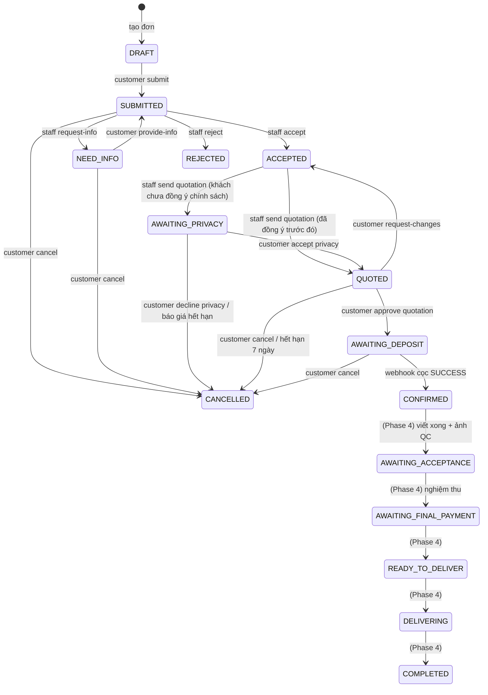

# AI-VHRS – Hướng dẫn kết nối API cho Frontend

> Dành cho: đội FE (web + Flutter) cần biết **gọi API nào, theo thứ tự nào, nhận gì về** để nối giao diện.
> Cập nhật lần cuối: **Phase 3** (xem `../PROJECT_STATUS.md` để biết dự án đang tới đâu).
> Nguồn sự thật tuyệt đối là Swagger (`/docs`): file này giải thích **luồng** và **quy ước**, Swagger cho **schema chi tiết**.

## 1. Kết nối nhanh

| Mục | Giá trị |
|---|---|
| Base URL | `<host>/api/v1` (local: `http://localhost:8000/api/v1`) |
| Swagger UI | `<host>/docs` (bấm **Authorize**, nhập email vào `username`) |
| Health check | `GET /api/v1/health` |
| Content-Type | `application/json` (trừ upload file: PUT thẳng lên link ký sẵn) |
| Xác thực | Header `Authorization: Bearer <access_token>` |
| Thời gian | ISO-8601 có múi giờ (UTC hoặc `+07:00`). FE tự hiển thị giờ VN |
| Tiền | VND, số nguyên. **Decimal trả về dạng chuỗi** (`"399600"`, `"50.00"`): dùng `Number()`/`BigInt`, đừng cộng chuỗi |
| Enum | Chuỗi IN HOA, ví dụ `AWAITING_DEPOSIT` |

Chạy local: `cd BE && source .venv/bin/activate && python -m uvicorn app.main:app --reload --port 8000`.
Tài khoản demo (mật khẩu chung do nhóm giữ): `customer@example.com`, `staff@netviet.vn`, `manager@netviet.vn`, `tech@netviet.vn`, `admin@netviet.vn`.

### Quy ước chung

**Lỗi luôn cùng một dạng** (hiển thị `message` cho người dùng, xử lý logic theo `code`):
```json
{"error": {"code": "INVALID_DEPOSIT", "message": "Tiền cọc phải từ 50% đến 100% ...", "details": {"min_deposit_pct": "50.00"}}}
```
Lỗi nhập liệu (422 `VALIDATION_ERROR`) có `details = [{"field": "quantity", "message": "..."}]`: gắn lỗi vào đúng ô nhập.

**Phân trang**: `?page=1&page_size=20` → `{items, total, page, page_size}`.

**Mã HTTP**: `401` chưa đăng nhập/hết phiên · `403` sai vai trò · `404` không tồn tại **hoặc không phải của bạn** (cố ý, để không lộ dữ liệu người khác) · `409` sai trạng thái/xung đột · `422` dữ liệu sai · `429` gọi quá nhanh (đọc header `Retry-After`) · `503` dịch vụ phụ chưa cấu hình.

**Phân biệt 403 và 404**: gọi sai vai trò → 403. Gọi đúng vai trò nhưng đơn của người khác → 404.

## 2. Vai trò và phạm vi

| Vai trò | Làm được gì | Không làm được |
|---|---|---|
| `CUSTOMER` | Tạo/sửa/gửi/huỷ đơn của mình, duyệt báo giá, đặt cọc, chat | Xem đơn người khác, bất kỳ API `/workshop`, `/manager` |
| `STAFF` | Hàng đợi, nhận/tiếp nhận/từ chối đơn, phác thảo AI, lập & gửi báo giá, chat | Đơn của Staff khác, `/manager/*`, đổi bảng giá |
| `MANAGER` | Mọi thứ của Staff trên **mọi** đơn đã gửi + phân công, duyệt giá vượt ngưỡng, vật tư/tồn kho/mẫu chữ/robot/bảng giá, lập lịch sản xuất | (Chưa có API Technical/Admin riêng ở đây) |
| `TECHNICAL_STAFF` | *(Phase 4)* xem job được giao, gói job, nhật ký | Chưa có endpoint |
| `ADMIN` | Tài khoản, vai trò, nhật ký hệ thống (`/admin/*`) | **Không** xem/sửa đơn, giá, sản xuất (BR-02) |

Bản nháp (`DRAFT`) chỉ chủ đơn thấy; xưởng không thấy cho tới khi khách bấm gửi.

## 3. Xác thực

```
POST /auth/register     {email, password(≥8, đủ mạnh), full_name, phone?}  → AccountOut
POST /auth/login        {email, password}  → {access_token, refresh_token, token_type, account{id,role,...}}
POST /auth/refresh      {refresh_token}    → cặp token mới
POST /auth/logout       (Bearer)           → thu hồi phiên hiện tại
GET  /me                → AccountOut        PATCH /me {full_name?, phone?, addresses?}
POST /me/change-password, POST /auth/password-reset/request|confirm
```
- Access token sống **30 phút**, refresh token **7 ngày**. Lưu refresh token an toàn (Flutter: secure storage; web: ưu tiên bộ nhớ/`httpOnly` nếu có BFF).
- Khi nhận `401` với `code` = `TOKEN_EXPIRED` hoặc `NOT_AUTHENTICATED` → gọi `/auth/refresh` **một lần**, thử lại request; refresh cũng lỗi → về màn đăng nhập.
- Sai mật khẩu 5 lần → `423 ACCOUNT_TEMP_LOCKED` (khoá tạm 15 phút).
- Vai trò lấy từ `account.role` sau login: dùng để chọn menu, **nhưng quyền thật luôn do BE kiểm tra**.

## 4. Vòng đời đơn hàng (state machine)

`order_status` (trạng thái nghiệp vụ) và `production_status` (trạng thái sản xuất) là **hai trường riêng** trong mọi object đơn.



`production_status`: `NOT_STARTED → PENDING_SCHEDULE (sau khi cọc xong) → SCHEDULED (Manager xếp lịch) → PREPARING → WRITING ⇄ PAUSED → WRITTEN → PHOTO_UPLOADED → FINISHED`; nhánh lỗi `FAILED`, `REWRITE_REQUIRED` quay lại `PENDING_SCHEDULE`. Hai bước đầu do Phase 3 làm; từ `PREPARING` trở đi là Phase 4.

### Bảng "trạng thái → màn hình khách thấy → nút được phép"

| `order_status` | Khách thấy | Hành động gọi |
|---|---|---|
| `DRAFT` | Đơn đang soạn | sửa vật tư, nhập nội dung, `submit`, xoá nháp |
| `SUBMITTED` | Chờ xưởng tiếp nhận | `cancel`, chat |
| `NEED_INFO` | Xưởng cần bổ sung (`info_request_note`) | sửa đơn, `provide-info`, `cancel` |
| `REJECTED` | Bị từ chối (`reject_reason`, `reject_note`) | chỉ xem |
| `ACCEPTED` | Xưởng đang làm phác thảo/báo giá | chat |
| `AWAITING_PRIVACY` | **Phải** đọc & đồng ý chính sách riêng tư mới xem được báo giá | `GET /privacy-policy`, `POST /orders/{id}/privacy` |
| `QUOTED` | Xem phác thảo + báo giá (hiệu lực `valid_until`) | `approve`, `request-changes`, `cancel` |
| `AWAITING_DEPOSIT` | Chờ cọc (`deposit_amount`) | `payments/deposit`, mock-checkout, `cancel` |
| `CONFIRMED` | Đã cọc, xưởng sắp xếp sản xuất (`production_status` cho biết bước) | chat |
| `CANCELLED` | Đã huỷ (`cancel_reason`) | chỉ xem |

> **Chưa có thông báo đẩy** (Phase 4). FE hiện phải **poll** `GET /orders/{id}` (ví dụ mỗi 15–30 giây ở màn chi tiết đơn) hoặc làm mới khi người dùng mở màn hình.

## 5. Luồng Customer (từ ý tưởng tới đã cọc)

### 5.1 Chuẩn bị đơn
1. **Danh mục** (không cần đăng nhập): `GET /catalog/papers`, `GET /catalog/pens?paper_id=` (chỉ bút tương thích với giấy), `GET /catalog/pens/{id}/inks`, `GET /catalog/templates`, `GET /catalog/templates/{id}/preview?text=...` (ảnh PNG xem thử). Bộ nét đã lưu: `GET /catalog/my-styles`.
2. **Giá ước tính**: `POST /pricing/estimate {order_type, quantity, paper_type_id?, pen_type_id?, ink_color_id?, text? | order_id?}` → `{chars_min, chars_max, price_min, price_max, min_deposit_pct, basis, note}`. Hiển thị **khoảng giá**; không bao giờ bắt khách tự nhập số ký tự (hệ thống tự đếm).
3. **Tạo đơn**: `POST /orders {order_type, quantity}` → đơn `DRAFT`. Loại đơn đang mở cho khách do hệ thống cấu hình: hiện **chỉ `OT1_COPY_RESTORE` và `OT3_TEMPLATE`** (OT-2 bị khoá, lỗi `409 ORDER_TYPE_SUSPENDED`).
4. **Chọn vật tư** `PATCH /orders/{id} {paper_type_id, pen_type_id, ink_color_id | workshop_suggest_materials:true, quantity, customer_note}`; bút/mực sai tương thích → `422 PEN_INCOMPATIBLE / INK_REQUIRES_PEN`. Mọi thay đổi khi còn nháp được **tự lưu** (có `last_saved_at`); danh sách nháp: `GET /orders?status=DRAFT`.
5. **Nội dung theo loại đơn**:

| Loại đơn | Gọi |
|---|---|
| `OT3_TEMPLATE` (viết theo mẫu) | `PUT /orders/{id}/inputs/text {text_content, template_id, font_size_mm?, alignment?}`; vẽ tay: `PUT /orders/{id}/inputs/canvas {canvas_data:{strokes:[{points:[{x,y,p}]}]}}` (x,y theo **mm**) |
| `OT1_COPY_RESTORE` (sao chép) | **Upload ảnh 3 bước** (bên dưới) |

**Upload ảnh/PDF – 3 bước** (jpg/png/pdf, ≤ 20 MB, ≤ 10 tệp):
```
1) POST /orders/{id}/inputs/upload-url {kind:"ORIGINAL_IMAGE", mime_type:"image/jpeg", size_bytes}
      → {input_id, upload_url, method:"PUT", expires_in}
2) PUT <upload_url>   body = file thô, header Content-Type = mime_type      (gọi thẳng Supabase Storage, KHÔNG qua BE, KHÔNG kèm Bearer)
3) POST /orders/{id}/inputs/{input_id}/confirm → InputOut {quality_result, is_quality_warning, ...}
```
Sau `confirm`, BE kiểm tra chất lượng + ước lượng số ký tự; nếu `is_quality_warning` hãy gợi ý chụp lại nhưng vẫn cho đi tiếp. Xoay/cắt: `PATCH .../inputs/{input_id} {rotation_deg, crop_box}`. Mở lại nháp cần ảnh: `GET .../inputs/{input_id}/file` (link hết hạn sau 10 phút, đừng cache lâu).

6. **Gửi đơn**: `POST /orders/{id}/submit {terms_accepted:true}` → `SUBMITTED`. Thiếu nội dung/vật tư → `422 ORDER_INCOMPLETE` (kèm `details` cho biết thiếu gì).

### 5.2 Nhận phác thảo & báo giá
- `NEED_INFO` → khách sửa rồi `POST /orders/{id}/provide-info {terms_accepted:true}`.
- Khi xưởng gửi báo giá, đơn sang `AWAITING_PRIVACY` (hoặc `QUOTED` nếu khách đã đồng ý bản chính sách hiện hành):
  1. `GET /privacy-policy` (public) → `{version, title, body}`; hiển thị toàn văn.
  2. `POST /orders/{id}/privacy {accept:true}` → `QUOTED`. `{accept:false}` → đơn **bị huỷ**; hãy hỏi xác nhận trước khi gọi.
  3. Trước bước này `GET /orders/{id}/quotation` trả `403 PRIVACY_REQUIRED`.
- `GET /orders/{id}/quotation` → `{status, line_items[], options[], final_total, min_deposit_pct, eta, valid_until, pdf_url, sketch{preview_urls[], estimated_writing_sec, ...}}`. `pdf_url` và `preview_urls` là **link hết hạn sau 10 phút**: lấy lại khi cần.
  - Báo giá **1 phương án**: `options` có 1 phần tử. Khách chọn "để xưởng gợi ý" có thể có **2–3 phương án vật tư**: bắt khách chọn 1.
  - `valid_until` quá hạn: lần gọi kế tiếp thấy `status:"EXPIRED"` và đơn `CANCELLED` (đếm ngược 7 ngày trong UI).
- Không đồng ý: `POST /orders/{id}/quotation/request-changes {note}` → đơn về `ACCEPTED`, xưởng lập lại; hoặc `POST /orders/{id}/cancel {reason}`.

### 5.3 Duyệt báo giá và đặt cọc
```
POST /orders/{id}/quotation/approve {option?: 1..3, deposit_pct?: số}      → OrderOut (order_status = AWAITING_DEPOSIT)
      - deposit_pct: từ min_deposit_pct (trong quotation) tới 100; bỏ trống = mức tối thiểu
      - đơn nhiều phương án bắt buộc có `option`
      - OrderOut mới có total_amount, deposit_pct, deposit_amount
POST /orders/{id}/payments/deposit {gateway:"VNPAY"|"MOMO"}                → PaymentOut {id, amount, status:"PENDING", mode:"MOCK", checkout_path, gateway_txn_id}
POST /payments/{payment_id}/mock-checkout {result:"SUCCESS"|"FAILED"}      → {result, status, order_status}
GET  /orders/{id}/payments                                                 → lịch sử giao dịch
```
- **Hiện toàn bộ thanh toán là MOCK** (`mode:"MOCK"`): không có tiền thật. FE nên hiện nhãn "Thanh toán mô phỏng" khi `mode == "MOCK"` và nút "Thanh toán thành công / thất bại" gọi `mock-checkout`.
- Cổng thật sau này sẽ trả URL chuyển hướng; `checkout_path` là chỗ FE đọc để mở trang thanh toán. Kết quả luôn tới BE qua **webhook** (FE không báo kết quả thanh toán cho BE); sau khi thanh toán xong, FE chỉ cần poll `GET /orders/{id}` tới khi `order_status = CONFIRMED`.
- Thất bại (`status:"FAILED"`): đơn vẫn `AWAITING_DEPOSIT`, gọi lại `payments/deposit` để thử lần mới. Gọi lại cùng cổng khi còn giao dịch `PENDING` sẽ **dùng lại** giao dịch đó.
- Cọc xong: `order_status = CONFIRMED`, `production_status = PENDING_SCHEDULE`. Từ đây khách **không tự huỷ online được** (`409 ORDER_CANCEL_UNSUPPORTED`: chính sách hoàn tiền ở Phase 4): hiển thị "Liên hệ xưởng".

### 5.4 Chat trong đơn
```
GET  /orders/{id}/messages?page=&page_size=     → {items[{id,mine,body,attachments[{url,mime}],read_at,created_at}], total, unread}
POST /orders/{id}/messages {body?, attachments?:[{path}]}
POST /orders/{id}/messages/read                  (đánh dấu đã đọc tin của bên kia)
POST /orders/{id}/messages/upload-url {mime_type:"image/jpeg"|"image/png", size_bytes ≤ 5MB} → {path, upload_url, method, expires_in}
```
Gửi ảnh: xin `upload-url` → `PUT` file → `POST messages` với `attachments:[{path}]`. Chat chỉ dùng được sau khi đơn đã gửi (`409 ORDER_NOT_SUBMITTED` nếu chưa) và còn mở (`409 ORDER_CLOSED` khi đơn đã đóng); Staff phải nhận đơn trước khi nhắn (`409 ORDER_NOT_CLAIMED`). Tối đa 2000 ký tự và 5 ảnh mỗi tin.

## 6. Luồng Staff / Manager (`/workshop/*`)

Staff thấy **đơn được giao cho mình + "pool" đơn `SUBMITTED` chưa ai nhận** (chỉ đọc cho tới khi nhận). Manager thấy mọi đơn (trừ nháp).

```
GET  /workshop/orders?status=&order_type=&unassigned=&q=&eta_before=&page=   hàng đợi
GET  /workshop/orders/{id}                      chi tiết: inputs (ảnh có link 10 phút), cảnh báo chất lượng
POST /workshop/orders/{id}/claim                Staff tự nhận (nguyên tử: 1 người thắng, người kia 404/409)
POST /workshop/orders/{id}/accept | reject {reason: TOO_OLD|DAMAGED|MISSING_CONTENT|PROHIBITED_CONTENT|OTHER, note?} | request-info {note}
        (Manager gọi các lệnh này cho đơn trong pool phải kèm staff_id)
PUT  /manager/orders/{id}/assignment {staff_id}      Manager phân công / đổi Staff
```
**Phác thảo (AI thật)** – chỉ khi đơn `ACCEPTED`:
```
POST /workshop/orders/{id}/sketches/generate {paper_size?, approach_note?, seed?}   OT-1: phục dựng nét từ ảnh; OT-3: sinh nét từ font một nét
POST /workshop/orders/{id}/sketches {trajectory, approach_note?, suggested_complexity?}   tải quỹ đạo vẽ tay (OT-2 / chỉnh sửa)
GET  /workshop/orders/{id}/sketches[/{version}]   danh sách / chi tiết (quỹ đạo + preview_urls từng trang)
PATCH .../sketches/{version} {approach_note, suggested_complexity}      POST .../sketches/{version}/finalize   (chốt đúng 1 bản)
```
`SketchOut` có `similarity_score` (độ giống bản gốc, OT-1), `suggested_complexity`, `estimated_writing_sec`, `warnings[]`. Lỗi AI thường gặp: `NO_STROKES_FOUND`, `IMAGE_TOO_NOISY`, `UNSUPPORTED_CHARS` (kèm danh sách ký tự), `TEXT_TOO_LONG`, `AI_TYPE_UNSUPPORTED` (OT-2 không có AI).

**Báo giá** (cần phác thảo đã chốt – BR-22):
```
POST /workshop/orders/{id}/quotations {complexity?, char_count?, options?:[{paper_type_id,pen_type_id,ink_color_id}] (≤3), eta?}
PUT  /workshop/quotations/{qid}/adjustment {adjusted_total, reason}     Staff điều chỉnh trong ngưỡng; vượt ngưỡng → chờ Manager
DELETE /workshop/quotations/{qid}/adjustment
POST /workshop/quotations/{qid}/send   (tạo PDF, hiệu lực 7 ngày)      POST .../cancel      GET .../pdf
GET  /manager/quotations/pending-approval      POST /manager/quotations/{qid}/approve-adjustment | reject-adjustment {reason}
```
- **Ngưỡng điều chỉnh** (mặc định ±15%) và tỷ lệ cọc tối thiểu do Manager cấu hình ở bảng giá (xem 7.2); `adjustment_status`: `NONE | WITHIN_THRESHOLD | PENDING_MANAGER | APPROVED | REJECTED`. Khi `PENDING_MANAGER` không gửi được (`409 APPROVAL_PENDING`).
- Giá nhập tay là **tổng đơn**, bội số 100 đồng; báo giá nhiều phương án **không** điều chỉnh được (`422`).
- Lý do điều chỉnh của Staff **không** hiện cho khách.
- Đọc thêm tiền/lịch của một đơn: `GET /workshop/orders/{id}/payments`, `GET /workshop/orders/{id}/jobs` (chỉ đọc).
- Chat dùng chung endpoint với khách (`/orders/{id}/messages`), tự biết vai trò.

## 7. Luồng Manager (`/manager/*`)

### 7.1 Vật tư, mẫu chữ, robot
| Việc | Endpoint |
|---|---|
| Giấy | `GET/POST /manager/papers`, `PATCH /manager/papers/{id}`, `POST /manager/papers/{id}/stock {mode:"ADD"\|"SET", quantity, reason}` |
| Bút (hồ sơ lực) | `GET/POST /manager/pens`, `PATCH .../{id}`, `POST .../{id}/stock` |
| Mực | `GET /manager/inks?pen_id=`, `POST /manager/pens/{id}/inks`, `PATCH /manager/inks/{id}`, `POST .../stock` |
| Tương thích giấy–bút | `GET /manager/compatibility`, `PUT /manager/compatibility/{paper_id}/{pen_id} {is_compatible, note?}` (thiếu dòng = **không** tương thích) |
| Mẫu chữ | `GET/POST /manager/templates`, `PATCH .../{id}` (bật/tắt qua `is_active`). `font_uri` phải dạng `hershey:<tên>` |
| Bộ nét chờ duyệt | `GET /manager/styles?status=`, `POST .../{id}/approve`, `POST .../{id}/reject {reason}` |
| Robot | `GET/POST /manager/robots`, `PATCH .../{id}`; đặt `MAINTENANCE`/`BROKEN` trả `affected_job_ids` (job cần xếp lại). Không đặt tay `BUSY` |

Không có xoá cứng: dùng `is_active:false` (khách không còn thấy nhưng đơn cũ vẫn tham chiếu được). Mọi thay đổi tồn kho cần `reason` và được ghi nhật ký.

### 7.2 Bảng giá có phiên bản (FR-30)
```
GET  /manager/pricing-config                  phiên bản đang áp dụng
GET  /manager/pricing-config/versions         mọi phiên bản (mới nhất trước)
POST /manager/pricing-config {…chỉ các trường muốn đổi…, note?}   → tạo phiên bản N+1 và áp dụng ngay
```
Trường: `u_ot1/2/3` (đ/ký tự), `w_min`, `s_ot1/2/3` (phí setup), `k_simple/medium/complex`, `discount_tiers[{min_qty,pct}]`, `p_min_pct` (cọc tối thiểu %), `adjust_threshold_pct` (ngưỡng điều chỉnh giá %), `canvas_mm_per_char`. Tiền là bội số 100. Báo giá đã lập **giữ nguyên** giá cũ; chỉ báo giá mới theo phiên bản mới. Lỗi `422 INVALID_PRICING` có `details[{field,message}]`; `422 NO_CHANGES` nếu không đổi gì.

### 7.3 Lập lịch sản xuất (đơn đã cọc)
```
GET  /manager/schedule/queue                       đơn PENDING_SCHEDULE / FAILED / REWRITE_REQUIRED (+ duration_min ước tính)
GET  /manager/orders/{id}/schedule-suggestion      ≤5 gợi ý {robot, technician, slot_start, slot_end, finish_by, eta_risk} + stock_warnings
POST /manager/orders/{id}/schedule {robot_id, technician_id, slot_start, note?}   → JobOut (201)
POST /manager/jobs/{id}/reschedule {robot_id?, technician_id?, slot_start?, reason}   (chỉ khi job còn SCHEDULED)
POST /manager/jobs/{id}/unschedule {reason}
GET  /manager/jobs?status=&robot_id=&technician_id=&from=&to=      (cũng dùng làm lịch/calendar)       GET /manager/jobs/{id}
GET  /manager/technicians                          kỹ thuật viên + số job đang giữ
```
- Thời lượng job = thời gian viết × số lượng + 15' chuẩn bị + 5' chụp ảnh. Giờ làm việc mặc định T2–T7, 08:00–17:00 (UTC+7); job dài tự nối sang ngày làm việc kế.
- `slot_start` **bắt buộc có múi giờ** (ví dụ `2026-10-20T09:00:00+07:00`) và nằm trong giờ làm việc.
- Lỗi cần xử lý trên UI: `409 SLOT_CONFLICT` (`details.resource` = `robot`|`technician`), `409 ROBOT_UNAVAILABLE`, `422 ROBOT_NOT_SUITABLE` (robot không hỗ trợ loại bút), `422 OUTSIDE_WORKING_HOURS`, `422 SLOT_IN_PAST`, `409 JOB_ALREADY_STARTED`.
- Đây chỉ là **lịch**; không điều khiển robot.

## 8. Mã lỗi hay gặp và cách xử lý trên UI

| `code` | HTTP | Ý nghĩa | UI nên |
|---|---|---|---|
| `VALIDATION_ERROR` | 422 | Dữ liệu sai | gắn lỗi theo `details[].field` |
| `NOT_AUTHENTICATED`, `TOKEN_EXPIRED`, `TOKEN_INVALID` | 401 | Phiên hết | refresh 1 lần rồi về đăng nhập |
| `FORBIDDEN` | 403 | Sai vai trò | ẩn tính năng, báo "không có quyền" |
| `ORDER_NOT_FOUND` (và `*_NOT_FOUND`) | 404 | Không có / không phải của bạn | quay danh sách |
| `STATE_CONFLICT` | 409 | Chuyển trạng thái không hợp lệ (đơn đã đổi) | tải lại đơn, báo "đơn đã được cập nhật" |
| `ORDER_TYPE_SUSPENDED` | 409 | Loại đơn đang tạm đóng | ẩn lựa chọn đó |
| `PRIVACY_REQUIRED` | 403 | Chưa đồng ý chính sách | chuyển tới màn chính sách |
| `QUOTATION_NOT_OPEN`, `QUOTATION_EXPIRED` | 409 | Báo giá không còn hiệu lực | tải lại đơn |
| `INVALID_DEPOSIT` | 422 | % cọc ngoài khoảng | hiện `details.min_deposit_pct` |
| `OPTION_REQUIRED`, `INVALID_OPTION` | 422 | Chưa chọn phương án | bắt chọn |
| `DEPOSIT_NOT_EXPECTED`, `DEPOSIT_ALREADY_PAID` | 409 | Sai thời điểm đặt cọc | tải lại đơn |
| `ORDER_CANCEL_UNSUPPORTED` | 409 | Không huỷ online được | "Liên hệ xưởng" |
| `UNSUPPORTED_CHARS`, `TEXT_TOO_LONG`, `FONT_TOO_LARGE`, `CANVAS_OUT_OF_PAPER` | 422 | Nội dung không sinh được nét | nêu lỗi, cho sửa |
| `SLOT_CONFLICT`, `ROBOT_UNAVAILABLE`, `ROBOT_NOT_SUITABLE` | 409/422 | Lịch sản xuất | đổi robot/giờ |
| `STOCK_NEGATIVE`, `NO_CHANGES`, `INVALID_PRICING`, `CODE_TAKEN` | 409/422 | Quản trị danh mục | hiện `message` |
| `RATE_LIMITED` | 429 | Gọi quá nhanh | chờ `Retry-After` giây |
| `STORAGE_NOT_CONFIGURED`, `STORAGE_UNAVAILABLE` | 503 | Chưa/không có kho file | báo lỗi tạm thời |

Danh sách đầy đủ nằm trong Swagger (mục `responses` của từng endpoint) và lệnh liệt kê trong `../PROJECT_STATUS.md` (mục 5).

## 9. Webhook thanh toán (tham khảo, FE không gọi)

`POST /webhooks/payments/{VNPAY|MOMO}` do cổng thanh toán gọi, body JSON ký HMAC-SHA256 ở header `X-Signature`, idempotent theo mã giao dịch. FE **không** gọi endpoint này; với cổng MOCK thì dùng `mock-checkout`. Khi nối cổng thật, FE chỉ thay bước "mở `checkout_path`" bằng chuyển hướng tới URL cổng cấp.

## 10. Chưa có / sẽ có (đừng chờ ở Phase này)

- Technical Staff: xem job, tải gói job, nhật ký, sự cố, ảnh sản phẩm + QC (Phase 4).
- Nghiệm thu, thanh toán cuối, giao hàng, huỷ sau cọc + hoàn tiền, dời ETA, **thông báo (in-app + email)** (Phase 4).
- Admin: tích hợp, tham số hệ thống, dashboard, OTP SMS, showcase, review (Phase 5).
- OT-2 (nét đã học) khoá với khách; AI không sinh phác thảo cho OT-2.
- Độ chính xác dựng nét OT-1 trên chữ viết tay thật **chưa được kiểm chứng**: giao diện nên cho Staff xem/sửa phác thảo trước khi gửi.

## 11. Ví dụ nhanh (fetch)

```js
const api = async (path, {method = "GET", body, token} = {}) => {
  const r = await fetch(`${BASE}/api/v1${path}`, {
    method, headers: {"Content-Type": "application/json", ...(token && {Authorization: `Bearer ${token}`})},
    body: body && JSON.stringify(body)});
  const data = r.status === 204 ? null : await r.json();
  if (!r.ok) throw Object.assign(new Error(data.error.message), data.error, {status: r.status});
  return data;
};
// khách duyệt báo giá rồi đặt cọc mô phỏng
await api(`/orders/${id}/quotation/approve`, {method: "POST", token, body: {deposit_pct: 50}});
const pay = await api(`/orders/${id}/payments/deposit`, {method: "POST", token, body: {gateway: "VNPAY"}});
await api(`/payments/${pay.id}/mock-checkout`, {method: "POST", token, body: {result: "SUCCESS"}});
```
