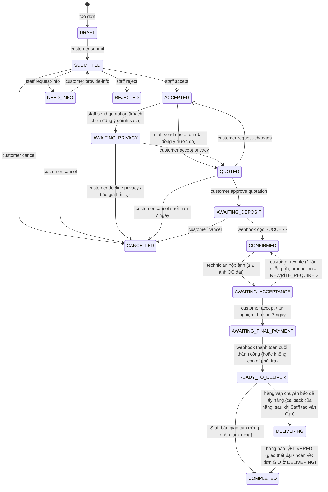

# AI-VHRS – Hướng dẫn kết nối API cho Frontend

> Dành cho: đội FE (web + Flutter) cần biết **gọi API nào, theo thứ tự nào, nhận gì về** để nối giao diện.
> Cập nhật lần cuối: **Phase 3** (xem `../PROJECT_STATUS.md` để biết dự án đang tới đâu).
> Nguồn sự thật tuyệt đối là Swagger (`/docs`): file này giải thích **luồng** và **quy ước**, Swagger cho **schema chi tiết**.

## 1. Kết nối nhanh

| Mục | Giá trị |
|---|---|
| Base URL | `<host>/api/v1` (local: `http://localhost:8000/api/v1`) |
| Swagger UI | `<host>/docs` (bấm **Authorize**, nhập email vào `username`) |
| Health check | `GET /api/v1/health` |
| Content-Type | `application/json` (trừ upload file: PUT thẳng lên link ký sẵn) |
| Xác thực | Header `Authorization: Bearer <access_token>` |
| Thời gian | ISO-8601 có múi giờ (UTC hoặc `+07:00`). FE tự hiển thị giờ VN |
| Tiền | VND, số nguyên. **Decimal trả về dạng chuỗi** (`"399600"`, `"50.00"`): dùng `Number()`/`BigInt`, đừng cộng chuỗi |
| Enum | Chuỗi IN HOA, ví dụ `AWAITING_DEPOSIT` |

Chạy local: `cd BE && source .venv/bin/activate && python -m uvicorn app.main:app --reload --port 8000`.
Tài khoản demo (mật khẩu chung do nhóm giữ): `customer@example.com`, `staff@netviet.vn`, `manager@netviet.vn`, `tech@netviet.vn`, `admin@netviet.vn`.

### Quy ước chung

**Lỗi luôn cùng một dạng** (hiển thị `message` cho người dùng, xử lý logic theo `code`):
```json
{"error": {"code": "INVALID_DEPOSIT", "message": "Tiền cọc phải từ 50% đến 100% ...", "details": {"min_deposit_pct": "50.00"}}}
```
Lỗi nhập liệu (422 `VALIDATION_ERROR`) có `details = [{"field": "quantity", "message": "..."}]`: gắn lỗi vào đúng ô nhập.

**Phân trang**: `?page=1&page_size=20` → `{items, total, page, page_size}`.

**Mã HTTP**: `401` chưa đăng nhập/hết phiên · `403` sai vai trò · `404` không tồn tại **hoặc không phải của bạn** (cố ý, để không lộ dữ liệu người khác) · `409` sai trạng thái/xung đột · `422` dữ liệu sai · `429` gọi quá nhanh (đọc header `Retry-After`) · `503` dịch vụ phụ chưa cấu hình.

**Phân biệt 403 và 404**: gọi sai vai trò → 403. Gọi đúng vai trò nhưng đơn của người khác → 404.

## 2. Vai trò và phạm vi

| Vai trò | Làm được gì | Không làm được |
|---|---|---|
| `CUSTOMER` | Tạo/sửa/gửi/huỷ đơn của mình, duyệt báo giá, đặt cọc, chat, **xem ảnh sản phẩm, nghiệm thu hoặc yêu cầu viết lại** | Xem đơn người khác, bất kỳ API `/workshop`, `/manager` |
| `STAFF` | Hàng đợi, nhận/tiếp nhận/từ chối đơn, phác thảo AI, lập & gửi báo giá, chat với khách | Đơn của Staff khác, `/manager/*`, đổi bảng giá, tự duyệt giá vượt ngưỡng |
| `MANAGER` | **Xem** mọi đơn đã gửi, xem phác thảo/báo giá/chat; **phân công Staff**, **duyệt/từ chối giá vượt ngưỡng**, vật tư/tồn kho/mẫu chữ/duyệt bộ nét/robot, **bảng giá + ngưỡng %**, lập lịch sản xuất | **Không** tiếp nhận/từ chối đơn, tạo phác thảo, lập/chỉnh/gửi báo giá (tách nhiệm vụ: người duyệt không tự làm). **Được** nhắn tin với khách để xử lý khiếu nại |
| `TECHNICAL_STAFF` | Chỉ **job được giao cho mình**: xem job, tải gói job + hash, chuẩn bị, hiệu chuẩn, ghi kết quả mô phỏng, bắt đầu/kết thúc viết, báo sự kiện an toàn, báo sự cố, **tải ảnh sản phẩm + QC rồi nộp ảnh** (`/technician/*`) | Job của người khác (trả `404`), đơn/khách/giá, `/manager/*`. **Không** điều khiển robot |
| `ADMIN` | Tài khoản, vai trò, nhật ký hệ thống (`/admin/*`) | **Không** xem/sửa đơn, giá, sản xuất (BR-02) |

Bản nháp (`DRAFT`) chỉ chủ đơn thấy; xưởng không thấy cho tới khi khách bấm gửi.

### Bảng quyền theo nhóm endpoint (BE kiểm tra từng request)

| Nhóm | Customer | Staff | Manager | Technical | Admin |
|---|:-:|:-:|:-:|:-:|:-:|
| Công khai: `/health`, `/catalog/papers|pens|templates`, `/privacy-policy`, đăng ký/đăng nhập/làm mới/quên mật khẩu | ✔ | ✔ | ✔ | ✔ | ✔ |
| Mọi vai trò đã đăng nhập: `/me*`, `/auth/logout` | ✔ | ✔ | ✔ | ✔ | ✔ |
| `/orders/*` (đơn của mình), `/pricing/estimate`, `/catalog/my-styles`, thanh toán cọc, `/payments/{id}/mock-checkout` | ✔ | ✘ | ✘ | ✘ | ✘ |
| Chat `/orders/{id}/messages` (đọc, gửi, ảnh, đánh dấu đã đọc) | ✔ | ✔ | ✔ (xử lý khiếu nại) | ✘ | ✘ |
| `/workshop/*` **đọc** (GET: hàng đợi, chi tiết, phác thảo, báo giá, PDF, payments, jobs, **product-photos**) | ✘ | ✔ | ✔ | ✘ | ✘ |
| `/workshop/*` **ghi** (claim, accept, reject, request-info, phác thảo, báo giá, điều chỉnh, gửi, huỷ báo giá) | ✘ | ✔ | ✘ | ✘ | ✘ |
| `/manager/*` (phân công, duyệt giá, vật tư, mẫu chữ, robot, bảng giá, lịch sản xuất, **sự cố, nhật ký job**) | ✘ | ✘ | ✔ | ✘ | ✘ |
| `/technician/*` (job của tôi, gói job, hiệu chuẩn, mô phỏng, viết, sự kiện, sự cố, ảnh sản phẩm + QC) | ✘ | ✘ | ✘ | ✔ (chỉ job được giao) | ✘ |
| `/admin/*` (tài khoản, nhật ký hệ thống) | ✘ | ✘ | ✘ | ✘ | ✔ |
| `POST /webhooks/payments/{gateway}` | không dùng token: xác thực bằng chữ ký HMAC | | | | |

**Cách hoạt động:** đăng nhập → nhận `access_token` (JWT) → gắn `Authorization: Bearer <token>` vào MỌI request. BE giải token, **đọc lại tài khoản và phiên từ DB mỗi lần** (khoá tài khoản, đăng xuất, đổi vai trò có hiệu lực ngay) và lấy **vai trò từ DB, không từ nội dung token**. Thiếu/sai/hết hạn token → `401`; đúng token nhưng sai vai trò → `403 FORBIDDEN`. Bảng trên được test tự động cho **từng route** (`tests/test_permission_matrix.py`); thêm endpoint mà quên khai báo quyền sẽ làm test đỏ.

## 3. Xác thực

```
POST /auth/register     {email, password(≥8, đủ mạnh), full_name, phone?}  → AccountOut
POST /auth/login        {email, password}  → {access_token, refresh_token, token_type, account{id,role,...}}
POST /auth/google       {id_token}         → cùng dạng như /auth/login (chỉ khách hàng, xem 3.1)
POST /auth/refresh      {refresh_token}    → cặp token mới
POST /auth/logout       (Bearer)           → thu hồi phiên hiện tại
GET  /me                → AccountOut        PATCH /me {full_name?, phone?, addresses?}
POST /me/change-password, POST /auth/password-reset/request|confirm
```
### 3.1 Đăng nhập bằng Google (khách hàng)
1. FE dùng **Google Identity Services** (web) hoặc Google Sign-In SDK (Flutter) với **Web Client ID** của dự án, nhận `credential` (= Google **ID token**).
2. `POST /auth/google {"id_token": "<credential>"}` → trả `{access_token, refresh_token, account}` y như đăng nhập thường; từ đó dùng Bearer như mọi API.
3. Lần đầu: BE tự tạo tài khoản `CUSTOMER` theo email Google (họ tên lấy từ Google). Đã có tài khoản cùng email: đăng nhập vào tài khoản đó (khớp theo email, không phân biệt hoa/thường). Khách có thể đặt mật khẩu sau bằng "Quên mật khẩu".
4. Lỗi: `401 GOOGLE_TOKEN_INVALID` (token sai/hết hạn/không phải của app này), `401 GOOGLE_EMAIL_NOT_VERIFIED`, `403 GOOGLE_NOT_ALLOWED` (email thuộc Staff/Manager/Admin/Technical: dùng email + mật khẩu), `403 ACCOUNT_DISABLED`, `503 GOOGLE_NOT_CONFIGURED` (BE chưa có env `GOOGLE_CLIENT`), `503 GOOGLE_UNAVAILABLE`.
5. FE **không** gửi email/họ tên tự khai: chỉ gửi `id_token`; BE xác minh với Google.

- Access token sống **30 phút**, refresh token **7 ngày**. Lưu refresh token an toàn (Flutter: secure storage; web: ưu tiên bộ nhớ/`httpOnly` nếu có BFF).
- Khi nhận `401` với `code` = `TOKEN_EXPIRED` hoặc `NOT_AUTHENTICATED` → gọi `/auth/refresh` **một lần**, thử lại request; refresh cũng lỗi → về màn đăng nhập.
- Sai mật khẩu 5 lần → `423 ACCOUNT_TEMP_LOCKED` (khoá tạm 15 phút).
- Vai trò lấy từ `account.role` sau login: dùng để chọn menu, **nhưng quyền thật luôn do BE kiểm tra**.

## 4. Vòng đời đơn hàng (state machine)

`order_status` (trạng thái nghiệp vụ) và `production_status` (trạng thái sản xuất) là **hai trường riêng** trong mọi object đơn.



`production_status`: `NOT_STARTED → PENDING_SCHEDULE (sau khi cọc xong) → SCHEDULED (Manager xếp lịch) → PREPARING → WRITING ⇄ PAUSED → WRITTEN → PHOTO_UPLOADED → FINISHED`; nhánh lỗi `FAILED`, `REWRITE_REQUIRED` quay lại `PENDING_SCHEDULE`. Hai bước đầu do Phase 3 làm; từ `PREPARING` trở đi là Phase 4.

### Bảng "trạng thái → màn hình khách thấy → nút được phép"

| `order_status` | Khách thấy | Hành động gọi |
|---|---|---|
| `DRAFT` | Đơn đang soạn | sửa vật tư, nhập nội dung, `submit`, xoá nháp |
| `SUBMITTED` | Chờ xưởng tiếp nhận | `cancel`, chat |
| `NEED_INFO` | Xưởng cần bổ sung (`info_request_note`) | sửa đơn, `provide-info`, `cancel` |
| `REJECTED` | Bị từ chối (`reject_reason`, `reject_note`) | chỉ xem |
| `ACCEPTED` | Xưởng đang làm phác thảo/báo giá | chat |
| `AWAITING_PRIVACY` | **Phải** đọc & đồng ý chính sách riêng tư mới xem được báo giá | `GET /privacy-policy`, `POST /orders/{id}/privacy` |
| `QUOTED` | Xem phác thảo + báo giá (hiệu lực `valid_until`) | `approve`, `request-changes`, `cancel` |
| `AWAITING_DEPOSIT` | Chờ cọc (`deposit_amount`) | `payments/deposit`, mock-checkout, `cancel` |
| `CONFIRMED` | Đã cọc, xưởng sắp xếp sản xuất (`production_status` cho biết bước; `REWRITE_REQUIRED` = đang viết lại) | chat |
| `AWAITING_ACCEPTANCE` | Sản phẩm đã viết xong, có ảnh thật để nghiệm thu (`awaiting_acceptance_at`) | `GET /orders/{id}/product-photos`, `accept`, `rewrite` (xem mục 7c). **Không huỷ được ở bước này** |
| `AWAITING_FINAL_PAYMENT` | Đã nghiệm thu (`accepted_product_at`); chờ thanh toán phần còn lại | `GET delivery-quote`, `PUT delivery`, `POST payments/final`, mock-checkout (mục 7d) |
| `READY_TO_DELIVER` | Đã thanh toán đủ; chờ nhận tại xưởng (`pickup_slot_*`) hoặc chờ hãng vận chuyển lấy hàng (`shipping_carrier`, `shipping_service_code`, `shipping_eta`) | chỉ xem. Nhận tại xưởng: Staff bàn giao → `COMPLETED`. Giao hàng: Staff tạo vận đơn, khách theo dõi bằng `GET /orders/{id}/shipment` (mục 7e) |
| `DELIVERING` | Hãng đã nhận hàng, đang giao; hiện mã vận đơn và `tracking_url` | `GET /orders/{id}/shipment`; giao thất bại thì đơn vẫn ở đây và Staff tạo vận đơn mới |
| `COMPLETED` | Đã nhận hàng (`completed_at`) | `POST /orders/{id}/receipt` (ghi `received_confirmed_at`), đánh giá (Phase 5) |
| `CANCELLED` | Đã huỷ (`cancel_reason`) | chỉ xem |

> **Chưa có thông báo đẩy** (Phase 4). FE hiện phải **poll** `GET /orders/{id}` (ví dụ mỗi 15–30 giây ở màn chi tiết đơn) hoặc làm mới khi người dùng mở màn hình.

## 5. Luồng Customer (từ ý tưởng tới đã cọc)

### 5.1 Chuẩn bị đơn
1. **Danh mục** (không cần đăng nhập): `GET /catalog/papers`, `GET /catalog/pens?paper_id=` (chỉ bút tương thích với giấy), `GET /catalog/pens/{id}/inks`, `GET /catalog/templates`, `GET /catalog/templates/{id}/preview?text=...` (ảnh PNG xem thử). Bộ nét đã lưu: `GET /catalog/my-styles`.
2. **Giá ước tính**: `POST /pricing/estimate {order_type, quantity, paper_type_id?, pen_type_id?, ink_color_id?, text? | order_id?}` → `{chars_min, chars_max, price_min, price_max, min_deposit_pct, basis, note}`. Hiển thị **khoảng giá**; không bao giờ bắt khách tự nhập số ký tự (hệ thống tự đếm).
3. **Tạo đơn**: `POST /orders {order_type, quantity}` → đơn `DRAFT`. Loại đơn đang mở cho khách do hệ thống cấu hình: hiện **chỉ `OT1_COPY_RESTORE` và `OT3_TEMPLATE`** (OT-2 bị khoá, lỗi `409 ORDER_TYPE_SUSPENDED`).
4. **Chọn vật tư theo thứ tự giấy → bút → mực.** Sau khi khách chọn giấy, gọi **`GET /catalog/suggest-materials?paper_type_id=`** (công khai) → `{paper, pens:[{id,name,category,surcharge,..., inks:[{id,name,hex_code,unit_price}]}]}`: chỉ gồm các bút **tương thích** với giấy đó, mỗi bút kèm màu mực còn bán; hiển thị để khách chọn (không cần gọi thêm `/catalog/pens` và `/pens/{id}/inks`). Khách không thể chọn bút/mực không phù hợp (BE từ chối `422 PEN_INCOMPATIBLE`), nên không cần cảnh báo chất lượng.
   **"Để xưởng chọn"** (`workshop_suggest_materials:true`): khách **giữ nguyên** những gì đã chọn (có thể chỉ chọn giấy, hoặc giấy + bút) và để trống phần còn lại; Staff chỉ điền phần thiếu (bút, mực… vẫn theo luật tương thích) và đề xuất 1–3 phương án, khách chọn một khi duyệt báo giá. Chọn đủ cả ba thì không còn gì để xưởng đề xuất.
   `PATCH /orders/{id} {paper_type_id, pen_type_id, ink_color_id | workshop_suggest_materials:true, quantity, customer_note}`; bút/mực sai tương thích → `422 PEN_INCOMPATIBLE / INK_REQUIRES_PEN`. Mọi thay đổi khi còn nháp được **tự lưu** (có `last_saved_at`); danh sách nháp: `GET /orders?status=DRAFT`.
5. **Nội dung theo loại đơn**:

| Loại đơn | Gọi |
|---|---|
| `OT3_TEMPLATE` (viết theo mẫu) | `PUT /orders/{id}/inputs/text {text_content, template_id, font_size_mm?, alignment?}`; vẽ tay: `PUT /orders/{id}/inputs/canvas {canvas_data:{strokes:[{points:[{x,y,p}]}]}}` (x,y theo **mm**) |
| `OT1_COPY_RESTORE` (sao chép) | **Upload ảnh 3 bước** (bên dưới) |

**Upload ảnh/PDF – 3 bước** (jpg/png/pdf, ≤ 20 MB, ≤ 10 tệp):
```
1) POST /orders/{id}/inputs/upload-url {kind:"ORIGINAL_IMAGE", mime_type:"image/jpeg", size_bytes}
      → {input_id, upload_url, method:"PUT", expires_in}
2) PUT <upload_url>   body = file thô, header Content-Type = mime_type      (gọi thẳng Supabase Storage, KHÔNG qua BE, KHÔNG kèm Bearer)
3) POST /orders/{id}/inputs/{input_id}/confirm → InputOut {quality_result, is_quality_warning, ...}
```
Sau `confirm`, BE kiểm tra chất lượng + ước lượng số ký tự; nếu `is_quality_warning` hãy gợi ý chụp lại nhưng vẫn cho đi tiếp. Xoay/cắt: `PATCH .../inputs/{input_id} {rotation_deg, crop_box}`. Mở lại nháp cần ảnh: `GET .../inputs/{input_id}/file` (link hết hạn sau 10 phút, đừng cache lâu).

6. **Gửi đơn**: `POST /orders/{id}/submit {terms_accepted:true}` → `SUBMITTED`. Thiếu nội dung/vật tư → `422 ORDER_INCOMPLETE` (kèm `details` cho biết thiếu gì).

### 5.2 Nhận phác thảo & báo giá
- `NEED_INFO` → khách sửa rồi `POST /orders/{id}/provide-info {terms_accepted:true}`.
- Khi xưởng gửi báo giá, đơn sang `AWAITING_PRIVACY` (hoặc `QUOTED` nếu khách đã đồng ý bản chính sách hiện hành):
  1. `GET /privacy-policy` (public) → `{version, title, body}`; hiển thị toàn văn.
  2. `POST /orders/{id}/privacy {accept:true}` → `QUOTED`. `{accept:false}` → đơn **bị huỷ**; hãy hỏi xác nhận trước khi gọi.
  3. Trước bước này `GET /orders/{id}/quotation` trả `403 PRIVACY_REQUIRED`.
- `GET /orders/{id}/quotation` → `{status, line_items[], options[], final_total, min_deposit_pct, eta, valid_until, pdf_url, sketch{preview_urls[], estimated_writing_sec, ...}}`. `pdf_url` và `preview_urls` là **link hết hạn sau 10 phút**: lấy lại khi cần.
  - Báo giá **1 phương án**: `options` có 1 phần tử. Khách chọn "để xưởng gợi ý" có thể có **2–3 phương án vật tư**: bắt khách chọn 1.
  - `valid_until` quá hạn: lần gọi kế tiếp thấy `status:"EXPIRED"` và đơn `CANCELLED` (đếm ngược 7 ngày trong UI).
- Không đồng ý: `POST /orders/{id}/quotation/request-changes {note}` → đơn về `ACCEPTED`, xưởng lập lại; hoặc `POST /orders/{id}/cancel {reason}`.

### 5.3 Duyệt báo giá và đặt cọc
```
POST /orders/{id}/quotation/approve {option?: 1..3, deposit_pct?: số}      → OrderOut (order_status = AWAITING_DEPOSIT)
      - deposit_pct: từ min_deposit_pct (trong quotation) tới 100; bỏ trống = mức tối thiểu
      - đơn nhiều phương án bắt buộc có `option`
      - OrderOut mới có total_amount, deposit_pct, deposit_amount
POST /orders/{id}/payments/deposit {gateway:"VNPAY"|"MOMO"}                → PaymentOut {id, amount, status:"PENDING", mode:"MOCK", checkout_path, gateway_txn_id}
POST /payments/{payment_id}/mock-checkout {result:"SUCCESS"|"FAILED"}      → {result, status, order_status}
GET  /orders/{id}/payments                                                 → lịch sử giao dịch
```
- **Hai chế độ (xem mục 5.3b):** mặc định thanh toán là **MOCK**; khi máy chủ bật cổng thật thì `mode` là `SANDBOX` (môi trường thử của VNPay/MoMo) hoặc `LIVE` (tiền thật) và giao dịch trả `pay_url`. Phần dưới mô tả MOCK.
- **Thanh toán MOCK** (`mode:"MOCK"`): không có tiền thật. FE nên hiện nhãn "Thanh toán mô phỏng" khi `mode == "MOCK"` và nút "Thanh toán thành công / thất bại" gọi `mock-checkout`.
- Cổng thật sau này sẽ trả URL chuyển hướng; `checkout_path` là chỗ FE đọc để mở trang thanh toán. Kết quả luôn tới BE qua **webhook** (FE không báo kết quả thanh toán cho BE); sau khi thanh toán xong, FE chỉ cần poll `GET /orders/{id}` tới khi `order_status = CONFIRMED`.
- Thất bại (`status:"FAILED"`): đơn vẫn `AWAITING_DEPOSIT`, gọi lại `payments/deposit` để thử lần mới. Gọi lại cùng cổng khi còn giao dịch `PENDING` sẽ **dùng lại** giao dịch đó.
- Cọc xong: `order_status = CONFIRMED`, `production_status = PENDING_SCHEDULE`. Từ đây khách **không tự huỷ online được** (`409 ORDER_CANCEL_UNSUPPORTED`: chính sách hoàn tiền ở Phase 4): hiển thị "Liên hệ xưởng".

### 5.3b Thanh toán thật qua VNPay / MoMo (Phase 4c-2a)

`PAYMENT_MODE` của máy chủ quyết định: `mock` (mặc định), `sandbox` (cổng thử, tiền thử), `live` (tiền thật). FE đọc cổng nào dùng được và chế độ hiện tại:

```
GET  /payments/gateways                          → [{gateway: "VNPAY"|"MOMO", mode: "MOCK"|"SANDBOX"|"LIVE", enabled: bool}]   (khách; chỉ hiện cổng enabled)
POST /orders/{id}/payments/deposit {gateway}     → PaymentOut        (cọc)
POST /orders/{id}/payments/final   {gateway, expected_total?}        (thanh toán cuối, mục 7d)
POST /payments/{id}/refresh                      → {result, status, order_status}   hỏi cổng khi IPN trễ/mất
```
- **MOCK**: `PaymentOut.checkout_path` có giá trị, nút "thanh toán thử" gọi `mock-checkout` (như trên). `pay_url` là `null`.
- **SANDBOX / LIVE**: `PaymentOut.pay_url` là địa chỉ trang thanh toán của cổng, `pay_url_expires_at` là hạn (mặc định 15 phút); `checkout_path` là `null`. **FE chuyển trình duyệt của khách tới `pay_url`** (`window.location = pay_url`). `mock-checkout` bị từ chối (`409 NOT_A_MOCK_PAYMENT`).
- Sau khi trả tiền, cổng đưa khách về **trang kết quả của web app** (`PAYMENT_RETURN_URL`, hiện là `https://ai-vhrs.vercel.app/payment/result`; BE gắn thêm `?order_id=`) kèm tham số của cổng. **Đừng tin các tham số đó**: trang kết quả chỉ để hiển thị. Kết quả thật tới BE qua IPN của cổng. Trang kết quả nên: gọi `GET /orders/{id}` mỗi 2–3 giây tới khi `order_status` đổi (`CONFIRMED` sau cọc; `READY_TO_DELIVER` sau thanh toán cuối) tối đa ~30 giây; nếu giao dịch vẫn `PENDING`, gọi **`POST /payments/{id}/refresh`** một lần (BE hỏi thẳng cổng). `result`: `PROCESSED` (vừa cập nhật), `ALREADY_PROCESSED`, `IGNORED` + `status:"PENDING"` (cổng chưa có kết quả cuối).
- **Việc FE phải làm để thanh toán thật chạy (chưa làm, ghi cho team FE):**
  1. **Trang kết quả `/payment/result`** (hiện FE chưa có; chỉ có `/orders/:id/review` và `/orders/:id/deposit`). BE tự gắn `?order_id=<id đơn>` vào địa chỉ này, cổng thêm tham số của họ (VNPay `vnp_*`, MoMo `orderId`, `resultCode`...). Trang đọc `order_id` rồi làm theo đoạn trên (poll `GET /orders/{id}`, tối đa ~30 giây; còn `PENDING` thì `POST /payments/{id}/refresh` một lần với `id` lấy từ `GET /orders/{id}/payments`); xong thì chuyển khách về `/orders/{id}/review` (hoặc trang đơn). Không dùng tham số của cổng để quyết định đã trả tiền.
  2. **`Deposit.tsx`**: hiện chỉ chạy luồng mock (`startDeposit` rồi `mock-checkout`). Khi `PaymentOut.pay_url` khác `null` thì `window.location.assign(pay_url)` và không gọi `mock-checkout`; thêm `pay_url`, `pay_url_expires_at` vào kiểu `Payment` trong `services/orders.ts`; nhãn "MOCK" chỉ hiện khi `mode === "MOCK"`.
  3. **Rewrite cho SPA trên Vercel** (hiện chưa có `vercel.json`): `{"rewrites":[{"source":"/(.*)","destination":"/index.html"}]}`. Thiếu thì cổng đưa khách về `/payment/result` sẽ bị 404.
  4. Màn **thanh toán cuối**, **chọn hãng + dịch vụ vận chuyển** (`POST /orders/{id}/delivery-quote`) và **xem vận đơn** (mục 7d, 7e) cũng chưa có trên FE.
- Giao dịch `FAILED` (khách huỷ/hết hạn trên cổng): đơn vẫn chờ, gọi lại endpoint thanh toán để tạo giao dịch mới. Gọi lại khi liên kết cũ còn hạn sẽ **dùng lại** giao dịch đó; hết hạn hoặc đổi cổng thì giao dịch cũ bị huỷ và tạo cái mới.
- `needs_refund: true` trên một giao dịch nghĩa là tiền đã về một giao dịch đã bị huỷ (khách trả muộn sau khi đổi ý): BE giữ bản ghi để hoàn tiền (Phase 4d); hãy hiện "Liên hệ xưởng".
- Lỗi riêng: `503 GATEWAY_NOT_CONFIGURED` (cổng chưa cấu hình trên máy chủ), `502 GATEWAY_UNAVAILABLE` / `502 GATEWAY_REJECTED` (cổng lỗi hoặc từ chối tạo giao dịch; không tạo giao dịch nào), `403 MOCK_WEBHOOK_DISABLED` (webhook mô phỏng bị tắt khi dùng cổng thật), `409 NOT_A_REAL_PAYMENT` (refresh giao dịch mô phỏng).
- FE **không** gọi các IPN: `GET /webhooks/payments/vnpay/ipn` và `POST /webhooks/payments/momo/ipn` là của cổng (xem mục 9).

### 5.4 Chat trong đơn
```
GET  /orders/{id}/messages?page=&page_size=     → {items[{id,mine,body,attachments[{url,mime}],read_at,created_at}], total, unread}
POST /orders/{id}/messages {body?, attachments?:[{path}]}
POST /orders/{id}/messages/read                  (đánh dấu đã đọc tin của bên kia)
POST /orders/{id}/messages/upload-url {mime_type:"image/jpeg"|"image/png", size_bytes ≤ 5MB} → {path, upload_url, method, expires_in}
```
Gửi ảnh: xin `upload-url` → `PUT` file → `POST messages` với `attachments:[{path}]`. Chat chỉ dùng được sau khi đơn đã gửi (`409 ORDER_NOT_SUBMITTED` nếu chưa) và còn mở (`409 ORDER_CLOSED` khi đơn đã đóng); Staff phải nhận đơn trước khi nhắn (`409 ORDER_NOT_CLAIMED`). Tối đa 2000 ký tự và 5 ảnh mỗi tin.

## 6. Luồng Staff (`/workshop/*`; Manager chỉ đọc ở nhóm này)

Staff thấy **đơn được giao cho mình + "pool" đơn `SUBMITTED` chưa ai nhận** (chỉ đọc cho tới khi nhận). Manager **chỉ đọc** mọi đơn (trừ nháp); mọi thao tác ghi trong `/workshop/*` là của Staff. Đơn mới trong pool: Staff tự `claim`, hoặc Manager `PUT /manager/orders/{id}/assignment` giao cho một Staff.

```
GET  /workshop/orders?status=&order_type=&unassigned=&q=&eta_before=&page=   hàng đợi
GET  /workshop/orders/{id}                      chi tiết: inputs (ảnh có link 10 phút), cảnh báo chất lượng
POST /workshop/orders/{id}/claim                Staff tự nhận (nguyên tử: 1 người thắng, người kia 404/409)
POST /workshop/orders/{id}/accept | reject {reason: TOO_OLD|DAMAGED|MISSING_CONTENT|PROHIBITED_CONTENT|OTHER, note?} | request-info {note}
        (chỉ STAFF; Manager gọi các lệnh ghi này nhận 403)
PUT  /manager/orders/{id}/assignment {staff_id}      Manager phân công / đổi Staff
```
**Phác thảo (AI thật)** – chỉ khi đơn `ACCEPTED`:
```
POST /workshop/orders/{id}/sketches/generate {paper_size?, approach_note?, seed?}   OT-1: phục dựng nét từ ảnh; OT-3: sinh nét từ font một nét
POST /workshop/orders/{id}/sketches {trajectory, approach_note?, suggested_complexity?}   tải quỹ đạo vẽ tay (OT-2 / chỉnh sửa)
GET  /workshop/orders/{id}/sketches[/{version}]   danh sách / chi tiết (quỹ đạo + preview_urls từng trang)
PATCH .../sketches/{version} {approach_note, suggested_complexity}      POST .../sketches/{version}/finalize   (chốt đúng 1 bản)
```
`SketchOut` có `similarity_score` (độ giống bản gốc, OT-1), `suggested_complexity`, `estimated_writing_sec`, `warnings[]`. Lỗi AI thường gặp: `NO_STROKES_FOUND`, `IMAGE_TOO_NOISY`, `UNSUPPORTED_CHARS` (kèm danh sách ký tự), `TEXT_TOO_LONG`, `AI_TYPE_UNSUPPORTED` (OT-2 không có AI).

**Báo giá** (cần phác thảo đã chốt – BR-22):
```
POST /workshop/orders/{id}/quotations {complexity?, char_count?, options?:[{paper_type_id,pen_type_id,ink_color_id}] (≤3), eta?}
PUT  /workshop/quotations/{qid}/adjustment {adjusted_total, reason}     Staff điều chỉnh trong ngưỡng; vượt ngưỡng → chờ Manager
DELETE /workshop/quotations/{qid}/adjustment
POST /workshop/quotations/{qid}/send   (tạo PDF, hiệu lực 7 ngày)      POST .../cancel      GET .../pdf
GET  /manager/quotations/pending-approval      POST /manager/quotations/{qid}/approve-adjustment | reject-adjustment {reason}
```
- **Ngưỡng điều chỉnh** (mặc định ±15%) và tỷ lệ cọc tối thiểu do Manager cấu hình ở bảng giá (xem 7.2). Ngưỡng so **giá Staff nhập** với **giá hệ thống tính** của chính báo giá đó (không so với giá ước tính lúc khách đặt đơn). Giá không chỉnh thì gửi thẳng, không cần duyệt. Manager **không** tự chỉnh giá: giá vượt ngưỡng do Staff đặt, Manager duyệt/từ chối. `adjustment_status`: `NONE | WITHIN_THRESHOLD | PENDING_MANAGER | APPROVED | REJECTED`. Khi `PENDING_MANAGER` không gửi được (`409 APPROVAL_PENDING`).
- **Vật tư khi khách chọn "để xưởng chọn"**: `GET /workshop/orders/{id}/material-suggestions` → `{fixed (phần khách đã chọn), combos[{paper,pen,ink ids + tên}], total}` liệt kê các tổ hợp còn đề xuất được. Tạo báo giá `options:[{paper_type_id?,pen_type_id?,ink_color_id?}]` chỉ cần ghi **phần còn thiếu**; đổi thứ khách đã chọn → `422 MATERIAL_LOCKED_BY_CUSTOMER` (`details.field`), thiếu/không tương thích → `422 INVALID_MATERIALS`.
- Giá nhập tay là **tổng đơn**, bội số 100 đồng; báo giá nhiều phương án **không** điều chỉnh được (`422`).
- Lý do điều chỉnh của Staff **không** hiện cho khách.
- Đọc thêm tiền/lịch của một đơn: `GET /workshop/orders/{id}/payments`, `GET /workshop/orders/{id}/jobs` (chỉ đọc).
- Chat dùng chung endpoint với khách (`/orders/{id}/messages`); Manager cũng nhắn được cho khách để xử lý khiếu nại.

## 7. Luồng Manager (`/manager/*`)

### 7.1 Vật tư, mẫu chữ, robot
| Việc | Endpoint |
|---|---|
| Giấy | `GET/POST /manager/papers`, `PATCH /manager/papers/{id}`, `POST /manager/papers/{id}/stock {mode:"ADD"\|"SET", quantity, reason}` |
| Bút (hồ sơ lực) | `GET/POST /manager/pens`, `PATCH .../{id}`, `POST .../{id}/stock` |
| Mực | `GET /manager/inks?pen_id=`, `POST /manager/pens/{id}/inks`, `PATCH /manager/inks/{id}`, `POST .../stock` |
| Tương thích giấy–bút | `GET /manager/compatibility`, `PUT /manager/compatibility/{paper_id}/{pen_id} {is_compatible, note?}` (thiếu dòng = **không** tương thích) |
| Mẫu chữ | `GET/POST /manager/templates`, `PATCH .../{id}` (bật/tắt qua `is_active`). `font_uri` phải dạng `hershey:<tên>` |
| Bộ nét chờ duyệt | `GET /manager/styles?status=`, `POST .../{id}/approve`, `POST .../{id}/reject {reason}` |
| Robot | `GET/POST /manager/robots`, `PATCH .../{id}`; đặt `MAINTENANCE`/`BROKEN` trả `affected_job_ids` (job cần xếp lại). Không đặt tay `BUSY` |

Không có xoá cứng: dùng `is_active:false` (khách không còn thấy nhưng đơn cũ vẫn tham chiếu được). Mọi thay đổi tồn kho cần `reason` và được ghi nhật ký.

### 7.2 Bảng giá có phiên bản (FR-30)
```
GET  /manager/pricing-config                  phiên bản đang áp dụng
GET  /manager/pricing-config/versions         mọi phiên bản (mới nhất trước)
POST /manager/pricing-config {…chỉ các trường muốn đổi…, note?}   → tạo phiên bản N+1 và áp dụng ngay
```
Trường: `u_ot1/2/3` (đ/ký tự), `w_min`, `s_ot1/2/3` (phí setup), `k_simple/medium/complex`, `discount_tiers[{min_qty,pct}]`, `p_min_pct` (cọc tối thiểu %), `adjust_threshold_pct` (ngưỡng điều chỉnh giá %), `canvas_mm_per_char`. Tiền là bội số 100. Báo giá đã lập **giữ nguyên** giá cũ; chỉ báo giá mới theo phiên bản mới. Lỗi `422 INVALID_PRICING` có `details[{field,message}]`; `422 NO_CHANGES` nếu không đổi gì.

### 7.3 Lập lịch sản xuất (đơn đã cọc)
```
GET  /manager/schedule/queue                       đơn PENDING_SCHEDULE / FAILED / REWRITE_REQUIRED (+ duration_min ước tính)
GET  /manager/orders/{id}/schedule-suggestion      ≤5 gợi ý {robot, technician, slot_start, slot_end, finish_by, eta_risk} + stock_warnings
POST /manager/orders/{id}/schedule {robot_id, technician_id, slot_start, note?}   → JobOut (201)
POST /manager/jobs/{id}/reschedule {robot_id?, technician_id?, slot_start?, reason}   (chỉ khi job còn SCHEDULED)
POST /manager/jobs/{id}/unschedule {reason}
GET  /manager/jobs?status=&robot_id=&technician_id=&from=&to=      (cũng dùng làm lịch/calendar)       GET /manager/jobs/{id}
GET  /manager/technicians                          kỹ thuật viên + số job đang giữ
```
- Thời lượng job = thời gian viết × số lượng + 15' chuẩn bị + 5' chụp ảnh. Giờ làm việc mặc định T2–T7, 08:00–17:00 (UTC+7); job dài tự nối sang ngày làm việc kế.
- `slot_start` **bắt buộc có múi giờ** (ví dụ `2026-10-20T09:00:00+07:00`) và nằm trong giờ làm việc.
- Lỗi cần xử lý trên UI: `409 SLOT_CONFLICT` (`details.resource` = `robot`|`technician`), `409 ROBOT_UNAVAILABLE`, `422 ROBOT_NOT_SUITABLE` (robot không hỗ trợ loại bút), `422 OUTSIDE_WORKING_HOURS`, `422 SLOT_IN_PAST`, `409 JOB_ALREADY_STARTED`.
- Đây chỉ là **lịch**; không điều khiển robot.
- Xem diễn biến sau khi xếp lịch (Phase 4a, chỉ đọc): `GET /manager/jobs/{id}/events` (nhật ký: tải gói, hiệu chuẩn, mô phỏng, tiến độ, dừng khẩn cấp, sự cố), `GET /manager/incidents?resolved=&robot_id=` và `POST /manager/incidents/{id}/resolve {note}`. `JobOut` có thêm `progress_pct`, `downloaded_at`, `started_at`, `finished_at`, `simulation_passed`. Đơn có sự cố quay lại `schedule/queue` với `production_status=FAILED`; đổi trạng thái robot về `AVAILABLE` (API robot) rồi xếp lại như bình thường.

## 7b. Luồng Technical Staff (`/technician/*`) – Phase 4a

Chỉ vai trò `TECHNICAL_STAFF`, chỉ job được giao cho chính mình (job khác → `404 JOB_NOT_FOUND`). **Hiện BE chưa kết nối robot** (sẽ làm khi chủ dự án yêu cầu); BE chỉ ghi nhận và canh trạng thái. Kết quả mô phỏng, tiến độ, lực, dừng khẩn cấp do client báo lên các endpoint dưới đây (web app, máy trạm hoặc nhập tay). Khi nối robot thật, hợp đồng các endpoint này giữ nguyên. Mỗi bước đổi trạng thái job đồng thời đổi `production_status` của đơn (BR-17).

```
SCHEDULED ──prepare──▶ PREPARING ──start──▶ WRITING ◀──RESUME──┐
                          │                    │ │ └─PAUSE/ESTOP/OVER_FORCE/STROKE_LOST/SENSOR_LOST─▶ PAUSED
                          │                    │ └──finish──▶ WRITTEN   (trừ tồn kho)
        PREPARING/WRITING/PAUSED ──báo sự cố──▶ FAILED ──▶ đơn về hàng đợi xếp lại của Manager
```
| Việc | Endpoint |
|---|---|
| Job được giao | `GET /technician/jobs?status=&from=&to=&page=` · `GET /technician/jobs/{id}` (chi tiết + hiệu chuẩn hiện hành + sự cố + `can_start`) |
| Tải gói job (UC-32) | `GET /technician/jobs/{id}/package` → `trajectory_url` (liên kết có chữ ký, hết hạn sau `trajectory_url_expires_in` giây), `package_hash` (SHA-256), `pages`, `paper`, `pen` (hồ sơ lực BR-20: `f_min_n/f_target_n/f_max_n/f_hard_n`, `v_max_mm_s`), `ink_*`, `preview_url`. **Máy trạm phải tính SHA-256 của file tải về và so với `package_hash` trước khi chạy** (khác → MSG14 "Gói job không khớp phác thảo đã duyệt") |
| Chuẩn bị | `POST /technician/jobs/{id}/prepare` (cần đã tải gói; robot phải `AVAILABLE`/`BUSY`) |
| Hiệu chuẩn (FR-44) | `POST /technician/jobs/{id}/calibration {checklist{frame_mounted,paper_clamped,pen_installed,force_zeroed: true}, force_zero_offset, probe_points[{x,y,z}…≥3, P0 P1 P2 không thẳng hàng], frame_transform?, height_map?, force_curve?}` → 201. Bản mới thay bản cũ và **xoá kết quả mô phỏng** (phải mô phỏng lại) |
| Kết quả mô phỏng (FR-45) | `POST /technician/jobs/{id}/simulation {passed, errors[], report?}`; cần đã hiệu chuẩn; `passed:true` mà còn `errors` → 422 |
| Bắt đầu viết (UC-35) | `POST /technician/jobs/{id}/start` – cần: đã tải gói, hiệu chuẩn hiện hành, mô phỏng **đạt**, hash khớp |
| Sự kiện từ máy trạm (UC-36) | `POST /technician/jobs/{id}/events {event_type, stroke_index?, progress_pct?, force_summary?, payload?}` với `PROGRESS` (cần `progress_pct`, không bao giờ giảm), `PAUSE`, `RESUME`, `ESTOP`/`OVER_FORCE`/`STROKE_LOST`/`SENSOR_LOST` (tự chuyển `PAUSED`), `FORCE_SUMMARY {f_mean,f_max,rms_err_pct,in_band_pct,samples}`. Các loại do BE tự ghi (`DOWNLOADED`, `CALIBRATED`, `SIMULATED`, `START`, `WRITTEN`, `INCIDENT`, `HASH_MISMATCH`) → `422 EVENT_NOT_ALLOWED`. `GET .../events` xem nhật ký |
| Viết xong (UC-39) | `POST /technician/jobs/{id}/finish` → `WRITTEN`; trừ tồn kho (giấy = số lượng × số trang, bút 1, mực 1); tồn không đủ thì về 0 và ghi `shortfall` trong sự kiện `WRITTEN`, **không chặn** |
| Báo sự cố (UC-37) | `POST /technician/jobs/{id}/incidents {type: ROBOT\|MATERIAL\|FORCE_MODULE\|OTHER, description, robot_status_after?: MAINTENANCE\|BROKEN}` → 201; job → `FAILED`, đơn → `FAILED` (về hàng đợi Manager). Chỉ khi job đã `PREPARING`/`WRITING`/`PAUSED` |

Lỗi riêng: `404 JOB_NOT_FOUND`, `409 JOB_STATE_CONFLICT` (sai bước; `details.allowed`), `409 JOB_NOT_ACTIVE` (job đã xong/hỏng/huỷ), `409 ORDER_NOT_ACTIVE` (đơn không còn `CONFIRMED`, ví dụ bị huỷ), `409 JOB_NOT_DOWNLOADED`, `409 CALIBRATION_REQUIRED`, `409 SIMULATION_REQUIRED`/`SIMULATION_FAILED`, `409 JOB_HASH_MISMATCH` (MSG14), `409 FILE_MISSING`, `409 ROBOT_UNAVAILABLE`, `422 CHECKLIST_INCOMPLETE`, `422 INVALID_PROBE_POINTS`, `422 SIMULATION_INCONSISTENT`, `422 INVALID_FORCE_SUMMARY`, `422 PROGRESS_REQUIRED`, `422 EVENT_NOT_ALLOWED`, `503 STORAGE_NOT_CONFIGURED`.
Ảnh sản phẩm + QC (UC-38) ở mục 7c; sự cố chưa có ảnh đính kèm.

## 7c. Ảnh sản phẩm, QC và nghiệm thu – Phase 4b

Sau khi `finish` (job `WRITTEN`), kỹ thuật viên chụp ảnh sản phẩm thật, đánh dấu QC rồi nộp; khách xem ảnh và nghiệm thu hoặc yêu cầu viết lại.

```
job WRITTEN ──nộp ≥2 ảnh QC đạt──▶ job PHOTO_UPLOADED + đơn AWAITING_ACCEPTANCE ──accept / quá 7 ngày──▶ job DONE, production FINISHED, đơn AWAITING_FINAL_PAYMENT
     │                                               └──rewrite (khách, 1 lần miễn phí)──▶ job REWRITE_REQUIRED, đơn CONFIRMED + production REWRITE_REQUIRED ─▶ Manager xếp lại (`POST /manager/orders/{id}/schedule`) ─▶ job mới `is_rewrite`
     └──qc-fail (kỹ thuật viên)──▶ job REWRITE_REQUIRED (đơn vẫn CONFIRMED; KHÔNG tính lượt viết lại miễn phí của khách)
```

**Kỹ thuật viên** (`/technician/jobs/{id}/…`, chỉ khi job `WRITTEN`):

| Việc | Endpoint |
|---|---|
| Xin liên kết tải ảnh | `POST …/photos/upload-url {mime_type: image/jpeg\|image/png, size_bytes}` → 201 `{photo_key, upload_url, method: "PUT", expires_in}`. Client `PUT` file thẳng vào `upload_url` |
| Đăng ký ảnh đã tải | `POST …/photos {photo_key, kind: OVERALL\|CLOSE_UP\|OTHER, qc_result?: PASS\|FAIL, qc_note?}` → 201 `{id, kind, qc_result, qc_note, url, url_expires_in}`. BE đọc lại file, kiểm tra loại thật (jpg/png), ≤ `max_upload_mb`, cạnh dài ≥ **1280 px**; sai thì xoá file và trả lỗi, không để lại bản ghi. Gọi lại cùng `photo_key` an toàn |
| Đánh dấu QC | `PATCH …/photos/{photo_id} {qc_result, qc_note}` (**FAIL bắt buộc có ghi chú**) |
| Xoá ảnh | `DELETE …/photos/{photo_id}` → 204 (xoá mềm; ảnh đã xoá không tính vào BR-21 và không đăng ký lại được) |
| Danh sách ảnh | `GET …/photos` (kèm liên kết xem có chữ ký) |
| Nộp ảnh | `POST …/photos/submit` – cần ≥ 2 ảnh, **có cả OVERALL và CLOSE_UP**, mọi ảnh còn lại QC = PASS (BR-21). Thành công: job `PHOTO_UPLOADED`, đơn `AWAITING_ACCEPTANCE`, khách được báo (MSG12) |
| Sản phẩm không đạt | `POST …/qc-fail {note}` → job `REWRITE_REQUIRED`, đơn vào hàng đợi xếp lịch của Manager |

Tối đa 10 ảnh/job. Lỗi: `409 PHOTO_REQUIREMENTS_NOT_MET` (`details`: `photos`, `missing_kinds`, `failed`, `unchecked`), `409 UPLOAD_NOT_FOUND`, `409 PHOTO_REMOVED`, `409 JOB_STATE_CONFLICT` (job không ở `WRITTEN`), `409 ORDER_NOT_ACTIVE`, `422 INVALID_PHOTO`, `422 PHOTO_TOO_SMALL`, `422 FILE_TOO_LARGE`, `422 TOO_MANY_PHOTOS`, `422 QC_NOTE_REQUIRED`, `422 INVALID_PHOTO_KEY`.

**Khách hàng** (chỉ đơn của mình):

| Việc | Endpoint |
|---|---|
| Xem ảnh thật | `GET /orders/{id}/product-photos` → `{order_status, photos[{id, kind, url, url_expires_in}] (chỉ ảnh QC đạt của lần viết gần nhất), sketch_preview_url (đối chiếu phác thảo), acceptance_due_at, can_accept, can_request_rewrite, free_rewrite_used}`. Dùng từ `AWAITING_ACCEPTANCE`; trước đó `409 PHOTOS_NOT_AVAILABLE` |
| Nghiệm thu | `POST /orders/{id}/accept` → đơn `AWAITING_FINAL_PAYMENT` (`production_status = FINISHED`, `accepted_product_at`) |
| Viết lại | `POST /orders/{id}/rewrite {reason_code: WORKSHOP_ERROR\|DIFFERS_FROM_SKETCH, note (≥5 ký tự)}` → đơn `CONFIRMED`, `production_status = REWRITE_REQUIRED`, `free_rewrite_used = true`. **Chỉ 1 lần miễn phí**; lần 2 trả `409 REWRITE_LIMIT_REACHED` ("liên hệ xưởng"). UI nên ẩn nút khi `can_request_rewrite = false` |

**Tự nghiệm thu:** nếu khách không trả lời trong `auto_accept_days` (mặc định 7 ngày) kể từ `awaiting_acceptance_at` thì đơn được nghiệm thu tự động (hiển thị hạn ở `acceptance_due_at`). BE kiểm tra khi khách đọc hoặc thao tác trên đơn (`GET /orders/{id}/product-photos`, `accept`, `rewrite`); thao tác muộn trả `409 ACCEPTANCE_CLOSED` và đơn đã được nghiệm thu. Chưa có tiến trình chạy nền chủ động và chưa có nhắc nghiệm thu sau 3 ngày (Phase 5 / 4e).
`OrderOut` có thêm `awaiting_acceptance_at`, `accepted_product_at`, `free_rewrite_used`.

**Xưởng:** `GET /workshop/orders/{id}/product-photos` (Staff của đơn, Manager) – mọi ảnh còn hiện của mọi job kèm QC (`job_status`, `qc_result`, `qc_note`). Ảnh chồng với phác thảo (`overlay_url`) **chưa được BE tạo**: client tự chồng `sketch_preview_url` lên ảnh.

## 7d. Thanh toán cuối và nhận hàng – Phase 4c-1

Sau khi nghiệm thu, đơn ở `AWAITING_FINAL_PAYMENT`. Khách **chọn cách nhận**, rồi **thanh toán một lần** `(G − D) + phí ship` (G = tổng, D = tiền cọc). Cổng thanh toán theo `PAYMENT_MODE` (mục 5.3b). Khách **chọn hãng và dịch vụ vận chuyển** như trên các sàn thương mại điện tử (Phase 4c-2b); sau khi thanh toán xong, Staff tạo vận đơn và hãng đưa đơn tới `DELIVERING` rồi `COMPLETED` (mục 7e). Nhận tại xưởng vẫn chạy như trước.

```
AWAITING_FINAL_PAYMENT ──chọn cách nhận──▶ ──POST payments/final──▶ (webhook SUCCESS) ──▶ READY_TO_DELIVER ──Staff bàn giao (mã đơn + SĐT)──▶ COMPLETED
                                                  └─ cọc 100% + nhận tại xưởng: không có gì phải trả → READY_TO_DELIVER ngay (payment_required = false)
```

| Việc | Endpoint |
|---|---|
| Xem phí và dịch vụ cho một **địa chỉ chưa lưu** (FR-21) | `POST /orders/{id}/delivery-quote {address: {...}}` → `services[]` mỗi mục `{carrier: GHN\|GHTK, service_code, service_name, fee, total_due (= G−D + phí), eta, is_fallback_fee, mode}`. Không đổi dữ liệu. **Dùng ngay khi khách nhập xong địa chỉ** để hiện danh sách cho khách chọn |
| Xem phí của đơn | `GET /orders/{id}/delivery-quote` → như trên cho địa chỉ **đã lưu** (chưa lưu: chỉ phí dự phòng) + `{paper_size, package_type, balance, is_fallback_fee, options: {DELIVERY, PICKUP}, chosen, chosen_service}`. Gói: A6/A5 → `FLAT_BOX_A5`, A4 → `FLAT_BOX_A4`. Hãng có API đang tắt/lỗi chỉ có **một** dịch vụ `STANDARD` tính theo bảng phí dự phòng (`is_fallback_fee: true`, `mode: "FALLBACK"`, `eta: null`); `mode` còn lại là `MOCK`/`SANDBOX`/`LIVE` |
| Chọn giao hàng + dịch vụ | `PUT /orders/{id}/delivery {method: "DELIVERY", address: {receiver, phone, street, province_code, district_code, ward_code, province_name?, district_name?, ward_name?, label?}, carrier: "GHN"\|"GHTK", service_code}` → `OrderOut` có `shipping_carrier`, `shipping_service_code`, `shipping_eta`. `carrier` và `service_code` **đi cùng nhau** và phải là một trong các dịch vụ vừa báo (`422 SERVICE_NOT_AVAILABLE` nếu không); **bỏ trống cả hai** = BE chọn dịch vụ rẻ nhất. `province_code/district_code/ward_code` theo mã của **GHN**; GHTK địa chỉ theo **tên**, nên gửi kèm `province_name`, `district_name` (`ward_name`) để GHTK có thể được đề xuất |
| Chọn nhận tại xưởng (FR-23) | `PUT /orders/{id}/delivery {method: "PICKUP", pickup_slot_start, pickup_slot_end (có múi giờ, trong giờ làm việc của xưởng, dài 15–240 phút, trong 30 ngày tới), contact_phone, receiver?}`. SĐT này dùng để đối chiếu khi bàn giao |
| Thanh toán cuối (FR-18) | `POST /orders/{id}/payments/final {gateway: VNPAY\|MOMO, expected_total?}` → 201 `{payment_required, total_due, order_status, payments[]}`. Giao hàng: 2 dòng `FINAL` (G−D) + `SHIPPING` (phí ship); nhận tại xưởng: chỉ `FINAL`. Cọc 100% thì không có dòng `FINAL`. **Hai dòng thuộc một giao dịch cổng**: mock-checkout bằng id của một trong hai dòng đều thanh toán cả hai |
| Mock thanh toán | `POST /payments/{payment_id}/mock-checkout {result: SUCCESS\|FAILED}` (như đặt cọc) → đơn `READY_TO_DELIVER` |
| Bàn giao tại xưởng | **Staff** `POST /workshop/orders/{id}/pickup/confirm {phone}` → đơn `COMPLETED` (`completed_at`). Chỉ Staff của đơn; sai số điện thoại → `422 PICKUP_PHONE_MISMATCH` |
| Xác nhận đã nhận (UC-20) | `POST /orders/{id}/receipt` → chỉ ghi `received_confirmed_at` (cho `DELIVERING` hoặc `COMPLETED`), gọi lại → `409 RECEIPT_ALREADY_CONFIRMED` |

- **`expected_total`** (nên gửi): số tiền khách đã thấy (`total_due` của dịch vụ đã chọn). Phí hãng thay đổi từ lúc đó thì trả `409 FEE_CHANGED` (`details.expected_total`, `details.current_total`) và **không** mở giao dịch nào: hiện số mới cho khách xác nhận lại. Dịch vụ đã chọn không còn khả dụng → `409 SERVICE_NOT_AVAILABLE` (cho khách chọn lại).
- Đổi cách nhận sau khi đã bắt đầu thanh toán: các giao dịch cuối đang chờ bị **huỷ** (webhook muộn của chúng được bỏ qua, `IGNORED`); gọi lại `payments/final` để tạo giao dịch mới theo số tiền mới. Sau khi đã thanh toán thì không đổi được (`409 FINAL_ALREADY_PAID`).
- `GET /orders/{id}/payments` liệt kê cả `FINAL` và `SHIPPING`. `OrderOut` có thêm `delivery_method`, `delivery_address` (nhận tại xưởng: chỉ `{receiver, phone}`), `pickup_slot_start/end`, `received_confirmed_at`, `completed_at`.
- Lỗi riêng: `409 FINAL_PAYMENT_NOT_EXPECTED`, `409 FINAL_ALREADY_PAID`, `409 DELIVERY_NOT_CHOSEN`, `409 DELIVERY_NOT_READY` (đơn chưa có loại giấy), `409 ORDER_NOT_DELIVERED`, `409 RECEIPT_ALREADY_CONFIRMED`, `409 PICKUP_NOT_EXPECTED`, `422 INVALID_ADDRESS` (`details.missing`), `422 INVALID_SLOT`, `422 SLOT_IN_PAST`, `422 SLOT_TOO_FAR`, `422 OUTSIDE_WORKING_HOURS`, `422 INVALID_CONTACT`, `422 PICKUP_PHONE_MISMATCH`, `503 SHIPPING_FEE_UNAVAILABLE` (chưa cấu hình phí cho loại gói), `409 FEE_CHANGED`, `409`/`422 SERVICE_NOT_AVAILABLE`, `422 ADDRESS_NAMES_REQUIRED` (chỉ khi dùng hãng cần tên địa chỉ).

## 7e. Vận đơn và giao hàng – Phase 4c-2c

Khách đã chọn hãng + dịch vụ và đã thanh toán đủ (`READY_TO_DELIVER`). **Staff tạo vận đơn đúng hãng + dịch vụ khách đã chọn**; hãng báo hành trình qua callback; đơn đi theo:

```
READY_TO_DELIVER ──Staff tạo vận đơn (CREATED)──▶ hãng lấy hàng (PICKED_UP/DELIVERING) ──▶ đơn DELIVERING ──hãng báo DELIVERED──▶ đơn COMPLETED
                                                       └─ FAILED / RETURNED: vận đơn đổi trạng thái, ĐƠN GIỮ DELIVERING; Staff tạo lại vận đơn mới
```
| Ai | Việc | Endpoint |
|---|---|---|
| Khách | Theo dõi vận đơn (FR-22), mới nhất trước | `GET /orders/{id}/shipment` → `[{id, carrier, service_code, waybill_code, status, fee (khách đã trả), eta, picked_up_at, delivered_at, mode, tracking_url}]`. `tracking_url` là trang tra cứu của hãng (`null` với vận đơn mô phỏng). Chưa có vận đơn → `[]` |
| Staff | Xem vận đơn + link nhãn PDF (hết hạn sau 10 phút) | `GET /workshop/orders/{id}/shipment` (Staff, Manager đọc) → thêm `package_type, weight_g, is_fallback_fee, carrier_status_raw, to_address, label_link, created_by` |
| Staff | Tạo vận đơn (UC-29) | `POST /workshop/orders/{id}/shipment {note?}` → 201. Đơn phải `READY_TO_DELIVER` (hoặc `DELIVERING` khi vận đơn trước đã `FAILED`/`RETURNED`/`CANCELLED`), hình thức giao hàng, đã có dịch vụ khách chọn, chưa có vận đơn đang sống |
| Staff | Huỷ vận đơn hãng chưa lấy hàng | `POST /workshop/shipments/{id}/cancel {reason}` (chỉ `CREATED`) → `CANCELLED`; sau đó tạo lại |
| Staff | **Demo** hãng báo trạng thái (chỉ vận đơn MOCK) | `POST /workshop/shipments/{id}/mock-event {status: PICKED_UP\|DELIVERING\|DELIVERED\|FAILED\|RETURNED, reason?}` → phát lại đúng callback có chữ ký |
| Hãng | Callback (FE không gọi) | `POST /webhooks/shipments/{GHN\|GHTK}` (mục 9) |

- Vận đơn: `CREATED → PICKED_UP → DELIVERING → DELIVERED`; `FAILED` (có thể giao lại), `RETURNED`, `CANCELLED`. Callback **trùng hoặc cũ hơn** trạng thái hiện tại bị bỏ qua (`ALREADY_PROCESSED`). Chỉ vận đơn **mới nhất** của đơn điều khiển trạng thái đơn.
- **Giao thất bại / hoàn về: đơn vẫn `DELIVERING`.** UI Staff nên hiện "Giao thất bại" và nút "Tạo vận đơn mới" (hoặc liên hệ khách chuyển sang nhận tại xưởng).
- Sau `COMPLETED` khách bấm "Đã nhận hàng" (`POST /orders/{id}/receipt`, chỉ ghi `received_confirmed_at`).
- Lỗi riêng: `409 SHIPMENT_NOT_EXPECTED`, `409 SHIPPING_SERVICE_NOT_CHOSEN`, `409 SHIPMENT_ALREADY_EXISTS` (`details.shipment_id`), `409 SHIPMENT_NOT_CANCELLABLE`, `409 NOT_A_MOCK_SHIPMENT`, `404 SHIPMENT_NOT_FOUND`, `502 CARRIER_REJECTED` / `502 CARRIER_UNAVAILABLE` (hãng từ chối/lỗi: chưa tạo vận đơn), `503 CARRIER_NOT_CONFIGURED`.
- Hãng mặc định là **MOCK** (`mode:"MOCK"`, mã vận đơn dạng `MOCK-GHN-...`, nhãn PDF có chữ MÔ PHỎNG). Khi máy chủ bật hãng thật, `mode` là `SANDBOX`/`LIVE` và hợp đồng API giữ nguyên.

## 8. Mã lỗi hay gặp và cách xử lý trên UI

| `code` | HTTP | Ý nghĩa | UI nên |
|---|---|---|---|
| `VALIDATION_ERROR` | 422 | Dữ liệu sai | gắn lỗi theo `details[].field` |
| `NOT_AUTHENTICATED`, `TOKEN_EXPIRED`, `TOKEN_INVALID` | 401 | Phiên hết | refresh 1 lần rồi về đăng nhập |
| `FORBIDDEN` | 403 | Sai vai trò | ẩn tính năng, báo "không có quyền" |
| `ORDER_NOT_FOUND` (và `*_NOT_FOUND`) | 404 | Không có / không phải của bạn | quay danh sách |
| `STATE_CONFLICT` | 409 | Chuyển trạng thái không hợp lệ (đơn đã đổi) | tải lại đơn, báo "đơn đã được cập nhật" |
| `ORDER_TYPE_SUSPENDED` | 409 | Loại đơn đang tạm đóng | ẩn lựa chọn đó |
| `PRIVACY_REQUIRED` | 403 | Chưa đồng ý chính sách | chuyển tới màn chính sách |
| `QUOTATION_NOT_OPEN`, `QUOTATION_EXPIRED` | 409 | Báo giá không còn hiệu lực | tải lại đơn |
| `INVALID_DEPOSIT` | 422 | % cọc ngoài khoảng | hiện `details.min_deposit_pct` |
| `OPTION_REQUIRED`, `INVALID_OPTION` | 422 | Chưa chọn phương án | bắt chọn |
| `DEPOSIT_NOT_EXPECTED`, `DEPOSIT_ALREADY_PAID` | 409 | Sai thời điểm đặt cọc | tải lại đơn |
| `ORDER_CANCEL_UNSUPPORTED` | 409 | Không huỷ online được | "Liên hệ xưởng" |
| `UNSUPPORTED_CHARS`, `TEXT_TOO_LONG`, `FONT_TOO_LARGE`, `CANVAS_OUT_OF_PAPER` | 422 | Nội dung không sinh được nét | nêu lỗi, cho sửa |
| `SLOT_CONFLICT`, `ROBOT_UNAVAILABLE`, `ROBOT_NOT_SUITABLE` | 409/422 | Lịch sản xuất | đổi robot/giờ |
| `JOB_STATE_CONFLICT`, `JOB_NOT_ACTIVE`, `ORDER_NOT_ACTIVE` | 409 | Job/đơn không ở bước đó (xem mục 7b) | tải lại job, vô hiệu nút |
| `JOB_HASH_MISMATCH` | 409 | Gói job không khớp phác thảo đã duyệt (MSG14) | chặn chạy, báo Manager |
| `GATEWAY_NOT_CONFIGURED`, `GATEWAY_UNAVAILABLE`, `GATEWAY_REJECTED` | 503/502 | Cổng thanh toán chưa cấu hình / lỗi / từ chối | ẩn cổng hoặc báo thử lại; không có giao dịch nào được tạo |
| `FEE_CHANGED` | 409 | Số tiền phải trả đã đổi so với lúc khách xem | hiện `details.current_total` để khách xác nhận lại |
| `SERVICE_NOT_AVAILABLE` | 422/409 | Dịch vụ vận chuyển đã chọn không còn khả dụng | tải lại danh sách dịch vụ, cho chọn lại |
| `SHIPMENT_*`, `CARRIER_*` | 409/502/503 | Vận đơn / hãng vận chuyển (mục 7e) | hiện `message` |
| `PHOTO_REQUIREMENTS_NOT_MET` | 409 | Chưa đủ ≥ 2 ảnh toàn cảnh + cận cảnh QC đạt (BR-21) | hiện `details` (thiếu loại nào, bao nhiêu ảnh FAIL / chưa QC) |
| `INVALID_PHOTO`, `PHOTO_TOO_SMALL`, `TOO_MANY_PHOTOS`, `QC_NOTE_REQUIRED`, `UPLOAD_NOT_FOUND`, `PHOTO_REMOVED` | 422/409 | Ảnh sản phẩm không hợp lệ (mục 7c) | nêu lỗi, cho chụp/tải lại |
| `PHOTOS_NOT_AVAILABLE`, `ORDER_NOT_AWAITING_ACCEPTANCE`, `ACCEPTANCE_CLOSED` | 409 | Đơn chưa/không còn ở bước nghiệm thu | tải lại đơn |
| `FINAL_PAYMENT_NOT_EXPECTED`, `FINAL_ALREADY_PAID`, `DELIVERY_NOT_CHOSEN`, `DELIVERY_NOT_READY` | 409 | Sai bước thanh toán cuối / chưa chọn cách nhận (mục 7d) | tải lại đơn, đưa khách về bước phù hợp |
| `INVALID_ADDRESS`, `INVALID_SLOT`, `SLOT_IN_PAST`, `SLOT_TOO_FAR`, `OUTSIDE_WORKING_HOURS`, `INVALID_CONTACT` | 422 | Địa chỉ / khung giờ nhận hàng không hợp lệ | gắn lỗi vào form, `details.missing` cho biết trường thiếu |
| `PICKUP_NOT_EXPECTED`, `PICKUP_PHONE_MISMATCH`, `ORDER_NOT_DELIVERED`, `RECEIPT_ALREADY_CONFIRMED` | 409/422 | Bàn giao / xác nhận nhận hàng sai bước hoặc sai SĐT | nêu lỗi |
| `REWRITE_LIMIT_REACHED` | 409 | Đã dùng lượt viết lại miễn phí (BR-13) | "Liên hệ xưởng" |
| `INVALID_REWRITE_REASON`, `REWRITE_NOTE_REQUIRED` | 422 | Lý do viết lại thiếu/sai | bắt chọn lý do và mô tả |
| `STOCK_NEGATIVE`, `NO_CHANGES`, `INVALID_PRICING`, `CODE_TAKEN` | 409/422 | Quản trị danh mục | hiện `message` |
| `RATE_LIMITED` | 429 | Gọi quá nhanh | chờ `Retry-After` giây |
| `STORAGE_NOT_CONFIGURED`, `STORAGE_UNAVAILABLE` | 503 | Chưa/không có kho file | báo lỗi tạm thời |

Danh sách đầy đủ nằm trong Swagger (mục `responses` của từng endpoint) và lệnh liệt kê trong `../PROJECT_STATUS.md` (mục 5).

## 9. Webhook và IPN (tham khảo, FE không gọi)

Tất cả do **bên ngoài** gọi vào BE; FE chỉ cần poll `GET /orders/{id}` (và `POST /payments/{id}/refresh` khi cần).

| Endpoint | Ai gọi | Xác thực | Ghi chú |
|---|---|---|---|
| `POST /webhooks/payments/{VNPAY\|MOMO}` | cổng **MOCK** | HMAC-SHA256 ở `X-Signature` | Tắt (`403 MOCK_WEBHOOK_DISABLED`) khi `PAYMENT_MODE` ≠ `mock` |
| `GET /webhooks/payments/vnpay/ipn` | VNPay | `vnp_SecureHash` HMAC-SHA512 | Luôn HTTP 200 + `{RspCode, Message}`: `00` ok, `02` đã xác nhận, `01` không thấy giao dịch, `04` sai số tiền, `97` sai chữ ký, `99` lỗi |
| `POST /webhooks/payments/momo/ipn` | MoMo | `signature` HMAC-SHA256 | `204` khi đã xử lý (kể cả trùng); `401` sai chữ ký; `422` sai số tiền/dữ liệu |
| `POST /webhooks/shipments/{GHN\|GHTK}` | hãng vận chuyển | MOCK: `X-Signature`; GHN: `?key=<mã bí mật>`; GHTK: `?hash=<mã bí mật>` | Idempotent; callback cũ/trùng → `ALREADY_PROCESSED` |

Tất cả idempotent theo mã giao dịch / mã vận đơn. Với cổng thật, địa chỉ IPN/callback phải là `https` công khai (`PUBLIC_BASE_URL`), và phải được đăng ký với từng bên (xem `DEPLOY.md`).

## 10. Chưa có / sẽ có (đừng chờ ở Phase này)

- Technical Staff: **đã có** xem job, gói job, hiệu chuẩn, mô phỏng, viết, sự kiện, sự cố (mục 7b), ảnh sản phẩm + QC và nộp ảnh (mục 7c). Ảnh chồng phác thảo do client tự làm.
- Khách: **đã có** xem ảnh, nghiệm thu, viết lại 1 lần, tự nghiệm thu sau 7 ngày (mục 7c). Thanh toán cuối + nhận tại xưởng **đã có** (mục 7d). Chọn dịch vụ vận chuyển, vận đơn và giao hàng qua hãng **đã có** (mục 7e). **Chưa có**: huỷ sau cọc + hoàn tiền (kể cả khoản `needs_refund`), dời ETA, **thông báo (in-app + email)** (Phase 4d/4e).
- Cổng thanh toán và hãng vận chuyển **thật** (VNPay, MoMo, GHN, GHTK) đã có code nhưng **chưa được thử với môi trường thật của họ**; mặc định vẫn là MOCK cho tới khi có tài khoản và cấu hình (xem `DEPLOY.md`).
- Admin: tích hợp, tham số hệ thống, dashboard, OTP SMS, showcase, review (Phase 5).
- OT-2 (nét đã học) khoá với khách; AI không sinh phác thảo cho OT-2.
- Độ chính xác dựng nét OT-1 trên chữ viết tay thật **chưa được kiểm chứng**: giao diện nên cho Staff xem/sửa phác thảo trước khi gửi.

## 11. Ví dụ nhanh (fetch)

```js
const api = async (path, {method = "GET", body, token} = {}) => {
  const r = await fetch(`${BASE}/api/v1${path}`, {
    method, headers: {"Content-Type": "application/json", ...(token && {Authorization: `Bearer ${token}`})},
    body: body && JSON.stringify(body)});
  const data = r.status === 204 ? null : await r.json();
  if (!r.ok) throw Object.assign(new Error(data.error.message), data.error, {status: r.status});
  return data;
};
// khách duyệt báo giá rồi đặt cọc mô phỏng
await api(`/orders/${id}/quotation/approve`, {method: "POST", token, body: {deposit_pct: 50}});
const pay = await api(`/orders/${id}/payments/deposit`, {method: "POST", token, body: {gateway: "VNPAY"}});
await api(`/payments/${pay.id}/mock-checkout`, {method: "POST", token, body: {result: "SUCCESS"}});
```
