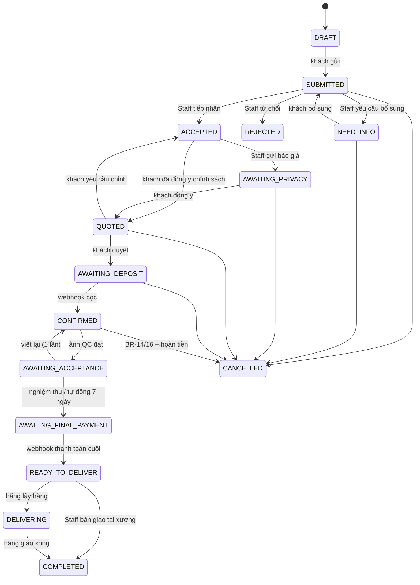
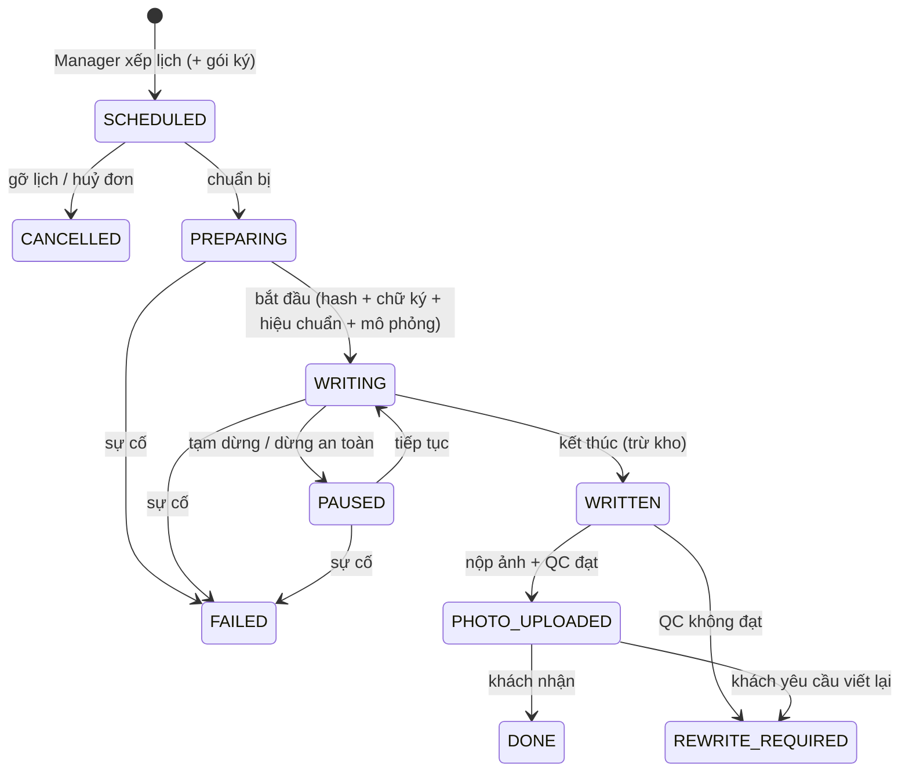

# 02 — Luồng nghiệp vụ, máy trạng thái và tình huống biên

Đường dẫn tính từ `BE/`. Mã vấn đề tra ở `05_ISSUES_AND_RECOMMENDATIONS.md`.

## 1. Đơn hàng (Order)

Mọi chuyển trạng thái do trigger `fn_order_state_guard` quyết định (`database/AI-VHRS_database_full.sql:440-548`). Service chỉ phát `UPDATE`; sai thì nhận lỗi `P0409` và trả `409 STATE_CONFLICT`.

| Chuyển | Actor / endpoint | Điều kiện chính |
|---|---|---|
| DRAFT → SUBMITTED | Customer `POST /orders/{id}/submit` | Khoá dòng, đủ đầu vào, phác thảo vẽ từ nội dung hiện tại |
| SUBMITTED → ACCEPTED / REJECTED / NEED_INFO | Staff đã nhận đơn | `services/staff_orders.py:109-131` |
| ACCEPTED → AWAITING_PRIVACY / QUOTED | Staff gửi báo giá | Có bản final khớp, điều chỉnh giá đã được duyệt |
| QUOTED → AWAITING_DEPOSIT | Customer duyệt | Báo giá còn hạn, cọc ≥ mức tối thiểu |
| AWAITING_DEPOSIT → CONFIRMED | Webhook / IPN / `refresh` | Chữ ký đúng, số tiền khớp; trigger ép `PENDING_SCHEDULE` |
| CONFIRMED → CANCELLED | Customer hoặc Staff được giao | BR-14/16; không khi đang viết |
| CONFIRMED → AWAITING_ACCEPTANCE | Kỹ thuật viên nộp ảnh | ≥ 2 ảnh QC đạt |
| AWAITING_ACCEPTANCE → AWAITING_FINAL_PAYMENT | Customer hoặc tác vụ nền | 7 ngày |
| AWAITING_FINAL_PAYMENT → READY_TO_DELIVER | Webhook FINAL + SHIPPING, hoặc còn 0 đồng | Đã chọn cách nhận |
| READY_TO_DELIVER → COMPLETED | Staff, khớp số điện thoại | Nhận tại xưởng |
| DELIVERING → COMPLETED | Callback hãng `DELIVERED` | Vận đơn mới nhất |

### Trạng thái không có lối ra

| Trạng thái | Tình huống | Mã |
|---|---|---|
| `ACCEPTED` | Trigger cho phép → `CANCELLED` nhưng không service nào dùng; không có thời hạn | CO-01 |
| `AWAITING_FINAL_PAYMENT` | Khách không trả phần còn lại: không hạn, không huỷ được | CO-02 |
| `READY_TO_DELIVER` | Khách không đến lấy: không hạn | CO-02 |
| `DELIVERING` | Vận đơn `FAILED` / `RETURNED`: chỉ tạo lại vận đơn được | CO-02 |
| `CONFIRMED` | Gói sản xuất không phát hành được (thiếu file, thiếu dòng xác thực): chỉ còn huỷ + hoàn tiền | SD-06 |

## 2. Báo giá, thanh toán, hoàn tiền, vận đơn

**Báo giá** (không có trigger, kiểm ở `services/quotations.py`; chỉ mục `ux_quotations_one_live` giữ một bản đang sống mỗi đơn):
`DRAFT ⇄ PENDING_APPROVAL → SENT → APPROVED | CHANGES_REQUESTED | EXPIRED | CANCELLED`; `CHANGES_REQUESTED → SUPERSEDED` khi lập bản mới. `APPROVED` không bao giờ rời, kể cả khi đơn bị huỷ (PP-04).

**Thanh toán**: `PENDING → SUCCESS | FAILED` chỉ qua một hàm `_settle` (`services/payments.py:214`). `PENDING → CANCELLED` khi đổi cổng, đổi số tiền, huỷ đơn, quá hạn cọc. Tiền về cho giao dịch đã huỷ hoặc đơn đã đóng được gắn `needs_refund`.

| Cổng | Đường vào | Xác thực |
|---|---|---|
| MOCK | `POST /payments/{id}/mock-checkout` do khách gọi | HMAC-SHA256, khoá dẫn xuất từ `JWT_SECRET`; đóng khi `PAYMENT_MODE ≠ mock` |
| payOS | `POST /webhooks/payments/payos` | HMAC-SHA256 trên dữ liệu sắp theo khoá; bật theo khoá, bất kể `PAYMENT_MODE` |
| VNPay | `GET /webhooks/payments/vnpay/ipn` | HMAC-SHA512 |
| MoMo | `POST /webhooks/payments/momo/ipn` | HMAC-SHA256; chưa chạy với cổng thật |

**Hoàn tiền**: là `Payment` loại `REFUND`, `PENDING → SUCCESS` do Staff được giao xác nhận tay. Không có `FAILED` / `CANCELLED` (PP-03).

**Vận đơn**: `CREATED → PICKED_UP → DELIVERING → DELIVERED`, hoặc `FAILED` / `RETURNED`. Callback lặp hay sai thứ tự không đổi gì; chỉ vận đơn mới nhất điều khiển đơn.

## 3. Phác thảo (Sketch)

| Thực thể | Ai sửa | Khi đơn ở |
|---|---|---|
| Phác thảo làm việc (`sketch_revisions`) | Customer, trợ lý AI, engine | `DRAFT`, `NEED_INFO` |
| Phiên bản chính thức (`sketches` v1..n) | Staff phụ trách | `ACCEPTED` |
| Bản final (`is_final`, duy nhất nhờ `ux_sketches_one_final`) | Staff chốt | `ACCEPTED` |
| Bản ghi duyệt (`sketch_approvals`) | Hệ thống, lúc khách duyệt | `QUOTED → AWAITING_DEPOSIT` |
| Gói sản xuất (`production_snapshots`) | Hệ thống, lúc cọc và lúc xếp lịch | `CONFIRMED` |

Hai tập trạng thái của khách và của Staff rời nhau, nên khách và Staff không bao giờ cùng sửa một bản.

Chuỗi ràng buộc "bản khách duyệt = bản robot viết":

1. Báo giá ghim `sketch_id`; gửi báo giá bị từ chối nếu bản final đã đổi (`SKETCH_CHANGED`).
2. Duyệt báo giá ghi phiên bản, SHA-256 của file quỹ đạo, ảnh khách đã xem, IP.
3. Gói sản xuất chỉ phát hành khi bản final trùng `sketch_id` và hash trong bản ghi duyệt (`services/production_snapshot.py:106-138`); gói được ký Ed25519 và bất biến bằng trigger.
4. Tải gói và bắt đầu viết đều so lại hash; agent so lại lần nữa ở máy trạm.

Điểm hở: bước 2 không bắt buộc client gửi `sketch_id` (SD-05); đơn phục dựng trung thành có thể mang nét không có nhãn (SD-02); khổ giấy của phác thảo không được đối chiếu với giấy của đơn (SD-07).

## 4. Job sản xuất, robot, lệnh

Mỗi bước job đổi kèm `production_status` của đơn trong cùng giao dịch. Database giữ thêm: `ex_job_robot_overlap`, `ex_job_technician_overlap` (chống trùng lịch), `ux_jobs_one_active_per_order`, `chk_job_run_requires_sim`.

**Robot**: `AVAILABLE / BUSY / MAINTENANCE / BROKEN`. `BUSY` không được gán ở đâu trong `app/`. Trạng thái kết nối suy từ heartbeat, quá 15 giây là offline.

**Lần chạy (RobotRun)**: tối đa một lần chạy mở mỗi robot (`ux_robot_runs_one_open`).

**Lệnh (RobotCommand)**: `PENDING → DELIVERED → DONE | FAILED`; `PENDING` quá hạn → `EXPIRED` (20 giây cho PAUSE / RESUME / STOP, 60 giây cho lệnh khác). Lệnh `DELIVERED` không có thời hạn (TP-08).

**Cảnh báo**: 4 mức lấy từ `alert_catalog`; mức 4 chỉ Manager đóng. Cảnh báo không chặn lệnh mới (TP-02).

## 5. Truy vết luồng end-to-end

| # | Bước | Actor | Endpoint chính | Service | Trạng thái | Kết luận |
|---|---|---|---|---|---|---|
| 1 | Tạo yêu cầu | Customer | `POST /orders`, `PUT …/inputs/*`, `upload-url`, `confirm` | `orders.py` | `DRAFT` | Chạy, nối web |
| 2 | AI dựng / sửa phác thảo | Customer + LLM | `…/assistant/messages`, `…/sketch/generate` | `ai/assistant.py`, `sketch_work.py`, `stroke_ai/engine.py` | `DRAFT` | Chạy; web tự áp dụng đề xuất (AI-01) |
| 3 | Gửi đơn | Customer | `POST …/submit` | `orders.py:490` | → `SUBMITTED` | Chạy |
| 4 | Staff nhận, sửa, chốt | Staff | `claim`, `accept`, `sketches/*`, `finalize` | `staff_orders.py`, `sketches.py` | → `ACCEPTED` | Chạy |
| 5 | Báo giá | Staff, Manager | `quotations`, `adjustment`, `send` | `quotations.py`, `pricing.py` | → `QUOTED` | Chạy |
| 6 | Duyệt + cọc | Customer, cổng | `quotation/approve`, `payments/deposit`, webhook | `payments.py` | → `CONFIRMED` | Chạy; cổng MOCK tự xác nhận (PP-01) |
| 7 | Khoá bản final | Hệ thống | (trong bước 6 và 8) | `production_snapshot.py` | gói ký | Chạy |
| 8 | Xếp lịch | Manager | `/manager/orders/{id}/schedule` | `scheduling.py` | job `SCHEDULED` | Chạy |
| 9 | Nhận job, tải gói | Technical Staff | `/technician/jobs/{id}/package`, `prepare` | `technician.py` | `PREPARING` | Có test; chỉ trên máy trạm / DesktopApp |
| 10 | Hiệu chuẩn, kiểm quỹ đạo, mô phỏng | Technical Staff + agent | `calibration`, `simulation` | `motion/*` | cờ `simulation_passed` | Có test; kết quả do máy trạm báo (TP-04) |
| 11 | Robot viết | Agent + FR3 | `/technician/robot-commands`, `/agent/sync`, `runs` | `robot_link.py`, `robot_agent/runner.py` | `WRITING` | **Chưa từng xong một trang trên robot thật** (RB-01) |
| 12 | Kết thúc viết | Technical Staff | `finish` | `technician.py:467` | `WRITTEN` | Chạy; không cần bằng chứng robot (TP-05) |
| 13 | Ảnh + QC | Technical Staff | `photos`, `photos/submit` | `product_photos.py` | → `AWAITING_ACCEPTANCE` | Chạy |
| 14 | Nghiệm thu | Customer | `accept`, `rewrite` | `acceptance.py` | → `AWAITING_FINAL_PAYMENT` | Chạy |
| 15 | Thanh toán cuối + giao | Customer, Staff, hãng | `delivery`, `payments/final`, `shipment`, `pickup/confirm` | `delivery.py`, `shipments.py` | → `COMPLETED` | Chạy; hãng MOCK cần Staff bấm sự kiện thử |

Bước cần thao tác tay hoặc phụ thuộc mock: 6 (khách tự chọn kết quả thanh toán), 10 (hiệu chuẩn lấy từ `calibration.json` ở máy trạm), 11 (bật REAL chỉ ở máy trạm), 15 (sự kiện hãng vận chuyển), hoàn tiền (chuyển khoản tay).

Bước 1–8 và 12–15 được chứng minh bằng 1.091 test chạy đạt trên DB cục bộ. Bước 9–11 được chứng minh bằng test với agent giả và mô phỏng, chưa bằng robot.

## 6. Tình huống biên

| Tình huống | Kết quả | Bằng chứng / mã |
|---|---|---|
| Khách đã duyệt, Staff sửa tiếp | Chặn: Staff chỉ sửa khi `ACCEPTED` | `sketches.py:50-54` |
| Khách đã cọc, muốn đổi nội dung | Chặn sửa; chỉ huỷ theo BR-14/16. Không có luồng "duyệt lại sau cọc" | SD-06 |
| Giá đổi sau khi khách duyệt | Chặn: báo giá đã gửi không sửa được, giá chép vào đơn lúc duyệt | `quotations.py:287,323,376` |
| Staff và khách cùng sửa phác thảo | Không xảy ra (hai tập trạng thái rời nhau) | mục 3 |
| Hai Staff cùng nhận một đơn | Một người thắng, người kia 409 | `repositories/orders.py:91-96` |
| Hai kỹ thuật viên cùng bắt đầu một job | Không thể: job có một `technician_id`, khoá dòng | `technician.py:71-75` |
| Một robot nhận nhiều job | Lịch: chặn bằng EXCLUDE. Lần chạy: một lần mở. Trạng thái job: một kỹ thuật viên vẫn để được hai job cùng `WRITING` trên một robot | TP-08 |
| Bấm xác nhận / thanh toán nhiều lần | Xử lý đúng: khoá + dùng lại giao dịch đang mở | `payments.py:136-138` |
| Callback thanh toán trùng | Trả `ALREADY_PROCESSED` | `payments.py:214-280` |
| Callback cho đơn đã huỷ | Không làm đơn sống lại; gắn `needs_refund` | `payments.py:227-230` |
| payOS: tiền về link đã đóng hoặc đã thành công | Không gắn cờ hoàn tiền | PP-02 |
| LLM lỗi hoặc quá thời gian | Chuyển hãng khác; hết hãng thì báo lỗi, đơn giữ nguyên | `ai/assistant.py:404-418`; hở ở AI-04 |
| LLM trả tham số bịa | Tool trả lỗi có mã; mỗi tool trong savepoint | `ai/order_tools.py:162-178` |
| AI sửa sai vùng | Chặn: nét ngoài vùng chọn được so trước / sau | `sketch_geometry.py` `EDIT_SCOPE_VIOLATION` |
| AI làm mất dữ liệu trước đó | Có thể: undo / redo của AI đổi bản vẽ tay thật; `discard_edits` do model tự quyết | AI-03, AI-01 |
| Phác thảo mới không khớp quỹ đạo đã tạo | Chặn bằng hash ở 4 chỗ | mục 3 |
| Hiệu chuẩn lại khi đang tạm dừng | Chặn `SIMULATION_STALE` ở 3 lối; hở khi RESUME không kèm `job_id` | TP-03 |
| Robot mất kết nối khi đang viết | Agent: lỗi SDK → trạng thái `UNKNOWN`, cần người xác nhận. BE: chỉ phát hiện khi có người mở màn hình | TP-08 |
| Robot dừng giữa chừng nhưng hệ thống báo xong | Có thể: `finish` không cần lần chạy `DONE` | TP-05 |
| Job hỏng nhưng đơn hoàn thành | Không: sự cố đưa đơn về `FAILED` rồi hàng đợi xếp lịch | `technician.py:491-510` |
| Robot chạy xong nhưng sản phẩm không đạt | QC không đạt → viết lại (không giới hạn phía xưởng); khách yêu cầu viết lại 1 lần | `product_photos.py`, `acceptance.py` |
| BE khởi động lại khi đang sản xuất | Lệnh nằm trong DB nên còn; khung hình sống, cache agent, SSE, giới hạn tần suất nằm trong RAM nên mất | AR-03 |
| Agent mất liên lạc BE quá 6 giây | Viết nốt nét rồi tạm dừng | `robot_agent/vhrs_agent/link.py` |
| Nhân viên bị khoá khi còn đơn / job | Không có kiểm tra; việc đứng yên | SD-01, TP-06 |
| Khách xem dữ liệu khách khác | Không thấy ở các điểm đã kiểm (404). Ngoại lệ có điều kiện: phát lại lượt chat | AI-05 |
| Gọi thẳng API để bỏ bước | Trigger database chặn chuyển trạng thái sai. Ngoại lệ: `mock-checkout`, `simulation {"passed": true}`, `start` rồi `finish` | PP-01, TP-04, TP-05 |
